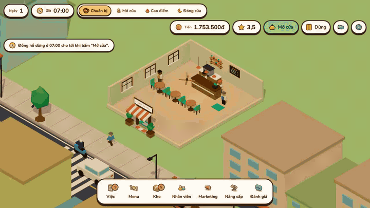
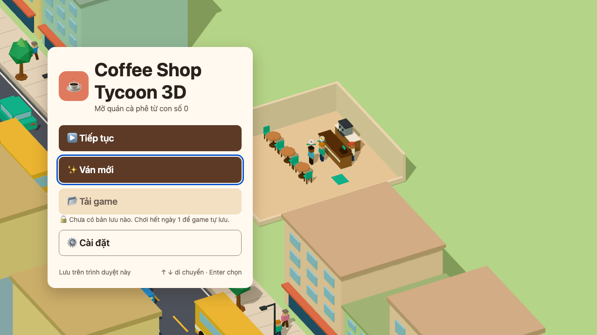
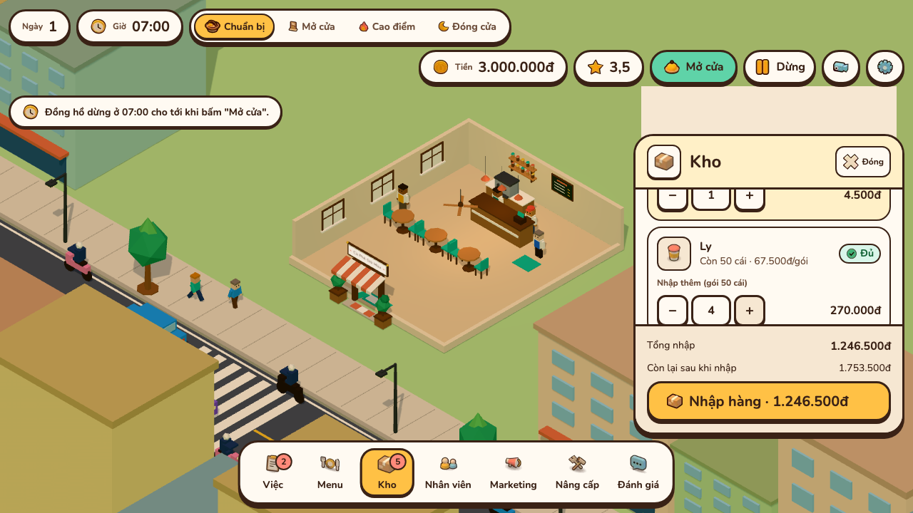
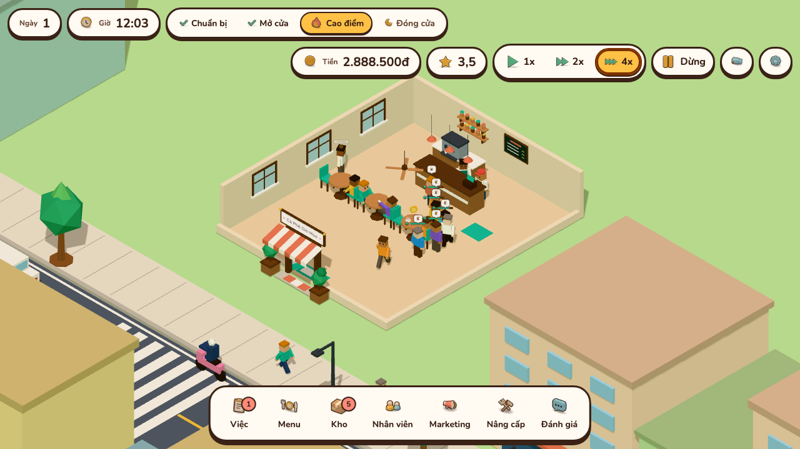
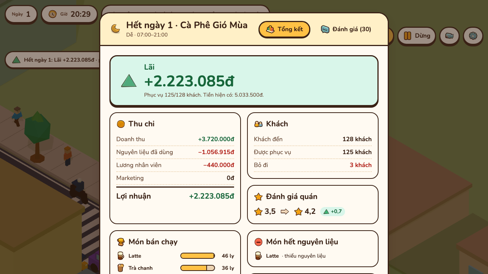
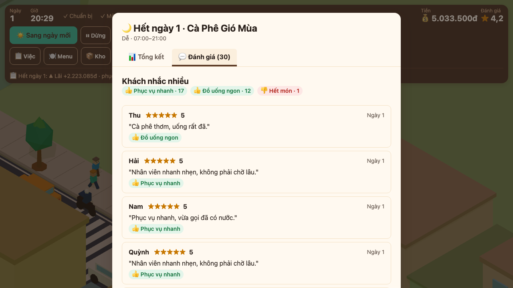

# coffee-shop-tycoon-3d

Game web 3D low-poly quản lý quán cà phê (Three.js), chơi ngay trên browser.

**[▶ Chơi thử](https://quangphung218.github.io/coffee-shop-tycoon-3d/)** · [Video mp4](docs/media/demo.mp4)



Người chơi mở một quán nhỏ với vốn hạn chế: chọn menu, nhập nguyên liệu, phục vụ khách, thuê nhân viên, chạy marketing và nâng cấp quán qua từng ngày. Toàn bộ hình 3D, nhân vật và âm thanh sinh bằng code, không cần asset ngoài. Chữ trong game là tiếng Việt, tiền tính bằng đồng (vd `25.000đ`).

Trạng thái: đã chơi được trọn vòng ngày (chuẩn bị → mở cửa → cao điểm → đóng cửa → báo cáo), có nhân viên, nâng cấp, phố xá và save/load. Camera mặc định xoay bằng `Q`/`E`, pan bằng `WASD` và phím mũi tên; tắt **Cài đặt → Di chuyển camera bằng WASD** để chuyển sang chế độ phím `Q`/`A` xoay (xem [Điều khiển](#điều-khiển)).

## Yêu cầu

- Node.js và npm.
- Trình duyệt có WebGL (Chrome, Edge, Firefox, Safari bản mới).

## Cài và chạy

```sh
npm install
npm run dev        # mở địa chỉ Vite in ra, mặc định http://localhost:5173
```

Build bản tĩnh và deploy lên GitHub Pages: xem [docs/deploy.md](docs/deploy.md).

## Cách chơi một ngày

1. **Main Menu** → **New Game**: đặt tên quán, chọn độ khó Dễ/Thường/Khó.
2. **Chuẩn bị** (đồng hồ dừng ở 07:00): mở các bảng ở dock giữa đáy màn hình (Việc, Menu, Kho, Nhân viên, Marketing, Nâng cấp) để bật/tắt món, nhập hàng, tuyển và phân vai nhân viên. Bấm **Mở cửa** trên HUD.
3. **Mở cửa** và **Cao điểm** (11:00–13:00, 17:00–19:00): khách vào, xếp hàng, gọi món. Bấm khách, quầy hay bàn trong cảnh để tự nhận order, pha, mang đồ, thu tiền, dọn bàn khi chưa đủ nhân viên.
4. **Đóng cửa** (từ 20:00): không nhận khách mới; ngày kết thúc khi khách cuối rời quán.
5. **Daily Report**: lãi/lỗ, thu chi, khách, món bán chạy, món hết nguyên liệu, rating, review và gợi ý cho ngày mai. Game tự lưu trước khi báo cáo hiện ra. Bấm **☀️ Ngày tiếp theo** để sang ngày mới.

Bảng **Đánh giá** ở dock liệt kê các review gần nhất bất cứ lúc nào.

| | |
| --- | --- |
| <br>Main Menu, quán chạy nền phía sau | <br>Chuẩn bị: nhập hàng ở bảng Kho |
| <br>Cao điểm trưa: khách xếp hàng, nhân viên pha và mang món | <br>Daily Report: lãi/lỗ, khách, món bán chạy |
| <br>Đánh giá của khách sau một ngày | |

Tạo lại ảnh và GIF: `npm run media` (xem [docs/media.md](docs/media.md)).

## Điều khiển

| Thao tác | Phím / chuột |
| --- | --- |
| Xoay camera | Kéo chuột trái; giữ `Q` / `E` |
| Zoom | Cuộn chuột |
| Di chuyển (pan) | `W` `A` `S` `D`, phím mũi tên, hoặc đưa chuột sát mép màn hình |
| Đặt lại camera | Nút **🎥 Đặt lại camera** trên HUD hoặc `Home` |
| Tạm dừng / tiếp tục | `Space` hoặc nút **⏸ Dừng** |
| Tốc độ 1x / 2x / 4x | `1` / `2` / `3` |
| Đóng bảng, mở menu tạm dừng | `Esc` |

Tắt **Cài đặt → Di chuyển camera bằng WASD** để xoay bằng `Q`/`A` (`E` vẫn xoay); khi đó chỉ phím mũi tên dùng để pan. Cài đặt còn có âm lượng nhạc, âm lượng hiệu ứng, chất lượng đồ họa Thấp/Vừa/Cao và tốc độ mặc định.

## Lưu game

- Lưu trong `localStorage` của trình duyệt: slot tự động (ghi cuối mỗi ngày) và 3 slot lưu tay trong menu Tạm dừng.
- **Load Game** ở Main Menu mở mọi slot; slot hỏng được báo, không bị xóa.

## Cấu trúc thư mục

| Thư mục | Nội dung |
| --- | --- |
| `src/sim/` | Lõi mô phỏng thuần TypeScript, tất định: giờ, pha, khách, đơn, kho, nhân viên, kinh tế, rating, review, báo cáo ngày. Không dùng DOM hay Three.js. |
| `src/sim/data/` | Bảng dữ liệu: menu, nguyên liệu, nâng cấp, marketing, độ khó. |
| `src/render/` | Three.js: `scene/` (renderer, camera, quán, chọn đối tượng), `actors/` (nhân vật và animation), `street/` (phố, xe, người đi đường). |
| `src/ui/` | Lớp phủ HTML/CSS: `screens/` (menu, cài đặt, tạm dừng), `hud/`, `panels/` (bảng chuẩn bị), `report/` (Daily Report, Đánh giá), `styles/` (token CSS). |
| `src/audio/` | Âm thanh tổng hợp bằng Web Audio. |
| `src/save/` | Lưu/tải game và cài đặt. |
| `tests/` | Test Vitest theo cùng cấu trúc, cộng `integration/` chạy cả ngày chơi. |
| `design/` | Token và mockup giao diện. |

## Phát triển và kiểm thử

```sh
npm run dev        # dev server có hot reload
npm test           # chạy test Vitest một lần
npm run check      # tsc --noEmit, toàn bộ test, rồi vite build
npm run build      # kiểm tra kiểu và build ra dist/
npm run preview    # mở bản build
npm run media      # build rồi chụp lại ảnh, GIF, mp4 vào docs/media/
```

Chạy `npm run check` trước khi commit. Xem nhân vật và animation riêng: `npm run dev` rồi mở `/?preview=actors`.

## Tài liệu khác

- [docs/architecture.md](docs/architecture.md): ba lớp sim/render/ui, lệnh và sự kiện, vòng ngày, FSM khách, định dạng save, mẹo hiệu năng.
- [docs/deploy.md](docs/deploy.md): build và deploy lên GitHub Pages.
- [docs/media.md](docs/media.md): tạo lại ảnh chụp và GIF/mp4 demo.
