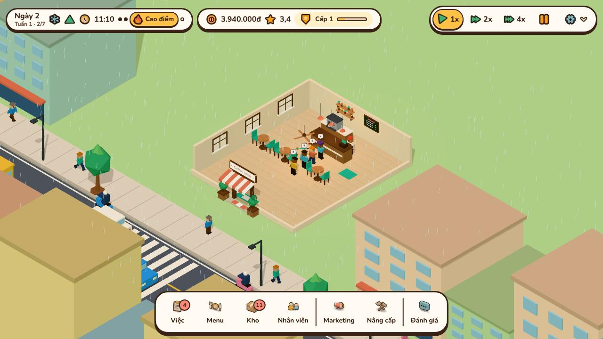
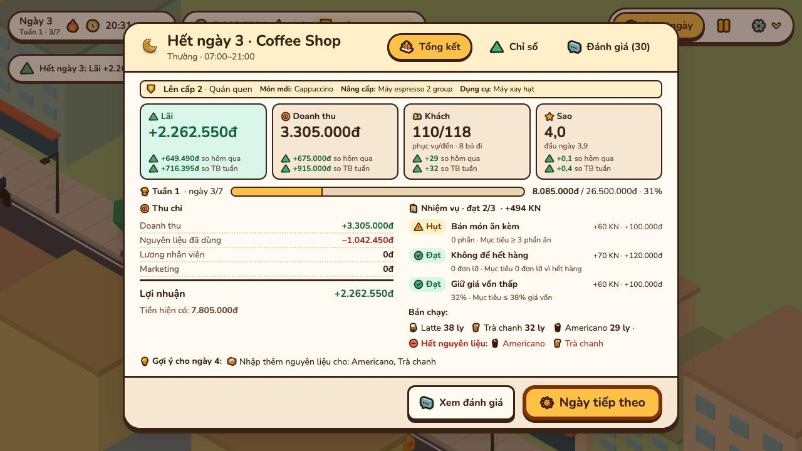
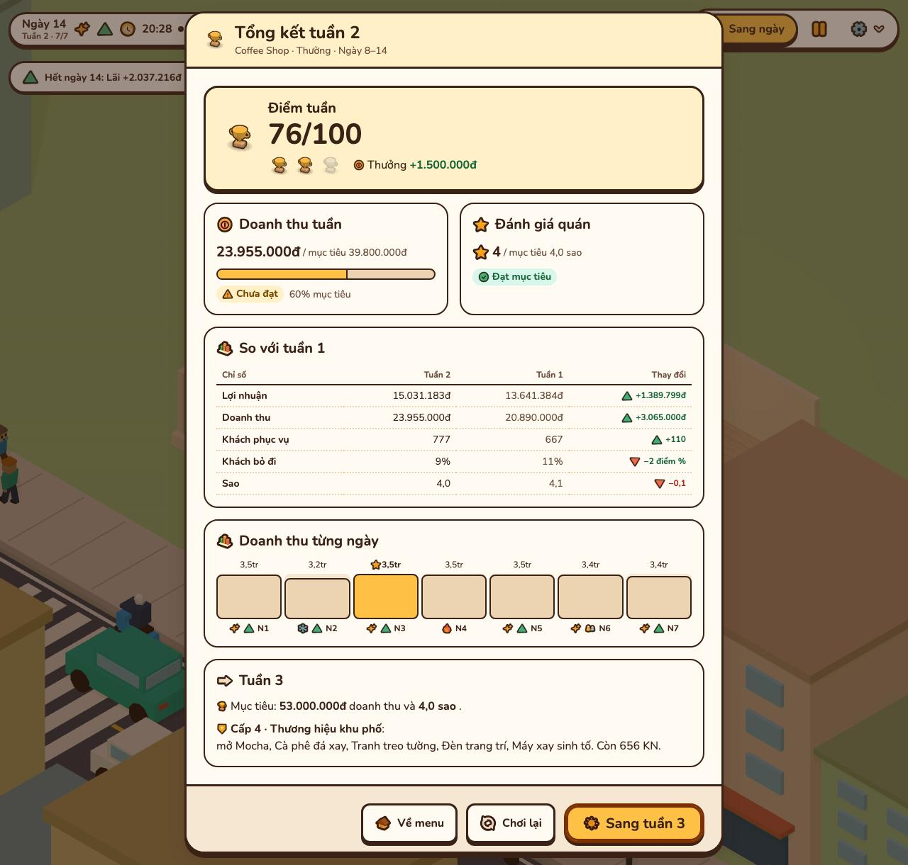

# coffee-shop-tycoon-3d

Game web 3D low-poly quản lý quán cà phê (Three.js), chơi ngay trên trình duyệt.

**[▶ Chơi thử](https://quangphung218.github.io/coffee-shop-tycoon-3d/)** · [Video mp4](docs/media/demo.mp4)

- **Cho ai:** người thích game quản lý nhẹ nhàng, chơi một ngày trong khoảng 7 phút.
- **Trạng thái:** chơi không giới hạn số ngày. Mỗi 7 ngày là một tuần có sự kiện, thời tiết và mục tiêu riêng, hết tuần có màn Tổng kết tuần chấm điểm rồi sang tuần sau; có nhân viên, nâng cấp, cấp quán 1–10, phố xá và save/load.
- **Ngôn ngữ:** chữ trong game là tiếng Việt, tiền tính bằng đồng (vd `25.000đ`).

## Mục lục

- [Tính năng](#tính-năng)
- [Cài và chạy](#cài-và-chạy)
- [Cách chơi một ngày](#cách-chơi-một-ngày)
- [Điều khiển](#điều-khiển)
- [Lưu game](#lưu-game)
- [Cấu trúc thư mục](#cấu-trúc-thư-mục)
- [Phát triển và kiểm thử](#phát-triển-và-kiểm-thử)
- [Phát hành và version](#phát-hành-và-version)
- [Tài liệu khác](#tài-liệu-khác)
- [License](#license)

## Tính năng

| Tính năng | Chi tiết |
| --- | --- |
| Vòng ngày | Chuẩn bị → mở cửa → cao điểm → đóng cửa → Daily Report. |
| Quản lý quán | Bật/tắt món, nhập nguyên liệu, tuyển và phân vai nhân viên, chạy marketing, mua nâng cấp và dụng cụ (máy xay, tủ bánh, máy xay sinh tố…). |
| Tuần | Ván chơi liên tục từng tuần 7 ngày, không có ngày cuối. Tuần 1 có lịch mở khoá theo ngày: từ ngày 2 mỗi ngày mở thêm món, dụng cụ hoặc khu; ngày 7 quán được tặng Mở rộng diện tích. Từ tuần 2 mọi thứ trong lịch đã mở, phần còn lại mở theo cấp quán. Luật tuần: [docs/spec/week-7-days.md](docs/spec/week-7-days.md). |
| Sự kiện và thời tiết | Mỗi ngày có thời tiết (nắng, mưa, nóng) và sự kiện (khai trương, hội chợ, nhà cung cấp tăng giá, ngày thường), lập sẵn theo seed của ván nên cùng seed ra cùng tuần. Mưa bớt khách, hội chợ đông khách, tăng giá làm nguyên liệu đắt hơn. Trong cảnh 3D, ngày mưa có mưa rơi xiên và giọt bắn trên phố, ngày nóng nắng gắt hơn. Ánh sáng đổi theo giờ: mặt trời đi từ đông sang tây, chiều tối trời ngả cam rồi xanh và quán bật đèn. |
| Trang trí | Đặt trang trí (Cây xanh, Tranh treo tường, Đèn trang trí…) ở nhóm Trang trí của bảng Nâng cấp để quán hút khách và được thêm sao. Trang trí không kèm chỗ ngồi có nút **Gỡ** (bấm hai lần): gỡ cấp trên cùng, hoàn lại một nửa tiền đã trả. |
| Mức giá và Mức lương | **Mức giá** (Rẻ / Chuẩn / Cao, bảng Menu): giá bán cao hơn thì sao và lượng khách giảm. **Mức lương** (Thấp / Chuẩn / Cao, bảng Nhân viên): lương cao hơn thì nhân viên làm nhanh hơn. Chỉ đổi được lúc chuẩn bị. |
| Mục tiêu tuần | Mục tiêu doanh thu 7 ngày và số sao theo độ khó; mục tiêu doanh thu tăng 50% mỗi tuần, tối đa gấp 3 tuần 1. Hết ngày 7 của tuần, màn Tổng kết tuần chấm điểm 0–100 và 0–3 cúp, tuần được 2 cúp trở lên thưởng tiền, so với tuần trước, rồi **Sang tuần N+1**. |
| Cấp quán và nhiệm vụ | Phục vụ khách, review cao và nhiệm vụ ngày cộng XP để lên cấp 1–10. Cấp 1–6 mở thêm món, nâng cấp và dụng cụ; cấp 7–10 nâng trần cấp của vài nâng cấp đã có, cấp 8 mở thêm Góc sofa. Mỗi ngày có 3 nhiệm vụ, tự chấm cuối ngày. |
| Nhân viên lên cấp | Mỗi nhân viên có một đặc điểm (Nhanh nhẹn, Tay pha cứng, Gọn gàng, Duyên dáng) và cấp 1–5. Làm việc tích kinh nghiệm; đủ thì **Đào tạo** lúc chuẩn bị bằng tiền (cấp 4–5 thêm Tem) để làm nhanh hơn, lương cao hơn. |
| Quà mỗi ngày và Tem | Mỗi ngày thật mở game nhận quà ở bảng Việc, chuỗi 7 ngày liền quà lớn dần. Tem là tiền phụ kiếm từ quà, thành tựu, đơn đặc biệt, khách VIP; dùng để đào tạo nhân viên cấp cao và mua nội thất đặc biệt. 6 thành tựu, mỗi cái 3 mốc. |
| Đơn đặc biệt và VIP | Từ ngày 2 mỗi ngày có một đơn: giao đủ số phần một món trước 13:00 hoặc 19:00 để nhận tiền và Tem. Từ ngày 3 thỉnh thoảng có khách VIP (ngôi sao trên đầu), ít kiên nhẫn hơn, phục vụ được Tem. |
| Nội thất và mở rộng 4 cấp | Biển neon, Kệ sách, Máy hát đĩa, Góc sofa ở nhóm Trang trí. Mở rộng diện tích có 4 cấp (cấp 3 mở ở cấp quán 7, cấp 4 ở cấp quán 9), mỗi cấp thêm 3 bàn; cấp 3–4 thêm chỗ cho nhân viên thứ 7 và 8. |
| Thống kê ngày và tuần | Daily Report so lãi, doanh thu, khách và sao với hôm qua và với trung bình tuần, kèm doanh thu tuần so mục tiêu. Tab Chỉ số: food cost, lương, prime cost, lấp ghế, thời gian chờ… kèm nhãn Tốt / Cần chú ý và gợi ý sửa. |
| Tự phục vụ | Bấm khách, quầy hay bàn trong cảnh để nhận order, pha, mang đồ, thu tiền, dọn bàn. |
| Khách và đánh giá | Khách có cá tính (văn phòng, sinh viên, khách quen, sành cà phê, gia đình) đổi gu món và độ kiên nhẫn; xếp hàng, bỏ về khi chờ lâu, để lại review 1–5 sao. |
| Cảnh 3D | Quán, nhân vật và phố sinh bằng code; đèn ấm buổi tối; 3 mức đồ họa. |
| Âm thanh | Tổng hợp bằng Web Audio, không dùng file âm thanh. |
| Lưu game | Slot tự động cuối ngày và 3 slot lưu tay trong trình duyệt. |

| | |
| --- | --- |
|  Main Menu, quán chạy nền phía sau |  Chuẩn bị: nhập hàng ở bảng Kho |
|  Cao điểm trưa: khách xếp hàng, nhân viên pha và mang món |  Đánh giá của khách sau một ngày |
|  Bảng Menu với icon 3D |  Hàng chờ đi theo lối trống giữa các bàn |
|  Mặt tiền quán buổi sáng |  Chiều tối: cửa sổ và biển hiệu sáng ấm |

| Màn | Ảnh |
| --- | --- |
| HUD 3 cụm: Hôm nay · Tiến độ · Điều khiển |  |
| Daily Report: 4 ô số kèm Δ so hôm qua và so trung bình tuần, doanh thu tuần so mục tiêu |  |
| Tổng kết tuần 2: so với tuần 1, doanh thu từng ngày, mục tiêu tuần 3, nút **Sang tuần 3** |  |

## Cài và chạy

Yêu cầu:

- Node.js và npm.
- Trình duyệt có WebGL (Chrome, Edge, Firefox, Safari bản mới).

Các bước:

1. Cài thư viện: `npm install`.
2. Chạy dev server: `npm run dev`.
3. Mở địa chỉ Vite in ra (mặc định `http://localhost:5173`); Main Menu hiện ra.

Build bản tĩnh và deploy lên GitHub Pages: xem [docs/deploy.md](docs/deploy.md).

## Cách chơi một ngày

1. **Main Menu** → **Ván mới**: đặt tên quán, chọn độ khó Dễ/Thường/Khó.
2. **Chuẩn bị** (đồng hồ dừng ở 07:00): HUD trên cùng gồm ba cụm: **Hôm nay** (ngày, tuần, thời tiết, sự kiện, giờ, pha), **Tiến độ** (tiền, Tem, sao, cấp quán và thanh XP) và **Điều khiển** (Mở cửa hoặc tốc độ, Dừng, menu camera và cài đặt). Dock giữa đáy chia hai nhóm — Vận hành (Việc, Menu, Kho, Nhân viên) và Phát triển (Marketing, Nâng cấp). Bảng **Việc** có thẻ **Quà hằng ngày** (bấm nhận mỗi ngày thật), 3 nhiệm vụ ngày, đơn đặc biệt và thành tựu; món và dụng cụ mở theo cấp quán hoặc theo ngày trong tuần, mốc nào tới trước thì mở; bảng **Menu** và **Nâng cấp** khóa thứ chưa mở với nhãn "Mở ngày N" hoặc "Mở ở cấp N". **Mức giá** (bảng Menu) và **Mức lương** (bảng Nhân viên) chỉ đổi được lúc chuẩn bị. Xong thì bấm **Mở cửa** trên HUD.
3. **Mở cửa** và **Cao điểm** (11:00–13:00, 17:00–19:00): khách vào, xếp hàng, gọi món; thiếu nhân viên thì tự bấm vào khách, quầy, bàn để phục vụ.
4. **Đóng cửa** (từ 20:00): không nhận khách mới; ngày kết thúc khi khách cuối rời quán.
5. **Daily Report** (ba tab Tổng kết · Chỉ số · Đánh giá). Tab Tổng kết vừa một màn:
   - thẻ "Lên cấp N" (ngày có lên cấp): huy hiệu cấp bật lên kèm confetti, chip có icon cho món, nâng cấp và dụng cụ vừa mở (tối đa 3, phần dư ghi "+N");
   - 4 ô số chính: Lãi/Lỗ, Doanh thu, Khách (phục vụ/đến), Sao; mỗi ô có Δ so hôm qua và Δ so trung bình các ngày trước trong tuần;
   - dòng Tuần N · ngày d/7 với doanh thu tuần so mục tiêu;
   - Thu chi cạnh nhiệm vụ đạt/hụt kèm thưởng và KN, một dòng 3 món bán chạy và món hết nguyên liệu;
   - 1 gợi ý cho ngày mai (các gợi ý khác ở tab Chỉ số).

   Chỉ số xem food cost, lương, thời gian chờ… với nhãn Tốt/Cần chú ý; Đánh giá xem review. Game tự lưu trước khi báo cáo hiện; bấm **Ngày tiếp theo** để sang ngày mới.
6. **Tổng kết tuần**: hết ngày 7 của tuần, nút chính của báo cáo thành **Xem tổng kết tuần**. Màn Tổng kết tuần N hiện điểm 0–100, 0–3 cúp và tiền thưởng, doanh thu và sao so mục tiêu, bảng so với tuần trước (từ tuần 2), cột doanh thu 7 ngày có đánh dấu ngày tốt nhất, mục tiêu tuần tới và cấp quán tiếp theo. **Sang tuần N+1** (nút chính) mở ngày đầu tuần mới ở pha chuẩn bị; **Chơi lại** (bấm 2 lần, lần đầu nút đổi thành "Bấm lần nữa để bỏ ván") mở ván mới cùng tên quán và độ khó; **Về menu** (hoặc `Esc`) về Main Menu.

Bảng **Đánh giá** (nhóm riêng cuối dock) liệt kê các review gần nhất bất cứ lúc nào.

## Điều khiển

| Thao tác | Phím / chuột |
| --- | --- |
| Xoay camera | Kéo chuột trái; giữ `Q` / `E` |
| Zoom | Cuộn chuột |
| Di chuyển (pan) | `W` `A` `S` `D`, phím mũi tên, hoặc đưa chuột sát mép màn hình |
| Đặt lại camera | **Đặt lại camera** trong menu bánh răng trên HUD, hoặc `Home` |
| Tạm dừng / tiếp tục | `Space` hoặc nút **Dừng** trên HUD |
| Mở bảng quản lý | Nút ở dock giữa đáy màn hình; bấm lại để đóng |
| Tốc độ 1x / 2x / 4x | `1` / `2` / `3` |
| Đóng bảng, mở menu tạm dừng | `Esc` |

**Cài đặt** có:

| Nhóm | Mục | Giá trị |
| --- | --- | --- |
| Âm thanh | Nhạc nền, Hiệu ứng | Âm lượng 0–100% |
| Hiển thị | Chất lượng đồ họa | Thấp / Vừa / Cao |
| Hiển thị | Giảm chuyển động | Theo máy (dùng cài đặt hệ điều hành) / Luôn giảm |
| Điều khiển | Kiểu phím camera | `WASD` di chuyển · `Q`/`E` xoay — hoặc mũi tên di chuyển · `Q`/`A` xoay |
| Điều khiển | Tốc độ xoay camera | Chậm / Vừa / Nhanh, cho cả kéo chuột và phím xoay |
| Trò chơi | Tốc độ mặc định khi mở cửa | 1x / 2x / 4x (đổi nhanh bằng `1` / `2` / `3` trên HUD) |
| Số liệu chơi | Lần dừng gần nhất, Xem JSON, Xuất JSON, Xoá | Log ẩn danh (ngày, pha, giờ game, thời điểm) lưu trong `localStorage` khoá `cst3d:playlog`, không gửi đi đâu; Xuất JSON tải file `playlog-<ngày>.json`, Xoá bấm hai lần |

Phím tắt nằm trong mục **Phím tắt** sổ ra ở nhóm Điều khiển. **Về mặc định** xác nhận tại chỗ: bấm lần đầu đổi thành "Bấm lần nữa để đặt lại", bấm lại trong 3 giây để áp dụng.

Thả chuột sau khi kéo thì camera trôi thêm một chút rồi dừng (tắt khi Giảm chuyển động là Luôn giảm, hoặc hệ điều hành bật giảm chuyển động).

Version đang chạy (vd `v0.1.0`) hiện ở chân Main Menu và cuối màn Cài đặt.

## Lưu game

- Lưu trong `localStorage` của trình duyệt: slot tự động (ghi cuối mỗi ngày) và 3 slot lưu tay trong menu Tạm dừng.
- **Tải game** ở Main Menu mở mọi slot; slot hỏng được báo, không bị xóa.
- Định dạng lưu là phiên bản 3. Save từ bản cũ tự nâng khi tải, giữ nguyên tiền và mọi món, nâng cấp đã mua: save v1 được tính cấp quán từ lịch sử đã chơi và thêm nhiệm vụ ngày; save v2 đã hết tuần 1 mở được tuần 2 và chơi tiếp (chi tiết ở [docs/architecture.md](docs/architecture.md#save-schema)).
- Save từ trước khi có Tem và quà ngày tải bình thường: Tem 0, chuỗi quà bắt đầu từ ngày 1, nhân viên ở cấp 1 và có đặc điểm theo seed của ván.
- Mỗi save có chuỗi quà ngày riêng. Main Menu ghi "Quà ngày N đang chờ" dưới **Tiếp tục** khi save gần nhất chưa nhận quà hôm nay.

## Cấu trúc thư mục

| Thư mục | Nội dung |
| --- | --- |
| `src/sim/` | Lõi mô phỏng thuần TypeScript, tất định: giờ, pha, khách, đơn, kho, nhân viên, kinh tế, rating, review, báo cáo ngày. |
| `src/sim/data/` | Bảng dữ liệu: menu, nguyên liệu, nâng cấp, marketing, độ khó. |
| `src/render/` | Three.js: `scene/` (renderer, camera, quán), `actors/` (nhân vật, animation), `street/` (phố, xe, người đi đường). |
| `src/ui/` | Lớp phủ HTML/CSS: `core/`, `screens/`, `hud/`, `panels/`, `report/`, `styles/`. |
| `src/audio/` | Âm thanh tổng hợp bằng Web Audio. |
| `src/save/` | Lưu/tải game và cài đặt. |
| `src/version.ts` | Version của game, lấy từ `package.json` lúc build. |
| `tests/` | Test Vitest theo cùng cấu trúc, cộng `integration/` chạy cả ngày chơi. |
| `scripts/` | Deploy, phát hành version, chụp ảnh demo, dựng icon, đo khởi động. |
| `design/` | Token và mockup giao diện. |

Chi tiết các lớp: [docs/architecture.md](docs/architecture.md).

## Phát triển và kiểm thử

| Lệnh | Tác dụng |
| --- | --- |
| `npm run dev` | Dev server có hot reload. |
| `npm test` | Chạy test Vitest một lần. |
| `npm run check` | `tsc --noEmit`, toàn bộ test, rồi `vite build`. Chạy trước khi commit. |
| `npm run build` | Kiểm tra kiểu và build ra `dist/`. |
| `npm run preview` | Mở bản build. |
| `npm run media` | Build rồi chụp lại ảnh, GIF, mp4 và ảnh trước/sau vào `docs/media/` ([docs/media.md](docs/media.md)). |
| `npm run layout` | Build rồi kiểm tràn ngang, CLS bảng Kho ở 390/768/1440 px, số hàng HUD và các bảng Menu, Việc, Nhân viên, Nâng cấp ở 390/768/1280/1440 px. |
| `npm run perf:frames` | Build rồi đo frame time và long task 5 s đầu sau khi cảnh 3D hiện; thêm `-- --base <commit>` để so với bản cũ ([báo cáo](docs/reports/p23-loading-frames.md)). |
| `npm run icons` | Dựng lại atlas icon 3D trong `public/icons3d/`. |

- `npm run media`, `npm run layout` và `npm run perf:frames` cần Chromium của Playwright: `npx playwright install chromium`.
- Xem nhân vật và animation riêng: `npm run dev` rồi mở `/?preview=actors`.
- Commit theo [Conventional Commits](https://www.conventionalcommits.org/) (`feat:`, `fix:`, `perf:`…); version tự tăng theo các commit này.

## Phát hành và version

Mỗi lần deploy bằng `sh scripts/deploy-pages.sh`, script tự tăng version theo commit kể từ tag `v*` gần nhất:

| Commit kể từ tag trước | Version mới |
| --- | --- |
| Có `BREAKING CHANGE` hoặc `!` (vd `feat!:`) | Tăng major; khi còn `0.x` thì tăng minor |
| Có `feat` | Tăng minor (`0.1.0` → `0.2.0`) |
| Chỉ có `fix` hoặc `perf` | Tăng patch (`0.1.0` → `0.1.1`) |
| Không có các loại trên | Giữ nguyên |

- Version mới được ghi vào `package.json`, `package-lock.json` và [CHANGELOG.md](CHANGELOG.md), commit `chore(release): vX.Y.Z` và tag `vX.Y.Z`.
- Script chỉ chạy trên `main` sạch và trùng `origin/main` (tự `git fetch origin`); lệch thì dừng trước khi build và in cách xử lý.
- Sau khi deploy, script tự `git push origin main vX.Y.Z`; push lỗi thì in cảnh báo đỏ và thoát mã 1.

Các bước đầy đủ, cách tạo tag gốc lần đầu: [docs/deploy.md](docs/deploy.md#version-và-phát-hành).

## Tài liệu khác

| Trang | Nội dung |
| --- | --- |
| [docs/architecture.md](docs/architecture.md) | Ba lớp sim/render/ui, lệnh và sự kiện, vòng ngày, FSM khách, save, hiệu năng. |
| [docs/deploy.md](docs/deploy.md) | Build, version và deploy lên GitHub Pages. |
| [docs/media.md](docs/media.md) | Tạo lại ảnh chụp, GIF/mp4 demo, ảnh trước/sau và atlas icon 3D. |
| [docs/spec/week-7-days.md](docs/spec/week-7-days.md) | Luật tuần: lịch mở khoá tuần 1, sự kiện, thời tiết, mục tiêu tuần N, chấm điểm và cúp, sang tuần mới, cấp quán 7–10, save cũ. |
| [docs/spec/p27-retention.md](docs/spec/p27-retention.md) | Nhân viên lên cấp, quà ngày và Tem, thành tựu, đơn đặc biệt, khách VIP, nội thất và mở rộng 4 cấp: luật và bảng con số. |
| [docs/reports/p27-retention.md](docs/reports/p27-retention.md) | Kiểm chứng P27: check, khởi động và khung hình so với P26, layout, ảnh quà ngày, Tem, nhân viên lên cấp, đơn đặc biệt, quán mở rộng, khách VIP. |
| [docs/reports/p25-progression.md](docs/reports/p25-progression.md) | Menu gọn với công tắc nhỏ, thẻ lên cấp, đồ vật và icon đổi theo bậc nâng cấp: ảnh trước/sau, kiểm layout, khởi động và khung hình. |
| [docs/reports/p24-ui.md](docs/reports/p24-ui.md) | Lỗi gợi ý nhập bỏ sót nguyên liệu của món mới bật, thang cỡ chữ/nút/viền/bóng chung, ảnh trước/sau HUD, dock, các bảng, toast, báo cáo. |
| [docs/reports/p23-ui.md](docs/reports/p23-ui.md) | Ảnh trước/sau HUD 3 cụm, Daily Report gọn, Tổng kết tuần 1 và 2, danh sách thành phần lúc tải. |
| [docs/reports/p21-week.md](docs/reports/p21-week.md) | Báo cáo tuần 7 ngày: log mô phỏng 7 ngày cùng seed, ảnh trước/sau màn kết tuần, mẫu JSON Số liệu chơi. |
| [docs/reports/loading-experience.md](docs/reports/loading-experience.md) | Màn tải có tiến độ thật: file nặng nhất khi mở game, thời gian tới Main Menu và cảnh 3D trước/sau. |
| [docs/reports/p19-polish.md](docs/reports/p19-polish.md) | Các chỉnh sửa P19 với ảnh trước/sau có khoanh. |
| [CHANGELOG.md](CHANGELOG.md) | Thay đổi theo từng version. |

## License

- Mã nguồn: [MIT](LICENSE), © 2026 Quang Phung.
- Thư viện và font đóng gói kèm (three.js MIT, font Nunito SIL OFL 1.1): [THIRD_PARTY_NOTICES.md](THIRD_PARTY_NOTICES.md).
