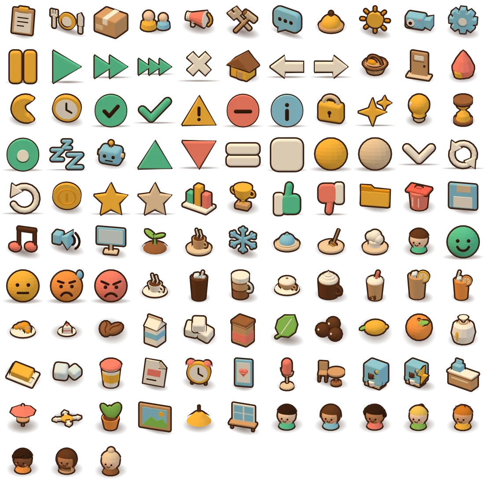

# P18 · i2 · Chốt hướng icon 3D

Tài liệu giải thích (Diátaxis: explanation) cho cổng duyệt icon 3D: bộ quy tắc phong cách đang dùng, đánh giá từng mẫu, đề xuất chỉnh và quy ước cho phần còn lại. Đây là bản tham khảo; cách render, kích thước atlas và hiệu ứng do Lead/FE quyết.

Mẫu do hạng mục i1 làm (`src/icon-studio/`, `npm run icons`). Thực tế có **9 mẫu** (không phải 8): `i-menu`, `i-inventory`, `i-upgrades`, `i-reviews`, `i-pause`, `i-close`, `i-avatar`, `i-latte`, `i-beans`. Bộ SVG hiện có 105 icon (`src/ui/core/icons.ts`), nên còn **96** icon.

## 1. Bộ quy tắc phong cách (đang có trong `src/icon-studio/style.ts`)

| Quy tắc | Giá trị | Ghi chú |
|---|---|---|
| Camera | Trực giao (orthographic), nhìn xuống 30°, xoay 35° sang phải so với mặt trước (+Z) | Góc 3/4, cùng tinh thần camera cảnh game. Không phối cảnh nên cạnh song song, dễ xếp hàng. |
| Ánh sáng | Hemisphere kem `#fff6e8` / nâu nhạt `#d9c2a5` (1,5); đèn chính ấm `#ffe2b8` (2,1) ở **trên-trái màn hình**; đèn phụ lạnh `#cfe6ff` (0,6) phải-dưới; đèn viền `#fff0d0` (1,1) phía sau | Đèn đặt theo hệ trục camera nên "trên-trái" luôn đúng trên ảnh, không phụ thuộc mô hình. |
| Vật liệu | `MeshLambertMaterial` tô phẳng (flat shading), mỗi mặt một sắc | Giống `src/render/scene/shop.ts`, nên icon và cảnh cùng chất low-poly. |
| Viền | Vỏ mặt sau đẩy ra theo pháp tuyến, màu mực `neutral.900` #3a2216; dày 3,5% khung (≈ 1,7 px ở 48 px) | Chi tiết nhỏ có thể tắt viền (`outline: false`), ví dụ 3 chấm của bong bóng. |
| Bảng màu | 15 màu lấy thẳng từ `design/tokens.json`: ink, honey 100/400/500, coffee 300/500/700, cream 50/200, mint 400, berry 400/500 ("coral"), sky 400, leaf 400, skin 1 | Mô hình chỉ được chọn tên màu trong `PALETTE`, không tự đặt hex. |
| Lề | 8% mỗi cạnh + chỗ cho viền; khung vuông ôm theo chiều lớn nhất | Vật dẹt (hạt cà phê) nhìn nhỏ vì khung ăn theo chiều ngang. |
| Bóng | Bóng tiếp xúc: elip mềm dưới chân, mực 55% → 0, rộng 1,25 × đáy + 0,2 | Bóng là ảnh nướng sẵn trong sprite, đi cùng icon. |
| Xuất | Playwright chụp, atlas WebP @1x / @2x, ô 48 px, khe 2 px, `atlas.json` ghi toạ độ | 9 icon = 152 × 152 px @1x. |

## 2. Đánh giá từng mẫu

Ký hiệu: ✔ đọc rõ, ~ đọc được nhưng yếu, ✘ không đọc ra. "Khớp cảnh" là so với quán low-poly ấm của P17.

| Icon | 16 px | 24 px | 48 px | Khớp cảnh | Nhận xét |
|---|---|---|---|---|---|
| `i-menu` (đĩa, dao, nĩa) | ~ | ✔ | ✔ | ✔ | 16 px chỉ còn một đốm vàng; dao nĩa mảnh mất nét. Đĩa vàng tốt. |
| `i-inventory` (thùng) | ✔ | ✔ | ✔ | ✔ | Mẫu tốt nhất: khối rõ, băng dính kem, đọc được cả 16 px. Lấy làm chuẩn. |
| `i-upgrades` (búa) | ✘ | ~ | ~ | ✔ | **Sai nghĩa**: đầu búa xanh nhìn 3/4 thành **biển chỉ đường** cắm trên chân đế. SVG là búa, 3D không còn là búa. Phải dựng lại. |
| `i-reviews` (bong bóng) | ✔ | ✔ | ✔ | ✔ | Khối dày đẹp, 3 chấm mất ở 16 px nhưng hình bong bóng vẫn rõ. Xanh sky hơi xám do đèn ấm, chấp nhận. |
| `i-pause` (dừng) | ~ | ~ | ~ | ✔ | Hai thanh xoay 3/4 chồng lên nhau, giống **2 thỏi vàng / chồng xu** hơn nút dừng. Ký hiệu điều khiển cần nhìn thẳng. |
| `i-close` (X) | ✔ | ✔ | ✔ | ~ | Đọc rõ, nhưng X đỏ berry mang nghĩa "lỗi/xoá" mạnh hơn "đóng" (SVG là nét mực trung tính). Xoay 3/4 làm X lệch. |
| `i-avatar` (người bán thân) | ~ | ✔ | ✔ | ✔ | 48 px dễ thương, khớp nhân vật hạt đậu. 16 px mặt quá nhỏ vì vai chiếm chỗ. Chỉ có 1 tổ hợp da/tóc, cần 8. |
| `i-latte` (ly mang đi) | ~ | ✔ | ✔ | ✔ | Đẹp, có lớp cà phê/sữa. Nhưng là ly giấy nắp tròn, dễ trùng với `i-cup` (ly nhựa) và các món khác cũng là ly. |
| `i-beans` (hạt cà phê) | ✘ | ✘ | ~ | ✔ | Nằm dẹt, nhìn từ 30° chỉ còn **một vạch nâu**; 16–24 px không ra hạt; nâu đậm sát màu viền nên mất khối. |

Tổng: 4/9 đạt ngay (inventory, reviews, menu, avatar ở ≥ 24 px), 2 cần chỉnh màu/góc (close, latte), 3 phải làm lại (upgrades, pause, beans). Hướng chung (khối, đèn ấm, viền mực, bóng) **khớp cảnh game và đáng làm tiếp**; lỗi chủ yếu do mọi icon dùng chung một góc 3/4.

Vấn đề chung ở 16 px: viền 3,5% chỉ còn ≈ 0,6 px nên icon mờ, thua SVG phẳng ở cỡ này.

## 3. Đề xuất chỉnh trước khi làm hết

1. **Ba "tư thế" camera thay vì một** (thêm vào `style.ts`, mô hình khai tư thế, không tự chỉnh góc):
   - `object` (mặc định): 30° / 35° như hiện tại. Cho đồ vật: thùng, ly, máy, bàn, cây…
   - `glyph`: nhìn thẳng (xoay 0°, nghiêng 10–15°), khối đùn dày như kẹo. Cho ký hiệu: dừng, tốc độ, đóng, quay lại/tiến, dấu tích, bằng, mũi tên xuống, xu hướng lên/xuống, sao.
   - `top`: nhìn xuống 55–60°. Cho vật dẹt nằm trên bàn: hạt cà phê, đường viên, bơ, chanh, cam lát, tờ rơi, trân châu.
2. **Hai bộ cỡ trong atlas**: ô 48 (dùng cho 32–48 px: dock, đầu panel, báo cáo) và ô 24 (dùng cho 16–24 px: nút, toast, dòng kho). Ô 24 nướng riêng với viền dày ≈ 7% khung, bỏ chi tiết nhỏ (chấm, dao nĩa), bóng nhỏ hơn. Nếu không muốn tăng dung lượng: giữ SVG phẳng cho chỗ hiển thị ≤ 16 px (xem câu hỏi ở cuối).
3. **Sửa từng mẫu**:
   - `i-upgrades`: búa nghiêng 40° qua một cờ-lê (đầu búa xám bạc cream-200 + cán gỗ coffee-300), không để mặt phẳng xanh to.
   - `i-pause`: tư thế `glyph`, hai thanh song song tách rõ, honey-400.
   - `i-close`: tư thế `glyph`, thân cream-50 viền mực (trung tính); để berry cho `i-delete` / `i-error`.
   - `i-beans`: tư thế `top`, 2 hạt to chồng chéo, rãnh giữa hạt khắc rõ, màu coffee-500 thay 700 cho sáng hơn viền.
   - `i-latte`: ly thuỷ tinh có quai, thấy 3 lớp (cà phê, sữa, bọt) như SVG; ly giấy để cho `i-cup`.
   - `i-menu`: dao nĩa dày gấp đôi; ở ô 24 chỉ còn đĩa + nĩa.
   - `i-avatar`: khung chặt hơn (đầu chiếm ≈ 70% ô), nướng 8 ô theo `AVATAR_LOOKS` (`src/ui/core/iconMap.ts`); áo đổi màu theo tổ hợp để phân biệt cả khi mù màu nhờ tóc/kiểu áo.
4. **Thêm 2 màu vào `PALETTE`** từ token sẵn có: `tangerine` (cam, nước cam, chậu cây) và `hair` 1–4 (avatar). Không thêm màu ngoài `design/tokens.json`.

## 4. Quy ước cho 96 icon còn lại

Quy tắc chung: một vật chính, tối đa 3 màu tô + mực; vật phụ (hơi nước, tia sáng) nhỏ hơn 1/3 vật chính; cùng nhóm cùng tư thế, cùng tỉ lệ đáy; không chữ, không số trong icon (chữ "x2" của tốc độ do HTML vẽ). Nhãn `aria-label` và chữ cạnh icon giữ nguyên như P17.

| Nhóm | Icon | Tư thế | Quy ước |
|---|---|---|---|
| HUD / điều hướng | tasks, people, marketing, camera, settings, open, next-day, home, load, save, delete, music, sound, quality, clock, coin, chart, trophy, lock, tip, busy, auto | `object` | Đồ thật cỡ trung: bảng kẹp giấy, chuông, máy quay, bánh răng dày, đồng xu vàng nhìn nghiêng thấy cạnh. Màu chủ đạo honey/cream, điểm nhấn 1 màu. |
| Ký hiệu điều khiển & trạng thái | pause, speed-1/2/4, close, back, forward, check, equal, chevron-down, retry, reset, ok, error, warning, info, trend-up/down, star, star-empty, dot, dot-empty, todo, free, rest, sparkle | `glyph` | Khối đùn dày như kẹo, nhìn thẳng, không bóng xoay. Màu theo nghĩa giống SVG (mint = tốt, berry = lỗi, honey = cảnh báo, sky = thông tin) **và luôn kèm hình khác nhau** (tích, gạch, chấm than, chữ i) để không chỉ bằng màu. `star-empty`, `dot-empty`: thân cream-200 mờ, cùng khối. |
| Món (10) | espresso, americano, latte, cappuccino, mocha, bubble-tea, lemon-tea, orange-juice, croissant, cake | `object` | Đồ uống: cùng một đáy ly, phân biệt bằng **dáng ly** (tách nhỏ, ly cao, ly thuỷ tinh quai, tách rộng, ly có kem, ly nhựa ống hút to) và topping. Món nóng có 2 sợi hơi nước kem; món lạnh có 2 viên đá. Bánh đặt trên đĩa nhỏ cream. |
| Nguyên liệu (12) | beans, milk, sugar, cacao, tea, pearls, lemon, orange, flour, butter, ice, cup | `top` cho vật dẹt/viên (beans, sugar, pearls, lemon, orange, butter, ice); `object` cho bao/hộp (milk, cacao, tea, flour, cup) | Vật nguyên liệu thô, không có ly (để khác món). Bao/hộp có nhãn một màu, không chữ. Đá viên: sky nhạt + vệt sáng. |
| Nâng cấp (10) | tables, machine, fast-machine, counter, outdoor, expand, plants, paintings, lights, window-bar | `object` | Dựng đúng đồ trong cảnh (`src/render/scene`), dùng lại hình và màu của cảnh nếu có, để người chơi nhận ra món đồ sẽ xuất hiện trong quán. `fast-machine`: máy pha + tia sét honey; `expand`: ô sàn với 4 mũi tên kẹo. |
| Marketing (4) | flyer, happy-hour, social, kol | `object` | Đồ vật cầm tay: tờ rơi gập góc, đồng hồ báo thức honey, điện thoại có tim berry, micro. Điểm nhấn berry chung cho cả nhóm. |
| Vai (5 + chef) | cup-hot (pha chế), role-server, role-cleaner, marketing, rest, chef | `object` | Dùng dụng cụ của vai, không vẽ người (avatar đã là người): tách nóng, khay có chuông, chổi, loa, gối "z". Cùng nền đáy tròn cream để thành bộ huy hiệu. |
| Pha (4 + flame) | phase-prep, phase-open, flame, phase-close | `object` | Giỏ, cửa quán có biển, ngọn lửa, trăng. Tông đèn theo pha: sáng sớm (honey nhạt), trưa (honey), tối (sky + trăng kem). `phase-close` dùng chung cho `report`. |
| Lý do review | thumb-up, thumb-down (+ face-happy/ok/worried/angry) | `glyph` | Tay ngón cái khối tròn: lên mint, xuống berry, **hướng tay** là tín hiệu chính. Mặt khách: quả cầu nhìn thẳng, nét mặt (miệng, lông mày, giọt mồ hôi) khác hẳn nhau như SVG. |
| Avatar | avatar × 8 | `object` khung chặt | 8 ô theo `AVATAR_LOOKS`, đầu ≈ 70% ô, vai ngắn; khác nhau bằng da, tóc, kiểu tóc. Không dùng biến CSS để đổi màu sprite. |
| Độ khó, nhiệt độ | easy, cold (+ flame, cup-hot dùng lại) | `object` | Mầm cây, bông tuyết khối. |

Dung lượng (ước tính, FE đo lại): 105 + 7 avatar thêm ≈ 112 ô 48 px ≈ 560 × 560 px @1x; WebP @2x khoảng 150–250 kB. Nếu thêm bộ ô 24 thì thêm ≈ 25%. Tải atlas sau Main Menu cùng cảnh nặng; trong lúc chờ hiển thị SVG phẳng hiện có, không để ô trống.

## 5. Chuyển động CSS nhẹ ("4D")

Không làm sprite hoạt ảnh; icon là một ảnh tĩnh, chỉ biến đổi bằng `transform`. Theo quy tắc P17 (`design/p17-states/README.md`): nút đã nâng/lún khi rê/nhấn, nên icon chỉ thêm một chuyển động nhỏ **bên trong** nút, không vượt khỏi viền nút, không che vòng focus.

| Trạng thái | Icon | Token |
|---|---|---|
| Mặc định | Đứng yên. Không nhún liên tục trên HUD/dock (gây phân tâm). | – |
| Rê chuột (hover) | Nghiêng −6° và nhấc 2 px, phóng 1,06; gốc xoay ở đáy icon | `duration.pop`, `easing.bounce` |
| Nhấn (active) | Ép dẹt: `scale(1.06, 0.92)` gốc đáy, rồi bật về | `duration.instant` |
| Focus bàn phím | Không thêm chuyển động; dùng vòng focus quế của nút (P17) | – |
| Đang chọn (dock) | Giữ nghiêng nhẹ −3°, không lặp | – |
| Vô hiệu | `grayscale(1)` + mờ 55%, không phản hồi hover; luôn kèm `i-lock` / chữ lý do | – |
| Báo hiệu một lần | Toast mới, xu bay về HUD: nảy 1 lần (lên 4 px rồi về), tối đa 400 ms | `duration.float`, `easing.out` |

`prefers-reduced-motion: reduce`: bỏ mọi `transform` và nảy; hover/nhấn chỉ còn đổi nền nút như P17 (trạng thái vẫn thấy được, không phụ thuộc chuyển động). Không có chuyển động nào lặp quá 5 giây (WCAG 2.2.2).

## Tự soát

- **Không chỉ bằng màu (1.4.1)**: nhóm trạng thái và review phân biệt bằng hình (tích/gạch/chấm than, hướng ngón tay), không chỉ mint/berry. Avatar khác nhau bằng kiểu tóc chứ không chỉ màu.
- **Tương phản biểu tượng (1.4.11)**: icon nằm trên kem, viền mực ≥ 9:1 so với nền kem (đã khai trong `tokens.json` của T237). Ở 16 px viền 3D mỏng dưới 1 px nên chưa đạt độ rõ như SVG; đề xuất 2 xử lý việc này. Icon luôn có chữ hoặc `aria-label` đi kèm như P17 nên thông tin không phụ thuộc icon.
- **Đích bấm (2.5.8)**: không đổi; icon nằm trong nút đã ≥ 44 px.
- **Focus (2.4.7, 2.4.11)**: chuyển động icon nằm trong nút, không che vòng focus.
- **Nielsen**: #2 khớp thế giới thật (icon là đồ thật trong quán, nâng cấp giống đồ trong cảnh) ✔; #4 nhất quán (một bộ quy tắc trong `style.ts`, 3 tư thế cố định) ✔; #6 nhận ra hơn nhớ (mỗi món một dáng ly) ✔; #8 tối giản (tối đa 3 màu tô, bỏ chi tiết ở ô 24) ✔. Lỗi đã thấy: `i-upgrades` và `i-pause` sai nghĩa (vi phạm #2) — đã đề xuất sửa ở mục 3.
- **Nhất quán token**: mọi màu đề xuất có sẵn trong `design/tokens.json`; thời lượng dùng `duration.*` / `easing.*` của T237.

## Cần anh chốt

1. Hướng chung (khối low-poly, đèn ấm trên-trái, viền mực, bóng tiếp xúc) — đề xuất **giữ**.
2. Ba tư thế `object` / `glyph` / `top` — đề xuất **dùng**.
3. Cỡ nhỏ ≤ 16 px: (a) nướng thêm bộ ô 24 viền dày (khuyên, đồng bộ 3D khắp nơi, +≈ 25% dung lượng) hoặc (b) giữ SVG phẳng ở ≤ 16 px (nhẹ hơn, nhưng lẫn hai phong cách).

## Nguồn đã đọc

- `docs/reports/p18-icons-sample.png`, `public/icons3d/atlas@2x.webp`, `public/icons3d/atlas.json`
- `src/icon-studio/style.ts`, `src/ui/core/icons.ts`, `src/ui/core/iconMap.ts`
- `design/t237-cartoon/README.md` (bảng thay emoji, ngữ pháp icon SVG), `design/p17-states/README.md` (quy tắc trạng thái, tham chiếu)
- WCAG 2.2 (1.4.1, 1.4.11, 2.2.2, 2.4.7, 2.4.11, 2.5.8), NN/g 10 Usability Heuristics — theo hiểu biết sẵn có, không mở lại trong phiên này.
