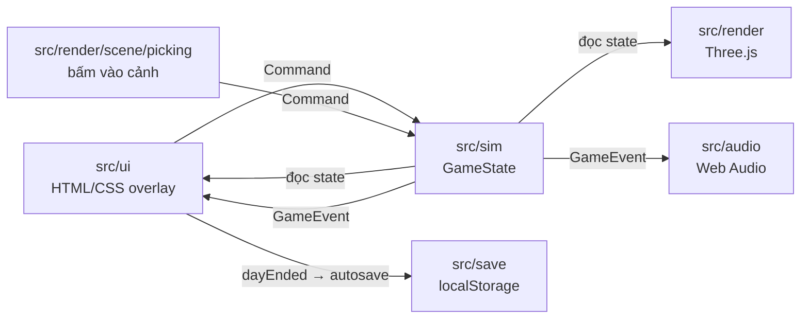
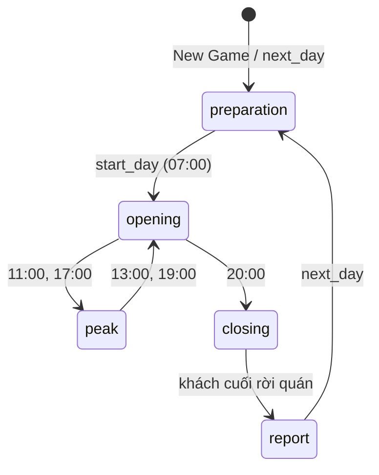
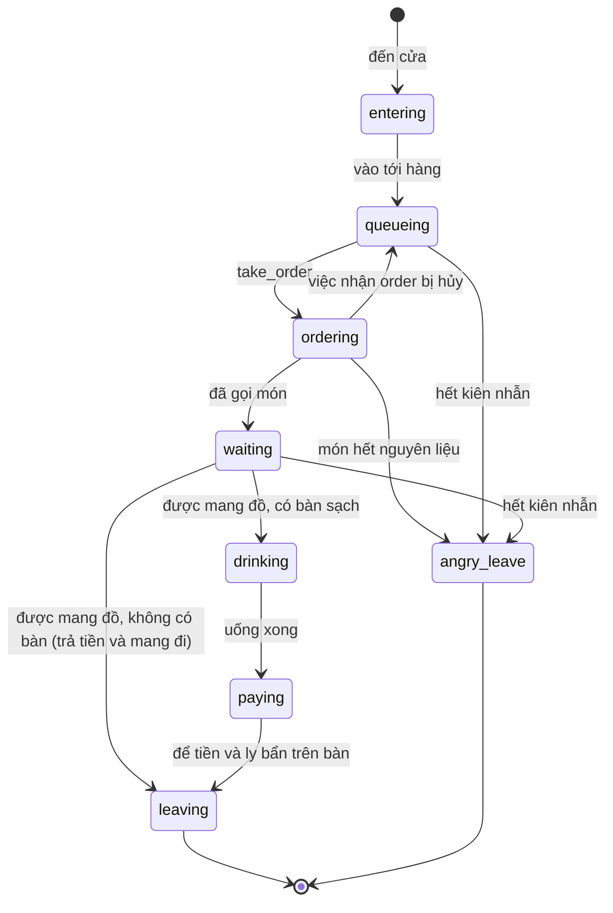

# Kiến trúc

Trang này mô tả cách game chia lớp, các hợp đồng giữa các lớp và định dạng dữ liệu, để thêm tính năng mà không phá vòng ngày đang chạy.

- [Ba lớp](#ba-lớp)
- [Vòng khung hình](#vòng-khung-hình)
- [Hợp đồng Command và GameEvent](#hợp-đồng-command-và-gameevent)
- [Vòng ngày](#vòng-ngày)
- [FSM khách](#fsm-khách)
- [Điều hướng và va chạm](#điều-hướng-và-va-chạm)
- [Save schema](#save-schema)
- [Mẹo hiệu năng](#mẹo-hiệu-năng)

## Ba lớp



| Lớp | Được làm | Không được làm |
| --- | --- | --- |
| `src/sim` | Giữ toàn bộ luật chơi trong `GameState`; `step(state, dtMinutes)` chạy thời gian, `dispatch(state, cmd)` áp lệnh; đẩy sự kiện vào `state.events`. | Import DOM, `three` hay `Math.random`. |
| `src/render` | Đọc `GameState`, vẽ quán, nhân vật, phố; đổi cú bấm trong cảnh thành `Command`. | Sửa state. |
| `src/ui` | Đọc state để vẽ HUD, bảng, màn hình; gửi `Command` qua `shell.dispatch`; hiện toast và tự lưu khi có sự kiện. | Đổi state trực tiếp (trừ `speed`/`paused` khi bắt đầu ván hay đổi cài đặt). |
| `src/audio` | Phát âm thanh theo `GameEvent`. | Đọc hay sửa state. |
| `src/save` | Ghi/đọc `GameState` và cài đặt vào `localStorage`, nâng phiên bản save cũ. | Biết gì về DOM ngoài `StorageLike`. |

| Quy ước | Chi tiết |
| --- | --- |
| `GameState` | JSON thuần (không class, Map hay hàm), nên lưu, so sánh và nhân bản trực tiếp được. |
| Ngẫu nhiên | Mulberry32, trạng thái trong `state.rngState`: cùng state cộng cùng chuỗi lệnh cho ra cùng một ngày. |
| Tiền | Số nguyên đồng (`25000` = 25.000đ). |
| Thời gian | Phút game tính từ nửa đêm (`420` = 07:00). |
| Version | `src/version.ts` (`APP_VERSION`), Vite thay `__APP_VERSION__` bằng `package.json` → `"version"` lúc build; xem [deploy.md](deploy.md#version-và-phát-hành). |

### Icon và font

UI và cảnh 3D không hiển thị emoji; mọi biểu tượng là icon 3D low-poly lấy từ atlas `public/icons3d/atlas@1x.webp`, `atlas@2x.webp` (vị trí từng ô trong `atlas.json`), do `npm run icons` dựng (xem [media.md](media.md#icon-3d)). Mỗi icon có hai ô trong cùng atlas:

| Ô | Dùng cho cỡ | Cách vẽ |
| --- | --- | --- |
| 48 px (lưới trên, bảng `icons`) | 32, 48 px; nhãn trong cảnh 3D | Viền mực ~1,7 px, bóng tiếp đất, đủ chi tiết. |
| 24 px (lưới dưới, bảng `smallIcons`) | 16, 24 px | Dải mực phẳng ~1,8 px quanh hình, không bóng, bỏ chi tiết nhỏ hơn ~1,4 px, tăng tương phản; nút chỉ có icon và `i-coin` dùng mô hình đơn giản riêng (`SMALL_MODELS`). |

| Module | Nội dung |
| --- | --- |
| `src/ui/core/icons.ts` | Danh sách id (`ICON_IDS`, theo thứ tự ô trong atlas). `iconCell(id, size)` tính vị trí ô từ số đo lưới trong `atlas.json` (`small` cho lưới 24 px): ô 24 px khi `size` là 16 hoặc 24, ô 48 px khi 32, 48 hoặc bỏ trống; test so từng ô với bảng `icons` và `smallIcons` của file đó. `icon(id, { size })` trả `<span class="ic" data-icon="…" aria-hidden="true" focusable="false">` rỗng; ảnh là nền của ô theo cỡ. `loadIconAtlas()` tải ảnh @2x một lần, `drawIcon()` chép ô 48 px lên canvas. |
| `src/ui/core/iconMap.ts` | Ánh xạ id của sim (món, nguyên liệu, marketing, nâng cấp, pha, vai, lý do review) sang icon. `avatarIcon(staffId)` trả ô `i-avatar-<n>` theo `AVATAR_LOOKS`. Trường `icon` emoji trong `src/sim/data` giữ nguyên nhưng không còn được hiển thị. |
| `src/ui/styles/ui.css` (`.ic`) | Kích thước ô theo class: `.ic` 24 px, `.ic-sm` 16, `.ic-lg` 32, `.ic-xl` 48. Nền `image-set(@1x 1x, @2x 2x)`; `icon()` đặt `--ic-size`, `--ic-pos` theo %, nên ô to nhỏ bao nhiêu cũng vừa. Icon trong nút nảy, nghiêng khi hover và co lại khi nhấn; tắt khi `prefers-reduced-motion`. |
| `src/render/actors/labels.ts` | Nhãn món và mặt cảm xúc trên đầu khách trong cảnh 3D: vẽ bong bóng, rồi `drawIcon()` từ atlas @2x khi ảnh tải xong. |
| `src/ui/core/iconSvg.ts` | Bộ icon SVG phẳng gốc từ `design/t237-cartoon/icons/index.html`; chỉ icon studio dùng để so cũ và mới (bảng `--sheet`, `public/icons3d/svg.json` cho trang xem icon), game không import. |

Ô có sẵn kích thước trước khi atlas tải xong, nên layout không nhảy; không preload atlas, Main Menu không chờ ảnh. URL ảnh tương đối (`icons3d/…` trong JS, `/icons3d/…` trong CSS do Vite đổi theo `base: './'`).

Thêm icon:

1. Thêm id vào `ICON_IDS` trong `src/ui/core/icons.ts`.
2. Dựng mô hình trong `src/icon-studio/models/` và khai vào `ICON_MODELS` (các bước ở [media.md](media.md#thêm-icon)).
3. Chạy `npm run icons -- --only <id>` để vẽ hai ô mới vào atlas.
4. Dùng `icon('<id>')` trong UI, hoặc nối id của sim trong `iconMap.ts`.

Font chữ:

- Nunito từ `@fontsource/nunito` (SIL OFL 1.1, xem [THIRD_PARTY_NOTICES.md](../THIRD_PARTY_NOTICES.md)), import trong `src/main.ts`.
- Chỉ subset `latin` và `vietnamese`, weight 400 và 700; 600 và 800 hiển thị bằng 700.
- `@font-face` dùng `font-display: swap`, không preload: Main Menu vẽ bằng font hệ thống rồi đổi sang Nunito khi tải xong.
- Token `--font-family-base` nằm ở `src/ui/styles/tokens.css`.

## Vòng khung hình

`src/main.ts` chạy mỗi `requestAnimationFrame`:

1. `step(game, dt × 2 × game.speed)`: 1 giây thật ở 1x là 2 phút game (một ngày khoảng 7 phút). `dt` bị chặn ở 0,1 s để tab nền không tua nhanh.
2. Sim chạy tick cố định 1 phút game; tối đa `MAX_TICKS_PER_STEP` = 240 tick mỗi lần gọi. Phần lẻ còn lại nằm trong `state.tickAccumulator`.
3. `world.update(game, game.tickAccumulator)`: render nội suy vị trí giữa hai tick bằng `alpha`.
4. `shell.update()`: HUD, bảng đang mở và Daily Report cập nhật DOM qua `Watcher` (chỉ chạm DOM khi giá trị đổi).
5. `audio.handleEvents(events)` rồi `shell.handleEvents(events)`; sau đó xóa `game.events`.

Thứ tự trong một tick: đồng hồ và pha → khách mới đến (trừ pha đóng cửa) → việc của người chơi → nhân viên → khách → ghi trải nghiệm và review → nếu đang đóng cửa và quán trống thì kết thúc ngày.

### Camera

`CameraController` (`src/render/scene/camera.ts`) giữ hai tư thế: `target` (đích của input) và `current` (đang vẽ). Mỗi khung `update(dt)`, `dt` bị chặn ở `MAX_CAMERA_DT` = 0,1 s:

| Input | Cách chạy |
| --- | --- |
| Kéo chuột | Xoay `DRAG_ROTATE_SPEED` rad/px. Lúc kéo, vận tốc được làm mượt; thả ra thì camera trôi tiếp với vận tốc đó (tối đa `MAX_INERTIA` = 4 rad/s), giảm dần theo `INERTIA_DECAY`. Bấm vào cảnh dừng ngay. Không trôi khi Giảm chuyển động bật (cài đặt `reducedMotion` là `reduce` hay `prefers-reduced-motion`). |
| Phím xoay, phím pan, pan mép màn | Tăng tốc và giảm tốc theo `KEY_RAMP`, không bật tắt đột ngột. |
| Bám đích | `current` đuổi theo `target` bằng `dampMoving` (`ROTATE_DAMPING`, `ZOOM_DAMPING`, `PAN_DAMPING`), nên chuyển động giống nhau ở mọi tốc độ khung hình. |

Tốc độ xoay theo cài đặt `cameraRotateSpeed` (Cài đặt → Tốc độ xoay camera): `ROTATE_SPEED_SCALE` nhân `KEY_ROTATE_SPEED` và `DRAG_ROTATE_SPEED` với 0,6 (`slow`), 1 (`normal`) hay 1,5 (`fast`); `world.setCameraRotateSpeed()` đổi ngay khi chơi.

## Hợp đồng Command và GameEvent

Kiểu đầy đủ ở `src/sim/types.ts`. `dispatch` trả `false` khi lệnh không áp dụng được lúc đó (sai pha, sai id, thiếu tiền…); UI dùng giá trị này thay vì tự kiểm luật.

| Command | Khi nào |
| --- | --- |
| `start_day` | Chuẩn bị → mở cửa. |
| `next_day` | Từ báo cáo sang ngày mới (pha `preparation`). |
| `set_menu_item` | Bật/tắt món. Giá món cố định theo dữ liệu menu; bật món chưa mở khóa theo cấp quán trả `false`. |
| `buy_ingredient`, `apply_restock` | Nhập hàng theo gói, hoặc theo gợi ý nhập tự động. |
| `hire_staff`, `fire_staff`, `assign_role`, `set_auto_assign` | Nhân viên. |
| `buy_upgrade`, `start_campaign` | Nâng cấp, marketing. Mua nâng cấp chưa mở khóa theo cấp quán trả `false`. |
| `set_speed`, `set_paused` | Nhịp game. |
| `take_order`, `brew`, `deliver`, `collect_cash`, `clean_table` | Người chơi tự phục vụ (từ cảnh 3D). |

| GameEvent | Ai dùng |
| --- | --- |
| `doorbell`, `brew`, `cash`, `angry`, `served`, `cleaned` | Âm thanh, hiệu ứng trong cảnh; `served`/`angry` còn sinh review. |
| `notify`, `low_stock`, `review` | Toast. |
| `level_up` | Quán lên cấp lúc `closeDay`; kèm `level` mới và `unlocks` (món, nâng cấp, dụng cụ mới mở). |
| `phase` | Đổi pha trong ngày. |
| `dayEnded` | Báo cáo đã nằm trong `state.lastReport`; shell tự lưu vào slot `auto` và chuyển kết quả cho Daily Report. |

Thêm tính năng mới: thêm biến thể vào `Command`, xử lý trong `dispatch` (`src/sim/index.ts`), viết test ở `tests/sim/`, rồi mới nối UI. UI cần biết chuyện gì vừa xảy ra thì thêm biến thể `GameEvent` thay vì so sánh state giữa hai khung hình.

## Vòng ngày



| Pha | Đồng hồ | Việc chính |
| --- | --- | --- |
| `preparation` | Dừng ở 07:00 | Bảng chuẩn bị ở dock giữa đáy; nút **Mở cửa** trên HUD. |
| `opening` | Chạy | Khách đến theo tốc độ cơ bản. |
| `peak` | Chạy | Khách đến nhiều hơn. |
| `closing` | Chạy | Không nhận khách mới. |
| `report` | Dừng | `closeDay` đã trả lương, cập nhật rating, chấm nhiệm vụ ngày, cộng XP và lên cấp, dựng `DailyReport`; UI hiện Daily Report (`src/ui/report`). |

Khi quán trống trong pha `closing`, sim gom tiền trên bàn, dọn bàn, gọi `closeDay` (`src/sim/report.ts`) rồi phát `dayEnded`. `next_day` đẩy `state.today` vào `state.history`, tăng ngày, chọn thời tiết mới, chạy tiếp chiến dịch marketing, phân vai nhân viên và rút nhiệm vụ mới cho ngày mới.

### Cấp quán và nhiệm vụ

Hệ cấp quán ở `src/sim/progression.ts` và bảng cấp `src/sim/data/levels.ts`:

| Khái niệm | Chi tiết |
| --- | --- |
| Cấp (`state.shopLevel`, 1–6) | Mỗi cấp mở thêm món và nâng cấp; `LEVELS` gộp đủ 11 món và 15 nâng cấp. Nhóm `tools` là 5 dụng cụ (`grinder`, `pastry_case`, `blender`, `ice_maker`, `dishwasher`), cũng là nâng cấp `category: 'equipment'` và mở khóa, mua như nâng cấp khác. `isUnlocked(state, kind, id)` so cấp hiện tại với cấp mở khóa. |
| XP (`state.xp`) | Mỗi khách phục vụ +2, mỗi review 4–5 sao trong ngày +6, mỗi nhiệm vụ hoàn thành cộng thưởng XP; tổng nhân `xpMult` của độ khó (Dễ 1,25 · Vừa 1 · Khó 0,8). Cộng lúc `closeDay`; qua ngưỡng `xpToReach` (cấp 2–6: 1100, 3500, 7000, 12000, 19000) thì lên cấp và phát `level_up`. Mốc thiết kế: chiến lược mẫu ở Vừa lên cấp 2 vào ngày 2–4, cấp 6 vào ngày 20–35 (`tests/integration/level-balance.test.ts`). |
| Nhiệm vụ ngày (`state.missions`) | 3 nhiệm vụ rút từ pool 6 loại bằng hash(`seed`, `day`) — không rút từ `rngState`, nên cùng seed ra cùng nhiệm vụ. Mục tiêu N theo cấp. Chấm lúc `closeDay`; nhiệm vụ xong thưởng 50–70 XP và 80.000–120.000 đ. Kết quả nằm trong `DailyReport` (`missions`, `xpGained`, `levelUp?`). Ngày không có khách thì không nhiệm vụ nào tính; `food_cost` cần có doanh thu mới tính đạt. |
| Tiến độ nhiệm vụ | `missionProgress(state, mission)` trả `{ value, ratio, met }` từ số liệu đang chạy của ngày: `value` theo đơn vị nhiệm vụ, `ratio` 0..1 cho thanh tiến độ (nhiệm vụ "đạt tối thiểu" là `value / target`; nhiệm vụ "giữ dưới ngưỡng" là 1 khi còn trong ngưỡng, giảm khi vượt), `met` là kết quả nếu ngày kết thúc lúc đó. Hàm thuần, `closeDay` chấm bằng chính hàm này. Chỉ đọc trường có giá trị trong ngày: `food_cost` = `ingredientCostUsed(state)` / doanh thu, `value` là `null` (UI ghi "Chưa đủ dữ liệu") khi chưa có doanh thu; `end_rating` = `nextRating(state, today.ratingStart)`, đúng số `updateRating` ghi lúc chốt ngày. |

### Nâng cấp và dụng cụ

10 nâng cấp và 5 dụng cụ ở `src/sim/data/upgrades.ts`; mỗi loại có `category` (`equipment` / `space` / `decor`) và `effectPerLevel`. `totalUpgradeEffect(state.upgrades)` cộng dồn hiệu ứng mọi cấp đã mua:

| Trường hiệu ứng | Tác dụng trong sim | Áp ở |
| --- | --- | --- |
| `capacity` | Thêm chỗ ngồi (thêm bàn vào bố cục) | `upgrades.ts` (`addTables`) |
| `appeal` | +% khách đến | `customers.ts` |
| `foodAppeal` | +% khách gọi món ăn và mua kèm món ăn | `customers.ts` (`pickOrder`, `maybeAddOn`) |
| `brewSpeed` | Pha mọi món nhanh hơn | `orders.ts` (`brewSpeedFor`) |
| `coffeeBrewSpeed` | Pha đồ cà phê nhanh hơn | `orders.ts` |
| `coldBrewSpeed` | Pha đồ lạnh nhanh hơn | `orders.ts` |
| `foodBrewSpeed` | Làm món ăn nhanh hơn | `orders.ts` |
| `cleanSpeed` | Dọn bàn nhanh hơn | `orders.ts` (`cleanMinutes`) |
| `iceCostReduction` | Giảm chi phí đá cho đồ lạnh | `inventory.ts` |
| `ratingBonus` | +sao cộng vào mỗi đơn | `reviews.ts`, `rating.ts` |

Dụng cụ (`grinder`, `pastry_case`, `blender`, `ice_maker`, `dishwasher`) là nâng cấp `category: 'equipment'`; chúng chỉ khác ở chỗ `LEVELS.tools` liệt kê riêng để UI xếp vào nhóm Dụng cụ. Mua một cấp gọi `buyUpgrade`; cấp có `capacity` thì thêm bàn và chạy `relayoutTables`. Ở Vừa, cấp 1 của mỗi dụng cụ hoàn vốn trong ≤ 15 ngày (`tests/integration/level-balance.test.ts`).

Thời gian pha (`brewMinutes`) và dọn bàn (`cleanMinutes`) là phút lẻ, giữ 2 chữ số thập phân. Người chơi và nhân viên làm theo ngân sách phút (`workMinute` trong `orders.ts`): việc xong giữa phút thì phần còn lại chuyển sang việc kế tiếp, nên mọi mức tăng tốc, kể cả cấp 1, đều rút ngắn thời gian thật.

### Trạng thái kho

`stockOutlook(state)` (`src/sim/inventory.ts`) trả cho mỗi nguyên liệu `{ qty, need, level, cups }`:

| Trường | Ý nghĩa |
| --- | --- |
| `need` | Lượng mà số bán dự kiến còn lại trong ngày sẽ dùng: `expectedDemand` (ngày gần nhất) nhân phần ngày còn lại (cả ngày khi chuẩn bị và báo cáo, 0 khi đóng cửa). |
| `level` | `out` khi hết; `low` khi ít hơn `need` hoặc dưới ngưỡng cố định `lowStock`; còn lại `ok`. |
| `cups` | Số ly của cơ cấu món hôm nay mà kho còn đủ; `null` khi menu không dùng nguyên liệu đó. |

Kết quả cache theo state, chỉ tính lại khi tồn kho, menu, pha, ngày hay khung 15 phút game đổi, nên gọi mỗi khung được. Nhãn Đủ / Sắp hết / Hết trong bảng Kho, huy hiệu dock Kho (`lowStockCount`) và toast `low_stock` cùng đọc hàm này; bảng Kho đang mở cập nhật theo sim qua `Watcher`, không cần bấm Gợi ý.

### Chỉ số kinh doanh

`buildInsights(state, stats)` (`src/sim/insights.ts`) dựng `Insights` lúc `closeDay` và gắn vào `DailyReport.insights`: tám KPI (`metrics`), lãi gộp từng món (`itemProfits`) và lượng khách theo giờ (`arrivalsByHour`). Tab Chỉ số của Daily Report (`src/ui/report/insights.ts`) vẽ chúng; save cũ không có `insights` thì tab hiện ô rỗng.

Ngưỡng ở `src/sim/data/benchmarks.ts` là mốc huấn luyện theo thông lệ quán cà phê (food cost, lương, prime cost), tinh chỉnh cho kinh tế trong game, không phải số kế toán thật. `lowerStatus` / `upperStatus` xếp mỗi KPI thành `good` / `watch` / `bad`:

| KPI | Tốt | Cần chú ý | Chiều |
| --- | --- | --- | --- |
| Food cost % (giá vốn / doanh thu) | ≤ 35 | ≤ 40 | thấp tốt |
| Chi phí lương % | ≤ 35 | ≤ 40 | thấp tốt |
| Prime cost % (vốn + lương) | ≤ 65 | ≤ 72 | thấp tốt |
| Tỷ lệ bỏ về % | ≤ 10 | ≤ 20 | thấp tốt |
| Chờ trung bình (phút game) | ≤ 8 | ≤ 15 | thấp tốt |
| Hao hụt % (trên giá vốn) | ≤ 5 | ≤ 12 | thấp tốt |
| Lấp ghế % (trên khung phục vụ) | ≤ 70 | ≤ 90 | cao = thiếu ghế |
| Biên món % | ≥ 65 | ≥ 58 | cao tốt |

Đơn trung bình (AOV) và giờ cao điểm chỉ để tham khảo, không có ngưỡng. KPI `watch` hoặc `bad` kèm một câu gợi ý và một `panel` để UI mở thẳng bảng sửa (Nhân viên, Nâng cấp, Menu, Kho, Marketing).

## FSM khách



- Cá tính (`persona`, `src/sim/data/personas.ts`): chọn lúc đến bằng hash của seed và id khách (không rút từ RNG), tỷ lệ theo giờ và thời tiết. 5 kiểu (văn phòng, sinh viên, khách quen, người sành cà phê, gia đình) đổi trọng số món, hệ số kiên nhẫn, thời gian ngồi, xác suất gọi kèm bánh (`extraItem`, cộng doanh thu và nguyên liệu), độ khắt khe và câu chữ review. Trường tùy chọn; save cũ thiếu thì coi là trung tính.
- Kiên nhẫn (`patience`) chỉ giảm khi xếp hàng và chờ đồ.
- `served` và `angry` sinh trải nghiệm: khách để lại review (1–5 sao, lý do `ReviewReason`) với xác suất 30% khi được phục vụ, 60% khi bỏ đi.
- Game giữ tối đa 30 review (`MAX_REVIEWS`).

Chuyển trạng thái đi theo đồng hồ, không chờ khách tới nơi. Đích đi (`target`) theo trạng thái:

| Trạng thái | Đích |
| --- | --- |
| `entering`, `queueing`, `ordering` | Chỗ thứ i của hàng chờ (`queueSlot`). |
| `waiting` có bàn, `drinking`, `paying` | Ghế của bàn (tâm bàn ± `CHAIR_OFFSET`, phía còn trống). |
| `waiting` chưa có bàn | Một ô lấy đồ mang đi riêng cạnh quầy. |
| `leaving`, `angry_leave` | Cửa (`DOOR_POS`). |

## Điều hướng và va chạm

Sim giữ mọi người trên sàn trống: không xuyên tường, quầy, máy, bàn, ghế, chậu cây, và không hai người đứng chồng một chỗ. Code ở `src/sim/nav/` (lưới, A*, kiểm bố cục) và `src/sim/customers.ts`, `src/sim/staff.ts` (chỗ đứng).

| Phần | Cách làm |
| --- | --- |
| Footprint | `layoutFootprints(layout)` (`nav/footprints.ts`) trả hình chiếu sàn của tường, khung cửa, hai chậu cây hai bên cửa (`doorPlanters`), quầy, quầy sau, máy, bàn, ghế, cột dù, chậu cây. Bậc thềm và thảm thấp, đi qua được, không có footprint. Render vẽ bằng cùng hằng số kích thước. |
| Lưới | `buildNavGrid(layout)`: ô `NAV_CELL` = 0,25; ô bị chặn khi tâm ô nằm ngoài sàn hoặc cách footprint dưới `AGENT_RADIUS` = 0,2. Lưới cache theo `navLayoutKey`, chỉ dựng lại khi bố cục đổi (mua nâng cấp). |
| Tìm đường | `findPath(grid, from, to)`: A* 8 hướng, không cắt góc ô chặn, hòa thì chọn chỉ số ô nhỏ hơn; đường được rút gọn theo tầm nhìn và cache LRU 128 đường. Đầu mút bị chặn được dời tới ô trống gần nhất (`nearestFree`). |
| Đi bộ của khách | Mỗi tick khách đi 4 đơn vị bằng `walkToward(grid, pos, target, 4)`: lần theo bản đồ khoảng cách (Dijkstra 8 hướng) tới ô đích, chỉ xét đoạn đi được trong tick và cắt góc khi tầm nhìn thông. Bản đồ dựng một lần cho mỗi ô đích, cache LRU 96 bản đồ cho bố cục hiện tại và xóa khi bố cục đổi; sim không chạy A* mỗi tick. `navSearchCount()` đếm số lần chạy A* và dựng bản đồ. Đường không lưu vào state. Khách ngồi dừng ở ô trống cạnh ghế; render vẽ họ trên ghế. |
| Hàng chờ và ô mang đi | `floorSpots(layout)` tính một lần cho mỗi bố cục: 6 chỗ hàng chờ (`MAX_QUEUE`) cách nhau 0,8 dọc lối đi từ trước quầy về phía cửa, 12 ô mang đi (`PICKUP_SPOTS`) quanh `layout.pickup`, rồi các ô dự phòng `overflow`: 4 ô ở lối đi trong cửa, còn lại trên vỉa hè trước quán, đủ cho mọi khách quán nhận (số ghế + hàng chờ, ít nhất 8 ô); lối cửa luôn để trống. Khách mang đi giữ ô của mình; khách mới lấy ô trống đầu tiên trong `takeaway` (ô quanh chỗ lấy đồ trước, rồi ô dự phòng). Không có hai khách chung một ô. |
| Giữ chỗ đứng | `claimSpot(grid, wants, taken)` chọn ô đầu tiên trong `wants` còn mở, nếu không thì ô mở gần nhất. Ô mở là ô trống, tới được từ cửa, và không có ô đã giữ trong ô 3×3 quanh nó, nên hai người đứng yên cách nhau ít nhất 0,5. |
| Chỗ đứng của nhân viên | `staffSpots(state)` giữ trước ô đích của khách, rồi xét nhân viên theo id: trạm của vai (nhiều người cùng vai tỏa ra ô kế bên), sau quầy khi nhận order, sau quầy trước máy khi pha, ô mở cạnh khách khi mang đồ, phía trước hoặc sau bàn (phía còn trống) khi dọn và thu tiền. Mỗi tick nhân viên được đặt lại sau khi khách nhận chỗ, nên không đứng lên ô mang đi vừa cấp. |
| Bố cục bàn | `tablePosition(i)` (`src/sim/state.ts`): hai khối hai cột hai bên lối đi chính `x = 0` (cột `x` = ±1,5 rồi ±3,5, cách nhau `TABLE_PITCH` = 2), hàng từ `TABLE_ROW_Z` = 0,75 về phía cửa cách nhau `TABLE_ROW_PITCH` = 2, chừa lối ngang giữa hai hàng. Ghế hai bên bàn (`CHAIR_OFFSET` = 0,62, mép ghế dưới mặt bàn) quay vào bàn. Bàn khu mở rộng nằm trên cùng các hàng, bàn ngoài hiên theo cùng bước. Mọi tâm bàn nằm trên lưới điều hướng. |
| Đi bộ trên màn hình | `src/render/actors/sync.ts`: khách đi tới `target` của sim, nhân viên tới `staff.pos`, người chơi tới `playerSpot()` (giữ chỗ bằng `claimSpot` sau khách và nhân viên). `setGoal` gọi `findPath` chỉ khi đích đổi, rồi bước nốt lên ghế với khách ngồi. Người đang đi gần nhau dưới 0,3 được `separate()` đẩy lệch phần vẽ (tối đa 0,3, không vào ô chặn); đứng yên thì về đúng chỗ. |
| Dáng đi | Chỉ ở phía render; sim và kết quả tất định không đổi. `roundCorners()` thay mỗi góc của đường A* bằng cung Bézier bậc hai bán kính tối đa `CORNER_RADIUS` = 0,35 (không quá nửa mỗi cạnh), giữ góc nhọn khi cung đi qua ô chặn. `easedStep()` tăng tốc từ đứng yên trong `ACCEL_MINUTES` và giảm tốc trên `BRAKE_DISTANCE` = 0,6 cuối. Thân quay về điểm phía trước trên đường (`lookAhead`) bằng `turnToward()`, tối đa `MAX_TURN_SPEED` = 10 rad/s. Nhịp bước theo quãng đường (`strideCycles`: một bước `STRIDE` = 0,9, tối đa 3 bước/giây) nên chân không trượt; đổi giữa đứng và đi trộn tư thế bằng `blendPose`. |
| Người đi bộ ngoài phố | `src/render/street/layout.ts`: `walkerSlots(n)` chia người đều trên 4 làn, cùng làn cùng tốc độ nên khoảng cách không đổi (`minWalkerGap`). Làn cách hàng cây/đèn ít nhất `PROP_CLEARANCE`; khách rời quán biến mất ở `exitPoint` trước làn gần nhất. |
| Kiểm bố cục | `validateLayout(layout)` báo footprint chồng nhau, cửa bị chặn, chỗ trước/sau quầy hay chỗ lấy đồ không tới được, bàn không tới được ghế. |

Mọi bước tất định: cùng state cho cùng đường và cùng chỗ đứng. Đổi kích thước đồ vật thì sửa hằng số trong `nav/footprints.ts`; thêm đồ đặt trên sàn thì thêm footprint vào `layoutFootprints`.

## Save schema

| Khóa `localStorage` | Nội dung |
| --- | --- |
| `cst3d:save:auto` | Slot tự động, ghi khi có `dayEnded`. |
| `cst3d:save:1` … `cst3d:save:3` | Slot lưu tay từ menu Tạm dừng. |
| `cst3d:settings` | Cài đặt: âm lượng, chất lượng, tốc độ, kiểu phím camera, tốc độ xoay camera (`cameraRotateSpeed`, thiếu thì `normal`), giảm chuyển động (`reducedMotion`: `system` hay `reduce`, thiếu thì `system`). |

Mỗi slot là JSON:

```json
{ "version": 2, "savedAt": 1760364000000, "state": { "...": "GameState, events = []" } }
```

- `SAVE_VERSION` trong `src/save/save.ts` là phiên bản hiện tại (2). Phiên bản 0 là `GameState` trần không có vỏ bọc; phiên bản 1 chưa có cấp quán.
- Migration 1→2 thêm `shopLevel`, `xp`, `missions` và `seed`: cấp tính từ số khách đã phục vụ trong `history`, nhưng không thấp hơn cấp đủ để mọi món đang bật và nâng cấp đã mua vẫn mở khóa, nên save cũ không mất quyền đã có. `xp` được nâng lên ít nhất `xpToReach(shopLevel)`.
- `migrate()` nâng lần lượt từng phiên bản qua bảng `MIGRATIONS`, rồi kiểm các trường bắt buộc. Save mới hơn bản game báo `version_unsupported`; JSON hỏng báo `corrupt`; thiếu trường báo `invalid`. Đọc slot không bao giờ sửa hay xóa dữ liệu đã lưu.
- Sau khi nâng, menu được bổ sung các món có trong `MENU` mà save chưa có (ví dụ `frappe` với save viết trước khi có món này), ở trạng thái tắt và giá mặc định. Bước này chạy với mọi save, kể cả save v2. Món đã có giữ nguyên giá và trạng thái bật/tắt.
- Tiếp đó `relayoutTables()` (`src/sim/upgrades.ts`) đặt lại mọi bàn vào chỗ của bố cục hiện tại: bàn thứ n (theo id) của mỗi khu (trong nhà, mở rộng, ngoài hiên) lấy chỗ thứ n của khu đó. Khách đang ngồi hay đang đi tới bàn chuyển theo sang ghế cùng phía. Tiền, đồ đã mua và các trường khác giữ nguyên.
- Tiếp đó `settleActors()` (`src/sim/index.ts`) dời khách và nhân viên đang đứng trong vật cản (save cũ có hàng chờ chạy qua ghế) ra ô trống gần nhất. Người đứng trên sàn trống giữ nguyên vị trí.
- Thêm trường bắt buộc vào `GameState`: tăng `SAVE_VERSION`, thêm hàm vào `MIGRATIONS` điền giá trị mặc định, và thêm ca kiểm trong `tests/save/`. Trường tùy chọn (`?`) không cần tăng phiên bản.

## Mẹo hiệu năng

### Khởi động

1. `index.html` vẽ màn hình chờ `#boot` (CSS và SVG inline: linh vật ly, thanh tiến độ chạy bằng animation; không chờ font) ngay khi trang tải, trước khi có JS.
2. Chunk chính (UI, sim, save, audio) chạy `createShell`, hiện Main Menu rồi làm mờ `#boot`; đánh dấu `performance.mark('cst:menu')`.
3. `main.ts` gọi `import('./render/scene')` ngay đầu `start()`. Sau khi menu đã vẽ, `createWorld` dựng cảnh, `world.prepare()` biên dịch shader bằng `compileAsync`, rồi canvas `#scene` hiện dần (`is-ready`) và đánh dấu `cst:world`. Trước lúc đó vòng khung hình vẫn chạy sim, chỉ bỏ qua phần vẽ.

Không import `src/render` hay `three` tĩnh từ `main.ts`, `src/ui`, `src/sim`, `src/save`: làm vậy kéo three.js trở lại chunk chính.

| Chunk (`npm run build`) | Raw | Gzip | Tải khi |
| --- | --- | --- | --- |
| `index-*.js` (chunk chính; từ `atlas.json` chỉ lấy số đo lưới) | 162,6 kB | 56,4 kB | Ngay khi mở trang, cần cho Main Menu |
| `index-*.css` | 62,8 kB | 10,0 kB | Ngay khi mở trang |
| `index-*.js` (`src/render`) | 84,3 kB | 31,2 kB | Sau khi chunk chính chạy |
| `three-*.js` | 502,0 kB | 125,7 kB | Sau khi chunk chính chạy; tách riêng để giữ cache giữa các lần deploy |
| `nunito-*.woff2` (4 file: latin, vietnamese × 400, 700) | 44,6 kB | (đã nén) | Khi trang dùng tới chữ; không chặn Main Menu |
| `icons3d/atlas@1x.webp` hoặc `atlas@2x.webp` (một trong hai, theo mật độ điểm ảnh) | 100,8 kB / 280,9 kB | (đã nén) | Khi icon đầu tiên hiện; không chặn Main Menu |

Trước khi tách, mọi thứ nằm trong một file `index-*.js` 653,1 kB (180,3 kB gzip), và menu chỉ hiện sau khi dựng cảnh và vẽ xong khung hình 3D đầu tiên. JS cần trước khi thấy menu giảm từ 180,3 kB xuống 44,8 kB gzip.

Thời gian tính từ lúc mở trang, bản build qua `vite preview`, Chrome headless không cache trên Apple M2 (ANGLE Metal), trung vị 3 lần:

| Cấu hình | Bản | Nội dung đầu tiên hiện | Main Menu hiện | Cảnh 3D hiện |
| --- | --- | --- | --- | --- |
| Máy bàn, không giới hạn | Một chunk, không màn chờ | 140 ms (menu) | 127 ms | 127 ms |
| Máy bàn, không giới hạn | Tách chunk + màn chờ | 64 ms (màn chờ) | 81 ms | 179 ms |
| Di động: 150 ms RTT, 1,6 Mbps, CPU chậm 4 lần | Một chunk, không màn chờ | 1580 ms (menu) | 1582 ms | 1582 ms |
| Di động: 150 ms RTT, 1,6 Mbps, CPU chậm 4 lần | Tách chunk + màn chờ | 584 ms (màn chờ) | 743 ms | 1840 ms |
| Máy bàn, không giới hạn | Tách chunk + giao diện hoạt hình (icon SVG, Nunito) | 52 ms (màn chờ) | 146 ms | 249 ms |
| Di động: 150 ms RTT, 1,6 Mbps, CPU chậm 4 lần | Tách chunk + giao diện hoạt hình (icon SVG, Nunito) | 624 ms (màn chờ) | 812 ms | 2153 ms |

Trong cùng lượt đo, bản tách chunk trước giao diện hoạt hình (`56ce5ca`) cho Main Menu 101 ms trên máy bàn và 757 ms trên di động.

Số đo thay đổi giữa các lượt đo; chỉ so các bản trong cùng một lượt. Lượt đo bản có mặt tiền, đèn ấm, lưới điều hướng và icon 3D, so với `07439cf`:

| Cấu hình | Bản | Nội dung đầu tiên hiện | Main Menu hiện | Cảnh 3D hiện |
| --- | --- | --- | --- | --- |
| Máy bàn, không giới hạn | `07439cf` | 124 ms | 446 ms | 794 ms |
| Máy bàn, không giới hạn | Mặt tiền, đèn ấm, điều hướng, icon 3D | 112 ms | 361 ms | 599 ms |
| Di động: 150 ms RTT, 1,6 Mbps, CPU chậm 4 lần | `07439cf` | 780 ms | 1165 ms | 3181 ms |
| Di động: 150 ms RTT, 1,6 Mbps, CPU chậm 4 lần | Mặt tiền, đèn ấm, điều hướng, icon 3D | 476 ms | 669 ms | 2515 ms |

Đo thời gian tới khi Main Menu hiện, so với một commit cũ (cần Chrome; đặt `CHROME_PATH` nếu Chrome không ở chỗ mặc định):

```sh
node scripts/measure-startup.mjs --base <git-ref> --runs 3
```

Script build cả hai bản, chạy `vite preview`, mở bằng Chrome headless không cache, in bảng kích thước chunk và trung vị thời gian tới first paint, Main Menu và cảnh 3D, ở hai cấu hình: máy bàn không giới hạn và di động (150 ms RTT, 1,6 Mbps, CPU chậm 4 lần).

### Khi chơi

- UI dựng DOM một lần bằng `h()` và cập nhật qua `Watcher` (`src/ui/core/dom.ts`); khung hình không đổi gì thì không chạm DOM. Daily Report chỉ dựng lại khi `state.lastReport` đổi.
- Bàn, ghế, đồ trang trí trong quán và nhà, cây, đèn ngoài phố dùng `InstancedMesh` với vật liệu dùng chung.
- Nhân vật dựng từ khối low-poly có khớp, animation viết bằng code, lấy từ pool (`src/render/actors/pool.ts`) thay vì tạo mới.
- Âm thanh cùng loại lặp lại trong khoảng ngắn bị bỏ qua, nên tốc độ 4x không chồng hàng chục tiếng chuông.

Chất lượng đồ họa:

| Mức | `pixelRatio` tối đa | Bóng đổ | Ánh sáng môi trường | Mật độ phố | Chi tiết quán | Chuyển động nhẹ | Đèn điểm trong quán |
| --- | --- | --- | --- | --- | --- | --- | --- |
| Thấp | 1 | Tắt | Tắt | Thấp | Bỏ lọ hạt, đèn thả, diềm mái hiên, song cửa sổ | Tắt | 0 |
| Vừa | 1,5 | Tắt | Bật | Vừa | Đủ, trừ hộp hoa dưới cửa sổ | Bật | 0 |
| Cao | 2 | Bật | Bật | Cao | Đủ | Bật | 2 |

Ánh sáng và vật liệu cảnh (`src/render/scene/renderer.ts`, `parts.ts`, `environment.ts`):

- Chiếu sáng gồm `HemisphereLight` + `DirectionalLight` tông ấm, cộng `scene.environment` lấy từ `RoomEnvironment` của three qua `PMREMGenerator` (0 byte tải). Env map dựng một lần, dùng lại qua các lần đổi mức; mức Thấp tắt env để bớt một lần lấy mẫu mỗi điểm ảnh.
- Đồ trong quán và ngoài phố dùng chung một `MeshStandardMaterial` phẳng (flatShading, roughness cao) để bắt ánh sáng môi trường mà vẫn giữ nét hoạt hình; một `CanvasTexture` vân nhỏ (≤ 128 px) vẽ lúc chạy, lát lên mọi mặt làm map màu.
- Mỗi máy và dụng cụ (`espresso`, `fast`, `grinder`, `pastry_case`, `blender`, `ice_maker`, `dishwasher`) là một mesh gộp (`machineGeometry` trong `shop.ts`), một draw call.

Mặt tiền và chi tiết quán (`src/render/scene/facade.ts`):

- `facadePlan(layout, quality)` đặt cửa sổ, cửa kính, mái hiên, biển tên quán (`state.shopName` vẽ lên canvas), chậu cây, bậc thềm, kệ lọ hạt, bảng menu, đèn thả, thảm cửa, quạt trần.
- `FacadeView` gộp thành vài mesh, chỉ dựng lại khi `layoutKey` hoặc mức đồ họa đổi.
- Đồ gắn tường co và ẩn theo tường khi tường hạ; khung cửa, mái hiên và biển đứng riêng nên vẫn thấy khi tường trước hạ.

Đèn ấm và chuyển động (`src/render/scene/ambient.ts`):

- `warmGlow(minute, weather)` lấy hệ số `lamps` của `lightingAt`: 0 ban ngày, tăng từ 16:00, đủ 1 sau 19:30; trời mưa giữ tối thiểu 0,4.
- Hệ số này làm kính cửa sổ và cửa phát sáng (`GLASS_MATERIAL` emissive), bóng đèn sáng hơn và biển hiệu ấm lên.
- Mức Cao thêm 2 `PointLight` ấm không đổ bóng, tạo theo mức đồ họa chứ không theo giờ.
- Chuyển động (quạt trần quay, chậu cây và cây cửa rung lệch pha, diềm mái hiên phấp phới, hơi nước trên máy pha khi có đơn `brewing`) chỉ xoay mesh có sẵn.
- Chuyển động dừng khi game tạm dừng, tắt ở mức Thấp và khi Giảm chuyển động bật — do cài đặt `reducedMotion` là `reduce` (`world.setReducedMotion`) hay trình duyệt bật `prefers-reduced-motion`.
