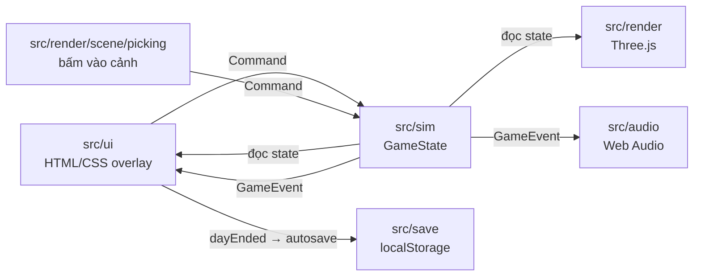
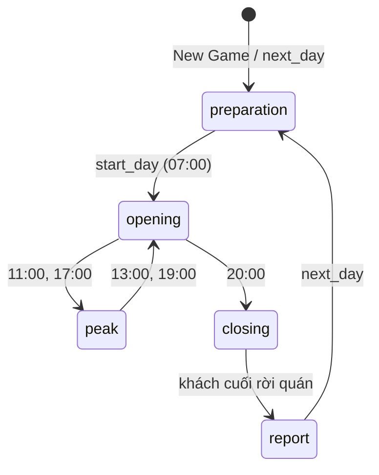
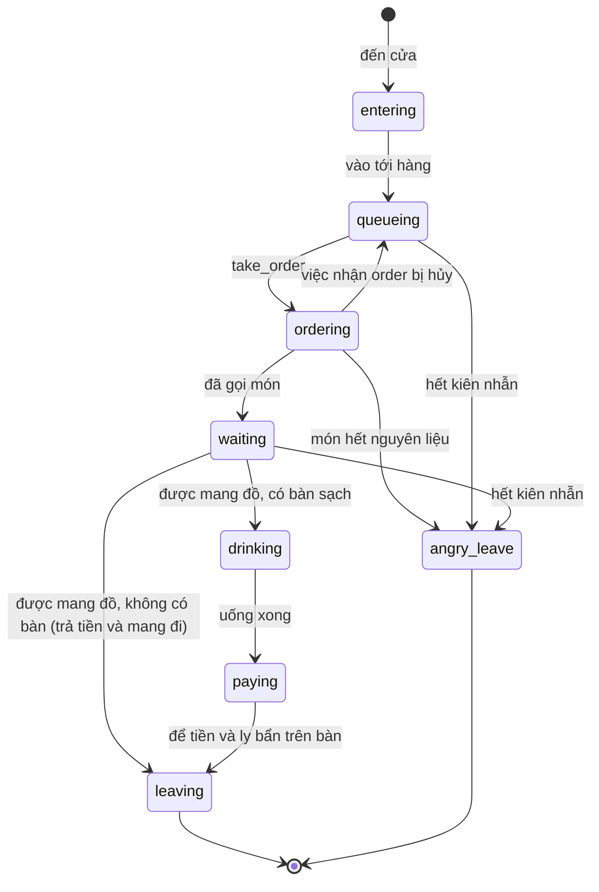

# Kiến trúc

Trang này mô tả cách game chia lớp, các hợp đồng giữa các lớp và định dạng dữ liệu, để thêm tính năng mà không phá vòng ngày đang chạy.

- [Ba lớp](#ba-lớp)
- [Vòng khung hình](#vòng-khung-hình)
- [Hợp đồng Command và GameEvent](#hợp-đồng-command-và-gameevent)
- [Vòng ngày](#vòng-ngày)
- [FSM khách](#fsm-khách)
- [Điều hướng và va chạm](#điều-hướng-và-va-chạm)
- [Save schema](#save-schema)
- [Mẹo hiệu năng](#mẹo-hiệu-năng)

## Ba lớp



| Lớp | Được làm | Không được làm |
| --- | --- | --- |
| `src/sim` | Giữ toàn bộ luật chơi trong `GameState`; `step(state, dtMinutes)` chạy thời gian, `dispatch(state, cmd)` áp lệnh; đẩy sự kiện vào `state.events`. | Import DOM, `three` hay `Math.random`. |
| `src/render` | Đọc `GameState`, vẽ quán, nhân vật, phố; đổi cú bấm trong cảnh thành `Command`. | Sửa state. |
| `src/ui` | Đọc state để vẽ HUD, bảng, màn hình; gửi `Command` qua `shell.dispatch`; hiện toast và tự lưu khi có sự kiện. | Đổi state trực tiếp (trừ `speed`/`paused` khi bắt đầu ván hay đổi cài đặt). |
| `src/audio` | Phát âm thanh theo `GameEvent`. | Đọc hay sửa state. |
| `src/save` | Ghi/đọc `GameState` và cài đặt vào `localStorage`, nâng phiên bản save cũ. | Biết gì về DOM ngoài `StorageLike`. |

| Quy ước | Chi tiết |
| --- | --- |
| `GameState` | JSON thuần (không class, Map hay hàm), nên lưu, so sánh và nhân bản trực tiếp được. |
| Ngẫu nhiên | Mulberry32, trạng thái trong `state.rngState`: cùng state cộng cùng chuỗi lệnh cho ra cùng một ngày. |
| Tiền | Số nguyên đồng (`25000` = 25.000đ). |
| Thời gian | Phút game tính từ nửa đêm (`420` = 07:00). |
| Version | `src/version.ts` (`APP_VERSION`), Vite thay `__APP_VERSION__` bằng `package.json` → `"version"` lúc build; xem [deploy.md](deploy.md#version-và-phát-hành). |

### Icon và font

UI và cảnh 3D không hiển thị emoji; mọi biểu tượng là icon 3D low-poly lấy từ atlas `public/icons3d/atlas@1x.webp`, `public/icons3d/atlas@2x.webp` (vị trí từng ô trong `public/icons3d/atlas.json`), do `npm run icons` dựng (xem [media.md](media.md#icon-3d)). Mỗi icon có hai ô trong cùng atlas:

| Ô | Dùng cho cỡ | Cách vẽ |
| --- | --- | --- |
| 48 px (lưới trên, bảng `icons`) | 32, 48 px; nhãn trong cảnh 3D | Viền mực ~1,7 px, bóng tiếp đất, đủ chi tiết. |
| 24 px (lưới dưới, bảng `smallIcons`) | 16, 24 px | Dải mực phẳng ~1,8 px quanh hình, không bóng, bỏ chi tiết nhỏ hơn ~1,4 px, tăng tương phản; nút chỉ có icon và `i-coin` dùng mô hình đơn giản riêng (`SMALL_MODELS`). |

| Module | Nội dung |
| --- | --- |
| `src/ui/core/icons.ts` | Danh sách id (`ICON_IDS`, theo thứ tự ô trong atlas). `iconCell(id, size)` tính vị trí ô từ số đo lưới trong `atlas.json` (`small` cho lưới 24 px): ô 24 px khi `size` là 16 hoặc 24, ô 48 px khi 32, 48 hoặc bỏ trống; test so từng ô với bảng `icons` và `smallIcons` của file đó. `icon(id, { size })` trả `<span class="ic" data-icon="…" aria-hidden="true" focusable="false">` rỗng; ảnh là nền của ô theo cỡ. Mỗi atlas chỉ `fetch` một lần, thành blob và object URL dùng chung cho CSS và canvas. `watchIconAtlas()` tải ảnh @1x, gán `--ic-atlas: url(…)` lên `<html>`, gắn `html.icons-ready` và đánh dấu `performance.mark('cst:icons')`; lỗi (mạng hay HTTP) thì thử lại một lần khi trình duyệt có mạng lại (`online`). `enableHdIcons()` chỉ chạy trên màn có `devicePixelRatio` > 1: lấy ảnh @2x qua `loadIconAtlas()`, giải mã thêm bằng `.decode()` (ảnh CSS vẽ, khác bản `ImageBitmap`), rồi gán nó vào `--ic-atlas` rồi gắn `html.icons-hd`; lỗi thì giữ @1x. `loadIconAtlas()` trả `ImageBitmap` @2x giải mã bằng `createImageBitmap` từ cùng blob (dùng cho nhãn 3D), `drawIcon()` chép ô 48 px lên canvas. |
| `src/ui/core/iconMap.ts` | Ánh xạ id của sim (món, nguyên liệu, marketing, nâng cấp, pha, vai, lý do review) sang icon. `avatarIcon(staffId)` trả ô `i-avatar-<n>` theo `AVATAR_LOOKS`. Trường `icon` emoji trong `src/sim/data` giữ nguyên nhưng không còn được hiển thị. |
| `src/ui/styles/ui.css` (`.ic`) | Kích thước ô theo class: `.ic` 24 px, `.ic-sm` 16, `.ic-lg` 32, `.ic-xl` 48. Nền theo class trên `<html>` (bảng dưới); `icon()` đặt `--ic-size`, `--ic-pos` theo %, nên ô to nhỏ bao nhiêu cũng vừa. Icon trong nút nảy, nghiêng khi hover và co lại khi nhấn; tắt khi `prefers-reduced-motion`. |
| `src/render/actors/labels.ts` | Nhãn món và mặt cảm xúc trên đầu khách trong cảnh 3D: vẽ bong bóng, rồi `drawIcon()` từ atlas @2x khi ảnh tải xong. `LabelAssets.prebuild()` làm sẵn mọi nhãn trước khi cảnh hiện. |
| `src/ui/core/iconSvg.ts` | Bộ icon SVG phẳng gốc từ `design/t237-cartoon/icons/index.html`; chỉ icon studio dùng để so cũ và mới (bảng `--sheet`, `public/icons3d/svg.json` cho trang xem icon), game không import. |

Thứ tự tải atlas (`src/main.ts`):

| Lúc | Việc | Ô `.ic` hiện |
| --- | --- | --- |
| Đầu `start()` (Main Menu hiện) | | Ô chờ: nền mờ `--surface-icon-wait`, không viền, bo `--radius-sm`, đứng yên |
| Menu đã vẽ (`afterPaint()`) | Xin chunk `import('./render/scene')`, ngay sau đó `watchIconAtlas()` fetch `atlas@1x.webp`, `priority: 'low'` | Vẫn ô chờ |
| @1x tải xong (`--ic-atlas`, `html.icons-ready`) | | Ô của atlas @1x |
| Sau `performance.mark('cst:world')`, màn 2x | `enableHdIcons()` fetch `atlas@2x.webp` | Vẫn @1x tới khi @2x tải xong |
| @2x tải xong (`--ic-atlas`, `html.icons-hd`) | | Ô của atlas @2x |

Mỗi atlas qua `atlasFile()`: một `fetch`, rồi blob và `URL.createObjectURL`; `--ic-atlas` nhận thẳng object URL đó (không tải qua `Image()`), nhãn 3D giải mã cùng blob bằng `createImageBitmap`. Fetch lỗi thì bỏ khỏi bộ nhớ đệm để lần sau xin lại. Nếu @2x về trước @1x (`html.icons-hd` đã có), @1x chỉ thêm `html.icons-ready`, không ghi đè `--ic-atlas`. Màn 1x không tải @2x cho UI; nhãn 3D vẫn tải @2x khi cảnh cần, dùng chung lần fetch với UI. Ô có sẵn kích thước trước khi atlas tải xong, nên layout không nhảy; không preload atlas, Main Menu không chờ ảnh. Atlas @1x tải song song với chunk cảnh nhưng ưu tiên thấp hơn, để về trước khi cảnh 3D bắt đầu vẽ; @2x không tranh băng thông với chunk cảnh. CSS không chứa URL atlas nào; URL trong JS tương đối (`icons3d/…`), đúng với `base: './'`.

Atlas bậc nâng cấp (`tiers`) là atlas thứ hai, chỉ bảng Nâng cấp dùng:

| Phần | Chi tiết |
| --- | --- |
| File | `public/icons3d/tiers@1x.webp`, `public/icons3d/tiers@2x.webp`, `public/icons3d/tiers.json` (`TIER_ATLAS_URLS`). Dựng bằng `npm run icons -- --set tiers`; lệnh luôn vẽ lại cả atlas này, không nhận `--only` hay `--sheet`, không đụng atlas chính. |
| Ô | Bậc 2 và 3 của mỗi icon trong `UPGRADE_ICONS`, id `<id>-t2`, `<id>-t3`; nâng cấp dùng chung icon thì dùng chung ô (biển neon, kệ sách, máy hát đĩa, góc sofa mượn icon đèn, quầy bar cửa sổ, tranh, bàn ghế) (`TIER_IDS`, `tierIconId` trong `src/icon-studio/atlas.ts`; mô hình ở `src/icon-studio/models/tiers.ts`). Bậc 1 là icon của atlas chính. |
| `loadTierAtlas()` | `renderUpgradesPanel` gọi khi mở bảng Nâng cấp. Lần đầu `fetch` `tiers.json` và ảnh @1x (@2x khi `<html>` đã có `icons-hd`), giải mã, gán `--ic-tiers` (`TIER_ATLAS_VAR`) lên `<html>`. Đã tải @1x mà sau đó `enableHdIcons` thêm `icons-hd` thì tải @2x đúng một lần rồi đổi `--ic-tiers` (`upgradeTierAtlas`); @2x lỗi thì giữ @1x. Lỗi thì giữ icon bậc 1 và thử lại ở lần gọi sau. `tiers.json` được `fetch`, không import, nên chunk chính không chứa nó. |
| `tierIcon(id, tier, opts)` | Như `icon()`; bậc 2–3 khi atlas `tiers` đã tải thì đổi ô sang `<id>-t<n>` và gắn `data-atlas="tiers"` (`ui.css` vẽ bằng `--ic-tiers`). Icon vẽ lúc atlas đang tải hiện bậc 1 rồi tự đổi khi tải xong, kích thước ô không đổi. |

Thêm icon:

1. Thêm id vào `ICON_IDS` trong `src/ui/core/icons.ts`.
2. Dựng mô hình trong `src/icon-studio/models/` và khai vào `ICON_MODELS` (các bước ở [media.md](media.md#thêm-icon)).
3. Chạy `npm run icons -- --only <id>` để vẽ hai ô mới vào atlas.
4. Dùng `icon('<id>')` trong UI, hoặc nối id của sim trong `iconMap.ts`.

Font chữ:

- Nunito từ `@fontsource/nunito` (SIL OFL 1.1, xem [THIRD_PARTY_NOTICES.md](../THIRD_PARTY_NOTICES.md)), import trong `src/main.ts`.
- Chỉ subset `latin` và `vietnamese`, weight 400 và 700; 600 và 800 hiển thị bằng 700.
- `@font-face` dùng `font-display: swap`, không preload: Main Menu vẽ bằng font hệ thống rồi đổi sang Nunito khi tải xong.
- Token `--font-family-base` nằm ở `src/ui/styles/tokens.css`.

## Vòng khung hình

`src/main.ts` chạy mỗi `requestAnimationFrame`:

1. `step(game, dt × 2 × game.speed)`: 1 giây thật ở 1x là 2 phút game (một ngày khoảng 7 phút). `dt` bị chặn ở 0,1 s để tab nền không tua nhanh.
2. Sim chạy tick cố định 1 phút game; tối đa `MAX_TICKS_PER_STEP` = 240 tick mỗi lần gọi. Phần lẻ còn lại nằm trong `state.tickAccumulator`.
3. `world.update(game, game.tickAccumulator)`: render nội suy vị trí giữa hai tick bằng `alpha`.
4. `shell.update()`: HUD, bảng đang mở và Daily Report cập nhật DOM qua `Watcher` (chỉ chạm DOM khi giá trị đổi).
5. `audio.handleEvents(events)`, `fresh.handleEvents(events)` rồi `shell.handleEvents(events)`; sau đó xóa `game.events`. `fresh` giữ id món và nâng cấp vừa mở ([Lên cấp, bậc nâng cấp và mục mới](#lên-cấp-bậc-nâng-cấp-và-mục-mới)).

Thân khung bọc trong `guardFrame` (`src/ui/core/startup.ts`): một bước throw thì lỗi đầu tiên của chuỗi khung lỗi được ghi ra console, khung sau vẫn được hẹn, game không đứng hình. Các bước 3–5 chạy qua `runEvents`: mỗi bước chạy riêng, rồi `game.events` luôn được xoá kể cả khi một bước throw, nên không event nào bị xử lý lại ở khung sau (không autosave, toast hay âm thanh lặp).

Thứ tự trong một tick: đồng hồ và pha → khách mới đến (trừ pha đóng cửa) → việc của người chơi → nhân viên (kèm kinh nghiệm, `onStaffTick`) → khách → hạn đơn đặc biệt (`tickSpecialOrders`) → ghi trải nghiệm và review → nếu đang đóng cửa và quán trống thì kết thúc ngày.

### Camera

`CameraController` (`src/render/scene/camera.ts`) giữ hai tư thế: `target` (đích của input) và `current` (đang vẽ). Mỗi khung `update(dt)`, `dt` bị chặn ở `MAX_CAMERA_DT` = 0,1 s:

| Input | Cách chạy |
| --- | --- |
| Kéo chuột | Xoay `DRAG_ROTATE_SPEED` rad/px. Lúc kéo, vận tốc được làm mượt; thả ra thì camera trôi tiếp với vận tốc đó (tối đa `MAX_INERTIA` = 4 rad/s), giảm dần theo `INERTIA_DECAY`. Bấm vào cảnh dừng ngay. Không trôi khi Giảm chuyển động bật (cài đặt `reducedMotion` là `reduce` hay `prefers-reduced-motion`). |
| Phím xoay, phím pan, pan mép màn | Tăng tốc và giảm tốc theo `KEY_RAMP`, không bật tắt đột ngột. |
| Bám đích | `current` đuổi theo `target` bằng `dampMoving` (`ROTATE_DAMPING`, `ZOOM_DAMPING`, `PAN_DAMPING`), nên chuyển động giống nhau ở mọi tốc độ khung hình. |
| Lăn chuột (zoom) | Zoom trong `minZoom`–`MAX_ZOOM` (2,5). `minZoom` là `MIN_ZOOM` (0,6), hoặc nhỏ hơn khi quán (`ShopView.extent` qua `setBounds`, cộng 1 đơn vị mỗi bên) không lọt khung hình ở 0,6 từ mọi góc xoay (`fitZoom`, tính lại khi đổi cỡ khung): quán cấp 4 trên điện thoại dọc. |

Tâm xoay chỉ pan trong `extent` nới thêm 6 đơn vị mỗi bên. **Đặt lại camera** về góc, độ cao và zoom 1 mặc định, tâm ở giữa tòa nhà (phòng chính cộng khu mở rộng, `ShopView.center`).

Tốc độ xoay theo cài đặt `cameraRotateSpeed` (Cài đặt → Tốc độ xoay camera): `ROTATE_SPEED_SCALE` nhân `KEY_ROTATE_SPEED` và `DRAG_ROTATE_SPEED` với 0,6 (`slow`), 1 (`normal`) hay 1,5 (`fast`); `world.setCameraRotateSpeed()` đổi ngay khi chơi.

## Hợp đồng Command và GameEvent

Kiểu đầy đủ ở `src/sim/types.ts`. `dispatch` trả `false` khi lệnh không áp dụng được lúc đó (sai pha, sai id, thiếu tiền…); UI dùng giá trị này thay vì tự kiểm luật.

| Command | Khi nào |
| --- | --- |
| `start_day` | Chuẩn bị → mở cửa. |
| `next_day` | Từ báo cáo sang ngày mới (pha `preparation`). Tuần đã chấm điểm (`week.result`) thì mở luôn tuần tiếp theo. |
| `set_menu_item` | Bật/tắt món. Giá món cố định theo dữ liệu menu; bật món chưa mở khóa (theo cấp quán hay lịch tuần) trả `false`. |
| `buy_ingredient`, `apply_restock` | Nhập hàng theo gói, hoặc theo gợi ý nhập tự động. `apply_restock` mua từng dòng gợi ý theo thứ tự danh mục, bỏ dòng không đủ tiền và gửi `notify` "Thiếu X đ để nhập …" kèm tên các nguyên liệu bị bỏ; mỗi dòng mua được phát một `spend`. Không đủ tiền (kể cả đang âm) vẫn mua chịu được 1 gói của nguyên liệu dưới mức cảnh báo (`canBuyOnCredit`); `apply_restock` cắt dòng đó còn 1 gói (`restockPlan`); nút "Gợi ý" của bảng Kho điền số gói theo cùng `restockPlan`, dòng không chịu được giữ nguyên cỡ gợi ý để hint nêu tên. Quán bị lương đẩy xuống âm với kho trống vì vậy vẫn mở bán được. |
| `hire_staff`, `fire_staff`, `assign_role`, `set_auto_assign` | Nhân viên. `hire_staff` trả `false` khi đội đã đủ `maxStaff(state)`. `fire_staff` sau khi mở cửa (pha `opening`, `peak`, `closing`) vẫn ghi lương ngày đó (đã nhân mức lương) vào `today.firedWages`; `settleDay` trả cùng lương cả đội. |
| `train_staff` | Đào tạo một nhân viên lên cấp kế tiếp (`trainStaff`). Chỉ trong pha `preparation`, cần đủ kinh nghiệm, tiền và Tem; không được thì trả `false` kèm `notify` lý do từ `canTrain` ([Nhân viên: đặc điểm và cấp](#nhân-viên-đặc-điểm-và-cấp)). |
| `claim_daily_gift` | Nhận quà ngày (`claimDailyGift`), mọi pha. `dateKey` là ngày trên máy `'YYYY-MM-DD'` do UI gửi; đã nhận hôm nay, ngày sai hay lùi lại thì trả `false` kèm `notify` ([Quà ngày, Tem và thành tựu](#quà-ngày-tem-và-thành-tựu)). |
| `buy_upgrade`, `start_campaign` | Nâng cấp, marketing. Mua nâng cấp chưa mở khóa (theo cấp quán hay lịch tuần) trả `false`. |
| `remove_decor` | Gỡ 1 cấp trang trí không có chỗ ngồi (cây, tranh, đèn, biển neon, kệ sách, máy hát đĩa, góc sofa), hoàn 50% tiền cấp đó; cấp 0 hay món không gỡ được trả `false`. |
| `set_policy` | Đặt quyết định giá hay lương (`low` / `standard` / `high`). Chỉ trong pha `preparation`; pha khác trả `false` kèm `notify`. |
| `set_speed`, `set_paused` | Nhịp game. |
| `take_order`, `brew`, `deliver`, `collect_cash`, `clean_table` | Người chơi tự phục vụ (từ cảnh 3D). |

| GameEvent | Ai dùng |
| --- | --- |
| `doorbell`, `brew`, `cash`, `angry`, `served`, `cleaned` | Âm thanh, hiệu ứng trong cảnh; `served`/`angry` còn sinh review. |
| `notify`, `low_stock`, `review` | Toast. |
| `spend` | Toast; `kind: 'upgrade'` còn phát âm `upgrade`. Phát mỗi lần trừ tiền thành công khi nhập một nguyên liệu (`restock`), mua nâng cấp (`upgrade`) hay chạy marketing (`campaign`); kèm `label` (tên; nâng cấp ghi thêm cấp mới, ví dụ "Máy pha lên cấp 2"), `amount` và `moneyLeft` (tiền còn lại). Đây là thông báo duy nhất của giao dịch, không kèm `notify` thành công. Giao dịch bị từ chối không phát. |
| `level_up` | Quán lên cấp lúc `closeDay`; kèm `level` mới và `unlocks` (món, nâng cấp, dụng cụ mới mở). Toast, âm `levelup`, `fresh`. |
| `week_unlocks` | Sáng ngày trong tuần có mở khóa theo lịch; kèm `day` (ngày trong tuần) và `unlocks`. Toast, `fresh`. |
| `phase` | Đổi pha trong ngày. |
| `dayEnded` | Báo cáo đã nằm trong `state.lastReport`; shell tự lưu vào slot `auto` và chuyển kết quả cho Daily Report. |
| `week_ended` | Ngày 7 của tuần vừa đóng, ngay sau `dayEnded`; kèm `result` (cũng nằm trong `state.week.result`). |
| `staff_promoted` | `train_staff` thành công; kèm `staffId` và `level` mới. Toast. |
| `gift_claimed` | `claim_daily_gift` thành công; kèm `streak` (ngày 1–7 của chuỗi), `money`, `tickets`. Toast. |
| `tickets_earned` | Mỗi lần cộng Tem; kèm `amount`, `total` (số dư sau khi cộng) và `reason` (`gift`, `achievement`, `special_order`, `vip`). Không có toast riêng: toast của quà, thành tựu, đơn đặc biệt và VIP cùng khung đã ghi số Tem. |
| `achievement_unlocked` | Lúc `closeDay`, mỗi mốc thành tựu mới đạt; kèm `id` và `tier` (1–3). Toast. |
| `special_order` | Đơn đặc biệt xong (`status: 'completed'`, lúc giao đủ) hoặc hụt (`failed`, quá hạn hay hết ngày); kèm `itemId`. Toast. |
| `vip_arrived` | Khách VIP vào cửa, ngay sau `doorbell`; kèm `customerId`. Toast. |

Thêm tính năng mới: thêm biến thể vào `Command`, xử lý trong `dispatch` (`src/sim/index.ts`), viết test ở `tests/sim/`, rồi mới nối UI. UI cần biết chuyện gì vừa xảy ra thì thêm biến thể `GameEvent` thay vì so sánh state giữa hai khung hình.

## Vòng ngày



| Pha | Đồng hồ | Việc chính |
| --- | --- | --- |
| `preparation` | Dừng ở 07:00 | Bảng chuẩn bị ở dock giữa đáy; nút **Mở cửa** trên HUD. |
| `opening` | Chạy | Khách đến theo tốc độ cơ bản. |
| `peak` | Chạy | Khách đến nhiều hơn. |
| `closing` | Chạy | Không nhận khách mới. |
| `report` | Dừng | `closeDay` đã trả lương, cập nhật rating, chấm nhiệm vụ ngày, cộng XP và lên cấp, dựng `DailyReport`, chốt đơn đặc biệt và chấm thành tựu; UI hiện Daily Report (`src/ui/report`). |

Khi quán trống trong pha `closing`, sim gom tiền trên bàn, dọn bàn, gọi `closeDay` (`src/sim/report.ts`) rồi phát `dayEnded`. Thứ tự trong `closeDay`:

1. `settleDay` (ghi giá vốn, trả lương), `updateRating`, `scoreProgression` (nhiệm vụ, XP, lên cấp), dựng `DailyReport` vào `state.lastReport`.
2. Ngày cuối tuần: `scoreWeek`, `summarizeWeek`, `grantWeekReward`.
3. `endOfDayStaffGrowth`: chưa làm gì (cấp chỉ lên khi đào tạo).
4. `endOfDaySpecialOrder`: đơn còn `active` thành `failed`, chép đơn vào `report.specialOrder`, xóa `state.specialOrder`.
5. `endOfDayRetention`: cộng ngày vào `retention.lifetime`, chấm thành tựu, ghi `report.achievements`. Chạy sau bước 2 nên tuần 3 cúp được tính ngay tối ngày 7.

`next_day` đẩy `state.today` vào `state.history` (giữ `HISTORY_DAYS` = 28 ngày gần nhất), tăng ngày, chọn thời tiết mới, chạy tiếp chiến dịch marketing, phân vai nhân viên và rút nhiệm vụ mới cho ngày mới. Ván có tuần thì trong tuần 1, sáng ngày có mở khóa phát `week_unlocks`; sáng ngày 7 tặng cấp 1 Mở rộng diện tích nếu quán chưa có. Tối ngày 7 mỗi tuần, `closeDay` chấm điểm tuần vào `state.week.result`, thêm một dòng vào `state.week.archive` và sim phát `week_ended`; `next_day` sau đó mở tuần tiếp theo ([Mục tiêu tuần](spec/week-7-days.md#mục-tiêu-tuần)).

### Cấp quán và nhiệm vụ

Hệ cấp quán ở `src/sim/progression.ts` và bảng cấp `src/sim/data/levels.ts`:

| Khái niệm | Chi tiết |
| --- | --- |
| Cấp (`state.shopLevel`, 1–10) | Cấp 1–6 mở thêm món và nâng cấp, tới cấp 6 (`FULL_UNLOCK_LEVEL`) đủ 11 món và 18 trong 19 nâng cấp; góc sofa mở ở cấp 8, mọi cấp 7–10 khác không mở gì mới. Mỗi cấp 7–10 nâng trần một số nâng cấp lên 1 (`maxLevelBonus`): 7 máy cao cấp + máy xay hạt + mở rộng diện tích (cấp 3), 8 bàn ghế + tủ bánh, 9 đèn + máy sinh tố + mở rộng diện tích (cấp 4), 10 máy cao cấp + máy rửa ly. Mỗi cấp mở rộng thêm một cột 3 bàn vào khu mở rộng, khu rộng thêm 2 đơn vị (`expansionArea`). `maxUpgradeLevel(state, id)` = `maxLevel` + phần cộng; cấp vượt `maxLevel` đắt gấp `BONUS_LEVEL_PRICE_MULT` (3) lần ([báo cáo](reports/p23-long-economy.md)). Nhóm `tools` là 5 dụng cụ (`grinder`, `pastry_case`, `blender`, `ice_maker`, `dishwasher`), cũng là nâng cấp `category: 'equipment'` và mở khóa, mua như nâng cấp khác. `isUnlocked(state, kind, id)` trả `true` khi cấp hiện tại đạt cấp mở khóa, hoặc khi ván có `state.week` và ngày trong tuần 1 đã tới ngày mở theo lịch (từ tuần 2 cả lịch đã mở) ([spec/week-7-days.md](spec/week-7-days.md)). |
| Tuần (`state.week`) | Ván mới chơi liên tục từng tuần 7 ngày; tuần 1 mở khóa thêm theo lịch `WEEK_UNLOCKS` ([Tuần 7 ngày](#tuần-7-ngày)). Save không có `week` chỉ mở khóa theo cấp. |
| XP (`state.xp`) | Mỗi khách phục vụ +2, mỗi review 4–5 sao trong ngày +6, mỗi nhiệm vụ hoàn thành cộng thưởng XP; tổng nhân `xpMult` của độ khó (Dễ 1,25 · Vừa 1 · Khó 0,8). Cộng lúc `closeDay`; qua ngưỡng `xpToReach` (cấp 2–10: 1100, 3500, 7000, 12000, 19000, 27000, 37000, 49000, 63000) thì lên cấp và phát `level_up`. Mốc thiết kế: chiến lược mẫu ở Vừa lên cấp 2 vào ngày 2–4, cấp 6 vào ngày 20–35 (`tests/integration/level-balance.test.ts`). |
| Nhiệm vụ ngày (`state.missions`) | 3 nhiệm vụ rút từ pool 6 loại bằng hash(`seed`, `day`) — không rút từ `rngState`, nên cùng seed ra cùng nhiệm vụ. Mục tiêu N theo cấp. Chấm lúc `closeDay`; nhiệm vụ xong thưởng 50–70 XP và 80.000–120.000 đ. Kết quả nằm trong `DailyReport` (`missions`, `xpGained`, `levelUp?`). Ngày không có khách thì không nhiệm vụ nào tính; `food_cost` cần có doanh thu mới tính đạt. |
| Tiến độ nhiệm vụ | `missionProgress(state, mission)` trả `{ value, ratio, met }` từ số liệu đang chạy của ngày: `value` theo đơn vị nhiệm vụ, `ratio` 0..1 cho thanh tiến độ (nhiệm vụ "đạt tối thiểu" là `value / target`; nhiệm vụ "giữ dưới ngưỡng" là 1 khi còn trong ngưỡng, giảm khi vượt), `met` là kết quả nếu ngày kết thúc lúc đó. Hàm thuần, `closeDay` chấm bằng chính hàm này. Chỉ đọc trường có giá trị trong ngày: `food_cost` = `ingredientCostUsed(state)` / doanh thu, `value` là `null` (UI ghi "Chưa đủ dữ liệu") khi chưa có doanh thu; `end_rating` = `nextRating(state, today.ratingStart)`, đúng số `updateRating` ghi lúc chốt ngày. |

### Tuần 7 ngày

Mọi ván mới chơi liên tục từng tuần 7 ngày, mỗi tuần có sự kiện, thời tiết, mục tiêu và chấm điểm; tuần 1 có thêm lịch mở khóa. Luật và con số ở [spec/week-7-days.md](spec/week-7-days.md); code ở `src/sim/week.ts` và `src/sim/data/week.ts`.

| Phần | Chi tiết |
| --- | --- |
| `state.week` (`WeekState`) | `length` (7), `index` (tuần thứ mấy, từ 1; `weekIndex(state)` coi thiếu là 1), `startedDay`, `plan` (7 `DayPlan`: `day`, `weather`, `event`), `goal` (`WeekGoal`: `revenue`, `stars`), `result?` (`WeekResult` của tuần vừa xong), `archive?` (`WeekSummary[]`, một dòng mỗi tuần đã xong). `createNewGame` điền tuần 1, chưa có `result` và `archive`. Ngày trong tuần `weekDay(state)` = `state.day − startedDay + 1`. |
| Lịch sự kiện | `rollWeekPlan(seed, weekIndex)` rút từng ngày từ hash(`seed`, tuần, ngày, lần rút), không đọc hay đổi `state.rngState`: cùng seed luôn ra cùng lịch cho từng tuần, dù người chơi làm gì. Tuần 1 dùng thẳng `seed` nên giữ lịch cũ. Tuần sai luật (`isValidWeekPlan(plan, weekIndex)`) rút lại; 64 lần không được thì dùng `FALLBACK_PLAN`. |
| Mục tiêu | `weekGoal(difficulty, index)`: tuần 1 là `WEEK_GOALS`, sau đó doanh thu +60%/tuần, trần ×3. |
| Thưởng cúp | Tuần được ≥ 2 cúp: `closeDay` gọi `grantWeekReward` cộng `weekReward(difficulty, cups)` (`WEEK_REWARDS`) vào tiền, phát `notify` và ghi lại `money` của báo cáo ngày. |
| Sang tuần mới | `next_day` khi có `result`: tạo tuần `index + 1` bắt đầu từ ngày mới, `plan` và `goal` theo index mới, giữ `archive`. |
| Thời tiết | `startNextDay` vẫn gọi `rollWeather` (giữ nguyên chuỗi RNG), rồi ghi đè `state.weather` bằng thời tiết của `plan`. |
| Hệ số sự kiện | `dayArrivalMult` nhân vào `arrivalRate` (`customers.ts`); `dayIngredientPriceMult` nhân vào `effectiveUnitPrice` (`inventory.ts`), nên đổi cả giá mua gói lẫn giá vốn phần làm ra. Hệ số ở `DAY_EVENTS`. |
| Mở khóa | `isUnlocked` trả `true` khi cấp quán đạt cấp mở, hoặc trong tuần 1 `weekDay` ≥ `dayUnlockDay(kind, id)` theo `WEEK_UNLOCKS`, hoặc từ tuần 2 món có trong lịch. Sáng ngày tuần 1 có mở khóa, `next_day` phát `week_unlocks`. |
| Mở rộng ngày 7 | Sáng ngày 7 tuần 1 (`expandShop`) mà `expand_area` còn cấp 0: `grantUpgradeLevel` lên cấp 1 không trừ tiền, phát `notify` "Quán mở rộng!". |
| Chấm điểm | Tối ngày cuối (`isLastWeekDay`), `closeDay` gọi `scoreWeek` lưu vào `state.week.result` và `summarizeWeek` thêm dòng vào `state.week.archive`; `endOfDay` phát `week_ended` sau `dayEnded`. Điểm = `weekScore` (60 phần doanh thu + 40 phần sao, mỗi phần chặn ở mục tiêu); cúp = `weekCups` (≥ 90 → 3, ≥ 70 → 2, ≥ 40 → 1). |
| UI | Cụm Hôm nay của HUD ghi "Ngày N" (`state.day`) trên dòng "Tuần T · d/7" (`weekLineLabel`; save không có `week` chỉ hiện "Ngày N"), icon thời tiết và chip sự kiện khi khác Ngày thường (`src/ui/hud/hud.ts`); bảng Việc có khối Hôm nay (`weekTodayLines` trong `src/ui/panels/tasks.ts`); `week_unlocks` và `week_ended` thành toast. Báo cáo ngày cuối tuần đổi nút chính thành **Xem tổng kết tuần**, ghi "Gợi ý cho tuần sau" và bỏ link mở bảng ở tab Chỉ số; nút chính mở màn Tổng kết tuần (`src/ui/screens/weekEnd.ts`): điểm, cúp, thưởng (`weekReward`), doanh thu và sao so mục tiêu, so với tuần trước (`weekCompare`, ẩn ở tuần 1), cột doanh thu 7 ngày đánh dấu `bestDay`, mục tiêu tuần tới (`weekGoal`) và cấp quán tiếp theo. **Sang tuần N+1** (nút chính) dispatch `next_day` rồi đóng màn; **Chơi lại** cần bấm 2 lần (lần đầu đổi nhãn thành "Bấm lần nữa để bỏ ván" trong `REPLAY_CONFIRM_MS`) rồi tạo ván mới cùng tên quán và độ khó, seed mới; **Về menu** và `Esc` về Main Menu. Dưới 480 px bảng so với tuần trước thành danh sách: nhãn, tuần này, Δ. |

### Nâng cấp và dụng cụ

14 nâng cấp và 5 dụng cụ ở `src/sim/data/upgrades.ts`; mỗi loại có `category` (`equipment` / `space` / `decor`) và `effectPerLevel`. `totalUpgradeEffect(state.upgrades)` cộng dồn hiệu ứng mọi cấp đã mua:

| Trường hiệu ứng | Tác dụng trong sim | Áp ở |
| --- | --- | --- |
| `capacity` | Thêm chỗ ngồi (thêm bàn vào bố cục) | `upgrades.ts` (`addTables`) |
| `appeal` | +% khách đến | `customers.ts` |
| `foodAppeal` | +% khách gọi món ăn và mua kèm món ăn | `customers.ts` (`pickOrder`, `maybeAddOn`) |
| `brewSpeed` | Pha mọi món nhanh hơn | `orders.ts` (`brewSpeedFor`) |
| `coffeeBrewSpeed` | Pha đồ cà phê nhanh hơn | `orders.ts` |
| `coldBrewSpeed` | Pha đồ lạnh nhanh hơn | `orders.ts` |
| `foodBrewSpeed` | Làm món ăn nhanh hơn | `orders.ts` |
| `cleanSpeed` | Dọn bàn nhanh hơn | `orders.ts` (`cleanMinutes`) |
| `iceCostReduction` | Giảm chi phí đá cho đồ lạnh | `inventory.ts` |
| `ratingBonus` | +sao cộng vào mỗi đơn | `reviews.ts`, `rating.ts` |

Dụng cụ (`grinder`, `pastry_case`, `blender`, `ice_maker`, `dishwasher`) là nâng cấp `category: 'equipment'`; chúng chỉ khác ở chỗ `LEVELS.tools` liệt kê riêng để UI xếp vào nhóm Dụng cụ. Mua một cấp gọi `buyUpgrade`; cấp có `capacity` thì thêm bàn và chạy `relayoutTables`. Ở Vừa, cấp 1 của mỗi dụng cụ hoàn vốn trong ≤ 15 ngày (`tests/integration/level-balance.test.ts`). Trong tuần 7 ngày mọi dụng cụ mở muộn nhất ngày 5 (`WEEK_UNLOCKS`); máy làm đá (ngày 2, giá gốc 60k) và máy rửa ly (ngày 4, giá gốc 400k) hoàn vốn trong tuần ở Dễ (`tests/sim/week-tool-payback.test.ts`: máy làm đá lãi ở mọi seed, máy rửa ly lãi trung bình ở Dễ và lãi ít nhất một seed ở Thường).

Nội thất (`category: 'decor'`, `appeal` và `ratingBonus` nhỏ):

| Nội thất | Cấp quán mở | Cấp tối đa | Chỗ đặt (`DECOR_SLOTS`) | Tem mỗi cấp (`ticketCost`) |
| --- | --- | --- | --- | --- |
| `neon_sign` Biển neon | 3 | 2 | Tường trước, hai bên cửa | — |
| `bookshelf` Kệ sách | 4 | 2 | Sát tường trái cạnh quầy | — |
| `record_player` Máy hát đĩa | 6 | 1 | Đầu phải quầy sau | 3 |
| `sofa_corner` Góc sofa | 8 | 1 | Tường sau khu mở rộng; cần `expand_area` ≥ 1 | 5 |

`buyUpgrade` từ chối theo thứ tự: cấp tối đa, thiếu nâng cấp cần trước (`upgradeBlockedReason`, ví dụ góc sofa khi chưa mở rộng), thiếu tiền, thiếu Tem (`notify` "Thiếu N Tem"). Đủ thì trừ tiền và trừ Tem ở `ensureRetention(state).tickets`; nâng cấp không có `ticketCost` không đụng tới `state.retention`. UI đọc giá Tem của cấp kế tiếp bằng `nextUpgradeTicketCost(state, id)` (0 khi không cần, `null` ở cấp tối đa).

Gỡ trang trí (`removeDecor`) áp cho mọi `decor` không có `capacity` (`isRemovableDecor`): cây, tranh, đèn và 4 nội thất trên; `window_bar` có bàn nên không gỡ được. Gỡ giảm 1 cấp, hoàn `DECOR_REFUND_SHARE` = 50% tiền của cấp đó theo `priceMult`, không hoàn Tem. `appeal`, `ratingBonus` và chỗ đặt trong `layout.decor` giảm theo cấp.

Mở rộng diện tích (`expand_area`, `category: 'space'`) có 4 cấp: `maxLevel` 2, cấp 3 mở ở cấp quán 7 và cấp 4 ở cấp quán 9 (`maxLevelBonus`), giá cấp 3–4 nhân `BONUS_LEVEL_PRICE_MULT`. Mỗi cấp thêm một cột 3 bàn vào khu `expansion` (`zoneTablePosition`) và nới khu thêm 2 đơn vị (`expansionArea`). Cấp 3 và 4 mỗi cấp thêm 1 chỗ nhân viên: `maxStaff(state)` = `BASE_MAX_STAFF` (6) + số cấp trên 2, tối đa `TOP_MAX_STAFF` (8). Giá từng cấp: [spec/p27-retention.md](spec/p27-retention.md#mở-rộng-diện-tích).

### Lên cấp, bậc nâng cấp và mục mới

Phản hồi khi quán tiến bộ nằm ở render và UI, sim không đổi; save giữ `SAVE_VERSION` 3 vì bậc tính lại từ `state.upgrades`, còn mục "Mới" không vào save.

`upgradeTier(id, level)` (`src/sim/data/upgrades.ts`) là bậc hình 0–3 của một nâng cấp: 0 khi chưa mua, còn lại `min(UPGRADE_TIERS, ceil(level / ceil(maxLevel / UPGRADE_TIERS)))` với `UPGRADE_TIERS` = 3; cấp vượt `maxLevel` (thưởng cấp quán) giữ bậc 3. `getShopLayout` ghi bậc vào `ShopLayout`:

| Trường | Bậc của |
| --- | --- |
| `machines[].tier` | `better_machine` cho máy `espresso` và `fast`; nâng cấp của chính nó cho 5 dụng cụ |
| `counter.tier` | `big_counter` |
| `furnitureTier` | `tables` (bàn, ghế) |
| `outdoorTier` | `outdoor_seating` (dù) |
| `decorTier` | Mỗi `DecorKind`: `plants`, `paintings`, `lights`, `neon_sign`, `bookshelf`, `record_player`, `sofa_corner` theo `plant`, `painting`, `light`, `neon`, `bookshelf`, `record_player`, `sofa` |
| `windowBarTier` | `window_bar`; cảnh 3D không có vật thể riêng cho nâng cấp này |

| Phần | Module | Cách chạy |
| --- | --- | --- |
| Máy và quầy theo bậc | `src/render/scene/equipment.ts` | `machineGeometry(m)` và `counterGeometry(width, level, tier)` dựng một mesh gộp theo bậc: bậc 0 vẽ như bậc 1 (hình gốc), bậc 2 thêm chi tiết chức năng và đế thép, bậc 3 đế vàng và huy hiệu sao vàng. Màu máy pha vẫn theo `quality`. `ShopView` dựng lại khi chữ ký máy hay quầy (có bậc) đổi. |
| Bàn ghế, dù, trang trí theo bậc | `src/render/scene/shop.ts` | `TIERED_GEOMETRY` (`table`, `chair`, `parasol`, `plant`, `painting`, `lamp`, `bulb`, `neon`, `neonTube`, `bookshelf`, `recordPlayer`, `sofa`) có hình cho từng bậc 1–3, cùng ngôn ngữ thép/vàng. Kệ sách, sofa và máy hát dựng theo `BOOKSHELF_SIZE`, `SOFA_SIZE`, `RECORD_PLAYER_MARGIN` của footprint. Biển neon treo bằng hai dây ngay trong tường trước (vẫn thấy khi tường hạ); bảng và ống neon là hai `InstancedMesh`, ống dùng `GLASS_MATERIAL`. Mỗi (vật, bậc) dựng một lần khi cần và giữ tới khi `ShopView` hủy; đổi bậc chỉ trỏ `InstancedMesh` sẵn có sang geometry khác (`setTier`), số mesh và draw call không đổi. Mỗi bậc không quá 1,6 lần số tam giác của bậc 1. |
| Lấp lánh và nảy khi mua | `src/render/scene/upgradeFx.ts` | `UpgradeFx.update(state, time)` chạy sau `ShopView.update` mỗi khung. Lần gọi đầu, và lần đầu sau khi đổi sang object state khác (tải save, ván mới), chỉ ghi mốc cấp của mọi nâng cấp; sau đó chỉ cấp tăng mới bắn. Mỗi lần bắn: `SPARKLES` (32, mức Thấp `SPARKLES_LOW` = 12) hạt sao vàng trong `SPARKLE_SECONDS` (0,9 s) tại `ShopView.upgradeAnchor(id)`; máy và quầy còn nảy (`bounceScale`, `BOUNCE_SECONDS` = 0,45 s), đồ instanced chỉ lấp lánh. Mọi lần bắn dùng chung một `Points` và `Pool` tối đa `MAX_BURSTS` (3); lần thứ 4 lấy lại lần cũ nhất, khung hình không cấp phát. Giảm chuyển động (cài đặt hay `prefers-reduced-motion`) thì không bắn. |
| Icon theo bậc | `src/ui/core/icons.ts`, `src/ui/panels/upgrades.ts` | Mỗi hàng Nâng cấp vẽ `tierIcon(UPGRADE_ICONS[id], upgradeTier(...))` từ atlas `tiers` ([Icon và font](#icon-và-font)). Dòng phụ thêm `tierText`: "Bậc n/3", và "mua để lên bậc n+1" khi cấp kế tiếp đổi bậc. |
| Thẻ lên cấp | `src/ui/report/report.ts` | `levelUpBand` ở đầu tab Tổng kết: huy hiệu cấp 40 px bật lên (CSS, tắt khi giảm chuyển động), tên cấp, tối đa `LEVELUP_CHIPS` (3) chip icon chia nhóm Món mới / Nâng cấp / Dụng cụ, phần dư ghi "+N". Từ 1024 px chip nằm một dòng, thẻ cao tối đa 56 px. Thẻ là `role="status"` tại chỗ, không chặn thao tác. |
| Confetti | `src/ui/fx/confetti.ts` | Báo cáo có `levelUp` thì Daily Report nạp module bằng `import('../fx/confetti')` ở lần đầu cần (chunk riêng), rồi `burst(el)` một lần cho mỗi báo cáo. Canvas 2D phủ lên, `pointer-events: none`, `aria-hidden`; tối đa `CONFETTI_MAX` (90) mảnh trong một buffer cấp sẵn, `CONFETTI_MS` (1,4 s) rồi tự gỡ; đóng báo cáo thì dừng ngay. Trong lúc bắn, canvas đo lại theo cỡ host (`ResizeObserver`, không có thì `resize` của window) và ngắt nghe khi gỡ. Giảm chuyển động thì không nạp, không bắn. |
| Mục "Mới" | `src/ui/core/fresh.ts` | Store `fresh` gom id món và nâng cấp trong `unlocks` của `level_up` và `week_unlocks`. Dock hiện chấm "Mới" (`.dock-new`) trên Menu/Nâng cấp khi bảng đó có id mới và đang đóng; hàng có id mới hiện nhãn "Mới" (`freshBadge`, `setFresh`) khi ô nhãn còn trống. Đóng hay chuyển khỏi bảng thì xóa id của bảng đó (`clearTab`); bắt đầu hay tải ván thì xóa hết (`onGameStart`). Chỉ sống trong phiên. |
| Âm thanh | `src/audio/index.ts` | `level_up` → `levelup` (arpeggio Đô–Mi–Sol–Đô), `spend` có `kind: 'upgrade'` → `upgrade` (hai tiếng chuông); tổng hợp Web Audio, không có file. `soundsForEvents` bỏ `notify` cùng khung với `levelup`. Khoảng lặp tối thiểu (`MIN_GAP_S`): `levelup` 1 s, `upgrade` 0,2 s. |
| Công tắc Menu gọn | `src/ui/panels/widgets.ts`, `menu.ts` | `toggle(..., { compact: true })` (class `toggle-compact`) bỏ chữ Bán/Không, vẽ track 40 × 24 và núm 14 px nằm trong dải vòng focus, trong vùng chạm 44 × 44; trình đọc màn hình đọc trạng thái từ `aria-checked`, tên từ `aria-label` "Bán <món>". Chỉ bảng Menu dùng bản gọn: mỗi món một hàng `.menu-row` với công tắc ở dòng đầu bên phải; tên và dòng "Giá … · lãi …%" xuống dòng được, không cắt chữ; nhãn trạng thái nằm dưới dòng giá. Nhãn "Thiếu <nguyên liệu>" là nút mở Kho (viền, bóng đáy, mũi tên); dòng đủ (giá, lãi mỗi ly, nóng/lạnh, phổ biến) nằm trong `title` của hàng và là mô tả của công tắc khi không có lý do khóa hay thiếu hàng. Công tắc ở bảng khác giữ bản có chữ. |

### Quyết định giá và lương

`state.policies` (`src/sim/policies.ts`) giữ hai quyết định, mỗi cái `low` / `standard` / `high`; thiếu thì là `standard`.

| Quyết định | `low` | `standard` | `high` | Áp ở |
| --- | --- | --- | --- | --- |
| Giá (`PRICE_POLICY`): giá bán × | 0,9 | 1 | 1,15 | `customers.ts` (`sellPrice`) |
| Giá: sao mỗi đơn và điểm ngày | +0,15 | 0 | −0,2 | `reviews.ts`, `rating.ts` (cộng với `ratingBonus`) |
| Giá: khách đến × | 1,06 | 1 | 0,92 | `customers.ts` (`arrivalRate`) |
| Lương (`WAGE_POLICY`): lương × | 0,85 | 1 | 1,2 | `economy.ts` (`totalWages`) |
| Lương: tốc độ làm × | 0,88 | 1 | 1,12 | `staff.ts` (`workSpeed`) |

Tổng `ratingBonus` + sao của giá âm thì mỗi review có cơ hội bị trừ 1 sao (tối đa 50%), dương thì cơ hội cộng 1 sao như cũ.

Thời gian pha (`brewMinutes`) và dọn bàn (`cleanMinutes`) là phút lẻ, giữ 2 chữ số thập phân. Người chơi và nhân viên làm theo ngân sách phút (`workMinute` trong `orders.ts`): việc xong giữa phút thì phần còn lại chuyển sang việc kế tiếp, nên mọi mức tăng tốc, kể cả cấp 1, đều rút ngắn thời gian thật.

### Nhân viên: đặc điểm và cấp

Code ở `src/sim/staffGrowth.ts` và `src/sim/data/staffTraits.ts`; con số ở [spec/p27-retention.md](spec/p27-retention.md#nhân-viên-đặc-điểm-và-cấp).

| Phần | Chi tiết |
| --- | --- |
| Đặc điểm (`Staff.trait`) | 4 loại trong `STAFF_TRAITS`, mỗi loại nhân tốc độ của vài loại việc (`taskMult`). `staffTrait(seed, id)` chọn bằng hash của seed và id nhân viên, không rút từ `rngState`; `withTraits` gắn cho ứng viên lúc tạo ván và mỗi sáng (`startStaffDay`). Nhân viên của save cũ không có `trait` thì `staffTraitOf` tính từ cùng hash mà không ghi vào state. |
| Kinh nghiệm (`Staff.exp`) | `onStaffTick` cộng 1 mỗi phút game nhân viên đang bận (`busy`), trừ pha `preparation` và `report`; chặn ở mốc cấp cuối của `STAFF_LEVEL_EXP`. |
| Cấp (`Staff.level`, 1–5) | Chỉ lên khi đào tạo (`train_staff`). Mỗi cấp trên 1 cộng `LEVEL_SPEED_STEP` (6%) tốc độ. |
| Tốc độ làm | `workSpeed` = `speed` × `staffSpeedMult` (mức lương) × `growthSpeedMult(state, member, kind)` (cấp × đặc điểm theo việc đang làm). Thu hút khách của người tiếp thị (`customerMultiplier`, `src/sim/marketing.ts`) nhân thêm `growthSpeedMult(…, 'promote')`. |
| Đào tạo | `canTrain` kiểm theo thứ tự: có nhân viên, chưa cấp tối đa, đang `preparation`, đủ kinh nghiệm cho cấp kế tiếp, đủ tiền, đủ Tem. `trainCost(member)`: tiền = 2 × lương ngày × cấp hiện tại (làm tròn 10.000 đ), Tem theo `TRAIN_TICKETS`. `trainStaff` trừ tiền và Tem, tăng cấp, nhân lương ngày `PROMOTION_WAGE_MULT` (1,08, làm tròn 1.000 đ), phát `spend` (`kind: 'upgrade'`) rồi `staff_promoted`. |
| Số chỗ | `hireStaff` từ chối khi đủ `maxStaff(state)` (6, thêm 1 mỗi cấp Mở rộng diện tích trên 2, tối đa 8). `MAX_STAFF` trong `staff.ts` là `BASE_MAX_STAFF`. |
| UI | Bảng Nhân viên (`src/ui/panels/staff.ts`): dòng thứ ba mỗi người ghi đặc điểm, "Cấp n/5" và kinh nghiệm, thanh tiến độ, nút **Đào tạo · giá** xác nhận tại chỗ, lý do không đào tạo được lấy từ `canTrain`. |

### Quà ngày, Tem và thành tựu

Code ở `src/sim/retention.ts` và `src/sim/data/retention.ts`; mọi thứ nằm trong `state.retention` (`RetentionState`). Con số ở [spec/p27-retention.md](spec/p27-retention.md#quà-ngày).

| Phần | Chi tiết |
| --- | --- |
| Tem (`retention.tickets`) | Tiền phụ, chỉ kiếm trong game: quà ngày, thành tựu, đơn đặc biệt, khách VIP. Tiêu cho đào tạo cấp 4–5 và nội thất có `ticketCost`. Mọi lần cộng qua `addTickets` và phát `tickets_earned`. |
| Ngày trên máy | UI đọc đồng hồ: `localDateKey()` (`src/ui/core/today.ts`) trả ngày địa phương `'YYYY-MM-DD'` và gửi trong `claim_daily_gift`. Sim không đọc đồng hồ: `parseDateKey` đổi khóa thành số ngày (không dùng `Date`), nên cùng state và cùng lệnh luôn ra cùng kết quả. |
| Chuỗi quà (`retention.login`) | `giftPreview(state, dateKey)` tính không đổi state: ngày sai, trùng `lastDate` hay sớm hơn `lastDate` thì không nhận được (chuỗi giữ nguyên); đúng ngày sau `lastDate` thì chuỗi + 1, quay về 1 sau ngày 7; cách hơn một ngày hay lần đầu thì ngày 1. `claimDailyGift` ghi `streak`, `lastDate`, `claimed`, cộng tiền (`GIFT_REWARDS` × `priceMult`, làm tròn 1.000 đ) và Tem. Mỗi save một chuỗi riêng. |
| Bộ đếm (`retention.lifetime`) | `served`, `revenue`, `fiveStar`, `perfectDays`, `threeCupWeeks`; `endOfDayRetention` cộng mỗi tối. |
| Thành tựu (`retention.achievements`) | 6 thành tựu trong `ACHIEVEMENTS`, mỗi cái 3 mốc. `endOfDayRetention` so giá trị với mốc; mỗi mốc mới trả Tem đúng một lần, phát `achievement_unlocked` và ghi vào `report.achievements`. `staff_master` đếm nhân viên đang có ở cấp ≥ `STAFF_MASTER_LEVEL` (3). Thành tựu không cho XP. |
| Tạo state | `ensureRetention(state)` tạo `retention` khi cần lần đầu (nhận quà, cộng hay tiêu Tem, `closeDay`). Đọc mà không tạo: `giftPreview`, `achievementProgress`. |
| UI | Bảng Việc (`src/ui/panels/tasks.ts`): thẻ **Quà hằng ngày** (`giftView`), khối Đơn đặc biệt, danh sách Thành tựu thu gọn (`achievementProgress`). HUD có chip Tem cạnh tiền (`retention?.tickets ?? 0`). Main Menu ghi "Quà ngày N đang chờ" dưới **Tiếp tục** ([Khởi động](#khởi-động)). |

### Đơn đặc biệt và khách VIP

Code ở `src/sim/specialOrders.ts`. Món, giờ hạn và ngày có VIP chọn bằng `dayHash(seed, day, salt)`, không rút từ `rngState`, nên chuỗi ngẫu nhiên của ngày (khách, thời tiết, ứng viên) giữ như khi chưa có tính năng này. Con số ở [spec/p27-retention.md](spec/p27-retention.md#đơn-đặc-biệt).

| Phần | Chi tiết |
| --- | --- |
| Tạo đơn | `dispatch` `start_day` gọi `startDaySpecialOrder` sau `openShop`, từ ngày `SPECIAL_ORDER_FROM_DAY` (2): một món đang bật và làm được (`canMake`) lúc mở cửa, hạn 13:00 hoặc 19:00 (`SPECIAL_ORDER_DEADLINES`), cần `3 + floor(shopLevel / 2)` phần. Không món nào đủ điều kiện thì `state.specialOrder` là `null`; ngày 1 không đụng tới trường này. |
| Tiến độ | `onServed` (gọi từ `serveCustomer`) cộng 1 cho đồ uống trùng món và 1 cho món kèm (`extraItem`) trùng món, khi chưa quá hạn. Đủ thì `completed`, cộng tiền và Tem, phát `special_order`. |
| Hụt | `tickSpecialOrders` mỗi tick, và `endOfDaySpecialOrder` lúc `closeDay`, đổi đơn `active` quá hạn thành `failed` và phát `special_order`. |
| VIP | `isVipDay(seed, day)`: từ ngày `VIP_FROM_DAY` (3), khoảng `VIP_DAY_CHANCE` (35%) số ngày. Ngày có VIP, khách đầu tiên vào cửa từ 10:00 (`isNextArrivalVip`, đọc `today.arrivalsByHour`) có `vip: true`, kiên nhẫn × `VIP_PATIENCE_MULT`; `spawnCustomer` phát `vip_arrived`. Phục vụ khách VIP cộng `VIP_TICKETS` Tem. Cảnh 3D vẽ ngôi sao `VIP_ICON` trên đầu khách. |

### Trạng thái kho

`expectedDemand(state)` (`src/sim/inventory.ts`) ước số ly mỗi món đang bật cho ngày tới, từ ngày tham chiếu (hôm nay khi đã đóng cửa, còn lại là ngày gần nhất trong `history`):

| Trường hợp | Nhu cầu |
| --- | --- |
| Món có nhu cầu quan sát > 0 | `sold` + `outOfStock` + `missedDemand` của món, không âm. |
| Món đang bật mà nhu cầu quan sát = 0 (mới bật, hay bị ẩn vì hết hàng) | Mức nền: tổng nhu cầu quan sát của ngày tham chiếu × `popularity` món / tổng `popularity` các món đang bật. |
| Chưa có ngày tham chiếu, hoặc ngày đó tổng nhu cầu = 0 | Như mức nền, với tổng là `DAY_ONE_SERVINGS` theo độ khó. |

`DayStats.missedDemand` ghi nhu cầu bị bỏ lỡ: khi `pickOrder` chỉ chọn trong các món còn làm được, mỗi món đang bật bị loại vì hết hàng được cộng trọng số của nó / tổng trọng số mọi món đang bật, và món khách chọn thay bị trừ đúng tổng phần đó (giá trị có thể âm), nên mỗi khách vẫn tính là một ly. Không rút thêm số ngẫu nhiên. Save cũ thiếu trường này coi như `{}`.

`autoRestockSuggestion` lấy nhu cầu này nhân lượng nguyên liệu mỗi ly, cộng `RESTOCK_BUFFER` (20%), trừ tồn kho, làm tròn lên theo gói.

`stockOutlook(state)` (`src/sim/inventory.ts`) trả cho mỗi nguyên liệu `{ qty, need, level, cups }`:

| Trường | Ý nghĩa |
| --- | --- |
| `need` | Lượng mà số bán dự kiến còn lại trong ngày sẽ dùng: `expectedDemand` (ngày gần nhất) nhân phần ngày còn lại (cả ngày khi chuẩn bị và báo cáo, 0 khi đóng cửa). |
| `level` | `out` khi hết; `low` khi ít hơn `need` hoặc dưới ngưỡng cố định `lowStock`; còn lại `ok`. |
| `cups` | Số ly của cơ cấu món hôm nay mà kho còn đủ; `null` khi menu không dùng nguyên liệu đó. |

Kết quả cache theo state, chỉ tính lại khi tồn kho, menu, pha, ngày hay khung 15 phút game đổi, nên gọi mỗi khung được. Nhãn Đủ / Sắp hết / Hết trong bảng Kho, huy hiệu dock Kho (`lowStockCount`) và toast `low_stock` cùng đọc hàm này; bảng Kho đang mở cập nhật theo sim qua `Watcher`, không cần bấm Gợi ý.

### Chỉ số kinh doanh

`buildInsights(state, stats)` (`src/sim/insights.ts`) dựng `Insights` lúc `closeDay` và gắn vào `DailyReport.insights`: tám KPI (`metrics`), lãi gộp từng món (`itemProfits`) và lượng khách theo giờ (`arrivalsByHour`). Tab Chỉ số của Daily Report (`src/ui/report/insights.ts`) vẽ chúng; save cũ không có `insights` thì tab hiện ô rỗng.

Ngưỡng ở `src/sim/data/benchmarks.ts` là mốc huấn luyện theo thông lệ quán cà phê (food cost, lương, prime cost), tinh chỉnh cho kinh tế trong game, không phải số kế toán thật. `lowerStatus` / `upperStatus` xếp mỗi KPI thành `good` / `watch` / `bad`:

| KPI | Tốt | Cần chú ý | Chiều |
| --- | --- | --- | --- |
| Food cost % (giá vốn / doanh thu) | ≤ 35 | ≤ 40 | thấp tốt |
| Chi phí lương % | ≤ 35 | ≤ 40 | thấp tốt |
| Prime cost % (vốn + lương) | ≤ 65 | ≤ 72 | thấp tốt |
| Tỷ lệ bỏ về % | ≤ 10 | ≤ 20 | thấp tốt |
| Chờ trung bình (phút game) | ≤ 8 | ≤ 15 | thấp tốt |
| Hao hụt % (trên giá vốn) | ≤ 5 | ≤ 12 | thấp tốt |
| Lấp ghế % (trên khung phục vụ) | ≤ 70 | ≤ 90 | cao = thiếu ghế |
| Biên món % | ≥ 65 | ≥ 58 | cao tốt |

Đơn trung bình (AOV) và giờ cao điểm chỉ để tham khảo, không có ngưỡng. KPI `watch` hoặc `bad` kèm một câu gợi ý và một `panel` để UI mở thẳng bảng sửa (Nhân viên, Nâng cấp, Menu, Kho, Marketing).

### Thống kê ngày và tuần

`src/sim/stats.ts` gồm các hàm thuần, chỉ đọc `state.history` (28 ngày gần nhất), `state.today` và `state.week.archive`; không lưu gì thêm vào state. Mỗi phép so có 5 chỉ số (`STAT_IDS`): lợi nhuận, doanh thu, khách đã phục vụ, tỉ lệ bỏ về (0–100) và sao lúc đóng ngày.

| Hàm | Trả về | Ai dùng |
| --- | --- | --- |
| `dayCompare(state, report)` | `StatDelta[]`: giá trị hôm nay, `vsYesterday` (`null` khi không có hôm qua) và `vsWeekAvg` so trung bình các ngày trước trong tuần (`null` ở ngày 1 của tuần hay khi không có `week`) | Ô số của tab Tổng kết (`src/ui/report/report.ts`) |
| `weekToDate(state)` | `WeekToDate`: số ngày đã xong, tổng, trung bình ngày, mục tiêu và `revenueProgress` (doanh thu / mục tiêu); `null` khi không có `week` | Dòng tiến độ tuần của tab Tổng kết |
| `weekCompare(state)` | Tuần vừa xong so tuần trước, mỗi chỉ số `value`, `previous`, `delta`; `null` khi `archive` chưa đủ 2 tuần | Bảng "So với tuần N" của màn Tổng kết tuần (`src/ui/screens/weekEnd.ts`) |
| `bestDay(state)` | Ngày doanh thu cao nhất của tuần | Cột được đánh dấu trên biểu đồ doanh thu 7 ngày |

Tỉ lệ bỏ về của tuần cũ là `null` khi các ngày của tuần đó đã ra khỏi `history`.

## FSM khách



- Cá tính (`persona`, `src/sim/data/personas.ts`): chọn lúc đến bằng hash của seed và id khách (không rút từ RNG), tỷ lệ theo giờ và thời tiết. 5 kiểu (văn phòng, sinh viên, khách quen, người sành cà phê, gia đình) đổi trọng số món, hệ số kiên nhẫn, thời gian ngồi, xác suất gọi kèm bánh (`extraItem`, cộng doanh thu và nguyên liệu), độ khắt khe và câu chữ review. Trường tùy chọn; save cũ thiếu thì coi là trung tính.
- Hình cá tính trong cảnh 3D (`src/render/actors/`, chỉ phần vẽ: tốc độ đi và đường đi như nhau, sim không đọc):

  | Cá tính | Phụ kiện (`ACCESSORIES`, `rig.ts`) | Dáng đi (`PERSONA_GAITS`, `animations.ts`) | Lúc đứng chờ (`stylePose`) |
  | --- | --- | --- | --- |
  | Văn phòng | Cặp da | Bước ngắn, nhanh, cúi đầu | Xem điện thoại |
  | Sinh viên | Ba lô | Nảy, vung tay mạnh | Ngả người, tay đút túi, gật gù |
  | Khách quen | Mũ len tím (thay tóc) | Bình thường | Bình thường |
  | Sành cà phê | Khăn quàng | Chậm, thẳng lưng, ngẩng cằm | Chắp tay sau lưng |
  | Gia đình | Túi vải vàng tay trái | Thong thả | Nhìn quanh |

  Mỗi nhân vật dùng chung một ô mesh phụ kiện, không đổ bóng. Chất lượng Thấp hoặc Giảm chuyển động giữ tư thế, bỏ gật, nhìn quanh và nảy. Khách sốt ruột (`impatient`) khoanh tay, gõ chân, mỗi vòng gỡ tay ra xem đồng hồ.
- Kiên nhẫn (`patience`) chỉ giảm khi xếp hàng và chờ đồ.
- `served` và `angry` sinh trải nghiệm: khách để lại review (1–5 sao, lý do `ReviewReason`) với xác suất 30% khi được phục vụ, 60% khi bỏ đi.
- Game giữ tối đa 30 review (`MAX_REVIEWS`).

Chuyển trạng thái đi theo đồng hồ, không chờ khách tới nơi. Đích đi (`target`) theo trạng thái:

| Trạng thái | Đích |
| --- | --- |
| `entering`, `queueing`, `ordering` | Chỗ thứ i của hàng chờ (`queueSlot`). |
| `waiting` có bàn, `drinking`, `paying` | Ghế của bàn (tâm bàn ± `CHAIR_OFFSET`, phía còn trống). |
| `waiting` chưa có bàn | Một ô lấy đồ mang đi riêng cạnh quầy. |
| `leaving`, `angry_leave` | Cửa (`DOOR_POS`). |

## Điều hướng và va chạm

Sim giữ mọi người trên sàn trống: không xuyên tường, quầy, máy, bàn, ghế, chậu cây, và không hai người đứng chồng một chỗ. Code ở `src/sim/nav/` (lưới, A*, kiểm bố cục) và `src/sim/customers.ts`, `src/sim/staff.ts` (chỗ đứng).

| Phần | Cách làm |
| --- | --- |
| Footprint | `layoutFootprints(layout)` (`src/sim/nav/footprints.ts`) trả hình chiếu sàn của tường, khung cửa, hai chậu cây hai bên cửa (`doorPlanters`), quầy, quầy sau, máy, bàn, ghế, cột dù, chậu cây, kệ sách (`BOOKSHELF_SIZE`), góc sofa (`SOFA_SIZE`). Biển neon treo tường và máy hát đĩa đặt trên quầy sau không có footprint; `backCounterSpan` kéo quầy sau tới dưới máy hát (`RECORD_PLAYER_MARGIN`). Bậc thềm và thảm thấp, đi qua được, không có footprint. Render vẽ bằng cùng hằng số kích thước. |
| Lưới | `buildNavGrid(layout)`: ô `NAV_CELL` = 0,25; ô bị chặn khi tâm ô nằm ngoài sàn hoặc cách footprint dưới `AGENT_RADIUS` = 0,2. Lưới cache theo `navLayoutKey`, chỉ dựng lại khi bố cục đổi (mua nâng cấp). |
| Tìm đường | `findPath(grid, from, to)`: A* 8 hướng, không cắt góc ô chặn, hòa thì chọn chỉ số ô nhỏ hơn; đường được rút gọn theo tầm nhìn và cache LRU 128 đường. Đầu mút bị chặn được dời tới ô trống gần nhất (`nearestFree`). |
| Đi bộ của khách | Mỗi tick khách đi 4 đơn vị bằng `walkToward(grid, pos, target, 4)`: lần theo bản đồ khoảng cách (Dijkstra 8 hướng) tới ô đích, chỉ xét đoạn đi được trong tick và cắt góc khi tầm nhìn thông. Bản đồ dựng một lần cho mỗi ô đích, cache LRU 96 bản đồ cho bố cục hiện tại và xóa khi bố cục đổi; sim không chạy A* mỗi tick. `navSearchCount()` đếm số lần chạy A* và dựng bản đồ. Đường không lưu vào state. Khách ngồi dừng ở ô trống cạnh ghế; render vẽ họ trên ghế. |
| Hàng chờ và ô mang đi | `floorSpots(layout)` tính một lần cho mỗi bố cục: 6 chỗ hàng chờ (`MAX_QUEUE`) cách nhau 0,8 dọc lối đi từ trước quầy về phía cửa, 12 ô mang đi (`PICKUP_SPOTS`) quanh `layout.pickup`, rồi các ô dự phòng `overflow`: 4 ô ở lối đi trong cửa, còn lại trên vỉa hè trước quán, đủ cho mọi khách quán nhận (số ghế + hàng chờ, ít nhất 8 ô); lối cửa luôn để trống. Khách mang đi giữ ô của mình; khách mới lấy ô trống đầu tiên trong `takeaway` (ô quanh chỗ lấy đồ trước, rồi ô dự phòng). Không có hai khách chung một ô. |
| Giữ chỗ đứng | `claimSpot(grid, wants, taken)` chọn ô đầu tiên trong `wants` còn mở, nếu không thì ô mở gần nhất. Ô mở là ô trống, tới được từ cửa, và không có ô đã giữ trong ô 3×3 quanh nó, nên hai người đứng yên cách nhau ít nhất 0,5. |
| Chỗ đứng của nhân viên | `staffSpots(state)` giữ trước ô đích của khách, rồi xét nhân viên theo id: trạm của vai (nhiều người cùng vai tỏa ra ô kế bên), sau quầy khi nhận order, sau quầy trước máy khi pha, ô mở cạnh khách khi mang đồ, phía trước hoặc sau bàn (phía còn trống) khi dọn và thu tiền. Mỗi tick nhân viên được đặt lại sau khi khách nhận chỗ, nên không đứng lên ô mang đi vừa cấp. |
| Bố cục bàn | `tablePosition(i)` (`src/sim/state.ts`): hai khối hai cột hai bên lối đi chính `x = 0` (cột `x` = ±1,5 rồi ±3,5, cách nhau `TABLE_PITCH` = 2), hàng từ `TABLE_ROW_Z` = 0,75 về phía cửa cách nhau `TABLE_ROW_PITCH` = 2, chừa lối ngang giữa hai hàng. Ghế hai bên bàn (`CHAIR_OFFSET` = 0,62, mép ghế dưới mặt bàn) quay vào bàn. Bàn khu mở rộng nằm trên cùng các hàng, bàn ngoài hiên theo cùng bước. Mọi tâm bàn nằm trên lưới điều hướng. |
| Đi bộ trên màn hình | `src/render/actors/sync.ts`: khách đi tới `target` của sim, nhân viên tới `staff.pos`, người chơi tới `playerSpot()` (giữ chỗ bằng `claimSpot` sau khách và nhân viên). `setGoal` gọi `findPath` chỉ khi đích đổi, rồi bước nốt lên ghế với khách ngồi. Người đang đi gần nhau dưới 0,3 được `separate()` đẩy lệch phần vẽ (tối đa 0,3, không vào ô chặn); đứng yên thì về đúng chỗ. |
| Dáng đi | Chỉ ở phía render; sim và kết quả tất định không đổi. `roundCorners()` thay mỗi góc của đường A* bằng cung Bézier bậc hai bán kính tối đa `CORNER_RADIUS` = 0,35 (không quá nửa mỗi cạnh), giữ góc nhọn khi cung đi qua ô chặn. `easedStep()` tăng tốc từ đứng yên trong `ACCEL_MINUTES` và giảm tốc trên `BRAKE_DISTANCE` = 0,6 cuối. Thân quay về điểm phía trước trên đường (`lookAhead`) bằng `turnToward()`, tối đa `MAX_TURN_SPEED` = 10 rad/s. Nhịp bước theo quãng đường (`strideCycles`: một bước `STRIDE` = 0,9, tối đa 3 bước/giây) nên chân không trượt; đổi giữa đứng và đi trộn tư thế bằng `blendPose`. |
| Người đi bộ ngoài phố | `src/render/street/layout.ts`: `walkerSlots(n)` chia người đều trên 4 làn, cùng làn cùng tốc độ nên khoảng cách không đổi (`minWalkerGap`). Làn cách hàng cây/đèn ít nhất `PROP_CLEARANCE`; khách rời quán biến mất ở `exitPoint` trước làn gần nhất. |
| Kiểm bố cục | `validateLayout(layout)` báo footprint chồng nhau, cửa bị chặn, chỗ trước/sau quầy hay chỗ lấy đồ không tới được, bàn không tới được ghế. |

Mọi bước tất định: cùng state cho cùng đường và cùng chỗ đứng. Đổi kích thước đồ vật thì sửa hằng số trong `src/sim/nav/footprints.ts`; thêm đồ đặt trên sàn thì thêm footprint vào `layoutFootprints`.

## Save schema

| Khóa `localStorage` | Nội dung |
| --- | --- |
| `cst3d:save:auto` | Slot tự động, ghi khi có `dayEnded`. Lần tự lưu đầu của một ván không tải từ ô này (ván mới, Chơi lại, tải từ Slot 1–3) gọi `keepAutosave` trước: chép nguyên dữ liệu đang có sang slot tay trống đầu tiên, bỏ qua nếu một slot đã giữ đúng bản đó. Hết slot trống thì màn Ván mới cảnh báo trước và màn Tải game hỏi lại khi tải Slot 1–3 (`autosaveAtRisk`); chỉ khi đó ô Tự lưu mới bị ghi đè. Ván mở bằng "Tiếp tục" vào Slot 1–3, hoặc lúc chép bị lỗi (`failed`), thì không tự lưu và có toast "Chưa tự lưu, để giữ ván trước" cho tới khi có slot trống. |
| `cst3d:save:1` … `cst3d:save:3` | Slot lưu tay từ menu Tạm dừng. |
| `cst3d:settings` | Cài đặt: âm lượng, chất lượng, tốc độ, kiểu phím camera, tốc độ xoay camera (`cameraRotateSpeed`, thiếu thì `normal`), giảm chuyển động (`reducedMotion`: `system` hay `reduce`, thiếu thì `system`). |
| `cst3d:playlog` | Số liệu chơi ẩn danh: `{ "v": 1, "entries": [...] }`, giữ 1000 dòng mới nhất (`src/save/playlog.ts`). |

Mỗi slot là JSON:

```json
{ "version": 3, "savedAt": 1760364000000, "state": { "...": "GameState, events = []" } }
```

- `SAVE_VERSION` khai trong `src/save/slots.ts` (`src/save/save.ts` xuất lại) là phiên bản hiện tại (3). Phiên bản 0 là `GameState` trần không có vỏ bọc; phiên bản 1 chưa có cấp quán; phiên bản 2 chưa có số tuần (`week.index`) và `week.archive`.
- Migration 1→2 thêm `shopLevel`, `xp`, `missions` và `seed`: cấp tính từ số khách đã phục vụ trong `history`, nhưng không thấp hơn cấp đủ để mọi món đang bật và nâng cấp đã mua vẫn mở khóa, nên save cũ không mất quyền đã có. `xp` được nâng lên ít nhất `xpToReach(shopLevel)`.
- Migration 2→3 cho `week` có sẵn thêm `index = 1` (nếu thiếu) và `archive`. Tuần đã có `result` được ghi một dòng `WeekSummary` vào `archive` (lợi nhuận và khách cộng từ các ngày của tuần trong `history` và `today`, không có thì 0) và giữ `result`, nên màn kết tuần vẫn hiện và `next_day` mở tuần 2. `history` dài hơn `HISTORY_DAYS` (28) bị cắt còn 28 ngày cuối. Save không có `week` giữ nguyên.
- `migrate()` nâng lần lượt từng phiên bản qua bảng `MIGRATIONS`, rồi kiểm các trường bắt buộc. Save mới hơn bản game báo `version_unsupported`; JSON hỏng báo `corrupt`; thiếu trường báo `invalid`. Đọc slot không bao giờ sửa hay xóa dữ liệu đã lưu.
- Sau khi nâng, menu được bổ sung các món có trong `MENU` mà save chưa có (ví dụ `frappe` với save viết trước khi có món này), ở trạng thái tắt và giá mặc định. Bước này chạy với mọi save, kể cả save v2. Món đã có giữ nguyên giá và trạng thái bật/tắt.
- Tiếp đó `relayoutTables()` (`src/sim/upgrades.ts`) đặt lại mọi bàn vào chỗ của bố cục hiện tại: bàn thứ n (theo id) của mỗi khu (trong nhà, mở rộng, ngoài hiên) lấy chỗ thứ n của khu đó. Khách đang ngồi hay đang đi tới bàn chuyển theo sang ghế cùng phía. Tiền, đồ đã mua và các trường khác giữ nguyên.
- Tiếp đó `settleActors()` (`src/sim/index.ts`) dời khách và nhân viên đang đứng trong vật cản (save cũ có hàng chờ chạy qua ghế) ra ô trống gần nhất. Người đứng trên sàn trống giữ nguyên vị trí.
- `week` và `policies` là trường tùy chọn: save không có `week` chơi không lịch tuần, không màn kết tuần ([Tuần 7 ngày](#tuần-7-ngày)); thiếu `policies` thì cả giá và lương là `standard`.
- Bậc hình nâng cấp (`upgradeTier`) tính lại từ `state.upgrades` mỗi lần dựng bố cục, mục "Mới" (`fresh`) chỉ sống trong phiên: không trường nào được lưu, save vẫn là phiên bản 3 và save cũ hiện đúng bậc theo cấp đã mua.
- Nhân viên, quà ngày, đơn đặc biệt và VIP chỉ thêm trường tùy chọn, save vẫn là phiên bản 3 và không có migration mới:

  | Trường | Thiếu thì |
  | --- | --- |
  | `GameState.retention` | Tạo bằng `ensureRetention` lần đầu cần tới: Tem 0, chưa nhận quà (`lastDate: null`, chuỗi 0), chưa có thành tựu. HUD hiện Tem 0. |
  | `GameState.specialOrder` | Không có đơn hôm nay; ngày mở cửa tiếp theo rút đơn mới. |
  | `Staff.trait`, `Staff.level`, `Staff.exp` | Đặc điểm tính từ hash của seed và id (không ghi vào save), cấp 1, kinh nghiệm 0. |
  | `Customer.vip` | Không phải VIP. |

  `retention.lifetime` của save cũ được điền khi tạo (`backfillLifetime`): `served` và `revenue` cộng từ các tuần đã xong trong `week.archive`, rồi các ngày trong `history` không thuộc tuần đó, cộng hôm nay nếu đang ở pha `report`. `fiveStar`, `perfectDays`, `threeCupWeeks` bắt đầu từ 0. Mốc thành tựu đã đủ nhờ phần điền này được trả Tem ở `closeDay` đầu tiên.
- Thêm trường bắt buộc vào `GameState`: tăng `SAVE_VERSION`, thêm hàm vào `MIGRATIONS` điền giá trị mặc định, và thêm ca kiểm trong `tests/save/`. Trường tùy chọn (`?`) không cần tăng phiên bản.

### Số liệu chơi

Shell ghi một dòng vào `cst3d:playlog` qua `appendPlayLog` khi: bắt đầu hay nạp ván (`run_start`), đổi pha (`phase`), hết ngày (`day_end`), hết tuần (`week_end`), tab ẩn hay hiện lại (`hidden`, `visible`, cả `pagehide`), về Main Menu (`quit_to_menu`), bấm Chơi lại (`replay`). Mỗi dòng chỉ có các field trong `PLAYLOG_FIELDS`:

| Field | Nội dung |
| --- | --- |
| `v` | Phiên bản dòng (1). |
| `run` | Id ngẫu nhiên của một lượt chơi (`crypto.randomUUID`), không gắn với save hay người chơi. |
| `kind` | Loại dòng, như trên. |
| `day` | Ngày game. |
| `phase` | Pha (`preparation` … `report`), `menu` hoặc `week_end` (dòng `hidden`, `visible`, `quit_to_menu` khi màn kết tuần đang mở). |
| `minute` | Phút game tính từ nửa đêm. |
| `at` | Giờ thật, epoch ms. |

`sanitizePlayLogEntry` bỏ mọi field khác và dòng sai kiểu, cả khi đọc lại dữ liệu đã lưu. Cài đặt › Số liệu chơi hiện lần dừng gần nhất, xem JSON, **Xuất JSON** (file `playlog-<YYYYMMDD>.json` từ `exportPlayLog`: `version`, `exportedAt`, `entries`, `lastStops` = dòng cuối của mỗi `run`) và **Xoá** (bấm hai lần).

## Mẹo hiệu năng

### Khởi động

1. `index.html` vẽ màn hình chờ `#boot` (CSS và SVG inline: linh vật ly, thanh tiến độ, %, một mẹo chơi; không chờ font) ngay khi HTML tới. Bản build dời `<link rel="stylesheet">` xuống dưới `#boot`, nên màn chờ không đợi CSS; JS vẫn chỉ chạy khi CSS đã tải.
2. Script inline dưới `#boot` lấp thanh theo file đã tải xong (Resource Timing), tính theo dung lượng: chunk chính và CSS. Sau 5 s chưa xong thì đổi dòng chữ thành "Mạng đang chậm…"; script hoặc stylesheet tải lỗi thì hiện "Không tải được game" và nút **Thử lại** (tải lại trang).
3. Chunk chính chỉ có UI của menu: `src/ui/screens/menuShell.ts`, `mainMenu.ts`, `settings.ts`, phần `src/ui/core` các màn đó dùng, và `src/save/settings.ts`, `slots.ts`, `storage.ts`, `playlog.ts`. `main.ts` chạy `createMenuShell`, hiện Main Menu rồi làm mờ `#boot`; đánh dấu `performance.mark('cst:menu')`. Main Menu đọc tóm tắt slot bằng `listSlotSummaries` (tên quán, ngày, tiền, giờ lưu, ngày nhận quà gần nhất và chuỗi quà trong `retention.login`), không nâng cấp hay ghi save; dòng "Quà ngày N đang chờ" dưới **Tiếp tục** so ngày đó với ngày trên máy (`localDateKey` trong `src/ui/core/today.ts`, `pendingGiftDay` trong `mainMenu.ts`) mà không import sim. Phần quà ngày chỉ thêm vào chunk chính việc đọc `retention.login.lastDate` và `streak` trong `slots.ts` cùng hai hàm nhỏ đó; bấm **Tiếp tục** mới đọc đầy đủ qua `loadGame`.
4. Khi menu đã vẽ (`afterPaint()`), `main.ts` gọi song song `import('./game')` và `import('./render/scene')`, rồi `watchIconAtlas()` tải atlas @1x. Chunk game (`src/game.ts`: sim, HUD, Daily Report, panel, màn chơi `mountGame`, `src/save/save.ts`, âm thanh) tới thì `main.ts` tạo âm thanh (`createAudio`) và cảnh nền menu (`createMenuScene`), rồi gắn phần game vào menu bằng `attachGame`. Bấm **Ván mới** hay **Tải game** trước lúc đó thì màn ấy mở khi chunk game tới, nếu người chơi vẫn ở Main Menu. Khi cả hai chunk đã tới, `createWorld` dựng cảnh, `world.prepare()` làm sẵn nhãn của mọi icon (`LABEL_BUBBLES`, `LABEL_FACES`, gồm ngôi sao `VIP_ICON` trên đầu khách `vip`), `WARM_BODIES` nhân vật và `WARM_COINS` popup xu vào pool, biên dịch shader bằng `compileAsync`, nạp texture nhãn bằng `renderer.initTexture`, rồi vẽ một khung warm-up trên canvas còn ẩn (nhân vật đủ kiểu khách và tâm trạng, kèm nhãn, hơi, xu) để nạp geometry và shader bóng đổ lên GPU. Sau đó canvas `#scene` hiện dần (`is-ready`) và đánh dấu `cst:world`. Trước lúc đó vòng khung hình vẫn chạy sim, chỉ bỏ qua phần vẽ.
5. Sau `cst:world`, `enableHdIcons()` tải atlas @2x cho icon trên màn 2x và nhãn 3D ([Icon và font](#icon-và-font)).

Danh sách file và dung lượng do plugin `cst-loading-screen` trong `vite.config.ts` ghi vào `window.__cstAssets` lúc build: `boot` (cho Main Menu) và `scene` (mọi file đến từ `import()` của chunk chính: chunk game kèm CSS của nó, chunk dùng chung, `src/render` và `three`). Lúc `npm run dev` hai danh sách rỗng: thanh màn chờ đứng yên, thanh cảnh 3D chỉ nhảy theo bước.

Tiến độ cảnh 3D là danh sách thành phần (`LOAD_COMPONENTS` trong `src/ui/core/loadProgress.ts`, hiện bằng `src/ui/core/sceneGate.ts`). Mỗi mục có trạng thái chờ, đang tải, xong hoặc lỗi và tiến độ 0–1; tổng % là trung bình có trọng số.

| Mục (`id`) | Trọng số | Tiến độ lấy từ |
| --- | --- | --- |
| Mã cảnh 3D (`code`) | 55 | `watchDownloads`: dung lượng file `scene` (chunk game, chunk dùng chung, `src/render`, `three`) đã xong; lúc dev nhảy thẳng từ 0 lên xong |
| Font (`fonts`) | 5 | `loadFonts()`: `document.fonts.load` cho Nunito 400 và 700, cả hai subset |
| Icon (`icons`) | 5 | `onIconAtlas()`: atlas @1x của `watchIconAtlas()` |
| Dựng quán (`world`) | 10 | `createWorld` xong |
| Biên dịch shader (`shaders`) | 15 | `onStep('shaders', f)` của `world.prepare()` (`compileAsync`) |
| Nhãn và texture (`labels`) | 10 | `onStep('labels', f)` của `world.prepare()`: tăng theo từng texture nhãn đã `initTexture`, xong sau khung warm-up |

Âm thanh tổng hợp bằng Web Audio, không có file, nên không có trong danh sách.

- Trong lúc tải, Main Menu, Ván mới và Tải game có dòng tiến độ: thanh tổng %, mỗi thành phần một dòng (icon trạng thái, tên, %) và một mẹo. Các nút vào quán (**Tiếp tục**, **Bắt đầu ngày 1**, **Tải slot**) bị `aria-disabled`, tô dần theo tổng % và ghi "Đang chuẩn bị N%". **Ván mới** và **Tải game** mở màn của mình ngay khi chunk game đã tới.
- Cảnh sẵn sàng (100%, mở nút vào quán) chỉ khi mọi mục đã xong.
- Sau 8 s chưa xong: dòng chữ đổi thành "Mạng đang chậm, game vẫn đang tải…".
- Một mục lỗi: dòng tiến độ báo lỗi, mục đó có nút **Thử lại**. Font và Icon tải lại riêng mục đó. Bốn mục còn lại tải lại cùng nhau: gọi lại `import()` cho cả chunk game và chunk cảnh (`retryModule`); trình duyệt có thể giữ lỗi của module cũ, nên nếu vẫn lỗi mà trang trả lời được thì tải lại trang. Lỗi khi dựng quán hay biên dịch shader (WebGL) báo riêng.
- Khi đang chơi, quán, mở rộng, khu mới và hình theo bậc đều dựng bằng code. Chỉ hai thứ tải giữa game, không có chỉ báo tải: chunk confetti khi Daily Report đầu tiên có lên cấp, và atlas `tiers` khi mở bảng Nâng cấp lần đầu. Cả hai lỗi thì bỏ qua: không confetti, icon giữ bậc 1.
- Main Menu không tải thêm file nào cho phần lên cấp và bậc: `equipment.ts`, `upgradeFx.ts` nằm trong chunk `src/render`; confetti và atlas `tiers` chỉ tải như trên. `fresh.ts` và phần atlas bậc của `icons.ts` nằm trong chunk chính nhưng không tải gì khi menu hiện.

Không import `src/render` hay `three` tĩnh từ `main.ts`, `src/ui`, `src/sim`, `src/save`: làm vậy kéo three.js trở lại chunk chính.

Không import tĩnh `src/sim`, `src/ui/hud`, `src/ui/report`, `src/ui/panels`, `src/audio` hay `src/save/save.ts` từ `main.ts` và các màn của menu (`menuShell.ts`, `mainMenu.ts`, `settings.ts`): làm vậy kéo phần game trở lại chunk chính. Chỉ `import type` được phép. `tests/scripts/startup-graph.test.ts` chặn việc này.

Chunk JS, CSS và font do `npm run build` sinh trong `dist/assets/`. Atlas icon ghi theo file nguồn `public/icons3d/…`; `npm run build` chép nguyên tên sang `dist/icons3d/…`, trang tải qua URL tương đối `icons3d/…`.

| Chunk (`npm run build`) hoặc file nguồn | Raw | Gzip | Tải khi |
| --- | --- | --- | --- |
| `index-*.js` (chunk chính; từ `public/icons3d/atlas.json` chỉ lấy số đo lưới) | 38,2 kB | 15,0 kB | Ngay khi mở trang, cần cho Main Menu |
| `index-*.css` | 53,3 kB | 9,6 kB | Ngay khi mở trang |
| `game-*.js` (`src/game.ts`) | 120,0 kB | 40,8 kB | Sau khi Main Menu đã vẽ |
| `game-*.css` (`src/ui/panels/panels.css`, `src/ui/report/report.css`) | 30,4 kB | 5,2 kB | Cùng chunk game |
| `iconMap-*.js` (chunk dùng chung của chunk game và `src/render`: phần `src/sim` cả hai cần, `src/ui/core/iconMap.ts`) | 66,0 kB | 24,0 kB | Sau khi Main Menu đã vẽ |
| `index-*.js` (`src/render`) | 98,8 kB | 36,4 kB | Sau khi Main Menu đã vẽ |
| `three-*.js` | 504,5 kB | 126,5 kB | Sau khi Main Menu đã vẽ; tách riêng để giữ cache giữa các lần deploy |
| `confetti-*.js` (`src/ui/fx/confetti.ts`) | 2,3 kB | 1,2 kB | Daily Report đầu tiên có lên cấp, khi không giảm chuyển động |
| `nunito-*.woff2` (4 file: latin, vietnamese × 400, 700) | 44,6 kB | (đã nén) | Khi trang dùng tới chữ; không chặn Main Menu |
| `public/icons3d/atlas@1x.webp` | 116,1 kB | (đã nén) | Sau khi Main Menu đã vẽ, ngay sau lệnh xin chunk cảnh, `priority: 'low'`; không chặn Main Menu |
| `public/icons3d/atlas@2x.webp` | 288,7 kB | (đã nén) | Sau `cst:world` trên màn 2x, hoặc khi nhãn 3D cần; một lần cho cả hai |
| `public/icons3d/tiers.json` + `public/icons3d/tiers@1x.webp` hoặc `public/icons3d/tiers@2x.webp` (tải từ `TIER_ATLAS_URLS`) | 8,8 kB + 40,6 kB hoặc 95,7 kB | (ảnh đã nén) | Lần đầu mở bảng Nâng cấp; @2x khi `html.icons-hd` đã có, hoặc thêm @2x khi `icons-hd` bật sau |

Trước khi tách, mọi thứ nằm trong một file `index-*.js` 653,1 kB (180,3 kB gzip), và menu chỉ hiện sau khi dựng cảnh và vẽ xong khung hình 3D đầu tiên. JS cần trước khi thấy menu giảm từ 180,3 kB xuống 44,8 kB gzip.

Thời gian tính từ lúc mở trang, bản build qua `vite preview`, Chrome headless không cache trên Apple M2 (ANGLE Metal), trung vị 3 lần:

| Cấu hình | Bản | Nội dung đầu tiên hiện | Main Menu hiện | Cảnh 3D hiện |
| --- | --- | --- | --- | --- |
| Máy bàn, không giới hạn | Một chunk, không màn chờ | 140 ms (menu) | 127 ms | 127 ms |
| Máy bàn, không giới hạn | Tách chunk + màn chờ | 64 ms (màn chờ) | 81 ms | 179 ms |
| Di động: 150 ms RTT, 1,6 Mbps, CPU chậm 4 lần | Một chunk, không màn chờ | 1580 ms (menu) | 1582 ms | 1582 ms |
| Di động: 150 ms RTT, 1,6 Mbps, CPU chậm 4 lần | Tách chunk + màn chờ | 584 ms (màn chờ) | 743 ms | 1840 ms |
| Máy bàn, không giới hạn | Tách chunk + giao diện hoạt hình (icon SVG, Nunito) | 52 ms (màn chờ) | 146 ms | 249 ms |
| Di động: 150 ms RTT, 1,6 Mbps, CPU chậm 4 lần | Tách chunk + giao diện hoạt hình (icon SVG, Nunito) | 624 ms (màn chờ) | 812 ms | 2153 ms |

Trong cùng lượt đo, bản tách chunk trước giao diện hoạt hình (`56ce5ca`) cho Main Menu 101 ms trên máy bàn và 757 ms trên di động.

Số đo thay đổi giữa các lượt đo; chỉ so các bản trong cùng một lượt. Lượt đo bản có mặt tiền, đèn ấm, lưới điều hướng và icon 3D, so với `07439cf`:

| Cấu hình | Bản | Nội dung đầu tiên hiện | Main Menu hiện | Cảnh 3D hiện |
| --- | --- | --- | --- | --- |
| Máy bàn, không giới hạn | `07439cf` | 124 ms | 446 ms | 794 ms |
| Máy bàn, không giới hạn | Mặt tiền, đèn ấm, điều hướng, icon 3D | 112 ms | 361 ms | 599 ms |
| Di động: 150 ms RTT, 1,6 Mbps, CPU chậm 4 lần | `07439cf` | 780 ms | 1165 ms | 3181 ms |
| Di động: 150 ms RTT, 1,6 Mbps, CPU chậm 4 lần | Mặt tiền, đèn ấm, điều hướng, icon 3D | 476 ms | 669 ms | 2515 ms |

Số đo thứ tải hiện tại so với v0.4.0 `f720b6f`: [p22-review.md](reports/p22-review.md#4-hiệu-năng).

Đo thời gian tới khi Main Menu hiện, so với một commit cũ (cần Chrome; đặt `CHROME_PATH` nếu Chrome không ở chỗ mặc định):

```sh
node scripts/measure-startup.mjs --base <git-ref> --runs 3
```

Script build cả hai bản, chạy `vite preview`, mở bằng Chrome headless không cache, in bảng kích thước chunk và trung vị thời gian tới first paint, Main Menu và cảnh 3D, ở ba cấu hình: máy bàn không giới hạn, di động (150 ms RTT, 1,6 Mbps, CPU chậm 4 lần) và Phone 390×844 @3x (cùng mạng và CPU, màn hình cảm ứng 390×844, tỉ lệ điểm ảnh 3). Các bản build chạy ở cổng `PORT` (mặc định 4173) trở lên, mỗi bản một cổng; `PORT` rỗng, không phải số nguyên hoặc ngoài 1–65535 thì script báo lỗi và thoát mã 1.

Đo frame time và long task 5 s đầu sau `cst:world`, để kiểm phần warm-up của `world.prepare()` còn chặn giật:

```sh
npm run perf:frames -- --base <git-ref> --runs 5
```

Thêm `--headed` để đo frame time trên cửa sổ có vsync; headless chỉ có số long task đáng tin. Script in tên GPU và cảnh báo khi WebGL vẽ bằng CPU (SwiftShader). Cách đọc kết quả và số đo: [reports/p23-loading-frames.md](reports/p23-loading-frames.md).

### Khi chơi

- UI dựng DOM một lần bằng `h()` và cập nhật qua `Watcher` (`src/ui/core/dom.ts`); khung hình không đổi gì thì không chạm DOM. Daily Report chỉ dựng lại khi `state.lastReport` đổi.
- Bàn, ghế, đồ trang trí trong quán và nhà, cây, đèn ngoài phố dùng `InstancedMesh` với vật liệu dùng chung.
- Nhân vật dựng từ khối low-poly có khớp, animation viết bằng code, lấy từ pool (`src/render/actors/pool.ts`) thay vì tạo mới.
- Âm thanh cùng loại lặp lại trong khoảng ngắn bị bỏ qua, nên tốc độ 4x không chồng hàng chục tiếng chuông.

Chất lượng đồ họa:

| Mức | `pixelRatio` tối đa | Bóng đổ | Ánh sáng môi trường | Mật độ phố | Chi tiết quán | Chuyển động nhẹ | Đèn điểm trong quán |
| --- | --- | --- | --- | --- | --- | --- | --- |
| Thấp | 1 | Tắt | Tắt | Thấp | Bỏ lọ hạt, đèn thả, diềm mái hiên, song cửa sổ | Tắt | 0 |
| Vừa | 1,5 | Tắt | Bật | Vừa | Đủ, trừ hộp hoa dưới cửa sổ | Bật | 0 |
| Cao | 2 | Bật | Bật | Cao | Đủ | Bật | 2 |

Ánh sáng và vật liệu cảnh (`src/render/scene/renderer.ts`, `parts.ts`, `environment.ts`):

- Chiếu sáng gồm `HemisphereLight` + `DirectionalLight` tông ấm, cộng `scene.environment` lấy từ `RoomEnvironment` của three qua `PMREMGenerator` (0 byte tải). Env map dựng một lần, dùng lại qua các lần đổi mức; mức Thấp tắt env để bớt một lần lấy mẫu mỗi điểm ảnh.
- Đồ trong quán và ngoài phố dùng chung một `MeshStandardMaterial` phẳng (flatShading, roughness cao) để bắt ánh sáng môi trường mà vẫn giữ nét hoạt hình; một `CanvasTexture` vân nhỏ (≤ 128 px) vẽ lúc chạy, lát lên mọi mặt làm map màu.
- Mỗi máy và dụng cụ (`espresso`, `fast`, `grinder`, `pastry_case`, `blender`, `ice_maker`, `dishwasher`) là một mesh gộp (`machineGeometry` trong `equipment.ts`), một draw call. Quầy (`counterGeometry`) cũng vậy.
- Máy và quầy đổi hình theo bậc `upgradeTier` (0..3, `getShopLayout` ghi vào `tier`): bậc 0 và 1 là hình gốc; bậc 2 thêm chi tiết chức năng và đế thép; bậc 3 có đế vàng và huy hiệu sao vàng. Số tam giác bậc 3 không quá 1,6 lần bậc 1. Bàn ghế, dù và trang trí cũng đổi hình theo bậc ([Lên cấp, bậc nâng cấp và mục mới](#lên-cấp-bậc-nâng-cấp-và-mục-mới)).

Mặt tiền và chi tiết quán (`src/render/scene/facade.ts`):

- `facadePlan(layout, quality)` đặt cửa sổ, cửa kính, mái hiên, biển tên quán (`state.shopName` vẽ lên canvas), chậu cây, bậc thềm, kệ lọ hạt, bảng menu, đèn thả, thảm cửa, quạt trần. Cửa sổ bỏ chỗ có tranh hay kệ sách. Quạt trần: một ở phòng chính, khu mở rộng cứ khoảng 4,5 đơn vị một quạt (một quạt ở cấp 1–2, hai ở cấp 3–4).
- Tường, sàn và cửa sổ theo `buildingArea`, nên nối liền tới mép khu mở rộng ở mọi cấp (cấp 4 tới x = 13,5). Nhà bên phía quán ngoài phố đứng từ |x| ≥ `NEAR_BUILDINGS_MIN_X` (15), không đè quán cấp 4.
- `FacadeView` gộp thành vài mesh, chỉ dựng lại khi `layoutKey` hoặc mức đồ họa đổi.
- Đồ gắn tường co và ẩn theo tường khi tường hạ; khung cửa, mái hiên và biển đứng riêng nên vẫn thấy khi tường trước hạ.

Đèn ấm và chuyển động (`src/render/scene/ambient.ts`):

- `warmGlow(minute, weather)` lấy hệ số `lamps` của `lightingAt`: 0 ban ngày, tăng từ 16:00, đủ 1 sau 19:30; trời mưa giữ tối thiểu 0,4.
- Hệ số này làm kính cửa sổ, cửa và ống biển neon phát sáng (`GLASS_MATERIAL` emissive), bóng đèn sáng hơn và biển hiệu ấm lên.
- Mức Cao thêm 2 `PointLight` ấm không đổ bóng, tạo theo mức đồ họa chứ không theo giờ.
- Chuyển động (quạt trần quay, chậu cây và cây cửa rung lệch pha, diềm mái hiên phấp phới, hơi nước trên máy pha khi có đơn `brewing`) chỉ xoay mesh có sẵn.
- Chuyển động dừng khi game tạm dừng, tắt ở mức Thấp và khi Giảm chuyển động bật — do cài đặt `reducedMotion` là `reduce` (`world.setReducedMotion`) hay trình duyệt bật `prefers-reduced-motion`.
