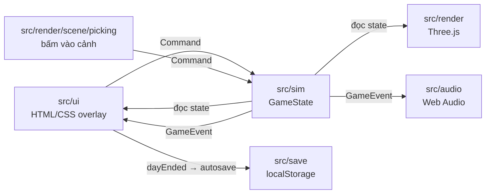
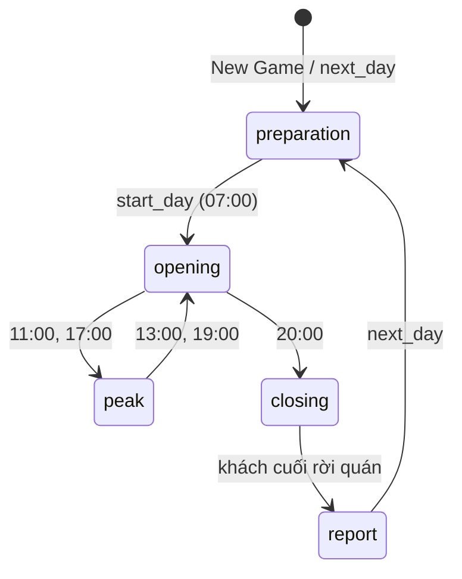
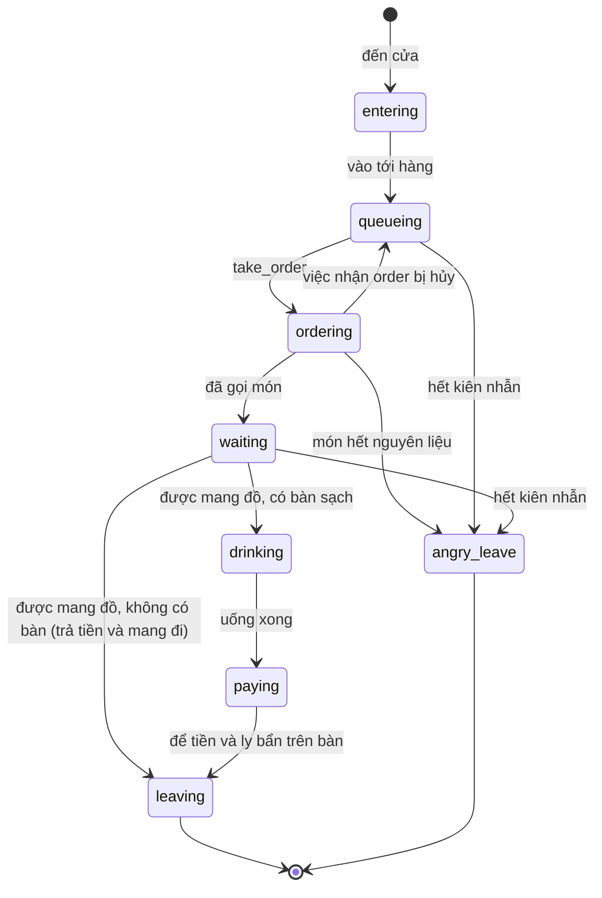

# Kiến trúc

Trang này mô tả cách game chia lớp, các hợp đồng giữa các lớp và định dạng dữ liệu, để thêm tính năng mà không phá vòng ngày đang chạy.

- [Ba lớp](#ba-lớp)
- [Vòng khung hình](#vòng-khung-hình)
- [Hợp đồng Command và GameEvent](#hợp-đồng-command-và-gameevent)
- [Vòng ngày](#vòng-ngày)
- [FSM khách](#fsm-khách)
- [Save schema](#save-schema)
- [Mẹo hiệu năng](#mẹo-hiệu-năng)

## Ba lớp



| Lớp | Được làm | Không được làm |
| --- | --- | --- |
| `src/sim` | Giữ toàn bộ luật chơi trong `GameState`; `step(state, dtMinutes)` chạy thời gian, `dispatch(state, cmd)` áp lệnh; đẩy sự kiện vào `state.events`. | Import DOM, `three` hay `Math.random`. |
| `src/render` | Đọc `GameState`, vẽ quán, nhân vật, phố; đổi cú bấm trong cảnh thành `Command`. | Sửa state. |
| `src/ui` | Đọc state để vẽ HUD, bảng, màn hình; gửi `Command` qua `shell.dispatch`; hiện toast và tự lưu khi có sự kiện. | Đổi state trực tiếp (trừ `speed`/`paused` khi bắt đầu ván hay đổi cài đặt). |
| `src/audio` | Phát âm thanh theo `GameEvent`. | Đọc hay sửa state. |
| `src/save` | Ghi/đọc `GameState` và cài đặt vào `localStorage`, nâng phiên bản save cũ. | Biết gì về DOM ngoài `StorageLike`. |

`GameState` là JSON thuần (không class, Map hay hàm) nên lưu, so sánh và nhân bản trực tiếp được. Bộ sinh số ngẫu nhiên mulberry32 giữ trạng thái trong `state.rngState`: cùng state cộng cùng chuỗi lệnh cho ra cùng một ngày. Tiền là số nguyên đồng (`25000` = 25.000đ); thời gian là phút game tính từ nửa đêm (`420` = 07:00).

## Vòng khung hình

`src/main.ts` chạy mỗi `requestAnimationFrame`:

1. `step(game, dt × 2 × game.speed)`: 1 giây thật ở 1x là 2 phút game (một ngày khoảng 7 phút). `dt` bị chặn ở 0,1 s để tab nền không tua nhanh.
2. Sim chạy tick cố định 1 phút game; tối đa `MAX_TICKS_PER_STEP` = 240 tick mỗi lần gọi. Phần lẻ còn lại nằm trong `state.tickAccumulator`.
3. `world.update(game, game.tickAccumulator)`: render nội suy vị trí giữa hai tick bằng `alpha`.
4. `shell.update()`: HUD, bảng đang mở và Daily Report cập nhật DOM qua `Watcher` (chỉ chạm DOM khi giá trị đổi).
5. `audio.handleEvents(events)` rồi `shell.handleEvents(events)`; sau đó xóa `game.events`.

Thứ tự trong một tick: đồng hồ và pha → khách mới đến (trừ pha đóng cửa) → việc của người chơi → nhân viên → khách → ghi trải nghiệm và review → nếu đang đóng cửa và quán trống thì kết thúc ngày.

## Hợp đồng Command và GameEvent

Kiểu đầy đủ ở `src/sim/types.ts`. `dispatch` trả `false` khi lệnh không áp dụng được lúc đó (sai pha, sai id, thiếu tiền…); UI dùng giá trị này thay vì tự kiểm luật.

| Command | Khi nào |
| --- | --- |
| `start_day` | Chuẩn bị → mở cửa. |
| `next_day` | Từ báo cáo sang ngày mới (pha `preparation`). |
| `set_menu_item` | Bật/tắt món. Giá món cố định theo dữ liệu menu. |
| `buy_ingredient`, `apply_restock` | Nhập hàng theo gói, hoặc theo gợi ý nhập tự động. |
| `hire_staff`, `fire_staff`, `assign_role`, `set_auto_assign` | Nhân viên. |
| `buy_upgrade`, `start_campaign` | Nâng cấp, marketing. |
| `set_speed`, `set_paused` | Nhịp game. |
| `take_order`, `brew`, `deliver`, `collect_cash`, `clean_table` | Người chơi tự phục vụ (từ cảnh 3D). |

| GameEvent | Ai dùng |
| --- | --- |
| `doorbell`, `brew`, `cash`, `angry`, `served`, `cleaned` | Âm thanh, hiệu ứng trong cảnh; `served`/`angry` còn sinh review. |
| `notify`, `low_stock`, `review` | Toast. |
| `phase` | Đổi pha trong ngày. |
| `dayEnded` | Báo cáo đã nằm trong `state.lastReport`; shell tự lưu vào slot `auto` và chuyển kết quả cho Daily Report. |

Thêm tính năng mới: thêm biến thể vào `Command`, xử lý trong `dispatch` (`src/sim/index.ts`), viết test ở `tests/sim/`, rồi mới nối UI. UI cần biết chuyện gì vừa xảy ra thì thêm biến thể `GameEvent` thay vì so sánh state giữa hai khung hình.

## Vòng ngày



| Pha | Đồng hồ | Việc chính |
| --- | --- | --- |
| `preparation` | Dừng ở 07:00 | Bảng chuẩn bị trên HUD; nút **Mở cửa**. |
| `opening` | Chạy | Khách đến theo tốc độ cơ bản. |
| `peak` | Chạy | Khách đến nhiều hơn. |
| `closing` | Chạy | Không nhận khách mới. |
| `report` | Dừng | `closeDay` đã trả lương, cập nhật rating, dựng `DailyReport`; UI hiện Daily Report (`src/ui/report`). |

Khi quán trống trong pha `closing`, sim gom tiền trên bàn, dọn bàn, gọi `closeDay` (`src/sim/report.ts`) rồi phát `dayEnded`. `next_day` đẩy `state.today` vào `state.history`, tăng ngày, chọn thời tiết mới, chạy tiếp chiến dịch marketing và phân vai nhân viên cho ngày mới.

## FSM khách



Kiên nhẫn (`patience`) chỉ giảm khi xếp hàng và chờ đồ. `served` và `angry` sinh trải nghiệm: khách để lại review (1–5 sao, lý do `ReviewReason`) với xác suất 30% khi được phục vụ, 60% khi bỏ đi. Game giữ tối đa 30 review (`MAX_REVIEWS`).

## Save schema

| Khóa `localStorage` | Nội dung |
| --- | --- |
| `cst3d:save:auto` | Slot tự động, ghi khi có `dayEnded`. |
| `cst3d:save:1` … `cst3d:save:3` | Slot lưu tay từ menu Tạm dừng. |
| `cst3d:settings` | Cài đặt: âm lượng, chất lượng, tốc độ, kiểu phím camera. |

Mỗi slot là JSON:

```json
{ "version": 1, "savedAt": 1760364000000, "state": { "...": "GameState, events = []" } }
```

- `SAVE_VERSION` trong `src/save/save.ts` là phiên bản hiện tại (1). Phiên bản 0 là `GameState` trần không có vỏ bọc.
- `migrate()` nâng lần lượt từng phiên bản qua bảng `MIGRATIONS`, rồi kiểm các trường bắt buộc. Save mới hơn bản game báo `version_unsupported`; JSON hỏng báo `corrupt`; thiếu trường báo `invalid`. Đọc slot không bao giờ sửa hay xóa dữ liệu đã lưu.
- Thêm trường bắt buộc vào `GameState`: tăng `SAVE_VERSION`, thêm hàm vào `MIGRATIONS` điền giá trị mặc định, và thêm ca kiểm trong `tests/save/`. Trường tùy chọn (`?`) không cần tăng phiên bản.

## Mẹo hiệu năng

### Khởi động

1. `index.html` vẽ màn hình chờ `#boot` (CSS thuần, thanh tiến độ chạy bằng animation) ngay khi trang tải, trước khi có JS.
2. Chunk chính (UI, sim, save, audio) chạy `createShell`, hiện Main Menu rồi làm mờ `#boot`; đánh dấu `performance.mark('cst:menu')`.
3. `main.ts` gọi `import('./render/scene')` ngay đầu `start()`. Sau khi menu đã vẽ, `createWorld` dựng cảnh, `world.prepare()` biên dịch shader bằng `compileAsync`, rồi canvas `#scene` hiện dần (`is-ready`) và đánh dấu `cst:world`. Trước lúc đó vòng khung hình vẫn chạy sim, chỉ bỏ qua phần vẽ.

Không import `src/render` hay `three` tĩnh từ `main.ts`, `src/ui`, `src/sim`, `src/save`: làm vậy kéo three.js trở lại chunk chính.

| Chunk (`npm run build`) | Raw | Gzip | Tải khi |
| --- | --- | --- | --- |
| `index-*.js` (chunk chính) | 107,7 kB | 36,8 kB | Ngay khi mở trang, cần cho Main Menu |
| `index-*.css` | 36,1 kB | 5,9 kB | Ngay khi mở trang |
| `index-*.js` (`src/render`) | 51,5 kB | 19,5 kB | Sau khi chunk chính chạy |
| `three-*.js` | 495,1 kB | 124,2 kB | Sau khi chunk chính chạy; tách riêng để giữ cache giữa các lần deploy |

Trước khi tách, mọi thứ nằm trong một file `index-*.js` 653,1 kB (180,3 kB gzip), và menu chỉ hiện sau khi dựng cảnh và vẽ xong khung hình 3D đầu tiên. JS cần trước khi thấy menu giảm từ 180,3 kB xuống 36,8 kB gzip.

Thời gian tính từ lúc mở trang, bản build qua `vite preview`, Chrome headless không cache trên Apple M2 (ANGLE Metal), trung vị 3 lần:

| Cấu hình | Bản | Màn chờ hiện | Main Menu hiện | Cảnh 3D hiện |
| --- | --- | --- | --- | --- |
| Máy bàn, không giới hạn | Một chunk | Không có (trang trống tới khi menu hiện) | 121 ms | 121 ms |
| Máy bàn, không giới hạn | Tách chunk + màn chờ | 76 ms | 84 ms | 155 ms |
| Di động: 150 ms RTT, 1,6 Mbps, CPU chậm 4 lần | Một chunk | Không có (trang trống tới khi menu hiện) | 1584 ms | 1584 ms |
| Di động: 150 ms RTT, 1,6 Mbps, CPU chậm 4 lần | Tách chunk + màn chờ | 620 ms | 746 ms | 1891 ms |

Đo thời gian tới khi Main Menu hiện, so với một commit cũ (cần Chrome; đặt `CHROME_PATH` nếu Chrome không ở chỗ mặc định):

```sh
node scripts/measure-startup.mjs --base <git-ref> --runs 3
```

Script build cả hai bản, chạy `vite preview`, mở bằng Chrome headless không cache, in bảng kích thước chunk và trung vị thời gian tới first paint, Main Menu và cảnh 3D, ở hai cấu hình: máy bàn không giới hạn và di động (150 ms RTT, 1,6 Mbps, CPU chậm 4 lần).

### Khi chơi

- UI dựng DOM một lần bằng `h()` và cập nhật qua `Watcher` (`src/ui/core/dom.ts`); khung hình không đổi gì thì không chạm DOM. Daily Report chỉ dựng lại khi `state.lastReport` đổi.
- Bàn, ghế, đồ trang trí trong quán và nhà, cây, đèn ngoài phố dùng `InstancedMesh` với vật liệu dùng chung.
- Nhân vật dựng từ khối low-poly có khớp, animation viết bằng code, lấy từ pool (`src/render/actors/pool.ts`) thay vì tạo mới.
- Chất lượng đồ họa:

| Mức | `pixelRatio` tối đa | Bóng đổ | Mật độ phố |
| --- | --- | --- | --- |
| Thấp | 1 | Tắt | Thấp |
| Vừa | 1,5 | Tắt | Vừa |
| Cao | 2 | Bật | Cao |

- Âm thanh cùng loại lặp lại trong khoảng ngắn bị bỏ qua, nên tốc độ 4x không chồng hàng chục tiếng chuông.
