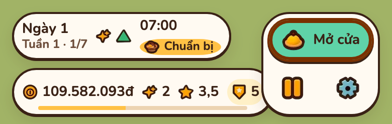
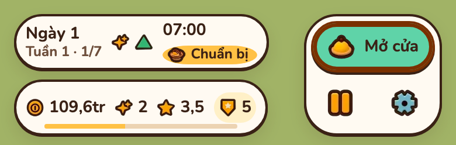
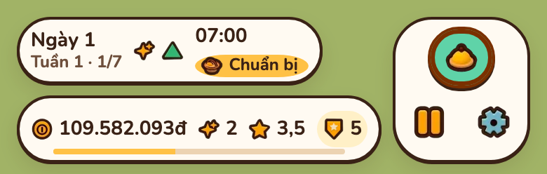
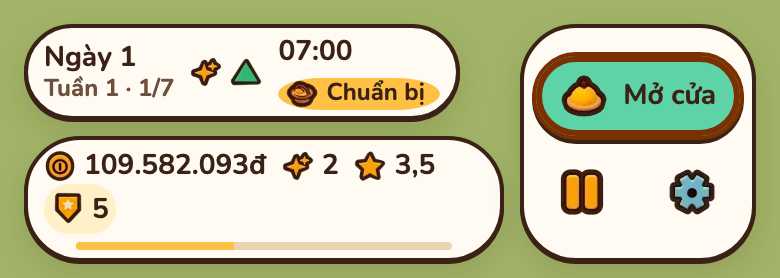
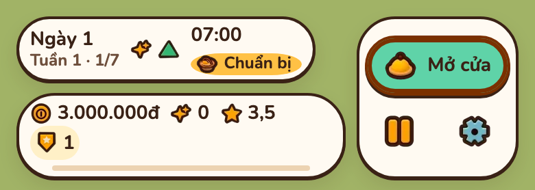
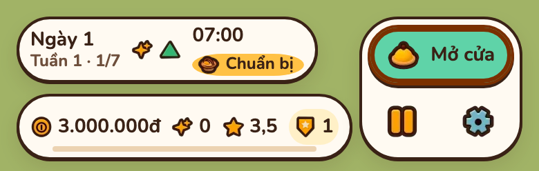
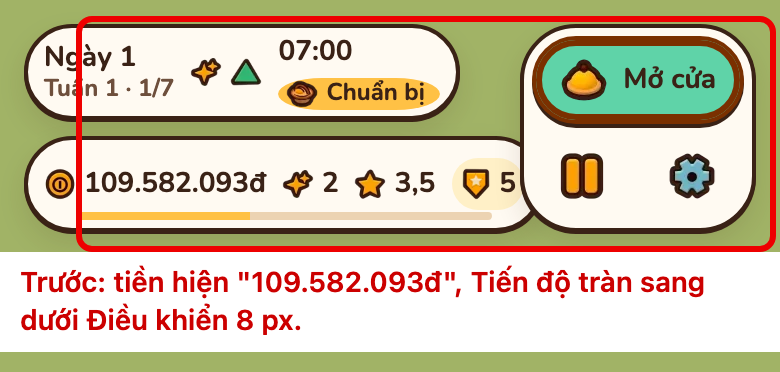
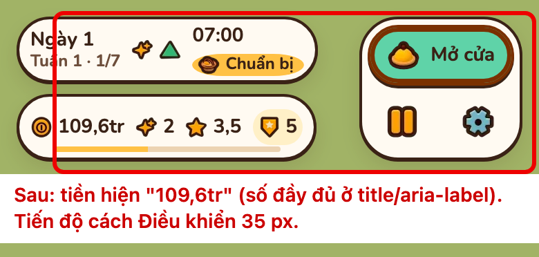

# HUD 390 px: Tiến độ đè Điều khiển

Báo cáo này ghi chỗ cụm Tiến độ đè cụm Điều khiển trên HUD ở 390×844, ba phương án sửa có ảnh mô phỏng, và kết quả sau khi sửa theo phương án A (mục 4).

## 1. Hiện trạng

Từ 1023 px trở xuống, `.hud` là lưới `minmax(0, 1fr) auto` (`src/ui/styles/ui.css`): Hôm nay trên Tiến độ ở cột trái, Điều khiển ở cột phải qua hai hàng. Tiến độ là `white-space: nowrap`, nên khi nội dung rộng hơn cột trái thì tràn sang dưới Điều khiển. Lúc chuẩn bị, nút "Mở cửa" làm Điều khiển rộng 118 px thay vì 104 px lúc mở cửa.

Số đo ngày sự kiện "Tăng giá nhập", 390×844 (mép phải Tiến độ so với mép trái Điều khiển, px):

| Số liệu | Lúc chuẩn bị | Lúc mở cửa |
| --- | --- | --- |
| Ván mới: 3.000.000đ, 0 Tem, Cấp 1 | hở 5 | hở 19 |
| Cuối game: 109.582.093đ, 2 Tem, Cấp 5 | **đè 12** | hở 2 |

`npm run layout` không bắt được: phép đo ngày sự kiện ở 390 px dùng số liệu ván mới, số liệu cuối game chỉ chạy từ 1100 px.

## 2. Phương án

Ảnh chụp bản build hiện tại, thêm CSS hoặc đổi chữ tạm trong trang để mô phỏng; số liệu cuối game, lúc chuẩn bị.

| | A. Rút gọn tiền | B. Nút "Mở cửa" chỉ còn icon | C. Tiến độ tự xuống dòng |
| --- | --- | --- | --- |
| Cách làm | Ở ≤ 480 px, tiền từ 100 triệu hiện "109,6tr", từ 1 tỷ "1,2 tỷ"; số đầy đủ trong `title` và `aria-label` | Ở ≤ 480 px, chữ "Mở cửa" ẩn, giữ icon và `aria-label`; khe trong Điều khiển nhỏ lại | Tiến độ `flex-wrap: wrap`, cụm cấp xuống dòng hai khi không vừa |
| Khoảng hở (chuẩn bị / mở cửa) | 31 / 45 px | 8 / 8 px | không đè; Tiến độ hai dòng |
| Chiều cao HUD | 104 px, giữ nguyên | 104 px, giữ nguyên | 119 px, cả ván mới cũng xuống dòng |
| Số 10 chữ số (từ 1 tỷ) | "1,2 tỷ", ngắn hơn số 9 chữ số | thêm khoảng 16 px, đè lại | xuống dòng, không đè |
| Đánh đổi | Mất số lẻ trên HUD điện thoại; cần sửa `hud.ts` (count-up tiền) và test định dạng | Nút chính khó hiểu hơn với người mới; chỉ gỡ được khoảng 20 px | Che thêm 15 px cảnh 3D; khung Tiến độ thành hình chữ nhật bo góc |

A, rút gọn tiền:

B, nút "Mở cửa" chỉ còn icon:

C, Tiến độ tự xuống dòng, cuối game và ván mới:

Ảnh hiện tại ở ván mới, để so với C:

## 3. Khuyên chọn

A: HUD giữ một khung hai hàng như thiết kế, còn chỗ cho tiền tăng tới hàng tỷ. Sửa kèm: thêm ca 390 px số liệu cuối game vào phép đo ngày sự kiện của `scripts/check-layout.mjs`.

## 4. Kết quả (phương án A)

| Thay đổi | Chỗ |
| --- | --- |
| `formatMoneyShort`: từ 10 triệu "12,5tr", từ 1 tỷ "1,2 tỷ", một chữ số thập phân; dưới 10 triệu như `formatMoney` | `src/ui/core/format.ts` |
| Ở ≤ 480 px (`NARROW_MONEY`), HUD hiện tiền gọn, cả lúc đếm tăng; số đầy đủ trong `title` ("Tiền: 109.582.093đ") và `aria-label`. Trên 480 px giữ số đầy đủ. Đổi khổ qua 480 px thì vẽ lại ngay. | `src/ui/hud/hud.ts` |
| Ca 390×844, ngày sự kiện, số liệu cuối game | `scripts/check-layout.mjs` (`EVENT_DAY`) |

Số đo 390×844, số liệu cuối game (mép phải nội dung Tiến độ so với mép trái Điều khiển, px):

| | Lúc chuẩn bị | Lúc mở cửa |
| --- | --- | --- |
| Số đầy đủ "109.582.093đ" | đè 8 | hở 2 (số đo mục 1) |
| Tiền gọn "109,6tr" | hở 35 | hở 49 |
| "1,2 tỷ" | hở 46 | hở 60 |
| "9.999.999đ" (dưới ngưỡng, không rút gọn) | hở 9 | hở 23 |

`LAYOUT_ONLY=event` của `scripts/check-layout.mjs`: 15/15 PASS; khi tắt rút gọn, hai ca 390 px cuối game (chuẩn bị, menu camera) báo FAIL. Ở 1100, 1280, 1440 px tiền vẫn đầy đủ, bề rộng cụm không đổi.

Ảnh trước dựng trên bản đã sửa, thay chữ tiền bằng số đầy đủ như bản cũ:

