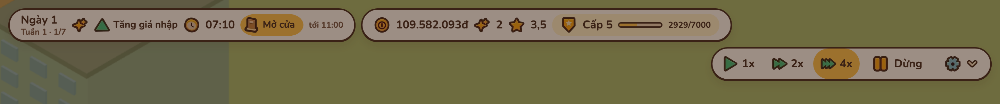
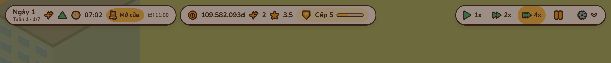
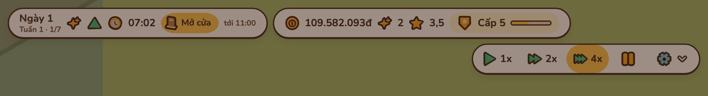
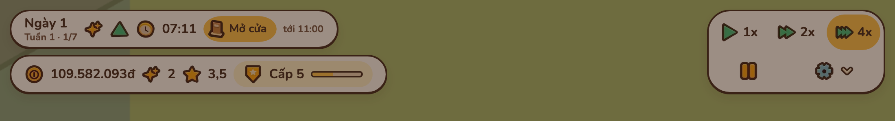

# HUD trên: ba cụm cùng một hàng

Báo cáo này ghi nguyên nhân cụm Điều khiển rớt xuống hàng hai trên HUD, cách sửa và ảnh trước/sau.

## 1. Nguyên nhân

`.hud` là flex `flex-wrap: wrap` (`src/ui/styles/ui.css`). Ba cụm vừa một hàng chỉ nhờ ngưỡng cố định: dưới 1440 px ẩn tên sự kiện, số KN và chữ "Dừng". Bề rộng cụm lại theo dữ liệu: tiền 9 chữ số, chip Tem, "Cấp 5" với "2929/7000". Phép đo HUD ngày sự kiện trong `npm run layout` dùng save ván mới (tiền ít, Cấp 1, 0 Tem), nên không bắt được.

Số đo lúc mở cửa ở 4x, ngày "Tăng giá nhập", 109.582.093đ, 2 Tem, Cấp 5 (bề rộng cụm, px):

| Khổ | Hôm nay | Tiến độ | Điều khiển | Trước | Sau |
| --- | --- | --- | --- | --- | --- |
| 1440 | 500 | 533 | 404 | Điều khiển ở hàng 2 (top 68) | 1 hàng, `.is-compact` (404, 464, 355) |
| 1100 | 404 | 464 | 355 | Điều khiển ở hàng 2 (top 68), lệch phải | 2 hàng, `.is-stacked` |
| 1280, 1366, 1512+ | | | | 1 hàng | 1 hàng, không đổi |

## 2. Cách sửa

| File | Thay đổi |
| --- | --- |
| `src/ui/hud/hud.ts` (`fitRow`) | Từ 1024 px, mỗi lần HUD hay một cụm đổi cỡ: bỏ class, đo `offsetTop` ba cụm; cụm nào nằm dưới Hôm nay thì thêm `.is-compact`, vẫn chưa vừa thì thêm `.is-stacked`. Class đổi trước khi vẽ. |
| `src/ui/styles/ui.css` | `.hud.is-compact` ẩn tên sự kiện, số KN, chữ "Dừng" như khối `max-width: 1439px`. `.hud.is-stacked` dùng lưới hai hàng của khối `max-width: 1023px` (Hôm nay trên Tiến độ, Điều khiển bên phải qua cả hai hàng). |
| `scripts/check-layout.mjs` | Ngày sự kiện ở 1100, 1280, 1440 px dùng số liệu cuối game. Thêm hai điều kiện: Điều khiển bắt đầu ở hàng đầu; khi 1 hàng, ba cụm cùng mép trên và chiều cao. Trên code cũ phép đo báo 4 FAIL. |
| `tests/ui/hud-clusters.test.ts` | Ca vừa, cần `.is-compact`, cần `.is-stacked`, đo lại khi màn rộng ra, bỏ qua ở ≤ 1023 px; class khớp các khối CSS. |

## 3. Ảnh trước/sau

1440 px, lúc mở cửa (đang dừng nên cảnh tối):

1100 px, lúc mở cửa:

## 4. Kết quả kiểm

| Lệnh | Kết quả |
| --- | --- |
| `npm run layout` | PASS 95 mục |
| `npm run check` | PASS, 1622 test |
