# Báo cáo P18: va chạm, khung quán, icon 3D

So sánh bản P17 (commit `07439cf`) với bản P18: các ca đi xuyên đã sửa, ảnh trước/sau của quán và icon, kích thước atlas icon.

## Mục lục

- [Các ca đi xuyên](#các-ca-đi-xuyên)
- [Sơ đồ đường đi trước/sau](#sơ-đồ-đường-đi-trướcsau)
- [Ảnh trong game trước/sau](#ảnh-trong-game-trướcsau)
- [Atlas icon 3D](#atlas-icon-3d)
- [Khởi động và chunk](#khởi-động-và-chunk)
- [Tạo lại báo cáo](#tạo-lại-báo-cáo)

## Các ca đi xuyên

| Ca | Trước (P17) | Sau (P18) | Test giữ |
| --- | --- | --- | --- |
| Khách xuyên bàn | Đi thẳng tới đích, cắt qua bàn và ghế trên đường | Đi theo trường khoảng cách (flow field) trên lưới 0,25 vòng quanh đồ vật: mỗi ô đích dựng một trường một lần, lưu cache (96 trường) tới khi bố cục đổi; mỗi bước đi thẳng tới góc xa nhất còn thấy được | `tests/integration/collision.test.ts` › customer vs table; nav cost |
| Khách ngồi lệch ghế | Chỗ ngồi ở tâm bàn ± 0,5, ghế vẽ ở ± 0,75: khách ngồi ở mép bàn | Chỗ ngồi đúng tâm ghế (`CHAIR_OFFSET`), bước cuối lên ghế không qua đồ khác | collision › customer vs chair |
| Hàng chờ đè ghế | 6 chỗ thẳng hàng ở x = 0, chạm ghế hai bàn giữa (x = ± 0,25) | 6 chỗ dọc lối đi trống từ quầy ra cửa (`floorSpots`) | collision › customer vs chair; `tests/sim/customers.test.ts` › no longer stands the line on the chairs of the middle tables |
| Đi xuyên quầy | Nhân viên nhận order đứng trong quầy, đi thẳng qua quầy | Đứng sau quầy, đi vòng quầy | collision › customer vs counter |
| Xuyên tường | Khách ra bàn ngoài hiên đi thẳng qua tường trước | Đi qua cửa | collision › customer vs wall |
| Xuyên khung cửa | Không có khung cửa và cánh cửa trong sim | Khung và cánh cửa có footprint, người đi giữa hai trụ | collision › customer vs door |
| Khách mang đi đứng chồng | Mọi khách mang đi đứng đúng một điểm `PICKUP_POS` | 12 ô riêng quanh chỗ lấy đồ, khách giữ ô của mình | collision › person vs person; customers › gives four takeaway customers four separate spots |
| Khách mang đi tràn ô | Không có | Hết 12 ô quanh chỗ lấy đồ thì khách nhận ô dự phòng riêng: 4 ô ở lối đi trong cửa, rồi trên vỉa hè trước quán, đủ cho mọi khách quán nhận; lối cửa luôn trống | customers › places the overflow in the aisle by the door, then on the sidewalk; collision soak › maxed shop with drinks stalled |
| Nhân viên chồng nhau, đè khách | Nhân viên cùng vai đứng cùng một trạm; người phục vụ đứng đúng chỗ khách | `staffSpots` giữ ô riêng cho từng người, cách nhau ít nhất 0,5 | collision › person vs person; `tests/sim/staff.test.ts` › where staff stand |
| Nhân viên dịch chuyển tức thời | Sim đặt nhân viên ngay vào chỗ mới; không có đường né đồ vật | Render đi theo `findPath` (A* trên lưới nav), đẩy nhẹ người đi gần nhau | `tests/render/actors.test.ts`; collision soak (phát lại khung hình) |
| Người đi đường chồng nhau | Không giữ khoảng cách giữa người ngoài phố | Chia làn, cùng làn cùng tốc độ | collision › pedestrian vs pedestrian |
| Đồ trang trí đặt chồng | Không kiểm | `validateLayout` báo footprint chồng nhau; mọi thứ tự mua nâng cấp đều sạch | collision › decor vs furniture |
| Save cũ có người trong vật cản | Không xử lý | `settleActors()` dời ra ô trống gần nhất khi tải | `tests/save/save.test.ts` › moves people saved inside furniture out to the nearest free floor |
| Chạy nhiều ngày | Không có test | 7 ngày × 3 độ khó × (quán mới, quán nâng cấp hết): không ai trong ô chặn, không ai đứng chồng, kiểm mỗi tick và mỗi khung hình | collision › collision soak |

## Sơ đồ đường đi trước/sau

Quán nâng cấp hết, nhìn từ trên xuống, đường phố ở dưới. Đỏ nét đứt: đường và chỗ đứng P17. Xanh nét liền: P18. Dấu × đỏ: chỗ thân người (bán kính 0,2) chạm đồ vật. Vòng tròn: một người đứng yên. Dòng cuối mỗi hình đếm số đồ vật bị chạm và số người đứng chồng.

### Khách xuyên bàn → đi vòng

Khách từ cửa vào bàn trái hàng sau. P17 đi thẳng qua ghế bàn hàng trước và ngồi ở mép bàn; P18 đi vòng và ngồi đúng ghế.

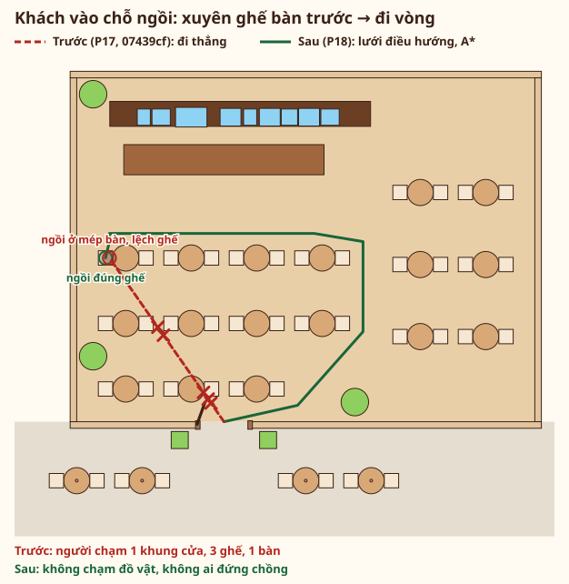

### Hàng chờ đè ghế → theo lối đi trống

P17 xếp 6 người thẳng ở x = 0, chạm ghế hai bàn giữa; P18 xếp dọc lối đi trống từ quầy ra cửa.

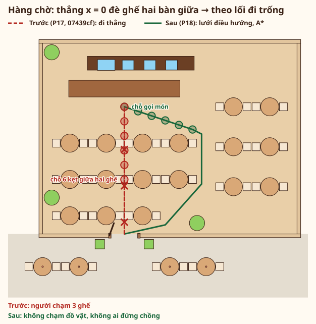

### Khách mang đi chồng một điểm → mỗi người một ô

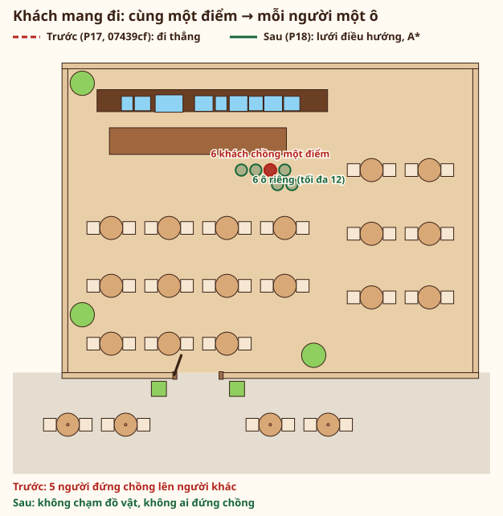

### Nhân viên trong quầy, chồng nhau, đè khách → mỗi người một ô

Quầy có 4 pha chế (1 nhận order, 1 pha, 2 rảnh) và 2 phục vụ (1 rảnh, 1 mang món cho khách đang ngồi).

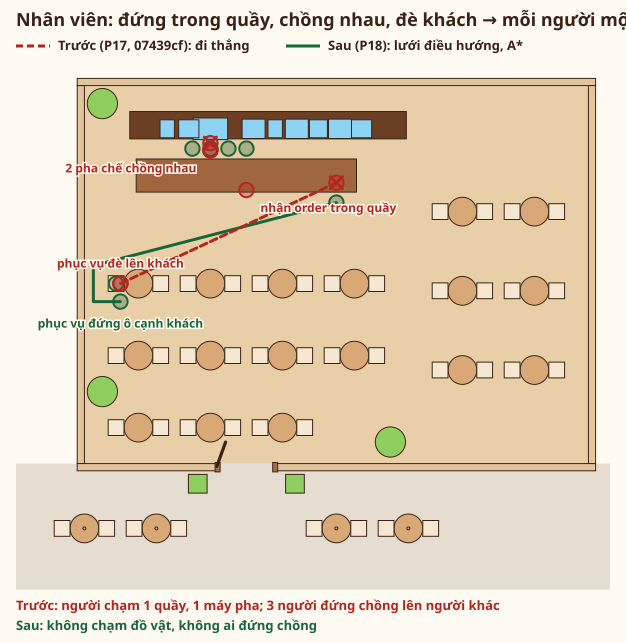

### Ra bàn ngoài hiên xuyên tường → đi qua cửa

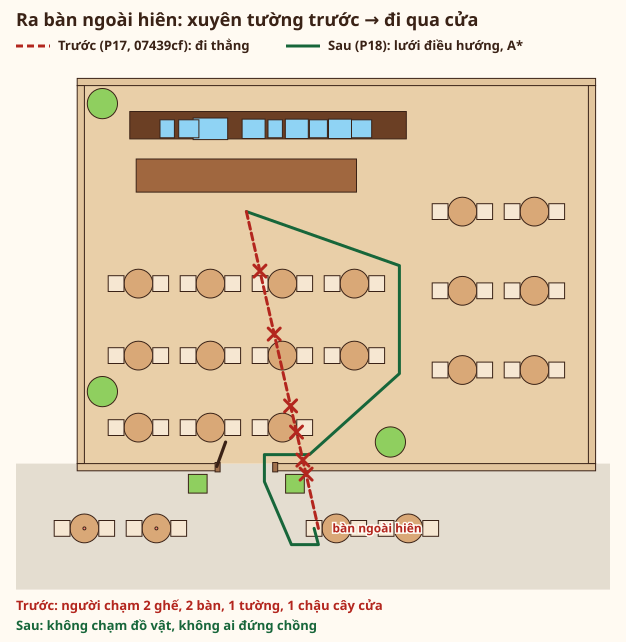

## Ảnh trong game trước/sau

Ảnh P17 chụp bằng `npm run media` ở `07439cf`; ảnh P18 chụp bằng cùng lệnh, cùng seed, mức đồ họa Cao. Mỗi hình đặt ảnh P17 (trái) cạnh ảnh P18 (phải). Vòng nét đứt đỏ: chỗ có lỗi ở P17. Vòng nét liền xanh: chỗ đã sửa hay chi tiết mới ở P18. Toạ độ vòng lấy từ camera của khung hình (chỗ đứng sim chiếu lên ảnh) và khung DOM, không vẽ tay.

### Giờ cao điểm

Hai ảnh cùng góc máy. Bên P17, vòng đặt ở chỗ đứng sim P17: hàng chờ thẳng ở x = 0 chạm ghế, mọi khách mang đi chung một điểm, nhân viên đứng trong quầy và chồng nhau. Bên P18, vòng khoanh từng người đang đứng ở chỗ sim giao: hàng chờ theo lối trống, mỗi khách mang đi một ô, nhân viên tách rời; cùng mặt tiền mới và icon 3D trên dock.

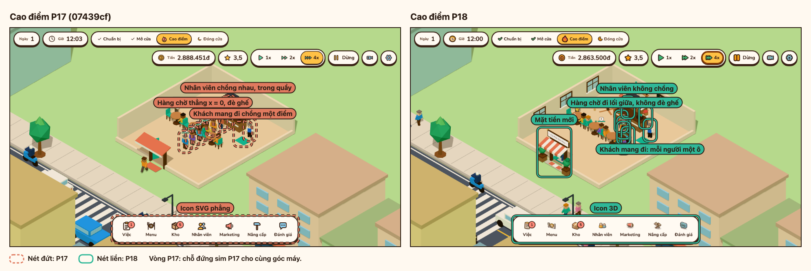

### Main Menu

Bên P18 khoanh chi tiết mới còn thấy được quanh thẻ menu: khung cửa sổ, quạt trần, kệ lọ hạt, đèn thả. P17 chưa có các chi tiết này. Mặt tiền (mái hiên, biển tên, cửa kính, chậu cây) nằm sau thẻ menu ở góc máy này; xem ở ảnh giờ cao điểm. Cả hai bên khoanh icon nút menu (SVG phẳng → 3D).

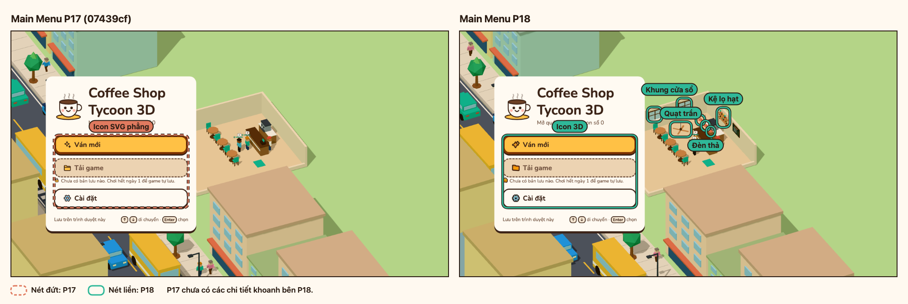

### Bảng Kho

Icon SVG phẳng trên dock, HUD và trong bảng thay bằng icon 3D từ atlas; chữ và nhãn giữ nguyên.

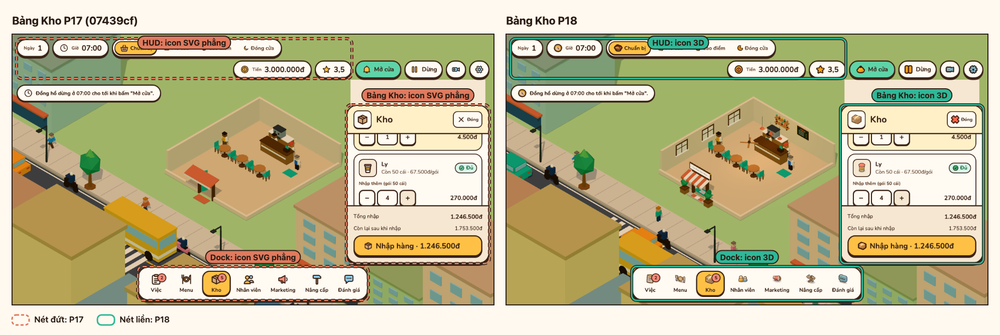

Ảnh mới của P18:

| Ảnh | Nội dung |
| --- | --- |
| 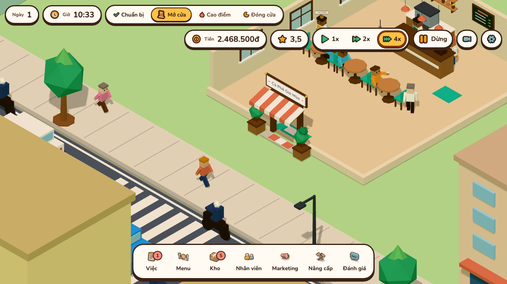 | Mặt tiền 10:21: mái hiên, biển tên, cửa kính, chậu cây. |
| 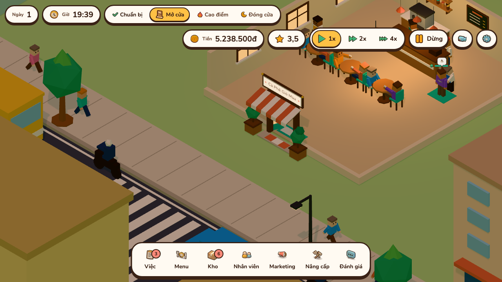 | Mặt tiền sau 19:30, đèn sáng đầy: cửa sổ và cửa kính phát sáng ấm, đèn thả và biển hiệu sáng hơn. |
| 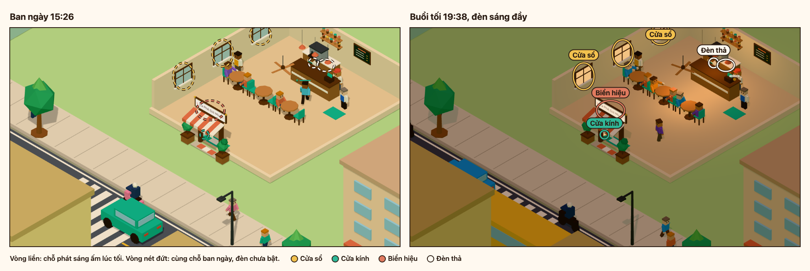 | Cùng góc máy lúc khoảng 15:30 và sau 19:30. Vòng liền khoanh chỗ phát sáng ấm lúc tối (cửa sổ, cửa kính, biển hiệu, đèn thả); vòng nét đứt là cùng chỗ đó ban ngày. |
| 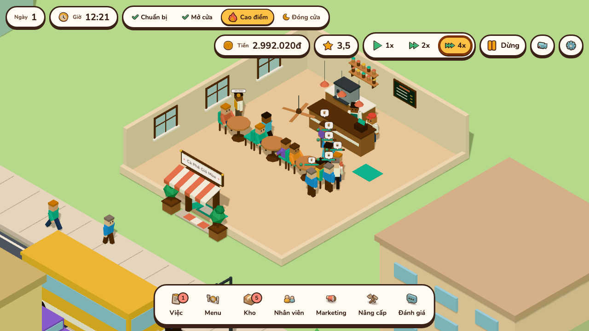 | Cao điểm trưa, gần quầy: hàng chờ dọc lối đi, không đè ghế. |
| 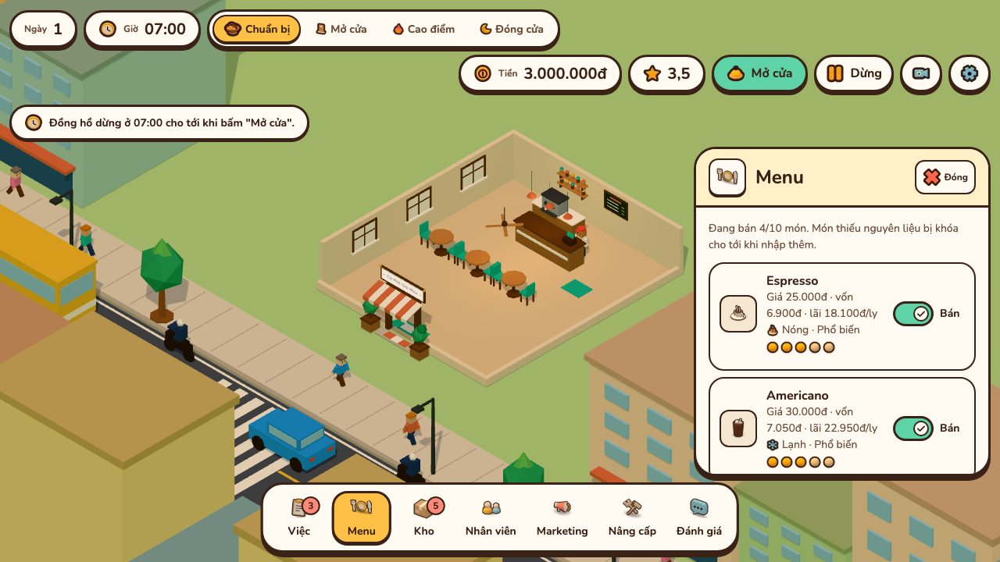 | Bảng Menu với icon 3D của từng món. |

## Atlas icon 3D

113 icon (105 icon và 8 avatar), mỗi icon vẽ hai ô: ô 48 px cho chỗ hiện ở 32 và 48 px, ô 24 px vẽ riêng cho chỗ hiện ở 16 và 24 px. @2x gấp đôi mọi số đo. Trình duyệt chỉ tải một trong hai file, theo mật độ điểm ảnh, sau khi Main Menu đã hiện.

| File | Dung lượng | Ngân sách (`BUDGET` trong `src/icon-studio/atlas.ts`) |
| --- | --- | --- |
| `public/icons3d/atlas@1x.webp` | 100,8 kB | 120 kB |
| `public/icons3d/atlas@2x.webp` | 280,9 kB | 300 kB |

SVG cũ và icon 3D cạnh nhau ở 16/24/48 px (16 và 24 px lấy ô 24 px, 48 px lấy ô 48 px), cho các nút chỉ có icon và một hai icon mỗi nhóm:

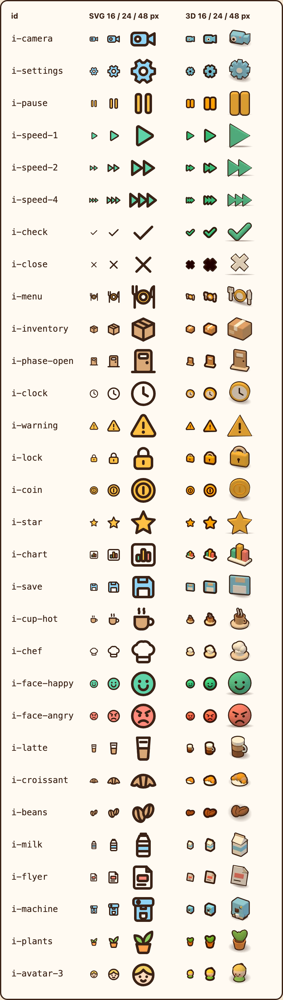

Trang xem mọi icon: `icons3d/` trong bản build, cột SVG cũ cạnh cột icon 3D (xem [media.md](../media.md#xem-icon)).

## Khởi động và chunk

`node scripts/measure-startup.mjs --base 07439cf --runs 3`: bản build qua `vite preview`, Chrome headless không cache trên Apple M2 (ANGLE Metal), trung vị 3 lần, hai bản đo trong cùng một lượt.

| Cấu hình | Bản | Nội dung đầu tiên hiện | Main Menu hiện | Cảnh 3D hiện |
| --- | --- | --- | --- | --- |
| Máy bàn, không giới hạn | P17 (`07439cf`) | 124 ms | 446 ms | 794 ms |
| Máy bàn, không giới hạn | P18 | 112 ms | 361 ms | 599 ms |
| Di động: 150 ms RTT, 1,6 Mbps, CPU chậm 4 lần | P17 (`07439cf`) | 780 ms | 1165 ms | 3181 ms |
| Di động: 150 ms RTT, 1,6 Mbps, CPU chậm 4 lần | P18 | 476 ms | 669 ms | 2515 ms |

Main Menu trên di động của P18 không chậm hơn P17. Số tuyệt đối thay đổi giữa các lượt đo; chỉ so hai bản trong cùng lượt.

| Chunk | P17 raw / gzip | P18 raw / gzip |
| --- | --- | --- |
| `index-*.js` (chunk chính, cần cho Main Menu) | 134,9 / 45,8 kB | 128,5 / 44,8 kB |
| `index-*.css` | 53,9 / 8,5 kB | 54,8 / 8,7 kB |
| `index-*.js` (`src/render`, tải sau menu) | 58,0 / 21,9 kB | 72,5 / 27,1 kB |
| `three-*.js` (tải sau menu) | 495,1 / 123,9 kB | 496,5 / 124,2 kB |

Mặt tiền, đèn ấm và chuyển động nằm trong chunk `src/render`, tải sau Main Menu.

## Tạo lại báo cáo

| Phần | Lệnh |
| --- | --- |
| Sơ đồ `p18-collision-*.svg` | `npx vitest run tests/report -u` (test `tests/report/collision-plot.test.ts` vẽ từ code nav thật và báo lỗi khi sơ đồ đã commit lệch code) |
| Ảnh trong game | `npm run media` (xem [media.md](../media.md)) |
| Atlas icon và bảng so sánh `p18-icons-sample.png` | `npm run icons -- --sheet` |
| Số đo khởi động | `node scripts/measure-startup.mjs --base 07439cf --runs 3` |
