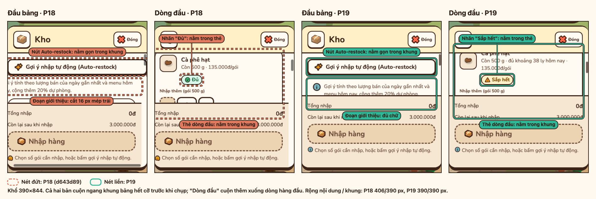
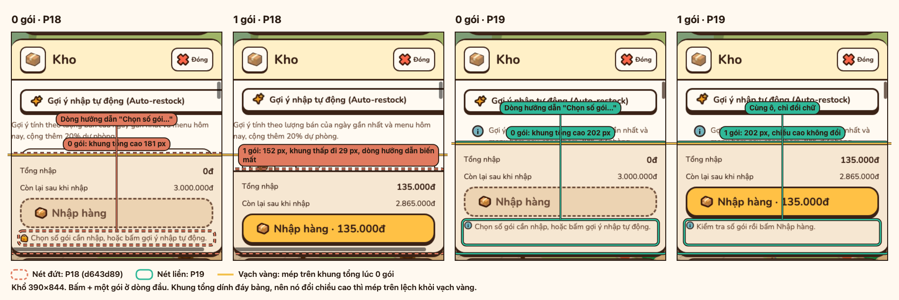
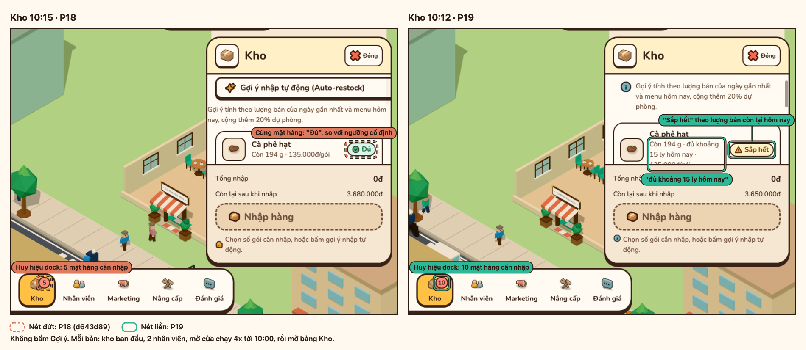
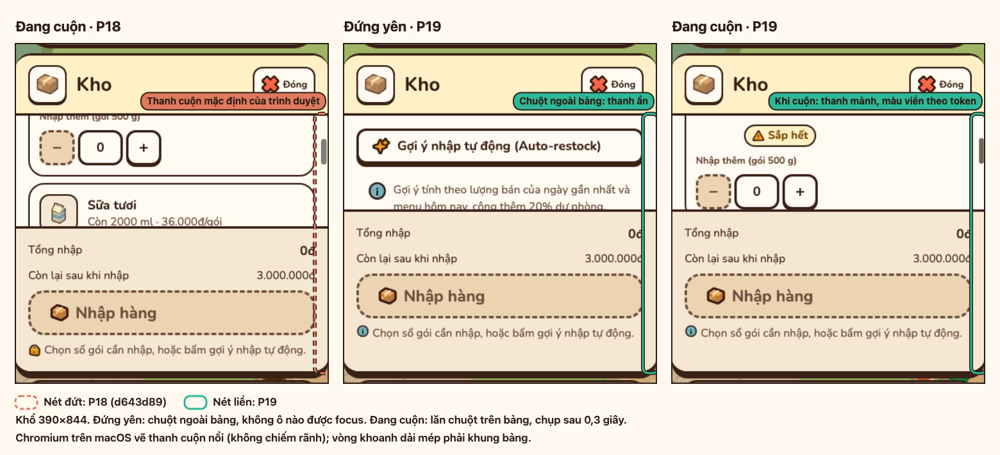
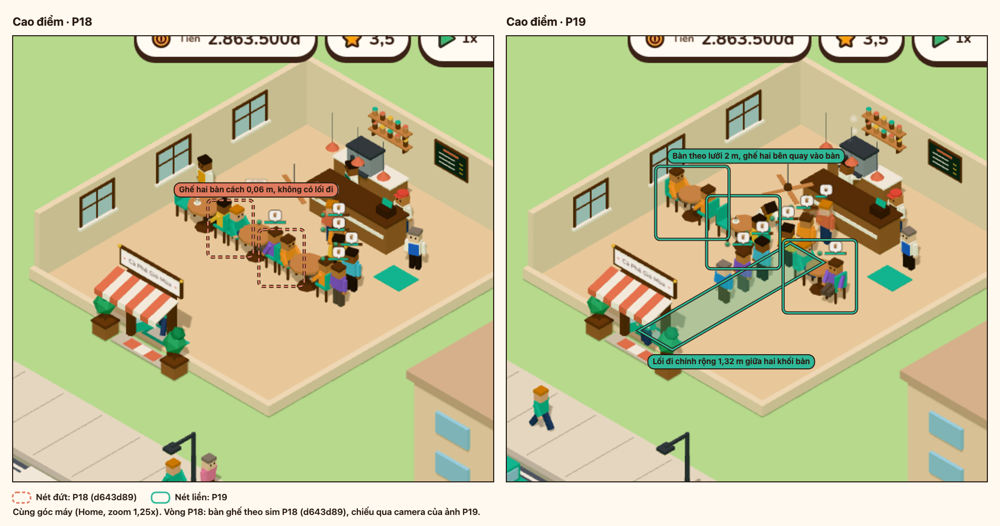

# Báo cáo P19: chỉnh lề, Kho, người đi, bàn ghế, thanh cuộn, camera

Sáu mục chỉnh sau khi chơi bản P18 (`d643d89`), với ảnh trước/sau có khoanh và số đo trên bản build production.

## Mục lục

- [Tóm tắt](#tóm-tắt)
- [Ảnh trước/sau](#ảnh-trướcsau)
- [Số đo](#số-đo)
- [Chạy lại](#chạy-lại)

## Tóm tắt

| Mục | Lỗi ở P18 | P19 |
| --- | --- | --- |
| Lề | Bảng Kho rộng hơn khung: nút Auto-restock `width: 100%` cộng `margin-inline`, nên đoạn giới thiệu bị cắt đầu dòng, nút lệch, nhãn "Đủ" lòi khỏi thẻ. | Nội dung bảng và Daily Report nằm trong bề rộng khung; test `tests/ui/layout-overflow.test.ts` và `npm run layout` chặn tái phát ở 390, 768, 1440 px. |
| Kho theo thời gian thực | Nhãn trạng thái chỉ so với ngưỡng cố định, phải bấm Gợi ý mới biết thiếu. | Nhãn Đủ / Sắp hết / Hết, huy hiệu dock Kho và toast "Sắp hết" cùng tính theo lượng bán còn lại hôm nay (`stockOutlook`), cập nhật khi sim chạy; mỗi dòng thêm "đủ khoảng N ly hôm nay". |
| Dòng hướng dẫn và khung tổng | Dòng "Chọn số gói cần nhập, hoặc bấm gợi ý nhập tự động." ẩn hiện làm khung tổng đổi chiều cao. | Dòng hướng dẫn là một ô cố định, chỉ đổi chữ; kết quả Gợi ý và Nhập hàng dùng chung một ô cao 3 dòng. CLS = 0 khi đổi số gói. |
| Người đi lại, bàn ghế | Người đi theo đường gấp khúc, bẻ hướng ngay tại góc, đi và dừng ở nguyên tốc độ; bàn cách nhau 2 m theo hàng, ghế hai bàn cạnh nhau chỉ cách 0,06 m, không có lối đi giữa. | Góc đường bo cung, tăng tốc khi bắt đầu đi và giảm tốc trước khi dừng, quay người có giới hạn tốc độ, chuyển giữa đứng và đi trộn tư thế. Bàn theo lưới 2 m, hai khối hai bên lối đi chính, ghế quay vào bàn; save cũ được xếp lại theo bố cục mới khi tải. |
| Thanh cuộn | Thanh cuộn mặc định của trình duyệt, luôn hiện. | Thanh mảnh, màu theo token viền, chỉ hiện khi hover, focus hay đang cuộn; Chrome, Firefox dùng `scrollbar-width`/`scrollbar-color`, Safari cũ dùng `::-webkit-scrollbar`. |
| Xoay camera | Xoay nhanh, dừng ngay khi thả chuột. | Xoay chậm hơn khoảng 40%, thả chuột thì camera trôi tiếp rồi chậm dần; Cài đặt có Tốc độ xoay camera (chậm, vừa, nhanh). |

Chi tiết cách chạy ở [architecture.md](../architecture.md#camera) (camera), [Trạng thái kho](../architecture.md#trạng-thái-kho), [Điều hướng và va chạm](../architecture.md#điều-hướng-và-va-chạm) (bố cục bàn, dáng đi) và [Save schema](../architecture.md#save-schema) (xếp lại bàn khi tải).

## Ảnh trước/sau

Mỗi bảng đặt ảnh P18 (khoanh nét đứt cam) cạnh ảnh P19 (nét liền xanh), chụp bằng cùng thao tác trên hai bản build. Nhãn ghi số đo của lần chụp đó.

### Lề bảng Kho ở 390 px

Cả hai bản cuộn ngang khung bảng hết cỡ trước khi chụp, ở đầu bảng và ở dòng hàng đầu. Khoanh đoạn giới thiệu, nút Auto-restock, nhãn trạng thái và thẻ dòng đầu; nhãn ghi số px bị cắt ở mép trái hay lòi ra mép phải.



### Khung tổng lúc 0 gói và 1 gói

Vạch vàng ở mép trên khung tổng lúc 0 gói. Khung dính đáy bảng, nên khi nó đổi chiều cao thì mép trên lệch khỏi vạch.



### Kho trong giờ mở cửa

10:00, kho ban đầu, không bấm Gợi ý. Khoanh nhãn không "Đủ" của P19 và cùng mặt hàng ở P18, dòng "đủ khoảng N ly hôm nay" và huy hiệu dock Kho.



### Thanh cuộn

P18 đang cuộn, P19 đứng yên (chuột ngoài bảng) và đang cuộn. Khoanh mép phải khung bảng, nơi thanh cuộn hiện.



### Bàn ghế giờ cao điểm

Cùng góc máy. Bàn ghế lấy từ sim của từng bản, chiếu qua camera của ảnh P19: ghế hai bàn sát nhau ở P18; lối đi chính và bàn theo lưới ở P19.



### Camera và người đi

Đoạn demo giữ khoảng 4 giây ở tốc độ thật giữa giờ cao điểm: kéo chuột rồi thả, camera trôi tiếp và chậm dần, khách đi vòng qua góc bàn.


## Số đo

Kết quả đầy đủ ở [p19-layout-check.md](p19-layout-check.md).

| Phần | Kết quả |
| --- | --- |
| Tràn ngang: Việc, Menu, Kho, Nhân viên, Marketing, Nâng cấp, Daily Report, Đánh giá × 390, 768, 1440 px | 24/24 PASS: không khung nào `scrollWidth > clientWidth`, không phần tử lệch khung. |
| CLS bảng Kho khi đổi số gói | 0 ở cả 3 khổ; khung tổng giữ 202 px, danh sách hàng không xê dịch. |
| Thời gian tới Main Menu (máy bàn / di động, trung vị 9 lần) | P19 265 ms / 1032 ms, `origin/main` 321 ms / 1081 ms. |

## Chạy lại

```sh
npm ci
npx playwright install chromium
npm run media    # ảnh, demo và các bảng *-p18-p19.png; xem docs/media.md
npm run layout   # tràn ngang và CLS bảng Kho
```
