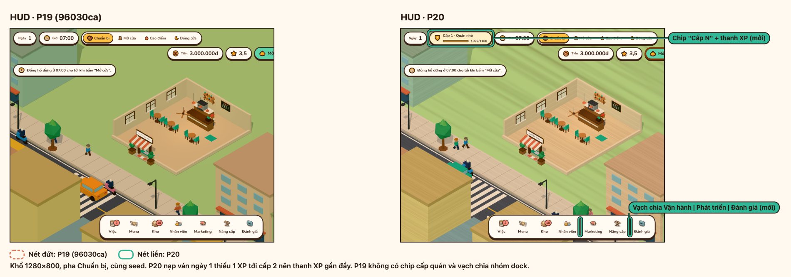
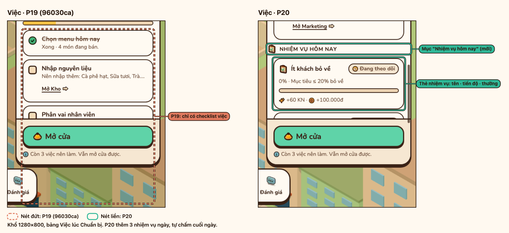
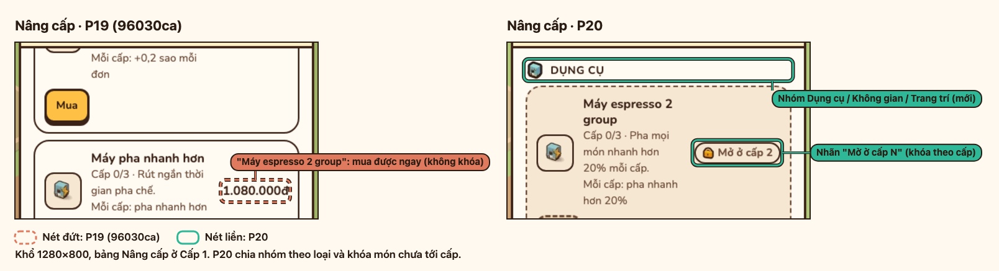
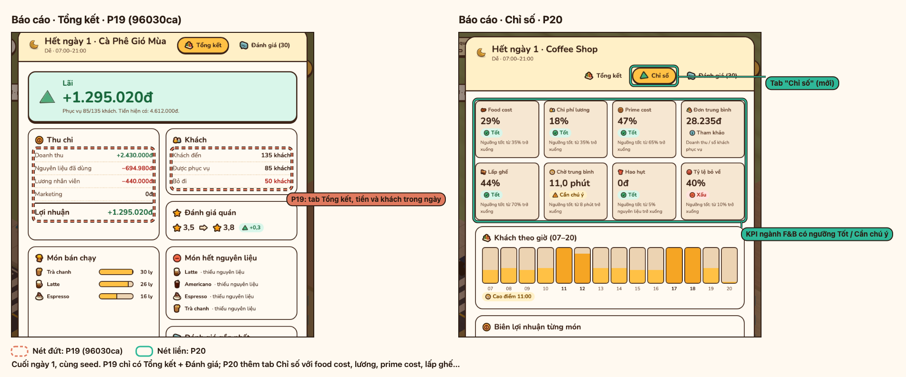
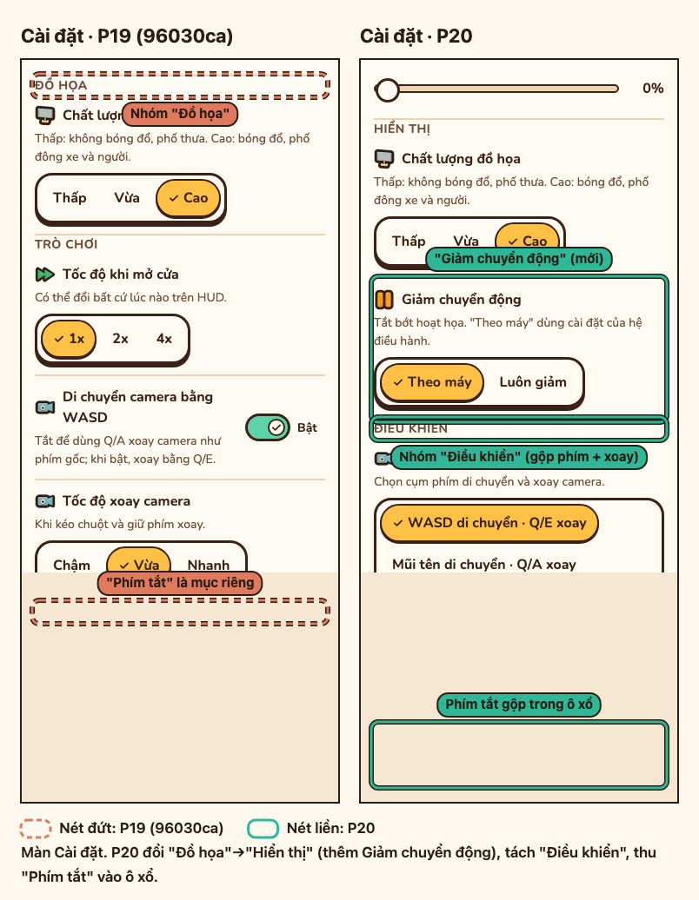
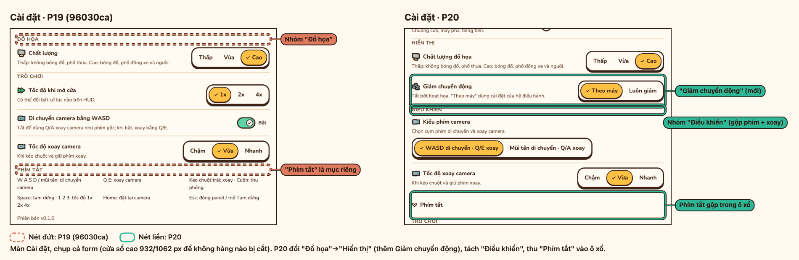
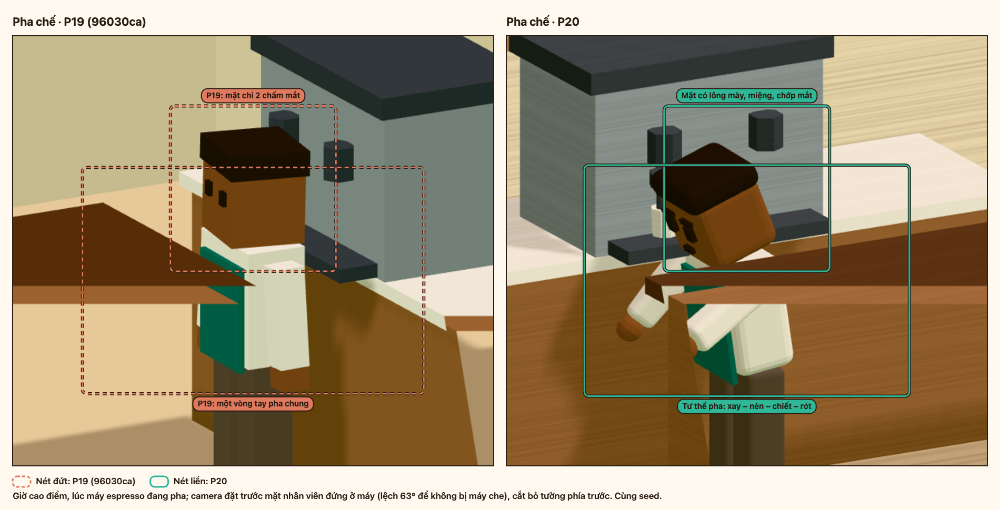
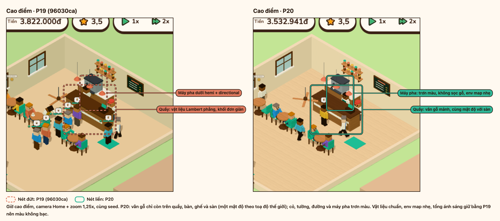

# P20 — Chiều sâu lối chơi và nâng chất 3D

Báo cáo P20: chấm hiện trạng 3D rồi cải tiến, cấp quán/nhiệm vụ/chỉ số và sắp xếp lại Cài đặt, kèm bằng chứng ảnh trước/sau (P19 `96030ca` → P20) và số đo khởi động.

## Bằng chứng ảnh trước/sau

```sh
npm run media:p20
```

Lệnh dựng tám bảng vào `docs/media/`, mỗi bảng ghép P19 cạnh P20 cùng seed và góc máy, khoanh chỗ đã đổi (P19 nét đứt cam, P20 nét liền xanh); cách chạy ở [docs/media.md](../media.md#ảnh-trướcsau-p20).

| | |
| --- | --- |
| <br>HUD: chip "Cấp N" + thanh XP, vạch chia Vận hành \| Phát triển | <br>Bảng Việc: mục "Nhiệm vụ hôm nay" ba thẻ |
| <br>Nâng cấp: nhóm Dụng cụ/Không gian/Trang trí, nhãn "Mở ở cấp N" | <br>Daily Report: tab Chỉ số với KPI ngành F&B |
| <br>Cài đặt 390 px: Hiển thị + Giảm chuyển động, Điều khiển, Phím tắt trong ô xổ | <br>Cài đặt 1280 px: cùng cấu trúc mới |
| <br>Cận cảnh quầy: nhân vật có mặt biểu cảm và chuỗi xay–nén–chiết–rót | <br>Giờ cao điểm: vật liệu chuẩn + RoomEnvironment, quầy chi tiết hơn |

## Chấm 3D: hiện trạng P19 → P20

Nguồn: `src/render/actors/rig.ts`, `animations.ts`, `src/render/scene/renderer.ts`, `environment.ts`, `parts.ts`, `shop.ts`.

| Hạng mục | P19 | P20 |
| --- | --- | --- |
| Hình khối nhân vật | Hộp vuông cạnh sắc, không cổ. | Hộp bo cạnh (`RoundedBoxGeometry`) bắt sáng; thêm khối cổ, tay tròn hơn. |
| Khuôn mặt | 2 chấm mắt; giận chỉ đổi màu da đỏ. | Lông mày + miệng đổi theo tâm trạng (vui/thường/sốt ruột/giận), có chớp mắt lệch pha (`blinkFor`). |
| Idle | Cùng pha, đám đông nhún đều. | Chớp mắt và nhịp thở lệch pha theo id nên đám đông tự nhiên. |
| Thao tác pha chế | Một vòng gộp chung. | Một vòng đọc ra bốn nhịp: xay → nén → chiết → rót (`poseFor`, beat trong `animations.ts`). |
| Cá tính khách | Không. | 5 persona kèm phụ kiện (túi, ba lô, khăn) gắn lên thân (`ACCESSORIES` trong `rig.ts`). |
| Vật liệu cảnh | `MeshLambertMaterial` phẳng, không texture. | `MeshStandardMaterial` phẳng + `CanvasTexture` vân nhỏ vẽ lúc chạy (`parts.ts`). |
| Ánh sáng | Hemi 1,6 + Directional 1,8. | Thêm `scene.environment` từ `RoomEnvironment` của three qua `PMREMGenerator` (`environment.ts`) ở mức Vừa/Cao với cường độ 0,1, hemi hạ còn 1,0 để tổng ánh sáng và độ tương phản giữ bằng P19 (`LIGHTING` trong `renderer.ts`); mức Thấp giữ nguyên đèn P19. |
| Dụng cụ quầy | Máy espresso + máy nhanh. | 5 dụng cụ mới (máy xay, tủ bánh, máy xay sinh tố, máy làm đá, máy rửa) là mesh gộp một draw call (`shop.ts`). |

Mọi cải tiến trên là procedural trong code: không nhúng file ảnh/HDRI, **0 byte tải thêm**, giữ style hoạt hình và ngân sách tải.

## Khởi động và FPS

Mục tiêu: Main Menu di động (150 ms RTT, 1,6 Mbps, CPU chậm 4 lần) dưới 1000 ms; FPS không tụt so với P19.

```sh
node scripts/measure-startup.mjs --base 96030ca --runs 3
```

Trung vị 3 lần, Chrome headless không cache trên Apple M2 (ANGLE Metal), so P19 `96030ca` với P20:

| Cấu hình | Mốc | P19 (96030ca) | P20 |
| --- | --- | --- | --- |
| Di động (150 ms RTT, 1,6 Mbps, CPU 4x) | Nội dung đầu tiên | 760 ms | 532 ms |
| Di động | **Main Menu** | 995 ms | **762 ms** |
| Di động | Cảnh 3D | 3072 ms | 2775 ms |
| Máy bàn, không giới hạn | Main Menu | 99 ms | 162 ms |

Main Menu di động của P20 là **762 ms (< 1000 ms)**. Số đo dao động giữa các lượt; chỉ so hai bản trong cùng một lượt.

P20 không thêm byte tải đồ họa (procedural, `RoomEnvironment`, texture canvas); chunk JS tải trước Main Menu tăng từ 46,8 kB lên 56,4 kB gzip do mã UI/sim mới (cấp quán, nhiệm vụ, chỉ số, Cài đặt).

FPS giờ cao điểm ở mức Vừa và Cao đo bằng `node scripts/measure-startup.mjs --base 96030ca --runs 3 --fps` (cách đo ở [docs/media.md](../media.md#đo-fps)).

## Nguồn và license asset tham khảo

P20 **không nhúng asset ngoài nào**; Poly Haven chỉ dùng tham khảo màu và tông ánh sáng rồi vẽ lại trong code.

| Nguồn | URL | License | Dùng để |
| --- | --- | --- | --- |
| Poly Haven FAQ | https://docs.polyhaven.com/en/faq | CC0 | Xác nhận license; không nhúng asset. |
| Poly Haven — HDRIs | https://polyhaven.com/hdris | CC0 | Tham khảo tông ánh sáng ấm; thay bằng `RoomEnvironment` trong code. |
| Poly Haven — Textures | https://polyhaven.com/textures | CC0 | Tham khảo màu gỗ/gạch; vẽ lại đơn giản bằng `CanvasTexture`. |

Nếu sau này nhúng bất kỳ asset Poly Haven nào, ghi nguồn + CC0 từng file vào [THIRD_PARTY_NOTICES.md](../../THIRD_PARTY_NOTICES.md).
