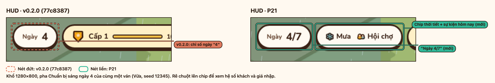
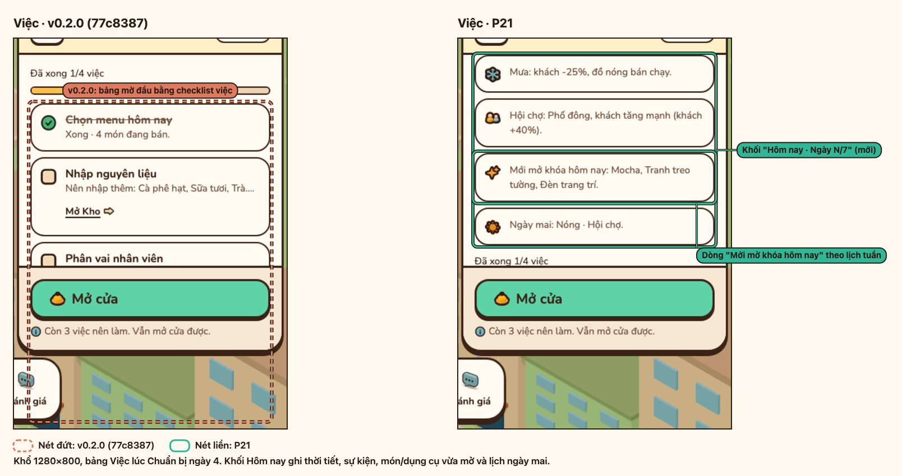
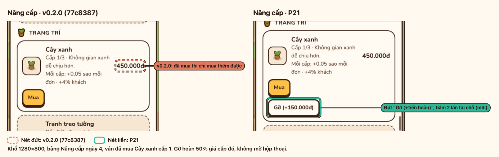
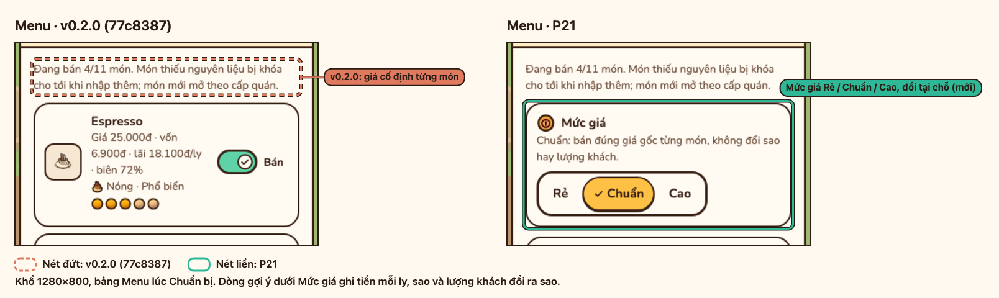
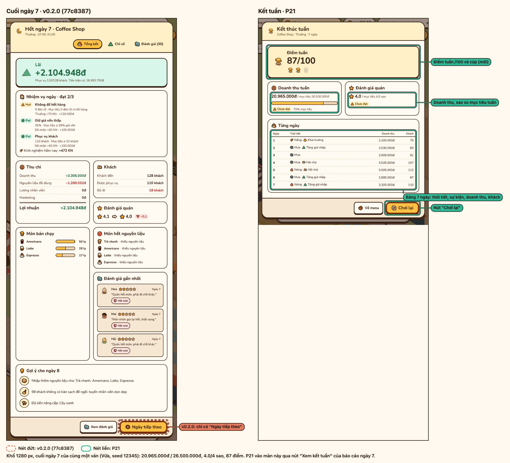
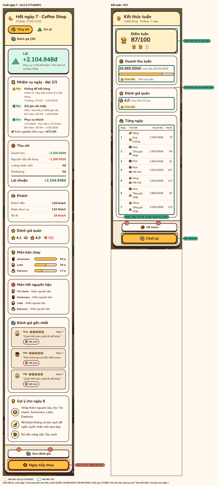

# P21 — Tuần 7 ngày

Báo cáo P21: lịch mở khoá theo ngày, sự kiện và thời tiết theo seed, mục tiêu và màn kết tuần, kèm log mô phỏng 7 ngày, ảnh trước/sau (v0.2.0 `77c8387` → P21), mẫu JSON số liệu chơi và kết quả kiểm tra. Luật đầy đủ ở [spec/week-7-days.md](../spec/week-7-days.md), chỗ code ở [architecture.md](../architecture.md#tuần-7-ngày).

## Lịch mở khoá

| Ngày | Mở mới |
| --- | --- |
| 1 | Món khởi đầu, Thêm bàn ghế, Cây xanh |
| 2 | Cappuccino, Máy xay hạt |
| 3 | Nước cam, Tủ bánh |
| 4 | Mocha, Tranh treo tường, Đèn trang trí |
| 5 | Cà phê đá xay, Máy xay sinh tố, Khu ngồi ngoài trời |
| 6 | Bánh ngọt, Máy làm đá, Quầy bar cửa sổ |
| 7 | Máy rửa ly, Mở rộng diện tích (tặng cấp 1) |

Từ ngày 2 ngày nào cũng có mở mới; test `tests/sim/week-unlocks.test.ts` và `tests/integration/week.test.ts` giữ luật không quá 2 ngày liền không mở gì và mở rộng quán ngày 7.

## Mô phỏng 7 ngày cùng seed

```sh
npx vitest run tests/integration/week.test.ts --silent=false
```

Ván Thường, seed `12345`, chiến lược cơ bản (mỗi sáng nhập hàng theo gợi ý, tự phục vụ một mình, không thuê, không nâng cấp):

| Ngày | Thời tiết | Sự kiện | Khách tới | Doanh thu | Giá vốn | Ly bán | Giá vốn/ly |
| --- | --- | --- | --- | --- | --- | --- | --- |
| 1 | Nắng | Khai trương | 111 | 2.200.000 | 675.250 | 75 | 9.003 |
| 2 | Mưa | Tăng giá nhập | 86 | 2.630.000 | 1.044.093 | 83 | 12.579 |
| 3 | Mưa | Ngày thường | 94 | 2.905.000 | 907.625 | 91 | 9.974 |
| 4 | Mưa | Hội chợ | 116 | 3.525.000 | 1.102.925 | 107 | 10.308 |
| 5 | Nóng | Hội chợ | 135 | 3.505.000 | 1.055.975 | 112 | 9.428 |
| 6 | Mưa | Tăng giá nhập | 93 | 2.895.000 | 1.145.033 | 87 | 13.161 |
| 7 | Nóng | Tăng giá nhập | 128 | 3.305.000 | 1.200.052 | 110 | 10.910 |

- Ngày nào cũng có mưa, nóng hoặc sự kiện; không hai ngày liền nhau cùng cặp thời tiết và sự kiện. Chạy lại cùng seed ra đúng bảng này.
- Doanh thu 7 ngày 20.965.000 đ, bằng 79% mục tiêu Thường (26.500.000 đ). Sao cuối tuần 3,98 / mục tiêu 4. Điểm tuần 87/100, 2 cúp.

Tách riêng từng biến số: chơi lại sáng ngày 3 với thời tiết và sự kiện thay bằng tay, trung bình 3 seed (`12345`, `777`, `20261016`):

| Ngày 3 chơi lại | Khách tới | So ngày thường nắng | Giá vốn/ly | So ngày thường nắng |
| --- | --- | --- | --- | --- |
| Nắng, ngày thường | 111,7 | | 9.294 | |
| Nắng, hội chợ | 131,3 | +17,6% | 9.263 | −0,3% |
| Mưa, ngày thường | 93,3 | −16,4% | 9.589 | +3,2% |
| Nắng, tăng giá nhập | 111,7 | 0% | 11.617 | +25,0% |

## Ảnh trước/sau

```sh
npm run media:p21
```

Lệnh nạp cùng ván của tuần trên (sáng ngày 4: mưa, hội chợ; và cuối ngày 7) vào v0.2.0 `77c8387` và P21, rồi ghép từng cặp ảnh. v0.2.0 khoanh nét đứt cam, P21 khoanh nét liền xanh. Cách chạy ở [docs/media.md](../media.md#ảnh-trướcsau-p21).

| | |
| --- | --- |
| <br>HUD ghi "Ngày 4/7", thêm chip thời tiết và sự kiện của hôm nay. | <br>Bảng Việc có thêm khối Hôm nay ở đầu, gồm dòng "Mới mở khóa hôm nay: Mocha, Tranh treo tường, Đèn trang trí". |
| <br>Thẻ trang trí đã mua có nút "Gỡ (+150.000đ)", bấm hai lần tại chỗ. | <br>Bảng Menu có thêm Mức giá Rẻ / Chuẩn / Cao, đổi tại chỗ, dòng gợi ý ghi tác động. |
| <br>1280 px: báo cáo ngày 7 của v0.2.0 chỉ có "Ngày tiếp theo"; P21 có màn kết tuần với điểm, cúp, doanh thu và sao so mục tiêu, bảng 7 ngày, nút Chơi lại. | <br>390 px: cùng màn kết tuần, bảng 7 ngày xuống dòng và hai nút xếp dọc. |
| <br>v0.2.0 hết form ở dòng Phiên bản; P21 thêm nhóm Số liệu chơi: lần dừng gần nhất (ngày, pha, giờ game), Xuất JSON và Xoá. | |

## Số liệu chơi

[`docs/media/playlog-p21.json`](../media/playlog-p21.json) là file mà nút Xuất JSON tạo ra sau lượt chơi trong `npm run media:p21`: nạp ván sáng ngày 4, mở cửa, về Main Menu lúc 11:00 (giờ cao điểm). Mỗi dòng chỉ có `v`, `run`, `kind`, `day`, `phase`, `minute`, `at`:

```json
{
  "version": 1,
  "exportedAt": 1760400119746,
  "entries": [
    { "v": 1, "run": "9a650cba-1074-4848-b472-243e7f452762", "kind": "run_start", "day": 4, "phase": "preparation", "minute": 420, "at": 1760400013262 },
    { "v": 1, "run": "9a650cba-1074-4848-b472-243e7f452762", "kind": "phase", "day": 4, "phase": "opening", "minute": 420, "at": 1760400080588 },
    { "v": 1, "run": "9a650cba-1074-4848-b472-243e7f452762", "kind": "phase", "day": 4, "phase": "peak", "minute": 660, "at": 1760400114613 },
    { "v": 1, "run": "9a650cba-1074-4848-b472-243e7f452762", "kind": "quit_to_menu", "day": 4, "phase": "peak", "minute": 660, "at": 1760400116141 }
  ],
  "lastStops": [
    { "run": "9a650cba-1074-4848-b472-243e7f452762", "kind": "quit_to_menu", "day": 4, "phase": "peak", "minute": 660, "at": 1760400116141 }
  ]
}
```

`lastStops` cho biết lượt này dừng ở ngày 4, pha cao điểm, 11:00 giờ game. `at` là giờ thật (epoch ms).

## Kiểm tra

| Lệnh | Kết quả |
| --- | --- |
| `npm run check` (`tsc --noEmit`, `vitest run`, `vite build`) | Không lỗi type; 59 file test, 817 test pass; build xong. |
| `npx vitest run tests/integration/week.test.ts` | 9 test pass. |
