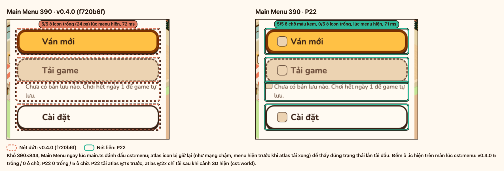
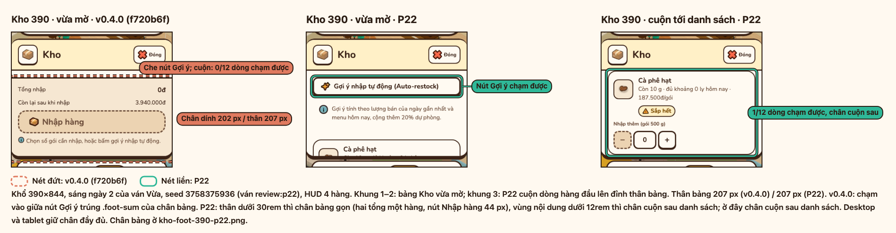
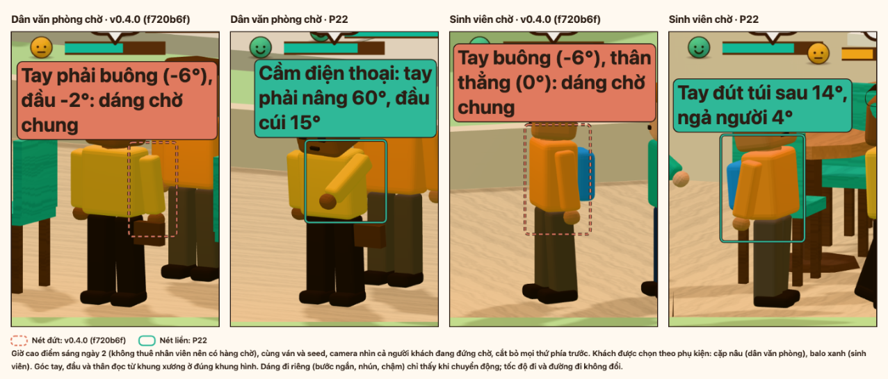
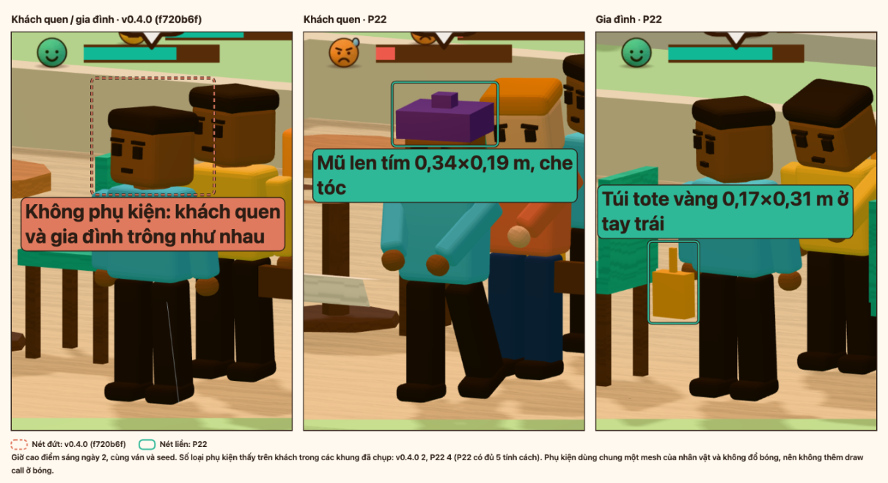
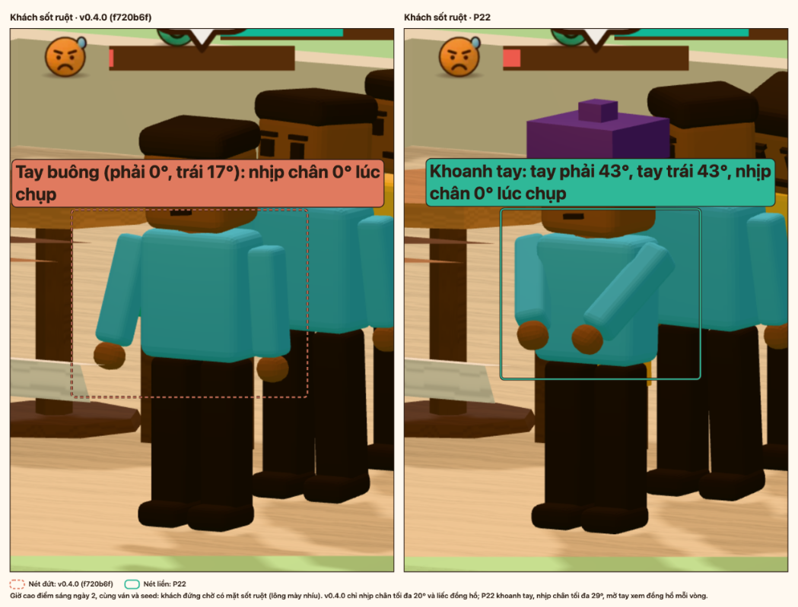
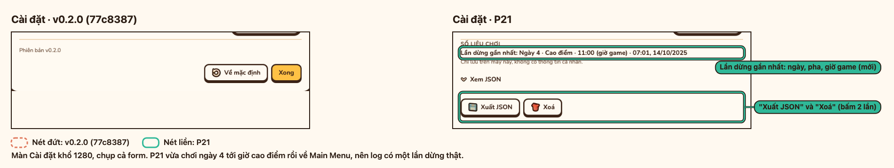

# P22 — Review giao diện, bố cục, nhân vật, nghiệp vụ và hiệu năng

Danh sách vấn đề tìm được khi chơi tuần 7 ngày ở khổ điện thoại và desktop, so với v0.4.0 `f720b6f`: bằng chứng, điểm tác động × công sức, phần đã sửa kèm ảnh trước/sau, số đo hiệu năng và phần để đợt sau.

- [1. Cách review](#1-cách-review)
- [2. Mọi vấn đề](#2-mọi-vấn-đề)
- [3. Đã sửa](#3-đã-sửa)
- [4. Hiệu năng](#4-hiệu-năng)
- [5. Để đợt sau](#5-để-đợt-sau)
- [6. Kiểm tra](#6-kiểm-tra)

## 1. Cách review

| Phần | Lệnh | Khổ màn | Seed, độ khó | Mốc |
| --- | --- | --- | --- | --- |
| Chơi tuần, chụp, đo từng màn | `npm run review:p22` ([media.md](../media.md#review-tuần-p22)) | 390×844 (điện thoại, tỉ lệ 3, cảm ứng), 1440×900 | `3758375936`, Vừa | Mã game của `f3e8b3a` trùng `f720b6f` (chỉ thêm script) |
| Mô phỏng kinh tế | `npx vitest run tests/integration/p22-strategies.test.ts` ([p22-economy.md](p22-economy.md)) | | `1, 42, 777, 2024, 31337, 9001`; Dễ, Vừa, Khó; 5 chiến lược | `f720b6f` |
| Bảng trước/sau | `npm run media:p22` ([media.md](../media.md#ảnh-trướcsau-p22)) | 390×844 (menu, Kho), 1280×800 (cận cảnh) | `3758375936`, Vừa, sáng ngày 2 | `f720b6f` |
| Khởi động và FPS | `node scripts/measure-startup.mjs --base f720b6f --runs 5`, rồi `--runs 3 --fps-only` | Máy bàn; di động 150 ms RTT, 1,6 Mbps, CPU 4x; FPS 1280×800 @2x | Ngày 1 Dễ, 4x | `f720b6f` |

Các bước `review:p22`:

1. Ngày 1 chơi qua UI ở 4x: Main Menu, mọi bảng dock, cao điểm 11:00, hàng chờ 11:45, Daily Report.
2. Ngày 2–7 nạp ván sáng do sim dựng (nhập theo gợi ý, tự phục vụ), chụp HUD và bảng Việc, nhập hàng, thuê 2 nhân viên, chụp cao điểm.
3. Ngày 7 chụp thêm báo cáo và màn kết tuần. Tuần review: doanh thu 20.890k / mục tiêu 26.500k, 4,1 / 4,0 sao, 87 điểm, 2 cúp.
4. Ảnh nằm ở `p22-review/390/` và `p22-review/1440/`; số đo ở [metrics.json](p22-review/metrics.json), vấn đề tự rút ở [findings.json](p22-review/findings.json).

Điểm = impact / effort (mỗi thang 1–3). Mục "cao" khi điểm ≥ 1,5; đợt này chỉ sửa mục cao có công sức 1 và không đổi `WEEK_GOALS`, `DAY_EVENTS`, giá món, lương.

## 2. Mọi vấn đề

Xếp theo điểm, rồi theo impact.

| Id | Mảng | Mô tả | Bằng chứng | Impact | Effort | Điểm | Quyết định |
| --- | --- | --- | --- | --- | --- | --- | --- |
| layout-blocked-suggest-390 | Bố cục | Chân bảng Kho dính (~190 px) che nút Gợi ý nhập và đầu danh sách ở 390 | [d2](p22-review/390/d2-blocked-suggest.jpg), [d5](p22-review/390/d5-blocked-suggest.jpg), [d7](p22-review/390/d7-blocked-suggest.jpg); `blocked.390/d2-suggest` | 3 | 1 | 3 | Đã sửa |
| actors-persona-motion | Nhân vật | Các cá tính chỉ khác một phụ kiện, đi và đứng chờ như nhau | [390 d4](p22-review/390/d4-peak.jpg), [1440 d4](p22-review/1440/d4-peak.png) | 3 | 1 | 3 | Đã sửa |
| E2 | Nghiệp vụ | Khó đạt 3 cúp dễ như Thường | Khó b: 3 cúp 6/6 seed; mục tiêu Khó 23.000k < Thường 26.500k ([E2](p22-economy.md#vấn-đề)) | 3 | 1 | 3 | Để đợt sau: đổi `WEEK_GOALS`, phá cân bằng P21 |
| E6 | Nghiệp vụ | Giá Cao luôn thắng giá Chuẩn | d − c: lãi +2.143k đến +3.075k, 18/18 ván; cúp vẫn 3 ([E6](p22-economy.md#vấn-đề)) | 3 | 1 | 3 | Để đợt sau: cần đổi chấm điểm tuần |
| ui-icons-blank-390 | Giao diện | 5/5 ô icon trống lúc Main Menu hiện (atlas@2x chưa tải) | [d0-menu-first](p22-review/390/d0-menu-first.png); `menu.390.icons` | 2 | 1 | 2 | Đã sửa |
| ui-icons-blank-1440 | Giao diện | 5/5 ô icon trống lúc Main Menu hiện (atlas@1x chưa tải) | [d0-menu-first](p22-review/1440/d0-menu-first.png); `menu.1440.icons` | 2 | 1 | 2 | Đã sửa |
| actors-persona-accessory | Nhân vật | Khách quen và gia đình không có phụ kiện, trông như nhau | [390 d4](p22-review/390/d4-peak.jpg), [1440 d4](p22-review/1440/d4-peak.png) | 2 | 1 | 2 | Đã sửa |
| actors-impatient-silhouette | Nhân vật | Dáng sốt ruột (gõ chân nhẹ) khó thấy từ camera chéo | [390 d4](p22-review/390/d4-peak.jpg) | 2 | 1 | 2 | Đã sửa |
| E5 | Nghiệp vụ | Máy rửa ly mở ngày 7, máy làm đá ngày 6: mua là lỗ | Lỗ 36/36 ván, có bật món hay không ([E5](p22-economy.md#vấn-đề)) | 2 | 1 | 2 | Đã sửa |
| E1 | Nghiệp vụ | Điểm tuần chạm trần: mọi chiến lược có thuê người đều 3 cúp | Điểm 95–100 ở 72/72 ván ([E1](p22-economy.md#vấn-đề)) | 3 | 2 | 1,5 | Để đợt sau: cần đổi `scoreWeek` |
| E4 | Nghiệp vụ | Dụng cụ không hoàn vốn trong tuần, càng khó càng lỗ | Hoàn vốn 47% / 36% / 19% ([E4](p22-economy.md#vấn-đề)) | 3 | 2 | 1,5 | Để đợt sau: E5 nâng lên 69% / 51% / 27% |
| perf-startup-mobile | Hiệu năng | Main Menu và cảnh 3D trên di động chậm hơn v0.4.0 | Main Menu 1008 / 890 ms, cảnh 3D 3050 / 2773 ms ([p22-perf.txt](../media/p22-perf.txt)) | 2 | 2 | 1 | Để đợt sau: cần đo lại nhiều lượt |
| perf-fps-1440 | Hiệu năng | FPS cao điểm 3 (< 55) ở 7/7 ngày | `peaks.1440/d1.fps`–`d7.fps` (SwiftShader) | 3 | 3 | 1 | Để đợt sau |
| perf-fps-390 | Hiệu năng | FPS cao điểm 2,4 (< 55) ở 7/7 ngày | `peaks.390/d1.fps`–`d7.fps` (SwiftShader) | 3 | 3 | 1 | Để đợt sau |
| E7 | Nghiệp vụ | Marketing rẻ nhất gần như luôn lỗ: khách thêm bỏ về | e − c: lãi −217k đến −483k, thắng 3/18 ([E7](p22-economy.md#vấn-đề)) | 2 | 2 | 1 | Để đợt sau |
| E8 | Nghiệp vụ | Không có áp lực tiền: cuối tuần dư gấp 6–11 lần vốn đầu | Tiền thấp nhất toàn bộ 184k, không âm ở 90/90 ván ([E8](p22-economy.md#vấn-đề)) | 2 | 2 | 1 | Để đợt sau |
| E9 | Nghiệp vụ | Điểm tuần không tính lãi, chi tiền không bị phạt | c lãi thấp hơn b 1.917k–3.719k, điểm c ≥ b ([E9](p22-economy.md#vấn-đề)) | 2 | 2 | 1 | Để đợt sau |
| E3 | Nghiệp vụ | Thuê 1 pha chế luôn lãi hơn tự làm | b − a: 18/18 ván thắng ([E3](p22-economy.md#vấn-đề)) | 2 | 2 | 1 | Không sửa: lựa chọn luôn lãi, không phải lỗi |
| E10 | Nghiệp vụ | Ngày nhàm (không mở khóa, không sự kiện) | 0 ở 90/90 ván ([E10](p22-economy.md#vấn-đề)) | 1 | 1 | 1 | Không sửa: không có ngày nhàm |
| actors-stuck-walking | Nhân vật | Người bước tại chỗ > 5 s | `stuckWalking` = 0 ở 14/14 lần đo cao điểm | | | | Không sửa: không có lỗi |
| actors-queue-overlap | Nhân vật | Khách chồng lên nhau trong hàng | Ảnh cao điểm không có ai lồng vào nhau; `separate()` trong `sync.ts` đã đẩy ra | | | | Không sửa: không có bằng chứng |
| actors-wait-expression | Nhân vật | Mặt khách chờ lâu | Thanh kiên nhẫn và mặt trên đầu (`labels.ts`) đã có | | | | Không sửa: phần dáng người nằm ở actors-impatient-silhouette |

Nguồn: mục `layout-*`, `ui-*`, `perf-fps-*` từ [findings.json](p22-review/findings.json); `actors-*` từ [fixed-actors.json](p22-review/fixed-actors.json); `E1`–`E10` từ [p22-economy.md](p22-economy.md#vấn-đề); `perf-startup-mobile` từ [p22-perf.txt](../media/p22-perf.txt).

## 3. Đã sửa

v0.4.0 khoanh nét đứt cam, P22 nét liền xanh.

| Id | Đã sửa gì | Test |
| --- | --- | --- |
| ui-icons-blank-390, ui-icons-blank-1440 | Ô icon hiện ô chờ màu kem tới khi atlas @1x tải xong; atlas @2x chỉ tải sau khi cảnh 3D hiện (`cst:world`). Bảng: 0/5 ô trống (v0.4.0 5/5). | `tests/ui/icons-loading.test.ts`, `tests/ui/icons.test.ts`, `tests/ui/styles.test.ts` |
| layout-blocked-suggest-390 | Thân bảng có chân thấp dưới 30rem thì chân không dính mà cuộn sau danh sách; desktop, tablet giữ chân dính. Bảng: nút Gợi ý chạm được, 1/12 dòng chạm được khi cuộn (v0.4.0 0/12). | `tests/ui/layout-overflow.test.ts`, `tests/ui/p22-review-fixes.test.ts` |
| actors-persona-motion | Mỗi cá tính có dáng đi và thói quen lúc chờ riêng (văn phòng xem điện thoại, sinh viên tay đút túi, sành cà phê chắp tay sau lưng, gia đình nhìn quanh); tốc độ và đường đi không đổi. | `tests/render/actors.test.ts` |
| actors-persona-accessory | Khách quen đội mũ len tím, gia đình xách túi vải vàng; dùng chung ô mesh phụ kiện, không đổ bóng. | `tests/render/actors.test.ts` |
| actors-impatient-silhouette | Khách sốt ruột khoanh tay, gõ chân 0,5 rad (trước 0,35), mỗi vòng gỡ tay xem đồng hồ. | `tests/render/actors.test.ts` |
| E5 | Máy làm đá mở ngày 2, giá gốc 80k (trước ngày 6, 200k); máy rửa ly mở ngày 4, giá gốc 400k (trước ngày 7, 800k). Hoàn vốn dụng cụ trong tuần 47/36/19% → 69/51/27%. | `tests/sim/week-tool-payback.test.ts`, `tests/sim/week-unlocks.test.ts` |
| Chụp Cài đặt | `media:p20`, `media:p21` chụp cả form Cài đặt thay vì phần nằm trong cửa sổ. | |

Bảng trước/sau:

- Ô icon Main Menu 390: 
- Chân bảng Kho 390: 
- Dáng chờ theo cá tính: 
- Phụ kiện khách quen và gia đình: 
- Dáng sốt ruột: 
- Cài đặt cả form (P21): 

E5 không có ảnh; số trước/sau ở [p22-economy.md](p22-economy.md#đã-sửa).

## 4. Hiệu năng

Chrome headless, Apple M2 (ANGLE Metal), `vite preview`, không cache. Số đầy đủ ở [p22-perf.txt](../media/p22-perf.txt).

Khởi động, trung vị 5 lượt:

| Số đo | Cấu hình | v0.4.0 `f720b6f` | P22 | Ngưỡng | Đạt |
| --- | --- | --- | --- | --- | --- |
| Main Menu hiện | Di động: 150 ms RTT, 1,6 Mbps, CPU 4x | 890 ms | 1008 ms | < 1000 ms | Không |
| Cảnh 3D hiện | Di động: 150 ms RTT, 1,6 Mbps, CPU 4x | 2773 ms | 3050 ms | ≤ 2829 ms | Không |
| Nội dung đầu tiên | Di động | 288 ms | 364 ms | | |
| Main Menu hiện | Máy bàn, không giới hạn | 67 ms | 134 ms | | |
| Cảnh 3D hiện | Máy bàn, không giới hạn | 272 ms | 285 ms | | |

FPS cao điểm ngày 1 (Dễ, 4x), 1280×800 @2x, 10 s mỗi lượt, hai bản xen kẽ:

| Mức đồ họa | Lượt đo | v0.4.0 `f720b6f` | P22 | Ngưỡng | Đạt |
| --- | --- | --- | --- | --- | --- |
| Vừa | `--runs 3 --fps-only` (trung vị) | 19,7 | 27,1 | 60 | Không |
| Cao | `--runs 3 --fps-only` (trung vị) | 24,9 | 23,3 | 60 | Không |
| Vừa | `--runs 5`, 5 lượt trước khi lệnh hết giờ (trung vị) | 24,0 | 23,5 | 60 | Không |
| Vừa, SwiftShader, hai khổ cùng lúc | `review:p22`, thấp nhất 7 ngày | 2,4 (390), 3 (1440) | | 60 | Không |

Không bản nào tụt quá 10% so với v0.4.0 (dòng `ok` của `--fps-only`). Số đo lệch nhiều giữa các lượt (một bản 16,0–29,9 FPS ở mức Vừa).

## 5. Để đợt sau

| Thứ tự | Id | Điểm | Việc cần làm |
| --- | --- | --- | --- |
| 1 | E2 | 3 | Mục tiêu và ngưỡng cúp riêng cho Khó (`WEEK_GOALS`). |
| 2 | E6 | 3 | Làm giá Cao có cái giá rõ hơn (sao, khách bỏ về) hoặc tính vào điểm tuần. |
| 3 | E1 | 1,5 | Giãn thang điểm tuần để chơi tốt và chơi tồi khác điểm (`scoreWeek`). |
| 4 | E4 | 1,5 | Tủ bánh, máy xay sinh tố: hoàn vốn trong tuần, hoặc gợi ý bật món đi kèm. |
| 5 | perf-startup-mobile | 1 | Đo lại khởi động di động nhiều lượt; nếu vẫn chậm hơn v0.4.0 thì tìm phần thêm vào chunk chính và CSS. |
| 6 | perf-fps-1440, perf-fps-390 | 1 | Giảm draw call giờ cao điểm để tiến tới 60 FPS. |
| 7 | E7 | 1 | Marketing: hiệu quả khi quán còn chỗ, hoặc báo quán đã đầy. |
| 8 | E8 | 1 | Áp lực tiền trong tuần (chi phí cố định, giá vốn). |
| 9 | E9 | 1 | Tính lãi vào điểm tuần. |

## 6. Kiểm tra

| Lệnh | Kiểm gì | Kết quả |
| --- | --- | --- |
| `npm run check` | `tsc --noEmit`, `vitest run`, `vite build` | Pass: 66 file test, 915 test; build xong |
| `npm run layout` | Tràn ngang ở 390×844, 768×1024, 1440×900; CLS = 0 ở bảng Kho khi đổi số gói ([media.md](../media.md#kiểm-lề-và-cls)) | Pass: 27/27 kiểm (24 màn × khổ không tràn ngang, không lệch khung; CLS bảng Kho 0,000000 ở cả 3 khổ, khung tổng và danh sách lệch 0,0 px) |
