# P23 — Ảnh trước/sau HUD, Daily Report, tổng kết tuần và màn tải

Ảnh so sánh P22 `f9508d8` với P23 ở 390×844 và 1280×720. Khung trái là P22 (khoanh nét đứt cam), khung phải là P23 (khoanh nét liền xanh); nhãn trên ảnh ghi chỗ đã đổi kèm số đo của lần chụp.

| Phần | Lệnh | Ván |
| --- | --- | --- |
| Toàn bộ ảnh | `npm run media:p23` ([media.md](../media.md#ảnh-trướcsau-p23)) | Vừa, seed `1760400000000 >>> 0`; mỗi bản chơi ván bằng sim của chính nó (nhập hàng theo gợi ý, tự phục vụ), nên số tiền có thể lệch giữa hai khung |

## 1. HUD lúc bắt đầu ngày và giờ cao điểm

| Khổ | Ảnh | Đã sửa |
| --- | --- | --- |
| 390 · chuẩn bị | 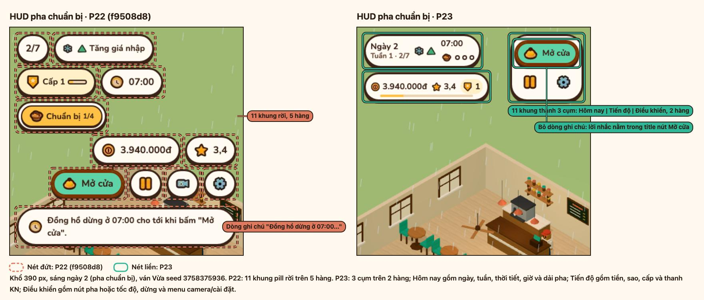 | 11 khung pill rời gộp thành 3 cụm Hôm nay, Tiến độ, Điều khiển; dòng ghi chú "Đồng hồ dừng ở 07:00…" bỏ đi, lời nhắc nằm trong title nút Mở cửa. |
| 1280 · chuẩn bị | 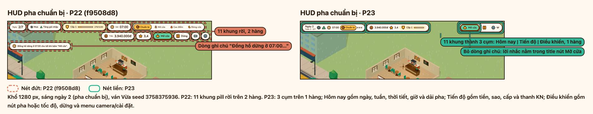 | 11 pill trên 2 hàng thành 3 cụm trên 1 hàng; bỏ dòng ghi chú pha chuẩn bị. |
| 390 · cao điểm | 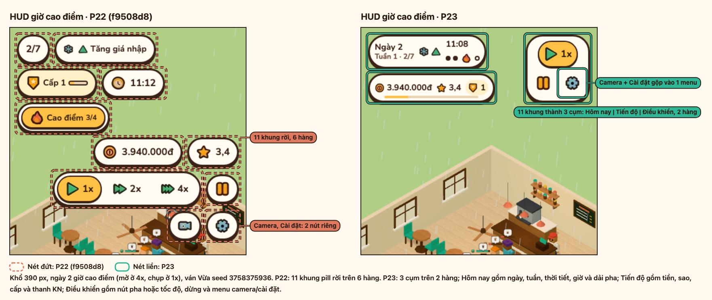 | 11 pill thành 3 cụm; hai nút Camera và Cài đặt gộp vào một menu sổ xuống. |
| 1280 · cao điểm | 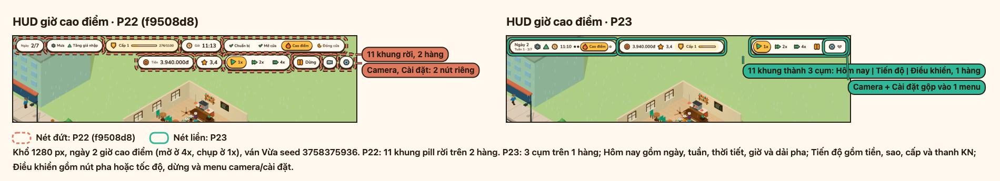 | 11 pill thành 3 cụm; tốc độ, Dừng và menu Camera/Cài đặt nằm chung cụm Điều khiển; 2 hàng thành 1 hàng, kể cả ngày có sự kiện "Tăng giá nhập". |

## 2. Daily Report ngày 3

| Khổ | Ảnh | Đã sửa |
| --- | --- | --- |
| 390 | 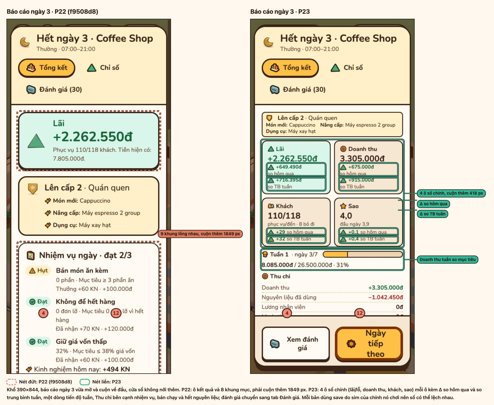 | Ô kết quả và các khung mục lồng nhau thành 4 ô số chính (lãi/lỗ, doanh thu, khách, sao), mỗi ô có Δ so hôm qua và Δ so TB tuần; phần phải cuộn giảm từ 1849 px xuống 418 px. |
| 1280 | 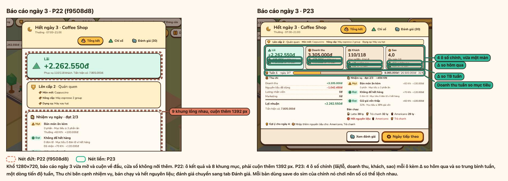 | 4 ô số kèm Δ so hôm qua và so TB tuần, một dòng doanh thu tuần so mục tiêu, Thu chi cạnh nhiệm vụ; phần phải cuộn 1392 px thành vừa một màn. |

## 3. Tổng kết tuần 1 và tuần 2

| Khổ | Ảnh | Đã sửa |
| --- | --- | --- |
| 390 · tuần 1 | 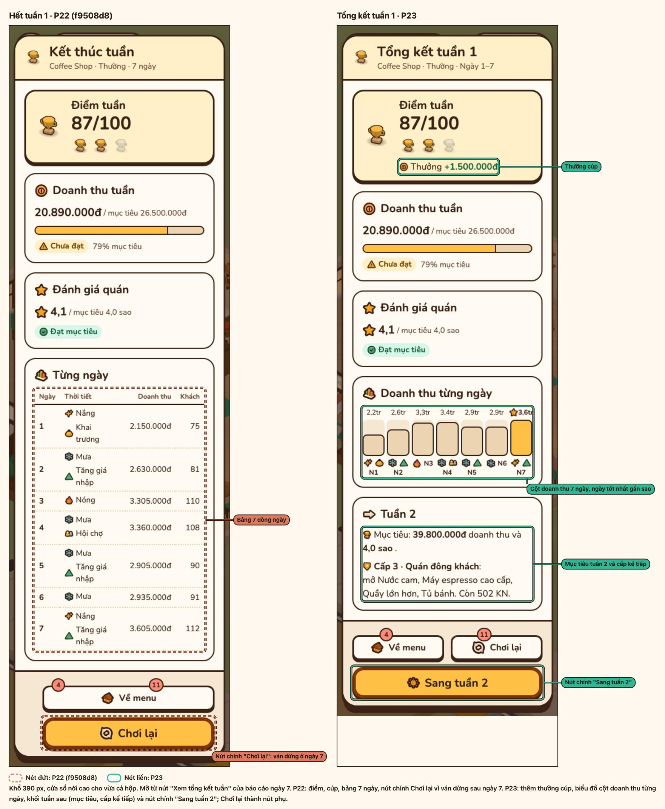 | Nút chính "Chơi lại" (ván dừng ở ngày 7) thành "Sang tuần 2"; bảng 7 dòng thành biểu đồ cột doanh thu có sao ở ngày tốt nhất; thêm thưởng cúp và khối mục tiêu tuần 2, cấp kế tiếp. |
| 1280 · tuần 1 | 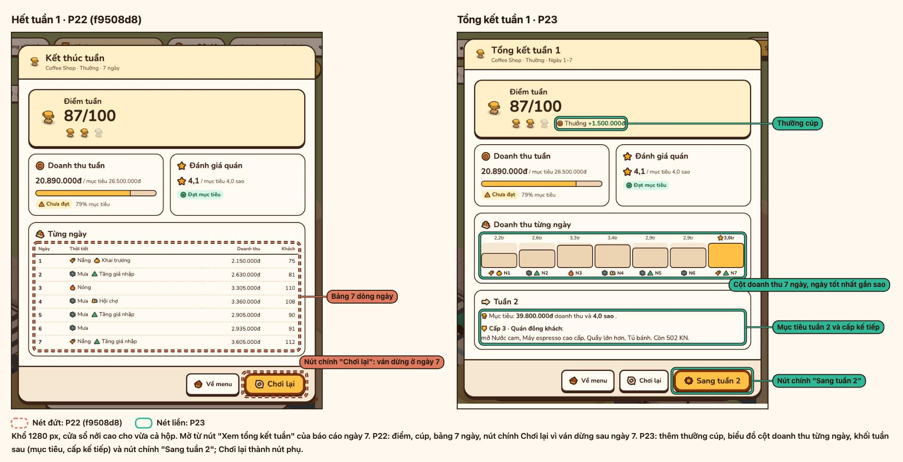 | Cùng thay đổi ở khổ desktop; Chơi lại và Về menu thành nút phụ. |
| 390 · tuần 2 | 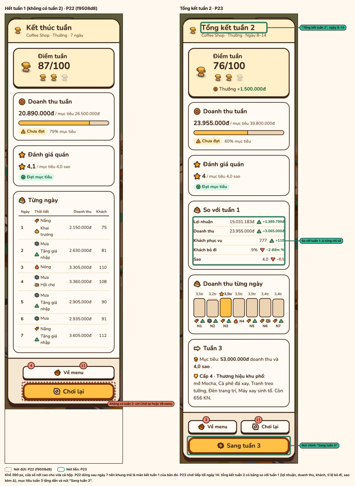 | P22 không có tuần 2 (khung trái là màn kết tuần 1 của P22); P23 có "Tổng kết tuần 2" với bảng so với tuần 1 kèm Δ từng chỉ số và nút "Sang tuần 3". |
| 1280 · tuần 2 | 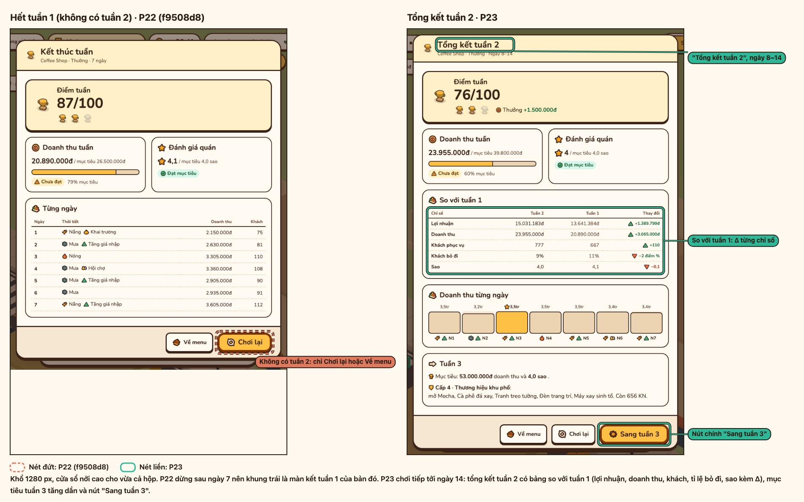 | Như trên ở khổ desktop: so với tuần 1 (lợi nhuận, doanh thu, khách, tỉ lệ bỏ đi, sao). |

## 4. Màn tải

| Khổ | Ảnh | Đã sửa |
| --- | --- | --- |
| 390 | 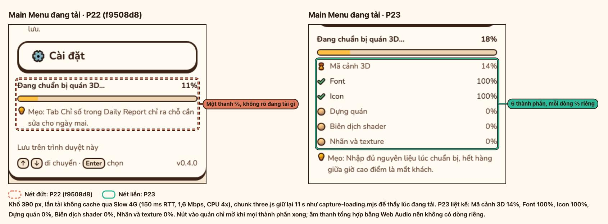 | Một thanh % chung thành danh sách thành phần (mã cảnh 3D, font, icon, dựng quán, biên dịch shader, nhãn và texture), mỗi dòng % riêng. |
| 1280 | 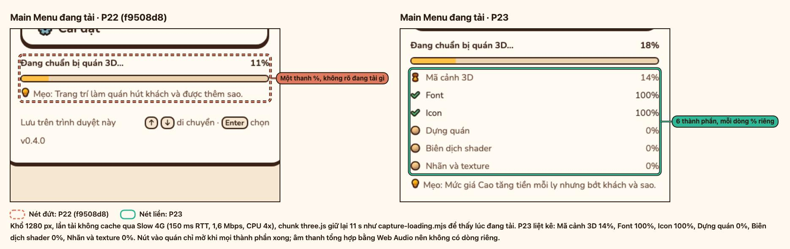 | Cùng danh sách ở khổ desktop: lúc chụp mã cảnh 3D 14%, font và icon 100%, ba bước dựng quán còn 0%; nút vào quán chỉ mở khi mọi thành phần xong. |

Số đo frame time trước/sau warm-up ở [p23-loading-frames.md](p23-loading-frames.md).
