# P24 — Nhập hàng cho món mới bật, thang giao diện chung

Báo cáo P24 so với P23 `3a08fe2`: vì sao Gợi ý nhập tự động bỏ sót Cam, Bột bánh, Bơ, cách sửa và mục tiêu tuần đo lại sau khi sửa; các chỗ đã thiết kế lại theo từng vùng; ảnh trước/sau có khoanh ở 390 và 1280 px; kết quả kiểm layout, khởi động và khung hình.

| Phần | Lệnh |
| --- | --- |
| Ảnh trước/sau | `npm run media:p24` ([media.md](../media.md#ảnh-trướcsau-p24)) |
| Lề, tràn ngang, số hàng HUD | `npm run layout` |
| Khởi động Main Menu | `npm run build && node scripts/measure-startup.mjs` |
| Khung hình 5 s đầu | `npm run perf:frames` |
| Kiểm tra code | `npm run check` |

## 1. Lỗi không tự nhập Cam, Bột bánh, Bơ

### Nguyên nhân gốc

| Chỗ | Hành vi ở P23 | Hệ quả |
| --- | --- | --- |
| `expectedDemand` (`src/sim/inventory.ts`) | Nhu cầu mỗi món đang bật = `sold + outOfStock` của ngày tham chiếu (hôm nay sau khi đóng cửa, hoặc ngày gần nhất trong lịch sử); chỉ ngày 1 mới chia theo độ phổ biến. | Món vừa bật (Nước cam ngày 3, Bánh ngọt ngày 6) chưa bán ly nào nên nhu cầu 0. |
| `autoRestockSuggestion` | Chỉ thêm nguyên liệu khi lượng dùng dự kiến × 1,2 vượt tồn kho. | Nguyên liệu riêng của món có nhu cầu 0 (Cam; Bột bánh, Bơ; Chanh khi Trà chanh bị ẩn) không bao giờ vào gợi ý. |
| `pickOrder` (`src/sim/customers.ts`) | Chỉ chọn trong các món còn làm được, trừ khi mọi món đều hết. `today.outOfStock` chỉ tăng khi khách bỏ về vì hết hàng. | Món hết nguyên liệu giữa ngày không để lại dấu vết nào, nên hôm sau vẫn nhu cầu 0: vòng lặp tự khoá. |

Không có dụng ý: món đã mở khoá và đã bật thì phải được nhập hàng. Test tái hiện viết trước khi sửa: `tests/sim/restock-demand.test.ts` (commit `0d96625`, đỏ có chủ ý).

### Cách sửa

| Thay đổi | Ở đâu |
| --- | --- |
| Món đang bật mà ngày tham chiếu không ghi nhận nhu cầu nhận phần theo độ phổ biến trên tổng số ly của ngày đó (tổng 0 thì dùng mặc định ngày 1). | `expectedDemand` |
| `pickOrder` cộng phần trọng số của mỗi món đang hết vào `DayStats.missedDemand` (trường tùy chọn, không rút thêm số ngẫu nhiên); nhu cầu hôm sau cộng phần này. Save cũ thiếu trường đọc là `{}`. | `pickOrder`, `DayStats` |
| Không đủ tiền thì không mua và báo "Thiếu …đ để nhập Cam, Bột bánh"; chân bảng Kho ghi số tiền còn thiếu. | `applyRestockSuggestion`, bảng Kho |
| Mỗi lần mua thành công phát `GameEvent` `spend`; UI hiện toast, không ghi câu vào bảng. | sim, `src/ui/core/toast.ts` |
| Mục tiêu tuần Khó và tốc độ tăng mục tiêu tuần đo lại sau khi sửa (`WEEK_GOALS.hard` 23.200.000đ, `WEEK_GOAL_GROWTH` 0,6), số đo ở [mục dưới](#mục-tiêu-tuần-sau-khi-sửa-gợi-ý-nhập). | `c7c9eca` |

"Chưa mở nhà cung cấp" không tồn tại trong game: lý do duy nhất không nhập được là thiếu tiền.

### Playtest

Ván Vừa, seed `1760400000000 >>> 0`, tự phục vụ, mỗi sáng bấm Gợi ý rồi Nhập hàng; sáng ngày 3 bật Nước cam, sáng ngày 6 bật Bánh ngọt, đọc gợi ý ngay sau khi bật.

| Sáng | Gợi ý nhập P23 `3a08fe2` | Gợi ý nhập P24 | P24 trong ngày |
| --- | --- | --- | --- |
| Ngày 3, bật Nước cam (Cam 0) | Cà phê hạt 1000, Sữa tươi 8000, Ly 50; thiếu Cam | Cà phê hạt 1000, Sữa tươi 7000, **Cam 48**, Ly 50 | Bán 16 ly Nước cam |
| Ngày 6, bật Bánh ngọt (Bột bánh 0, Bơ 0) | Cà phê hạt 1000, Sữa tươi 5000, Ly 50; thiếu Cam, Bột bánh, Bơ | Cà phê hạt 500, Sữa tươi 3000, Bột cacao 200, **Cam 12**, **Bột bánh 2000**, **Bơ 500**, Ly 50 | Bán 25 bánh, 7 ly Nước cam |

Kết quả: **PASS**, gợi ý P24 có Cam, Bột bánh và Bơ. Cột P23 lấy từ `npm run media:p24`, sim mỗi bản chơi cùng ván; P23 không nhập Cam lần nào nên ngày 6 kho vẫn hết Cam. Tuần 1 của ván này: P23 20.890.000đ, 87 điểm, 2 cúp; P24 22.605.000đ, 91 điểm, 3 cúp.

### Mục tiêu tuần sau khi sửa gợi ý nhập

Gợi ý đúng nhập cả nguyên liệu của món mới bật, nên quán bán được thêm món và doanh thu tăng. Đo ở `c7c9eca` với mức cũ 0,5/tuần: chiến lược cơ bản có bật món mới ở Khó làm 28,9–29,9 triệu ở tuần 2, seed 1 và 42 được 3 cúp với mục tiêu 34,5 triệu. Mục tiêu đổi như sau, Dễ và Thường giữ mục tiêu tuần 1:

| Số | P23 | P24 |
| --- | --- | --- |
| `WEEK_GOALS.hard` | 23.000.000 | 23.200.000 |
| `WEEK_GOAL_GROWTH` | 0,5 | 0,6 |
| Mục tiêu tuần 1–4, Dễ (triệu) | 28 / 42 / 56 / 70 | 28 / 44,8 / 61,6 / 78,4 |
| Mục tiêu tuần 1–4, Thường (triệu) | 26,5 / 39,8 / 53 / 66,3 | 26,5 / 42,4 / 58,3 / 74,2 |
| Mục tiêu tuần 1–4, Khó (triệu) | 23 / 34,5 / 46 / 57,5 | 23,2 / 37,1 / 51 / 65 |

Từ tuần 5 mục tiêu chạm trần ×3: Dễ 84, Thường 79,5, Khó 69,6 triệu.

Tuần 1, chiến lược cơ bản như [spec](../spec/week-7-days.md#mục-tiêu-tuần) (`a_basic` của `tests/integration/p22-strategies.test.ts`: mỗi sáng nhập theo gợi ý, tự phục vụ, không thuê, không nâng cấp, không bật món mới). Doanh thu triệu đồng, trong ngoặc là tỉ lệ so với mục tiêu:

| Độ khó | Mục tiêu | Seed 1 | 42 | 777 | 2024 | 31337 | 9001 | Trung bình |
| --- | --- | --- | --- | --- | --- | --- | --- | --- |
| Dễ | 28,0 | 23,00 (82,2%) | 22,95 (82,0%) | 22,95 (82,0%) | 21,86 (78,1%) | 22,07 (78,8%) | 22,53 (80,5%) | 22,56 (80,6%) |
| Thường | 26,5 | 21,97 (82,9%) | 20,95 (79,0%) | 21,21 (80,1%) | 20,84 (78,7%) | 20,32 (76,7%) | 20,86 (78,7%) | 21,03 (79,3%) |
| Khó | 23,2 | 19,88 (85,7%) | 18,14 (78,2%) | 17,79 (76,7%) | 18,82 (81,1%) | 17,55 (75,6%) | 17,81 (76,8%) | 18,33 (79,0%) |

Tuần 2–4, chiến lược của `tests/integration/p23-long-run.test.ts` (mỗi sáng bật mọi món đã mở khoá rồi nhập theo gợi ý), cùng 6 seed. `a_basic` không thuê, không nâng cấp; điểm theo thứ tự seed 1 / 42 / 777 / 2024 / 31337 / 9001:

| Độ khó | Tuần | Mục tiêu (triệu) | Doanh thu TB (triệu) | Điểm | Cúp |
| --- | --- | --- | --- | --- | --- |
| Dễ | 2 | 44,8 | 32,96 | 85 / 85 / 84 / 84 / 84 / 83 | 2 |
| Dễ | 3 | 61,6 | 33,42 | 73 / 73 / 73 / 72 / 72 / 72 | 2 |
| Dễ | 4 | 78,4 | 33,05 | 66 / 65 / 65 / 65 / 66 / 65 | 1 |
| Thường | 2 | 42,4 | 31,99 | 85 / 85 / 85 / 85 / 84 / 86 | 2 |
| Thường | 3 | 58,3 | 32,52 | 73 / 74 / 74 / 73 / 73 / 72 | 2 |
| Thường | 4 | 74,2 | 31,90 | 65 / 66 / 65 / 65 / 66 / 65 | 1 |
| Khó | 2 | 37,1 | 29,47 | 87 / 87 / 86 / 84 / 87 / 85 | 2 |
| Khó | 3 | 51,0 | 29,52 | 72 / 75 / 72 / 75 / 72 / 72 | 2 |
| Khó | 4 | 65,0 | 28,73 | 64 / 65 / 66 / 64 / 64 / 65 | 1 |

`c_spend` (thuê 1 barista, mua nâng cấp rẻ nhất mỗi sáng) và `e_marketing` (thêm chiến dịch rẻ nhất ngày lẻ) được 100 điểm, 3 cúp ở mọi tuần 2–4, mọi seed. Doanh thu trung bình tuần 2 / 3 / 4 (triệu):

| Độ khó | `c_spend` | `e_marketing` |
| --- | --- | --- |
| Dễ | 93,67 / 93,67 / 94,33 | 94,26 / 94,37 / 95,10 |
| Thường | 86,99 / 90,91 / 90,53 | 88,67 / 91,81 / 92,75 |
| Khó | 71,26 / 83,40 / 82,65 | 73,08 / 85,93 / 85,85 |

## 2. Các chỗ đã thiết kế lại

Thang chung đặt một lần trong `src/ui/styles/tokens.css` (ghi trong `design/NOTES.md`):

| Token | Giá trị |
| --- | --- |
| Cỡ chữ | `--font-size-caption` 12, `--font-size-label` 14, `--font-size-value` 16, `--font-size-panel-title` 20, `--font-size-screen-title` 24 px |
| Nút, hàng | `--size-control-sm` 32, `--size-control-md` 44, `--size-control-lg` 56, `--size-hud-row` 48 px |
| Viền | `--size-frame-outline` 2 px cho khung, cụm HUD, dock, bảng, toast và nút (trước là 3 px) |
| Bóng | Bóng mực giảm một nửa (`--shadow-lg` 6 → 3 px, `--shadow-md` 4 → 2 px, `--shadow-sm` 2 → 1 px), bóng mờ `0 6px 14px` alpha 0,12 (trước `0 12px 24px` alpha 0,18); khung nổi dùng `--frame-shadow` = `--shadow-sm` + bóng mờ |

| Vùng | Đã sửa |
| --- | --- |
| HUD | Dải 4 chấm pha thành một pill có icon và tên pha, thêm "tới HH:MM" khi đang mở cửa; danh sách 4 pha chỉ còn cho trình đọc màn hình và trong title. Các cụm cùng cao `--size-hud-row`, viền 2 px, `--frame-shadow`; tốc độ đang chọn chỉ còn nền mật ong. |
| Dock | Nút 56 px, nhãn 14 px, viền 2 px, `--frame-shadow`. |
| Toast | Mỗi sự kiện `spend` thành một toast thành công; các lần mua liền nhau gộp một toast: cộng tiền, tối đa 3 tên, số dư mới, đếm lại 4 s. |
| Kho | Bỏ câu "Đã nhập … Còn …" và kết quả gợi ý trong bảng; hàng gợi ý có nhãn "gợi ý" (bỏ nền tô); chân bảng ghi khi không cần nhập hoặc còn thiếu bao nhiêu đ; dòng dưới Gợi ý là một câu giới thiệu cố định. |
| Kho, Menu | Một mẫu hàng: icon 32 \| tên + một dòng meta \| một nhãn trạng thái \| ô nhập hoặc công tắc. Menu ghi "Thiếu Cam" kèm link "Mở Kho" thay cho "Khóa" và chấm độ phổ biến. Ô nhập và nút trong bảng theo `--size-control-md/lg`. |
| Nhân viên | Ảnh đại diện ở ô icon, lương và tốc độ trên một dòng meta ("Lương …/ngày · tốc độ ×1,15"); bỏ thanh tốc độ và nhãn "Vai"; Bận/Rảnh là nhãn trạng thái; menu vai và "Cho nghỉ" chung ô điều khiển. |
| Marketing | Giá vào dòng meta ("Giá … · +N% khách · N ngày"), bỏ dòng mô tả và cột giá; "Đang chạy" là nhãn duy nhất. |
| Nâng cấp | Một dòng meta "Giá … · Cấp n/max · mỗi cấp …", bỏ dòng mô tả và cột giá; nhãn chỉ còn "Mở ngày N"/"Mở ở cấp N" và "Tối đa"; "Gỡ (+…)" nằm dưới hàng cùng lý do. |
| Việc | Danh sách việc, nhiệm vụ và mẹo dùng chung mẫu hàng; "Cần chú ý" là nhãn duy nhất; bỏ nền cảnh báo và thẻ nhiệm vụ tô màu; dòng tuần là chữ thường, không khung. |
| Báo cáo ngày, Tổng kết tuần | Tiêu đề theo `--font-size-screen-title`/`--font-size-panel-title`, số liệu `--font-size-value`; viền 2 px; chỉ hộp còn `--shadow-card`, dải kết quả và ô mẹo bỏ bóng lồng; nút chính 56 px, nút phụ và tab 44 px; chân ở 390 px vẫn một hàng; dòng phụ bỏ giờ "07:00–21:00". |

## 3. Ảnh trước/sau

Khung trái là P23 `3a08fe2` (khoanh nét đứt cam), khung phải là P24 (nét liền xanh). Nhãn trên ảnh ghi chỗ đã sửa, số px đọc từ style tính được của mỗi bản lúc chụp. Mọi ảnh chụp ngày 3 tuần 1 (Hội chợ), trừ Tổng kết tuần.

| Cảnh | 390×844 | 1280×800 |
| --- | --- | --- |
| HUD pha chuẩn bị | 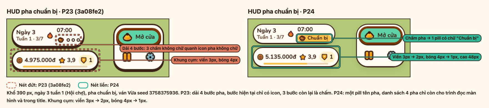 | 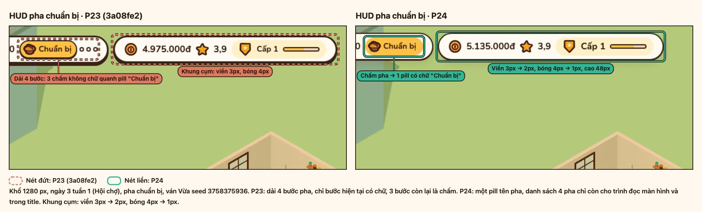 |
| HUD giờ cao điểm | 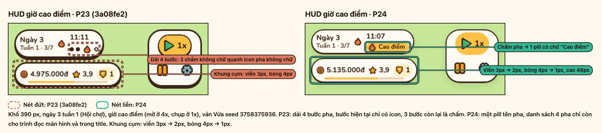 | 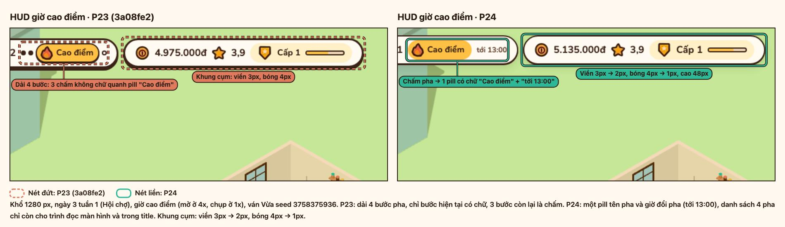 |
| Dock | 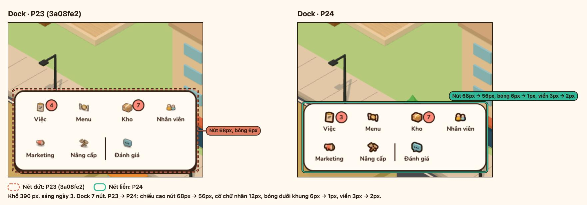 | 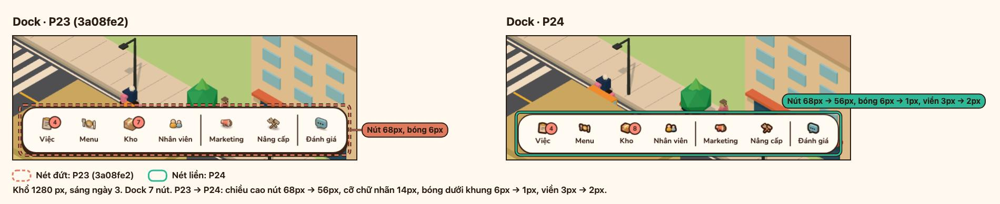 |
| Kho sau Gợi ý | 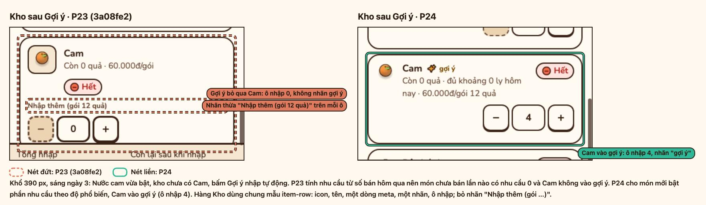 | 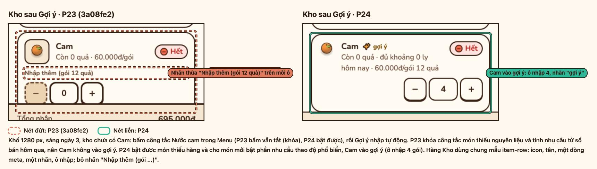 |
| Sau 2 lần Nhập hàng | 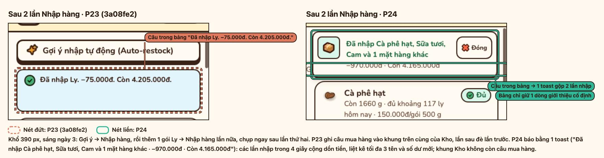 | 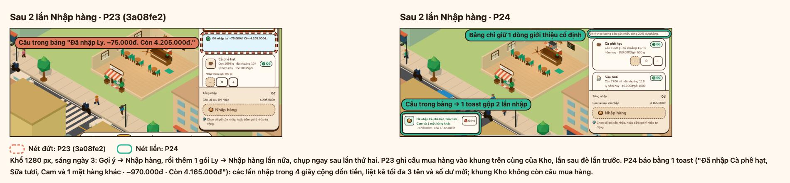 |
| Menu, Nước cam thiếu Cam | 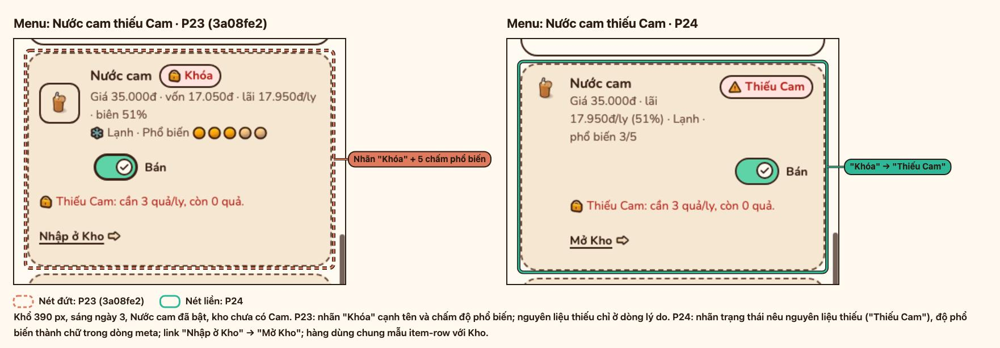 | 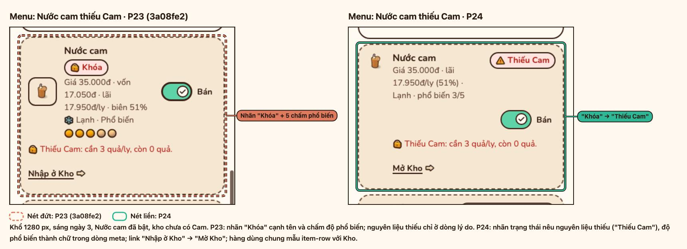 |
| Nhân viên | 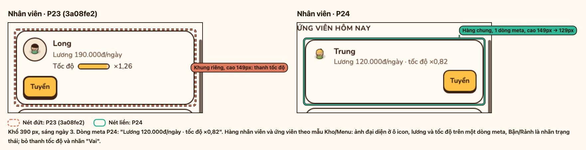 | 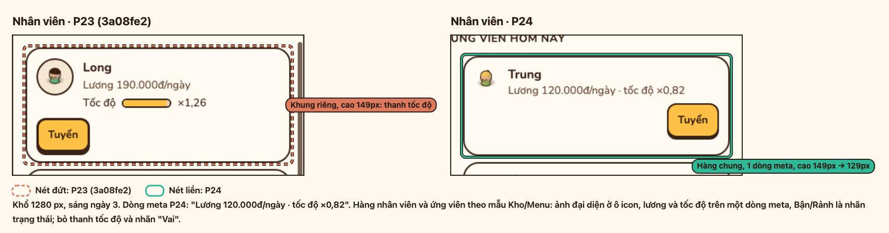 |
| Nâng cấp | 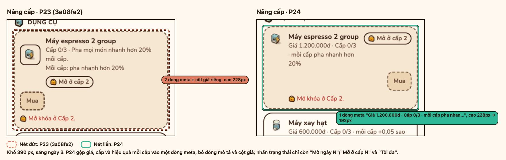 | 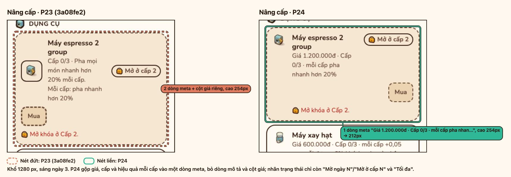 |
| Báo cáo ngày 3 | 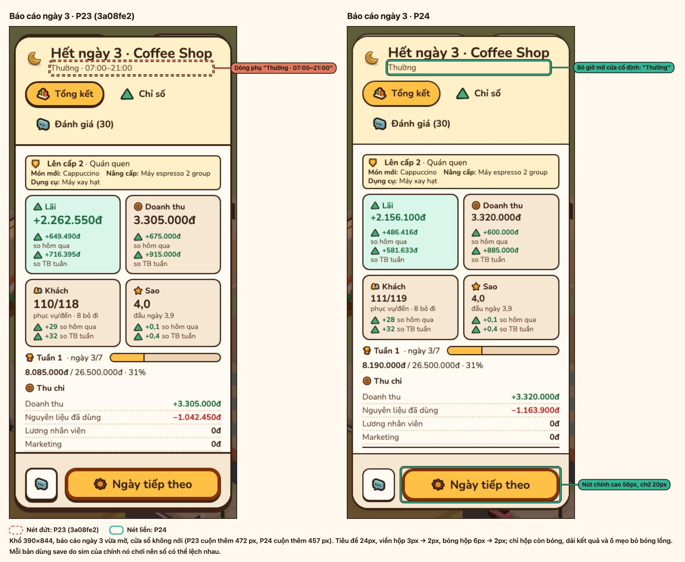 | 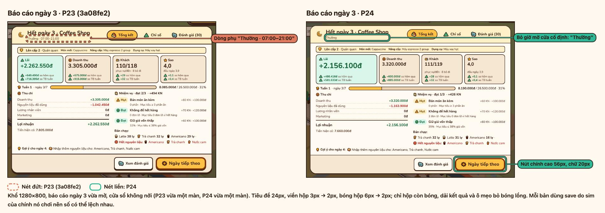 |
| Tổng kết tuần 1 | 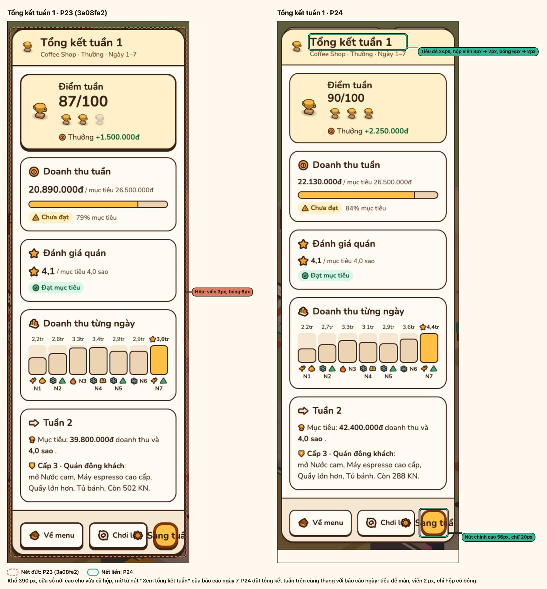 | 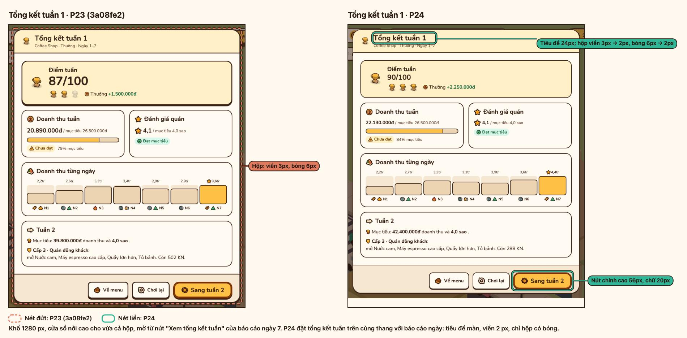 |

## 4. Kết quả kiểm

| Kiểm | Ngưỡng | Kết quả |
| --- | --- | --- |
| Playtest Cam, Bột bánh, Bơ trong gợi ý | Có cả ba | PASS (mục 1) |
| `npm run check` | tsc, test, build xanh | PASS: 80 file, 1117 test |
| `npm run layout` ở 390/768/1280/1440 | Không tràn ngang, CLS Kho = 0, HUD 1 hàng từ 1280 px | PASS, 48/48: 6 bảng, Daily Report, Đánh giá không tràn ở 390/768/1440; CLS Kho 0,000000 ở cả ba khổ; HUD 2 hàng cao 104 px ở 390 và 768, 1 hàng cao 56 px ở 1280 và 1440, kể cả ngày "Tăng giá nhập"; mọi nút HUD ≥ 44 px |
| Main Menu, hồ sơ Mobile (150 ms RTT, 1,6 Mbps, CPU 4x) | < 1 s | FAIL so với mốc: 1107 ms (lượt đơn), 1132 ms (lượt so); không lùi so với `3a08fe2` (1216 ms cùng lượt) |
| `npm run perf:frames` | Không tệ hơn P23 ([p23-loading-frames.md](p23-loading-frames.md)) | PASS: 0 long task ở cả hai hồ sơ; khung > 50 ms headless 34 (máy bàn), 49 (di động), cùng khoảng với P23 |
| `npm run media:p24` | Không cảnh báo `!!` | PASS: 20 bảng, không cảnh báo |

Số đo khởi động và khung hình: Chrome 155 headless, ANGLE Metal (Apple M2), trung vị 3 lần, chỉ đo bản hiện tại.

| Số đo | Máy bàn | Di động, CPU 4x |
| --- | --- | --- |
| Nội dung đầu tiên hiện | 128 ms | 364 ms |
| Main Menu | 140 ms | 1107 ms |
| Cảnh 3D (`measure-startup.mjs`) | 336 ms | 3077 ms |
| Khung p50 / p95 / dài nhất, 5 s sau `cst:world` | 50 / 133 / 133 ms | 100 / 133 / 133 ms |
| Khung > 50 ms (3 lần) | 34 (42/34/33) | 49 (49/45/56) |
| Long task | 0 | 0 |

- Main Menu di động đã trên 1 s từ trước P24 ([p23-loading-frames.md](p23-loading-frames.md): 1067 ms ở `f9508d8`, 1045 ms ở `0205afe`). P24 không làm chậm thêm, theo lượt so cùng lúc bên dưới.

`measure-startup.mjs --base 3a08fe2 --runs 5`, cùng máy, trung vị 5 lần:

| Cấu hình | Bản | Nội dung đầu tiên hiện | Main Menu | Cảnh 3D |
| --- | --- | --- | --- | --- |
| Máy bàn | `3a08fe2` | 48 ms | 53 ms | 339 ms |
| Máy bàn | P24 | 84 ms | 61 ms | 300 ms |
| Di động, CPU 4x | `3a08fe2` | 388 ms | 1216 ms | 3219 ms |
| Di động, CPU 4x | P24 | 464 ms | 1132 ms | 3243 ms |

- Main Menu di động: P24 1132 ms so với 1216 ms của `3a08fe2` (−84 ms, −6,9%). Vẫn trên mốc 1 s, nhưng không lùi so với P23.
- Gói tải gần như không đổi: JS chính 72,9 → 73,2 kB gzip, CSS 12,8 → 12,7 kB gzip.
- Headless khoá nhịp khung, nên số khung > 50 ms chỉ dùng để so khoảng (P23: 39–44 máy bàn, 40–45 di động), không cho biết có giật.
