# P25 — Menu gọn, cảm giác lên cấp và nâng cấp

Báo cáo P25 so với P24 `5d33195`: các ý đã làm và để sau, ảnh trước/sau có khoanh ở 390 và 1280 px, kết quả kiểm layout, khởi động và khung hình lúc có hiệu ứng.

| Phần | Lệnh |
| --- | --- |
| Ảnh trước/sau | `npm run media:p25` ([media.md](../media.md#ảnh-trướcsau-p25)) |
| Lề, tràn ngang, cao dòng Menu, thẻ lên cấp | `npm run layout` |
| Khởi động Main Menu | `node scripts/measure-startup.mjs --base 5d33195 --runs 5` |
| Khung hình 5 s đầu, khung hình quanh hiệu ứng | `npm run perf:frames`, `npm run perf:frames -- --fx` |
| Kiểm tra code | `npm run check` |

## 1. Tóm tắt

- Menu: mỗi món một dòng 56 px (P24: 150 px, món thiếu hàng 236 px ở 390 px); công tắc nhỏ trên dòng, "Thiếu Cam" là nút mở Kho. Một màn thấy trọn 7/11 món ở 390 px, 8/11 ở 1280 px (P24: 3).
- Lên cấp: thẻ có huy hiệu cấp bật lên, chip icon các mục mở khoá và confetti 1,4 s không chặn bấm.
- Nâng cấp: máy pha, máy xay, tủ bánh, quầy, bàn ghế, cây, tranh, đèn đổi hình theo 3 bậc; vừa mua thì máy nảy và rắc sao; mỗi bậc có icon riêng và dòng "Bậc n/3".
- Kiểm: `npm run check`, cao dòng Menu, `perf:frames` (0 long task) và `media:p25` đạt. Chưa đạt: `npm run layout` (tên món có nhãn bị cắt chữ; báo cáo có thẻ lên cấp cuộn 8 px ở 1280×720), Main Menu di động 1241 ms (> 1,15 s, nhưng nhanh hơn base), JS chính +1,9 kB gzip ([mục 4](#4-kết-quả-kiểm)).

## 2. Ý đã làm và để sau

| Ý | Trạng thái | Ở đâu |
| --- | --- | --- |
| Thẻ lên cấp: huy hiệu bật lên, confetti, danh sách mở khoá có icon | Đã làm | `src/ui/report/report.ts`, `src/ui/fx/confetti.ts` (chunk riêng, tải khi cần) |
| Vật thể đổi hình theo bậc, lấp lánh và nảy lúc vừa mua | Đã làm | `src/render/scene/equipment.ts`, `shop.ts`, `upgradeFx.ts` |
| Icon riêng cho từng bậc, "Bậc n/3" và "mua để lên bậc n+1" | Đã làm | Atlas `public/icons3d/tiers*`, `src/ui/panels/upgrades.ts` |
| Tiếng lên cấp và tiếng nâng cấp tổng hợp Web Audio | Đã làm | `src/audio/index.ts` |
| Chấm "Mới" trên dock, nhãn "Mới" trên hàng vừa mở | Đã làm | `src/ui/core/fresh.ts`, `src/ui/hud/hud.ts` |
| Nợ P24: số mục tiêu tuần, cỡ số và chân màn Tổng kết tuần | Đã làm | `docs/spec/week-7-days.md`, [p24-ui.md](p24-ui.md), `src/ui/screens/weekEnd.ts` |
| Menu gọn: công tắc nhỏ trên dòng, dòng thấp hơn | Đã làm | `src/ui/panels/menu.ts`, `widgets.ts`, `panels.css` |
| Mặt tiền và biển hiệu đổi theo cấp quán | Để sau | Đổi cảnh lớn; đo P25 trước |
| Khách hiện biểu cảm "wow" cạnh đồ mới | Để sau | Đổi hành vi khách |
| Số tiền, KN đếm dần lên | Để sau | Trùng toast và báo cáo |
| Thành tích, cột mốc | Để sau | Đổi gameplay |
| Camera bay tới vật vừa nâng | Để sau | Đổi camera |
| So sánh quán theo tuần | Để sau | Trùng Tổng kết tuần |
| Prestige | Để sau | Đổi gameplay |

## 3. Ảnh trước/sau

Khung trái là P24 `5d33195` (nét đứt cam), các khung phải là P25 (nét liền xanh). Nhãn ghi chỗ đã sửa; số đọc từ trang lúc chụp. Mỗi bản dùng save do sim của chính nó chơi (ván Vừa, seed `1760400000000 >>> 0`); save bậc là ván mới ở cấp quán 10 mua tới bậc 1, 2, 3.

| Cảnh | 390×844 | 1280×800 |
| --- | --- | --- |
| Menu, bấm công tắc Nước cam khi thiếu Cam | 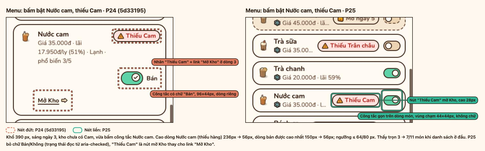 | 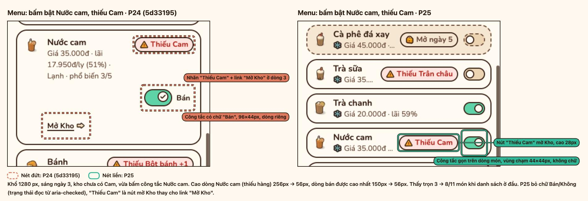 |
| Nâng cấp: icon bậc 1/2/3 | 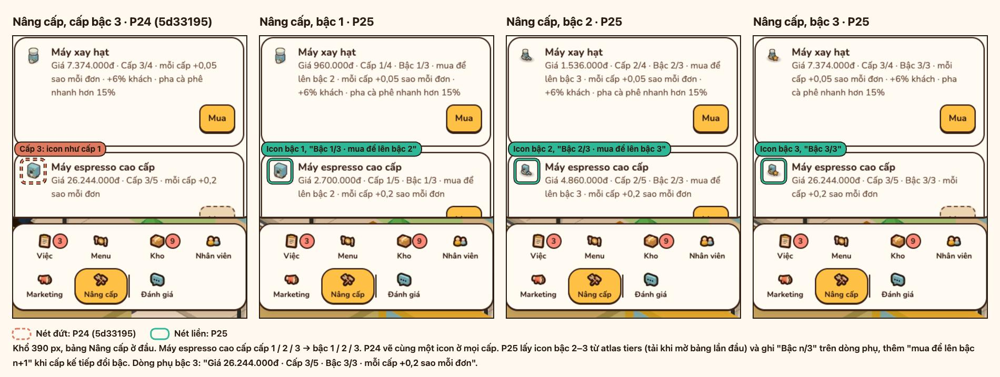 | 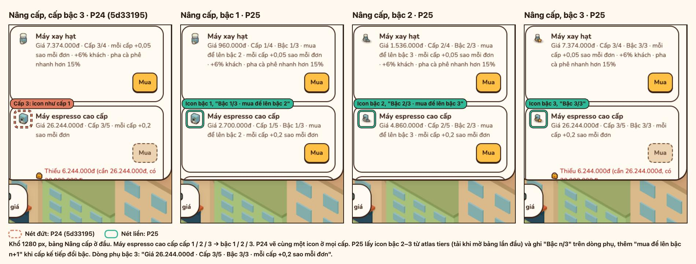 |
| Máy espresso bậc 1/2/3 | 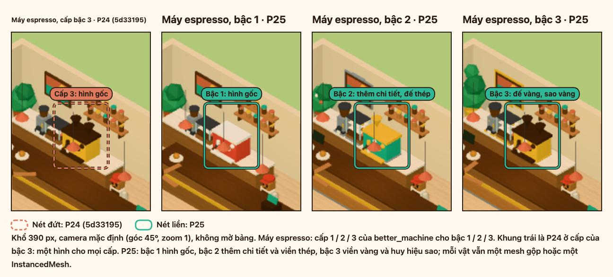 | 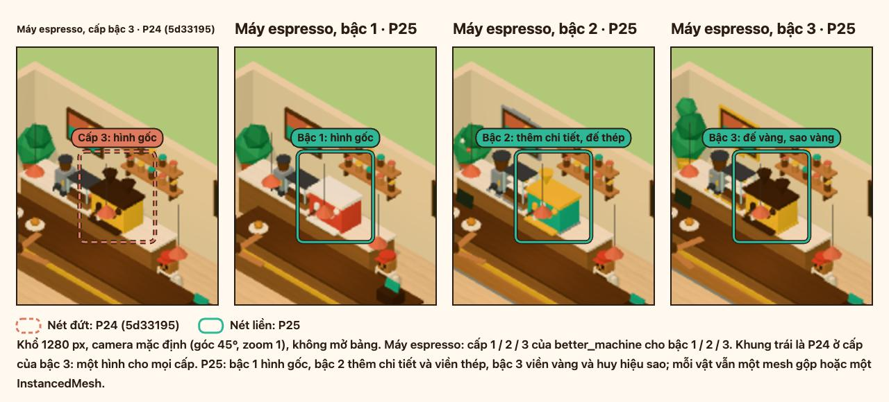 |
| Máy xay, tủ bánh bậc 1/2/3 | 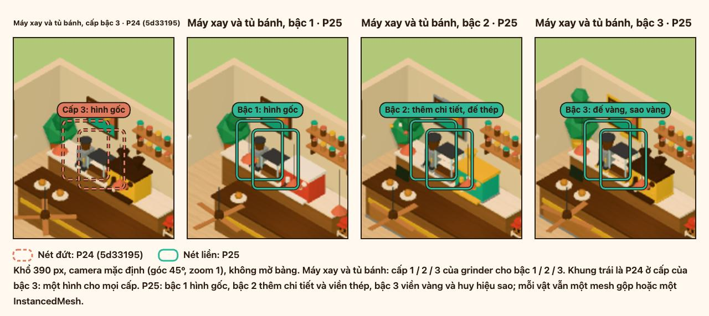 | 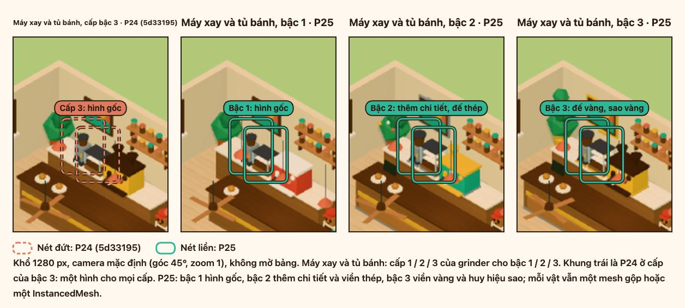 |
| Bàn ghế bậc 1/2/3 | 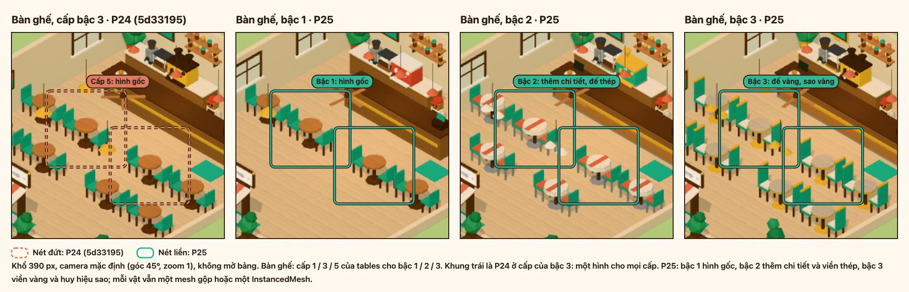 | 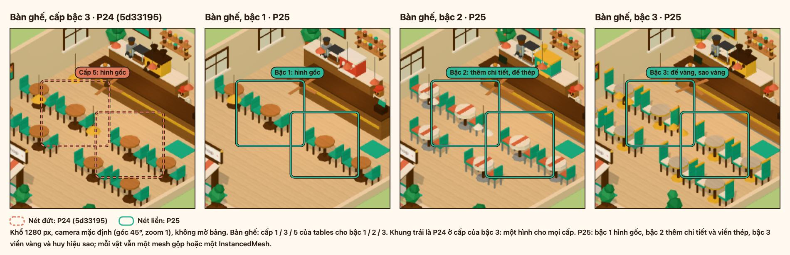 |
| Cây, đèn bậc 1/2/3 | 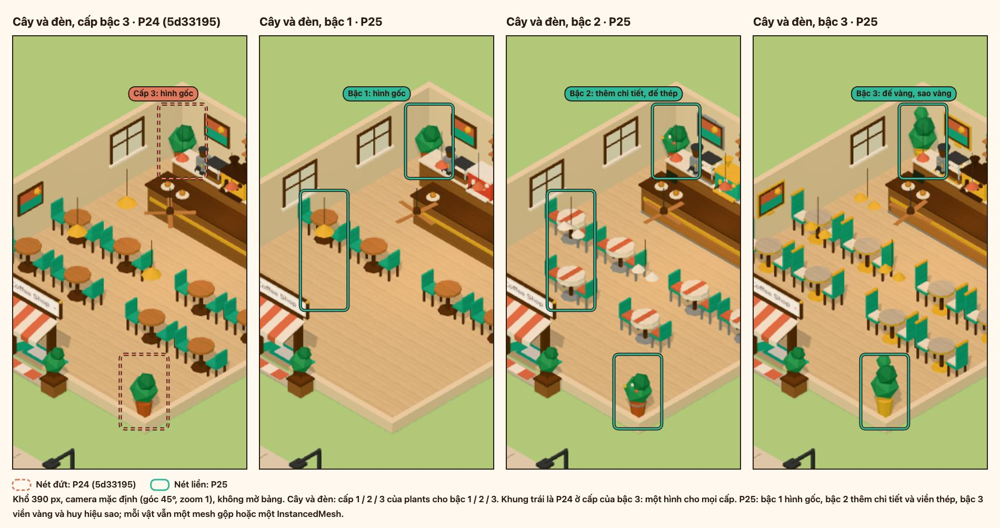 | 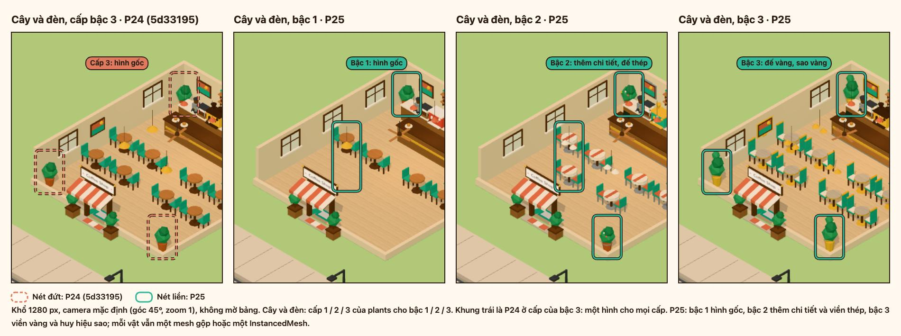 |
| Hiệu ứng vừa mua, 0 / 0,2 / 0,5 s | 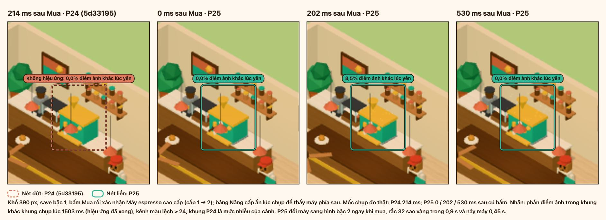 | 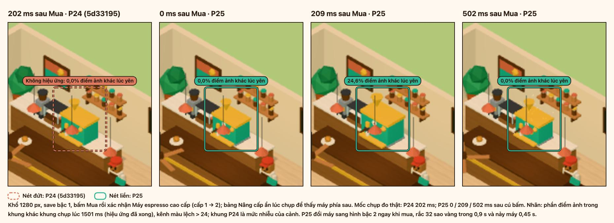 |
| Báo cáo có thẻ lên cấp: confetti đang bay, 2 s sau | 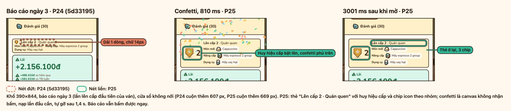 | 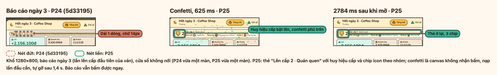 |
| Dock có chấm "Mới" | 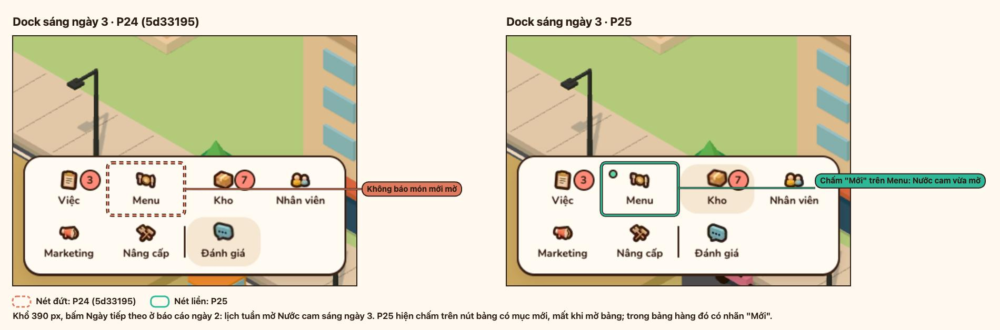 | 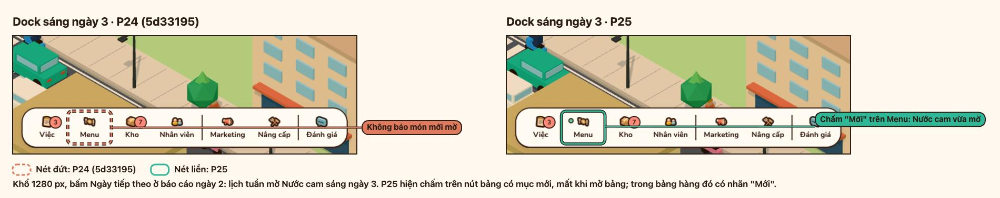 |
| Tổng kết tuần 1 | 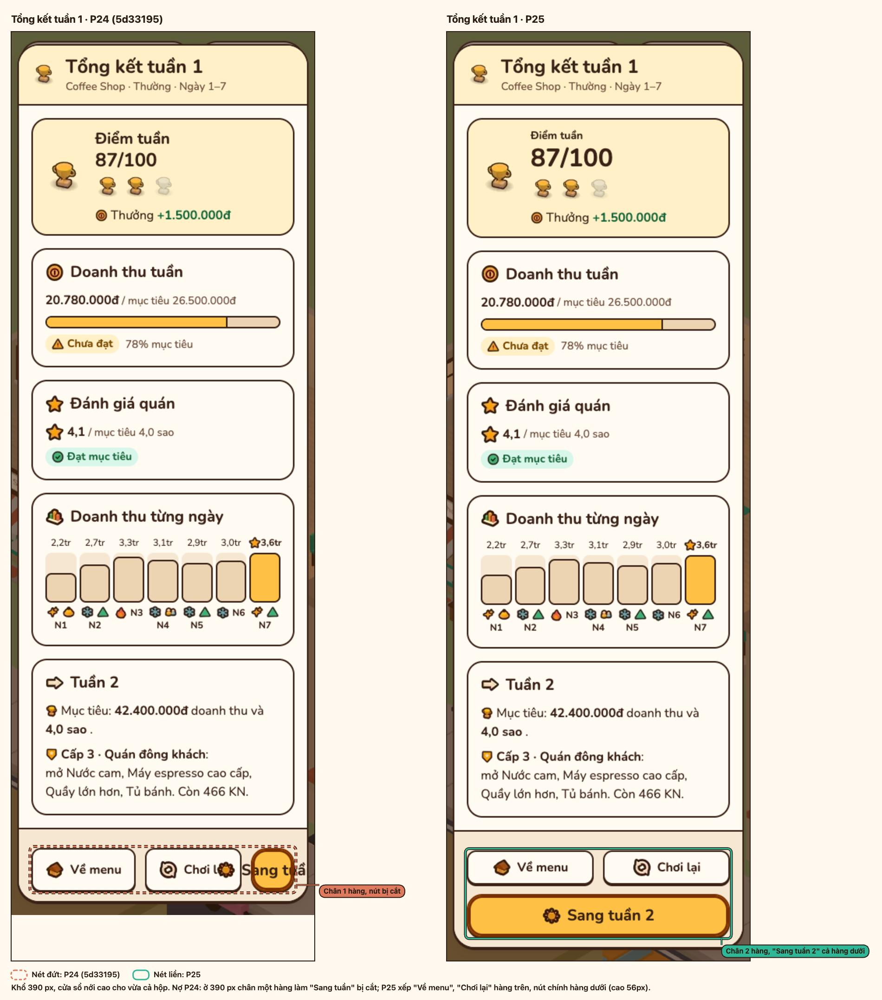 | |

Hiệu ứng vừa mua, phần điểm ảnh trong khung máy khác khung lúc yên (1,5 s sau khi mua, kênh màu lệch > 24):

| Khổ | P24, 0,2 s | P25, 0 s | P25, 0,2 s | P25, 0,5 s |
| --- | --- | --- | --- | --- |
| 390 | 0,0% | 0,0% | 8,5% | 0,0% |
| 1280 | 0,0% | 0,0% | 24,6% | 0,0% |

Máy đã ở hình bậc 2 ngay khung đầu; nảy thấy rõ ở 0,2 s. Lúc 0,5 s chỉ còn vài sao nhỏ, dưới ngưỡng đo.

## 4. Kết quả kiểm

| Kiểm | Ngưỡng | Kết quả |
| --- | --- | --- |
| `npm run check` | tsc, test, build xanh | PASS: 89 file, 1262 test |
| `npm run layout` ở 390/768/1280/1440 | Không tràn ngang, CLS Kho = 0, mọi nút ≥ 44 px, báo cáo có thẻ lên cấp vừa 1280×720 | FAIL, 56/64: CLS Kho 0,000000 ở 390/768/1440; HUD, Kho, Nhân viên, Marketing, Nâng cấp, Daily Report, Đánh giá, báo cáo có thẻ lên cấp không tràn; mọi nút ≥ 44 px (nút "Thiếu Cam" cao 28 px, vùng chạm `::before` 44 px). 7 FAIL ở Menu: tên và dòng giá bị cắt chữ (`scrollWidth > clientWidth`), 1 FAIL: báo cáo có thẻ lên cấp cuộn 8 px ở 1280×720 |
| Cao một dòng Menu ở 390 px | ≤ 64 px bán được, ≤ 80 px thiếu hàng | PASS: 56 / 56 px (P24: 150 / 236 px) |
| Main Menu di động so với `5d33195` | ≤ base + 5% và ≤ 1,15 s | ≤ base + 5%: PASS, 1241 ms so với 1292 ms (−3,9%). ≤ 1,15 s: FAIL, 1241 ms; base cùng lượt 1292 ms |
| JS chính gzip | Tăng ≤ 1 kB | FAIL: 73,7 → 75,6 kB (+1,9 kB) |
| Confetti, atlas `tiers` ngoài đường tải Main Menu | Không tải trước và 5 s sau `cst:world` | PASS: không file nào ở cả hai hồ sơ (`perf:frames`, cột cuối) |
| `npm run perf:frames` | 0 long task | PASS: 0 ở máy bàn và di động |
| `npm run perf:frames -- --fx` | 0 long task; tỉ lệ khung > 50 ms không hơn chế độ thường quá 10% | PASS: 0 long task ở mọi hiệu ứng và hồ sơ; tỉ lệ khung > 50 ms 62–69% so với 67–69% chế độ thường |
| 60 FPS máy bàn khi có hiệu ứng (`--fx --headed`) | p95 ≤ 16,7 ms ± nhịp màn hình | PASS: p95 18 ms (bằng chế độ thường), 0 khung > 50 ms ở máy bàn |
| `npm run media:p25` | Không `!!`, nhãn chỉ đúng chỗ sửa | PASS: 19 bảng, thoát mã 0 |

### Layout chưa đạt

| FAIL | Nguyên nhân | Đề xuất |
| --- | --- | --- |
| Menu, Menu gọn ở 390/768/1280/1440: tên món và dòng giá cắt bằng dấu "…" | Lưới `.menu-row` là `32px minmax(0, 1fr) auto auto` trên một hàng, chữ `nowrap` + `ellipsis`. Hàng có nhãn ("Mở ngày N" 108 px, "Thiếu Trân châu") cộng công tắc 44 px chiếm gần hết dòng, nên cột tên còn 22 px ở 768 px (bảng rộng 323 px: "Capp…", "T…") và 59–116 px ở khổ khác | Cho nhãn xuống dòng dưới tên khi cột tên dưới khoảng 7em (dòng thiếu hàng vẫn ≤ 80 px), hoặc rút nhãn thành icon kèm `title` |
| Báo cáo có thẻ lên cấp, 1280×720: cuộn thêm 8 px | Thẻ cao 68 px, thêm vào tab Tổng kết vốn vừa sát 720 px | Giảm lề trên dưới của thẻ hoặc đưa chip mở khoá lên cùng hàng tiêu đề ở khổ rộng |

### Số đo

`measure-startup.mjs --base 5d33195 --runs 5`: Chrome 155 headless, ANGLE Metal (Apple M2), trung vị 5 lần.

| Cấu hình | Bản | Nội dung đầu tiên hiện | Main Menu | Cảnh 3D |
| --- | --- | --- | --- | --- |
| Máy bàn | `5d33195` | 28 ms | 49 ms | 337 ms |
| Máy bàn | P25 | 52 ms | 65 ms | 291 ms |
| Di động, CPU 4x | `5d33195` | 388 ms | 1292 ms | 3293 ms |
| Di động, CPU 4x | P25 | 500 ms | 1241 ms | 3339 ms |

| Chunk | `5d33195` gzip | P25 gzip |
| --- | --- | --- |
| JS chính `index-*.js` | 73,7 kB | 75,6 kB |
| CSS `index-*.css` | 13,0 kB | 13,5 kB |
| `src/render` `index-*.js` | 32,8 kB | 36,3 kB |
| `confetti-*.js` | – | 1,1 kB, chỉ khi báo cáo có lên cấp |

`perf:frames`, trung vị 3 lần, 1280×800. Headless cấp khung theo bội số nhịp màn hình, nên p95 133 ms và số khung > 50 ms chỉ dùng để so; dòng headed là thời gian khung thật.

| Chế độ | Hồ sơ | Cửa sổ | p50 / p95 / dài nhất | Khung > 50 ms | Long task |
| --- | --- | --- | --- | --- | --- |
| Thường, headless | Máy bàn | 5 s sau `cst:world` | 100 / 133 / 150 ms | 45/65 | 0 |
| Thường, headless | Di động | 5 s sau `cst:world` | 83 / 133 / 150 ms | 42/63 | 0 |
| `--fx` upgrade, headless | Máy bàn | 3 s quanh Mua | 83 / 133 / 133 ms | 24/39 | 0 |
| `--fx` level-up, headless | Máy bàn | 3 s từ Tiếp tục | 83 / 133 / 133 ms | 26/41 | 0 |
| `--fx` upgrade, headless | Di động | 3 s quanh Mua | 67 / 133 / 133 ms | 27/39 | 0 |
| `--fx` level-up, headless | Di động | 3 s từ Tiếp tục | 83 / 117 / 133 ms | 28/42 | 0 |
| Thường, headed | Máy bàn | 5 s sau `cst:world` | 17 / 18 / 19 ms | 0 | 0 |
| `--fx` upgrade, headed | Máy bàn | 3 s quanh Mua | 17 / 18 / 19 ms | 0 | 0 |
| `--fx` level-up, headed | Máy bàn | 3 s từ Tiếp tục | 17 / 18 / 33 ms | 0 | 0 |

- p95 máy bàn: 18 ms trong cửa sổ thật (headed), lúc thường cũng như lúc có hiệu ứng.
- Main Menu di động trên 1,15 s là nợ có từ trước: base `5d33195` đo cùng lượt chậm hơn (1292 ms). Tối ưu Main Menu là một dự án riêng.
