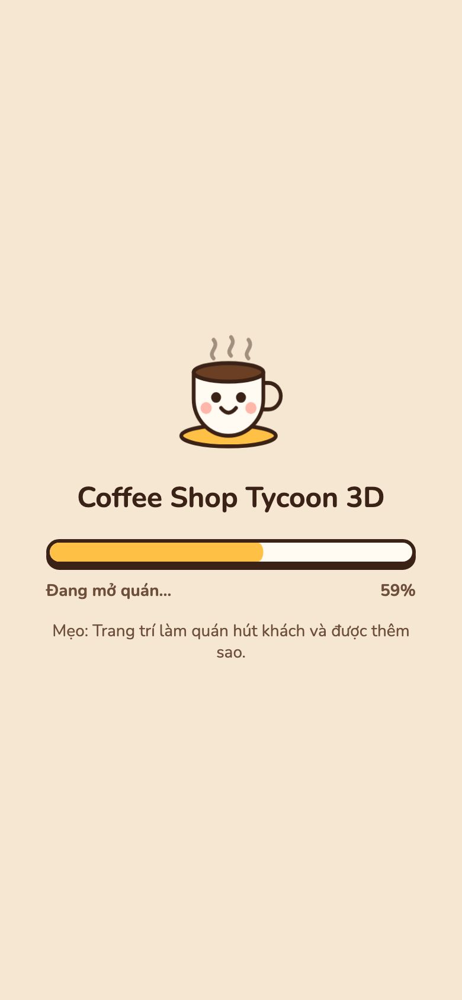
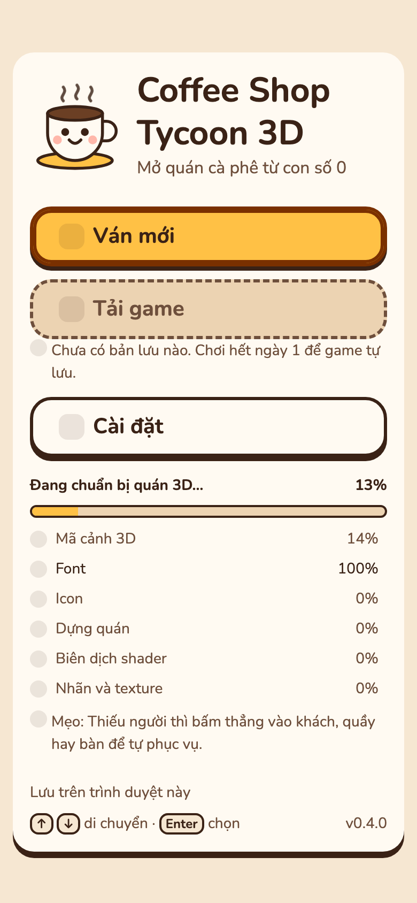
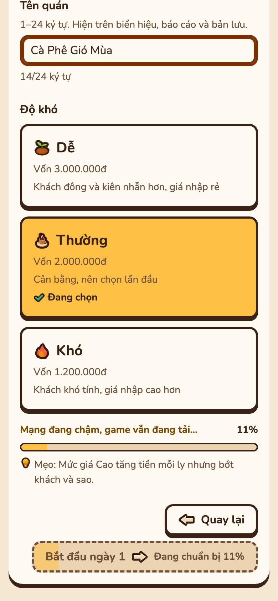
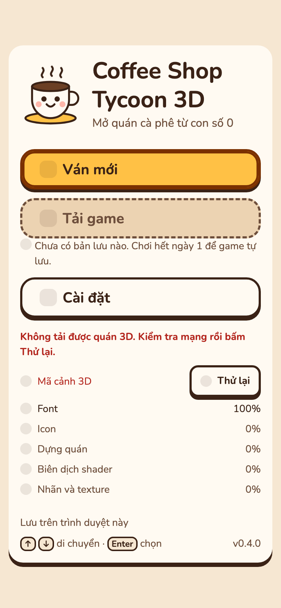
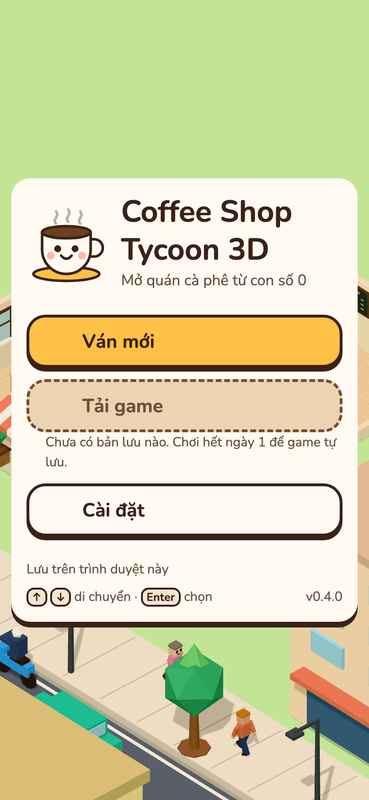

# P26 — Main Menu dưới 1 s trên điện thoại

Báo cáo P26 so với `57d7559`: thời gian tới Main Menu và cảnh 3D, kích thước chunk gzip, kết quả kiểm các ngưỡng. Kế hoạch: [startup-under-1s-plan.md](startup-under-1s-plan.md).

| Phần | Lệnh |
| --- | --- |
| Khởi động, bảng chunk | `PORT=<cổng> node scripts/measure-startup.mjs --base 57d7559 --runs 5` |
| Khung hình 5 s đầu, long task | `MEDIA_PORT=<cổng> npm run perf:frames -- --base 57d7559 --runs 5`, thêm `--headed` để lấy p95 thật |
| Lề, tràn ngang, vùng chạm | `LAYOUT_PORT=<cổng> npm run layout` |
| Màn chờ, dòng tiến độ, nút khoá, Thử lại | `MEDIA_PORT=<cổng> npm run media:loading` |
| Kiểm tra code | `npm run check` |

## 1. Tóm tắt

- Main Menu trên Phone 390×844 (150 ms RTT, 1,6 Mbps, CPU 4x): 896 ms, base 1324 ms (−428 ms, −32%).
- JS chính `index-*.js`: 75,8 → 14,7 kB gzip. Sim, HUD, panel, báo cáo, save, audio nằm ở chunk `game-*.js` (40,9 kB) và `iconMap-*.js` (23,9 kB), tải bằng `import()` sau khung hình đầu của menu.
- Cảnh 3D chậm hơn base 3,5% trên Phone 390×844 và 3,6% trên Mobile, trong ngưỡng 10%.
- Khung hình máy bàn headed: p95 20 ms (base 23 ms), chưa đạt 16,7 ms. Không còn long task sau `cst:world` ở di động headless qua 5 lượt ([mục 3](#3-số-đo)).
- Layout 68/68: thẻ lên cấp ở 1280×720 vừa một màn. Màn chờ, dòng tiến độ, nút khoá và Thử lại vẫn đúng.
- Font Nunito ở màn chờ và định dạng save giữ nguyên.

## 2. Kết quả kiểm

| Kiểm | Ngưỡng | Kết quả |
| --- | --- | --- |
| `npm run check` | tsc, test, build xanh | PASS: 94 file, 1414 test |
| Main Menu, Phone 390×844 | < 1000 ms | PASS: 896 ms (base 1324 ms) |
| Main Menu, Mobile | Không chậm hơn base | PASS: 862 ms (base 1262 ms) |
| Cảnh 3D so với `57d7559` | ≤ base + 10% | PASS: Phone 3644 / 3521 ms (+3,5%), Mobile 3532 / 3408 ms (+3,6%), Desktop 534 / 554 ms (−3,6%) |
| JS chính gzip | Tăng ≤ 2 kB | PASS: 75,8 → 14,7 kB (−61,1 kB) |
| `perf:frames`, máy bàn headless | 0 long task | PASS: 0 ở cả 5 lượt (base 0) |
| `perf:frames`, di động headless | 0 long task | PASS: 0 ở cả 5 lượt (lượt 0 / 0 / 0 / 0 / 0 ms); base cùng lượt 0 / 0 / 0 / 0 / 0 ms |
| p95 máy bàn (`--headed`) | ≤ 16,7 ms | FAIL: 20 ms (lượt 22 / 20 / 20 / 21 / 19 ms); base cùng lượt 23 ms. Nợ từ P25 (P25 đo 18 ms), chờ anh quyết |
| Long task máy bàn (`--headed`) | 0 long task | PASS: trung vị 0, lượt 0 / 1 / 0 / 0 / 0 ms; base trung vị 0, lượt 84 / 0 / 0 / 56 / 0 ms |
| `npm run layout` ở 390/768/1280/1440 | PASS mọi mục | PASS: 68/68. Thẻ lên cấp ở 1280×720 cao 54 px, vừa một màn. Tràn ngang 0, CLS Kho 0, nút ≥ 44 px, Menu gọn PASS |
| `npm run media:loading` | Màn chờ có %, dòng tiến độ, nút khoá "Đang chuẩn bị n%", Thử lại khi lỗi | PASS: 6 ảnh, xem [mục 4](#4-màn-chờ-và-main-menu-lúc-tải) |

## 3. Số đo

`measure-startup.mjs --base 57d7559 --runs 5`: Chrome headless, ANGLE Metal (Apple M2), trung vị 5 lần.

| Cấu hình | Bản | Nội dung đầu tiên hiện | Main Menu | Cảnh 3D |
| --- | --- | --- | --- | --- |
| Máy bàn | `57d7559` | 100 ms | 146 ms | 554 ms |
| Máy bàn | P26 | 72 ms | 80 ms | 534 ms |
| Di động, CPU 4x | `57d7559` | 388 ms | 1262 ms | 3408 ms |
| Di động, CPU 4x | P26 | 372 ms | 862 ms | 3532 ms |
| Phone 390×844 @3x, CPU 4x | `57d7559` | 432 ms | 1324 ms | 3521 ms |
| Phone 390×844 @3x, CPU 4x | P26 | 448 ms | 896 ms | 3644 ms |

Di động và Phone dùng mạng 150 ms RTT, 1,6 Mbps.

| Chunk | `57d7559` gzip | P26 gzip | Tải lúc |
| --- | --- | --- | --- |
| JS chính `index-*.js` | 75,8 kB | 14,7 kB | Trước Main Menu |
| CSS `index-*.css` | 13,6 kB | 9,5 kB | Trước Main Menu |
| `game-*.js` | – | 40,9 kB | Sau khung hình đầu của menu |
| `game-*.css` | – | 5,2 kB | Cùng `game-*.js` |
| `iconMap-*.js` | – | 23,9 kB | Cùng `game-*.js` |
| `src/render` `index-*.js` | 36,3 kB | 36,4 kB | Sau khung hình đầu của menu |
| `three-*.js` | 126,1 kB | 126,1 kB | Cùng `src/render` |
| `confetti-*.js` | 1,2 kB | 1,2 kB | Khi báo cáo có lên cấp |

`perf:frames --base 57d7559 --runs 5`: Chrome 155, 1280×800, 5 s sau `cst:world`, trung vị 5 lần. Headless cấp khung theo bội số nhịp màn hình, nên p95 headless chỉ dùng để so; dòng headed là thời gian khung thật. Confetti và atlas `tiers` không tải ở mọi dòng.

| Chế độ | Hồ sơ | Bản | Cảnh 3D | p50 / p95 / dài nhất | Khung > 50 ms | Long task |
| --- | --- | --- | --- | --- | --- | --- |
| Headless | Máy bàn | `57d7559` | 274 ms | 100 / 117 / 133 ms | 46 (42/53/46/49/44) | 0 |
| Headless | Máy bàn | P26 | 204 ms | 67 / 133 / 133 ms | 44 (47/45/44/32/43) | 0 |
| Headless | Di động | `57d7559` | 3151 ms | 67 / 133 / 133 ms | 43 (53/43/38/49/42) | 0 |
| Headless | Di động | P26 | 3284 ms | 83 / 117 / 117 ms | 45 (41/48/45/53/37) | 0 |
| Headed | Máy bàn | `57d7559` | 1447 ms | 17 / 23 / 84 ms | 2 (2/1/3/1/5) | 0 |
| Headed | Máy bàn | P26 | 1249 ms | 17 / 20 / 55 ms | 1 (2/1/2/1/0) | 0 |
| Headed | Di động | `57d7559` | 3160 ms | 17 / 18 / 19 ms | 0 (0/0/0/0/0) | 0 |
| Headed | Di động | P26 | 3352 ms | 17 / 19 / 33 ms | 0 (0/0/1/0/0) | 0 |

- Thời gian long task trong 5 s sau `cst:world`, từng lượt: headless di động base và P26 đều 0 / 0 / 0 / 0 / 0 ms; headed máy bàn base 84 / 0 / 0 / 56 / 0 ms, P26 0 / 1 / 0 / 0 / 0 ms; headed di động 0 ở cả 5 lượt của hai bản.
- p95 headed từng lượt: máy bàn base 22 / 28 / 24 / 23 / 23 ms, P26 22 / 20 / 20 / 21 / 19 ms; di động base 18 / 19 / 18 / 18 / 18 ms, P26 19 / 19 / 18 / 19 / 19 ms.

## 4. Màn chờ và Main Menu lúc tải

`npm run media:loading`: 390×844, mạng 150 ms RTT, 1,6 Mbps, CPU 4x. Ảnh P26.

| Cảnh | Chỗ cần nhìn | Ảnh |
| --- | --- | --- |
| Màn chờ | Thanh và dòng "Đang mở quán… 59%", mẹo bên dưới |  |
| Main Menu khi cảnh 3D đang tải | Dòng "Đang chuẩn bị quán 3D… 7%", thanh tiến độ, danh sách 6 thành phần; Tải game khoá vì chưa có bản lưu. Icon nút còn là ô trống tới khi atlas @1x tải xong |  |
| Ván mới khi cảnh 3D chưa xong | Nút "Bắt đầu ngày 1" khoá, viền đứt, phần đã tô và chữ "Đang chuẩn bị 31%"; dòng "Mạng đang chậm, game vẫn đang tải… 31%" |  |
| Cảnh 3D tải lỗi | Dòng đỏ "Không tải được quán 3D…", "Mã cảnh 3D" báo lỗi kèm nút Thử lại |  |
| Sau Thử lại khi có mạng | Dòng tiến độ ẩn, quán 3D hiện sau menu |  |
| Script game lỗi lúc mở | Màn chờ báo "Không tải được game…" và nút Thử lại |  |
