# P27 — Nhân viên lên cấp, quà ngày, đơn đặc biệt, mở rộng quán

Báo cáo kiểm chứng P27 so với P26 `d58350b`: kết quả `npm run check`, thời gian tới Main Menu và cảnh 3D, kích thước chunk gzip, khung hình và long task, save cũ, layout, ảnh có khoanh. Luật và con số của các tính năng: [spec/p27-retention.md](../spec/p27-retention.md).

`npm run check`, bản build và test save đo trên HEAD sau merge `main` (`d8d5a45`, kéo theo `eeccb88` `fix(hud): keep the top clusters on one row`). Khởi động, khung hình, layout và ảnh là lượt đo trước merge `main`.

| Phần | Lệnh |
| --- | --- |
| Kiểm tra code | `npm run check` |
| Khởi động, bảng chunk | `PORT=<cổng> node scripts/measure-startup.mjs --base d58350b --runs 9` |
| Khung hình 5 s đầu, long task | `MEDIA_PORT=<cổng> npm run perf:frames -- --base d58350b --runs 5`, thêm `--headed` để lấy p95 thật |
| Save cũ | `npx vitest run tests/integration/p27-save-compat.test.ts tests/save` |
| Lề, tràn ngang, vùng chạm | `LAYOUT_PORT=<cổng> npm run layout` (chạy từng phần: [media.md](../media.md#kiểm-lề-và-cls)) |
| Ảnh P27 | `MEDIA_PORT=<cổng> npm run media:p27` ([media.md](../media.md#ảnh-p27)) |

## 1. Tóm tắt

- `npm run check` xanh trên HEAD: 108 file, 1633 test.
- CSS chính FAIL: `index-G0d7UaCo.css` 9,64 kB gzip, quá ngưỡng 9,6 kB. CSS giống hệt `main` (cùng 9,64 kB); phần tăng là 57 dòng `src/ui/styles/ui.css` của `eeccb88` ([mục 2](#2-kết-quả-kiểm)).
- JS chính `index-*.js`: 15,0 → 15,46 kB gzip (Vite).
- Main Menu trên Phone 390×844 (150 ms RTT, 1,6 Mbps, CPU 4x), lượt trước merge `main`: 660 / 657 / 850 ms qua 3 lượt, đều dưới 1 s.
- Main Menu trên Mobile so với base, lượt trước merge `main`: +91 / −1 / +42 ms; lượt 3 cả máy bàn cũng chậm hơn base ([mục 3](#3-khởi-động)).
- Long task, lượt trước merge `main`, chấm theo từng lần: máy bàn headless P27 3/10 lần, base 1/10; di động headless P27 1/10, base 0/10; máy bàn headed 0/5 cả hai bản; di động headed P27 2/5, base 1/5 ([mục 4](#4-khung-hình)).
- Khung hình máy bàn headed, lượt trước merge `main`: p95 18 ms, bằng base (18 ms), chưa đạt 16,7 ms (nợ cũ, chỉ ghi).
- Save v0–v3 nạp được, chơi tiếp 3 ngày có quà, Đào tạo, nội thất Tem; `SAVE_VERSION` vẫn là 3.
- Layout 92/92: 68 mục cũ và 24 mục mới cho bảng Việc, Nhân viên, Nâng cấp của P27.
- 14 ảnh P27 có khoanh đỏ, 0 cảnh báo `!!`.

## 2. Kết quả kiểm

| Kiểm | Ngưỡng | Kết quả |
| --- | --- | --- |
| `npm run check` (HEAD) | tsc, test, build xanh | PASS: 108 file, 1633 test |
| Test P27 (12 file), trước merge `main` | Xanh | PASS: 190 test |
| JS chính gzip (HEAD) | ≤ 17,0 kB (tăng ≤ 2 kB) | PASS: `index-BGuo_h3r.js` 15,46 kB |
| CSS chính gzip (HEAD) | ≤ 9,6 kB | FAIL: `index-G0d7UaCo.css` 9,64 kB. `main` cũng 9,64 kB: `git diff main HEAD -- src/ui/styles` rỗng; so với base chỉ khác 57 dòng `src/ui/styles/ui.css` của `eeccb88` (HUD một hàng). Trước merge `main`: 9,55 kB |
| Save cũ (HEAD) | v0–v3 nạp được, giữ dữ liệu P27 qua lưu/nạp | PASS: 10 file, 188 test save và tương thích |
| Main Menu, Phone 390×844 | < 1000 ms | Trước merge `main`: PASS 660 / 657 / 850 ms (base 671 / 641 / 741 ms) |
| Main Menu, Mobile | Không chậm hơn base | Trước merge `main`, theo lượt: 701 / 610 ms (+91, FAIL), 651 / 652 ms (−1, PASS), 823 / 781 ms (+42, FAIL) |
| Cảnh 3D, Phone và Mobile | ≤ base + 10% | Trước merge `main`: PASS cả 3 lượt: Phone +0,2% / +4,0% / +4,4%, Mobile +4,9% / +0,7% / +0,8% |
| Cảnh 3D, máy bàn | ≤ base + 10% | Trước merge `main`: lượt 1 PASS (258 / 242 ms, +6,6%), lượt 2 PASS (255 / 242 ms, +5,4%), **lượt 3 FAIL** (293 / 243 ms, +20,6%) |
| `perf:frames`, máy bàn headless | 0 long task mỗi lần | Trước merge `main`: FAIL, P27 3/10 lần có long task (0 / 0 / 435 / 0 / 0 và 311 / 428 / 0 / 0 / 0 ms); base 1/10 (0 / 0 / 0 / 0 / 0 và 0 / 488 / 0 / 0 / 0 ms) |
| `perf:frames`, di động headless | 0 long task mỗi lần | Trước merge `main`: FAIL, P27 1/10 lần có long task (0 / 0 / 0 / 1 / 0 và 0 / 0 / 0 / 0 / 0 ms); base 0/10 |
| Long task máy bàn (`--headed`) | 0 long task mỗi lần | Trước merge `main`: PASS, P27 0/5 lần, base 0/5 |
| Long task di động (`--headed`) | 0 long task mỗi lần | Trước merge `main`: FAIL, P27 2/5 lần (lần 2: 2 ms, lần 4: 402 ms); base 1/5 (lần 4: 311 ms) |
| p95 máy bàn (`--headed`) | ≤ 16,7 ms (nợ cũ, chỉ ghi) | Trước merge `main`: 18 ms, base 18 ms |
| `npm run layout` ở 390/768/1280/1440 | PASS mọi mục | PASS: 92/92. Tràn ngang 0, CLS Kho 0, HUD 1–2 hàng, mọi nút ≥ 44 px |
| Layout P27 (mục mới) | Không tràn, đủ phần mới, nút ≥ 44 px | PASS: 24/24. Việc (thẻ quà, đơn đặc biệt, thành tựu; 9 nút), Nhân viên (chip đặc điểm, thanh KN, xác nhận Đào tạo; 12 nút), Nâng cấp (2 dòng giá Tem; 20 nút) |
| `npm run media:p27` | Nhãn và vòng khoanh trong khung, không `!!` | PASS: 14 ảnh, 0 cảnh báo |

Đường khởi động tới Main Menu chỉ thêm `pendingGiftDay` trong `src/ui/screens/mainMenu.ts` và hai trường quà trong `listSlotSummaries` (`src/save/slots.ts`): so ngày và đọc hai trường của save, không tải thêm chunk.

Output build trên HEAD (`npm run check`, phần `vite build`):

```
 Test Files  108 passed (108)
      Tests  1633 passed (1633)
dist/assets/game-DqiI1TBm.css                             31.52 kB │ gzip:   5.33 kB
dist/assets/index-G0d7UaCo.css                            54.28 kB │ gzip:   9.64 kB
dist/assets/confetti-CoKwk5Sz.js                           2.31 kB │ gzip:   1.22 kB
dist/assets/index-BGuo_h3r.js                             39.38 kB │ gzip:  15.46 kB
dist/assets/iconMap-DFV1JIJr.js                           77.14 kB │ gzip:  27.92 kB
dist/assets/index-DPuBJNkT.js                            104.16 kB │ gzip:  38.08 kB
dist/assets/game-pEsl-ZWw.js                             130.30 kB │ gzip:  43.99 kB
dist/assets/three-CMIswvRL.js                            504.48 kB │ gzip: 126.49 kB
```

`npx vitest run tests/integration/p27-save-compat.test.ts tests/save` trên HEAD:

```
 Test Files  10 passed (10)
      Tests  188 passed (188)
```

## 3. Khởi động

Lượt đo trước merge `main`. `measure-startup.mjs --base d58350b`: Chrome headless, ANGLE Metal (Apple M2). Lượt 1 trung vị 5 lần, lượt 2 và 3 trung vị 9 lần, chạy liền nhau. Mobile và Phone dùng mạng 150 ms RTT, 1,6 Mbps, CPU 4x; khác nhau ở khổ và DPR.

| Lượt | Cấu hình | Bản | Nội dung đầu tiên hiện | Main Menu | Cảnh 3D |
| --- | --- | --- | --- | --- | --- |
| 1 | Máy bàn | `d58350b` | 48 ms | 83 ms | 242 ms |
| 1 | Máy bàn | P27 | 48 ms | 68 ms | 258 ms |
| 1 | Mobile, CPU 4x | `d58350b` | 284 ms | 610 ms | 2984 ms |
| 1 | Mobile, CPU 4x | P27 | 344 ms | 701 ms | 3129 ms |
| 1 | Phone 390×844 @3x, CPU 4x | `d58350b` | 344 ms | 671 ms | 3064 ms |
| 1 | Phone 390×844 @3x, CPU 4x | P27 | 316 ms | 660 ms | 3070 ms |
| 2 | Máy bàn | `d58350b` | 52 ms | 43 ms | 242 ms |
| 2 | Máy bàn | P27 | 40 ms | 41 ms | 255 ms |
| 2 | Mobile, CPU 4x | `d58350b` | 348 ms | 652 ms | 3086 ms |
| 2 | Mobile, CPU 4x | P27 | 340 ms | 651 ms | 3109 ms |
| 2 | Phone 390×844 @3x, CPU 4x | `d58350b` | 320 ms | 641 ms | 3022 ms |
| 2 | Phone 390×844 @3x, CPU 4x | P27 | 308 ms | 657 ms | 3143 ms |
| 3 | Máy bàn | `d58350b` | 56 ms | 57 ms | 243 ms |
| 3 | Máy bàn | P27 | 88 ms | 100 ms | 293 ms |
| 3 | Mobile, CPU 4x | `d58350b` | 352 ms | 781 ms | 3312 ms |
| 3 | Mobile, CPU 4x | P27 | 412 ms | 823 ms | 3340 ms |
| 3 | Phone 390×844 @3x, CPU 4x | `d58350b` | 360 ms | 741 ms | 3227 ms |
| 3 | Phone 390×844 @3x, CPU 4x | P27 | 420 ms | 850 ms | 3369 ms |

Cảnh 3D máy bàn lượt 3 FAIL: 293 / 243 ms, +20,6%, quá base + 10%. Ở lượt này P27 chậm hơn base ở cả ba cấu hình, kể cả máy bàn không giới hạn mạng và CPU (Main Menu 100 / 57 ms). Lượt 2 với 9 lần đo cho Mobile bằng base (651 / 652 ms).

| Chunk | `d58350b` gzip | P27 gzip | Tải lúc |
| --- | --- | --- | --- |
| JS chính `index-*.js` | 15,0 kB | 15,4 kB | Trước Main Menu |
| CSS `index-*.css` | 9,5 kB | 9,5 kB (trước merge `main`) | Trước Main Menu |
| `game-*.js` | 40,7 kB | 43,6 kB | Sau khung hình đầu của menu |
| `game-*.css` | 5,2 kB | 5,3 kB | Cùng `game-*.js` |
| `iconMap-*.js` | 23,9 kB | 27,9 kB | Cùng `game-*.js` |
| `src/render` `index-*.js` | 36,4 kB | 38,0 kB | Sau khung hình đầu của menu |
| `three-*.js` | 126,1 kB | 126,1 kB | Cùng `src/render` |
| `confetti-*.js` | 1,2 kB | 1,2 kB | Khi báo cáo có lên cấp |

Bảng chunk lấy từ `measure-startup.mjs` (gzip mức 9) trước merge `main`; lúc đó `npm run build` ghi JS chính 15,39 kB, CSS chính 9,55 kB. Trên HEAD, `npm run build` ghi JS chính 15,46 kB, CSS chính 9,64 kB ([mục 2](#2-kết-quả-kiểm)).

## 4. Khung hình

Lượt đo trước merge `main`. `perf:frames --base d58350b --runs 5`: Chrome 155, 1280×800, 5 s sau `cst:world`, trung vị 5 lần. Headless chạy hai lượt liền nhau, headed một lượt. Headless cấp khung theo bội số nhịp màn hình, nên p95 headless chỉ dùng để so; dòng headed là thời gian khung thật. Confetti và atlas `tiers` không tải ở mọi dòng.

Long task chấm theo từng lần như P26: lần nào có long task > 0 ms là FAIL ở lần đó; cột Long task ghi số lần có long task trên số lần đo. Thời gian long task chỉ tính phần nằm trong cửa sổ 5 s đo, nên có thể nhỏ hơn 50 ms.

| Chế độ | Hồ sơ | Bản | Cảnh 3D | p50 / p95 / dài nhất | Khung > 50 ms | Long task |
| --- | --- | --- | --- | --- | --- | --- |
| Headless, lượt 1 | Máy bàn | `d58350b` | 227 ms | 50 / 67 / 67 ms | 31 | 0/5 lần |
| Headless, lượt 1 | Máy bàn | P27 | 273 ms | 33 / 67 / 67 ms | 36 | FAIL: 1/5 lần |
| Headless, lượt 1 | Di động | `d58350b` | 3048 ms | 33 / 67 / 67 ms | 24 | 0/5 lần |
| Headless, lượt 1 | Di động | P27 | 3077 ms | 33 / 67 / 67 ms | 26 | FAIL: 1/5 lần |
| Headless, lượt 2 | Máy bàn | `d58350b` | 230 ms | 50 / 67 / 67 ms | 35 | FAIL: 1/5 lần |
| Headless, lượt 2 | Máy bàn | P27 | 234 ms | 50 / 67 / 83 ms | 32 | FAIL: 2/5 lần |
| Headless, lượt 2 | Di động | `d58350b` | 3248 ms | 33 / 100 / 133 ms | 40 | 0/5 lần |
| Headless, lượt 2 | Di động | P27 | 3293 ms | 50 / 133 / 133 ms | 38 | 0/5 lần |
| Headed | Máy bàn | `d58350b` | 247 ms | 17 / 18 / 36 ms | 0 | 0/5 lần |
| Headed | Máy bàn | P27 | 235 ms | 17 / 18 / 27 ms | 0 | 0/5 lần |
| Headed | Di động | `d58350b` | 3056 ms | 17 / 17 / 34 ms | 0 | FAIL: 1/5 lần |
| Headed | Di động | P27 | 3075 ms | 17 / 18 / 33 ms | 0 | FAIL: 2/5 lần |

- Thời gian long task từng lần, headless máy bàn: base 0 / 0 / 0 / 0 / 0 và 0 / 488 / 0 / 0 / 0 ms; P27 0 / 0 / 435 / 0 / 0 và 311 / 428 / 0 / 0 / 0 ms.
- Headless di động: base 0 ở cả 10 lần; P27 0 / 0 / 0 / 1 / 0 và 0 / 0 / 0 / 0 / 0 ms.
- Headed: máy bàn 0 ở cả 5 lần của hai bản; di động base lần 4 có 311 ms, P27 lần 2 có 2 ms và lần 4 có 402 ms.
- Long task máy bàn headless rơi vào lần đo khác nhau giữa hai lượt và base cũng có (488 ms). Muốn chặn hẳn thì cần một lượt đo có trace (`chrome://tracing`) ở lần có long task để biết việc nào chạy trên main thread.

## 5. Save cũ

| Kiểm | Kết quả |
| --- | --- |
| Save v0, v1, v2, v3 không có trường P27 | Nạp được, `ensureRetention` điền mặc định, chơi tiếp 3 ngày có nhận quà, Đào tạo, mua nội thất giá Tem |
| Trường P27 (Tem, chuỗi quà, cấp/KN/đặc điểm nhân viên, đơn đặc biệt) | Giữ nguyên qua `saveGame` rồi `loadGame` |
| Danh sách slot ở Main Menu | `listSlotSummaries` khớp `listSlots` cho v0–v3, JSON hỏng, version 99 và −1, storage lỗi; không ghi vào storage |
| `SAVE_VERSION` | Vẫn là 3 |

## 6. Layout

`npm run layout` chạy làm hai phần (`LAYOUT_ONLY=day,hud,event` rồi `LAYOUT_ONLY=p25,p27`), 92 mục:

| Phần | Khổ | Mục | Kết quả |
| --- | --- | --- | --- |
| Ván mới, 6 bảng, một ngày 4x, báo cáo | 390, 768, 1440 | 36 | PASS |
| HUD, HUD ngày sự kiện | 390, 1280, 1440 | 12 | PASS |
| P25: Menu gọn, thẻ lên cấp | 390, 768, 1280×720, 1440 | 20 | PASS |
| P27: Việc, Nhân viên, Nâng cấp | 390, 768, 1280×720, 1440 | 24 | PASS |

## 7. Ảnh

`npm run media:p27`, Chromium headless. Chỗ mới khoanh đỏ, nhãn đỏ chữ trắng. Save của từng bản do sim của chính bản đó chơi ra: ván Vừa, cùng seed, tuyển 2 nhân viên ngày 1, nhận quà sáng ngày 3 với ngày hôm qua của máy.

### Trước/sau

Mỗi ảnh ghép P26 `d58350b` (trái) cạnh P27 (phải), cùng save và cùng khổ.

| Cảnh | Khổ | Chỗ cần nhìn | Ảnh |
| --- | --- | --- | --- |
| Main Menu | 390 | Dòng "Quà ngày 2 đang chờ" dưới **Tiếp tục**; P26 không có dòng này | 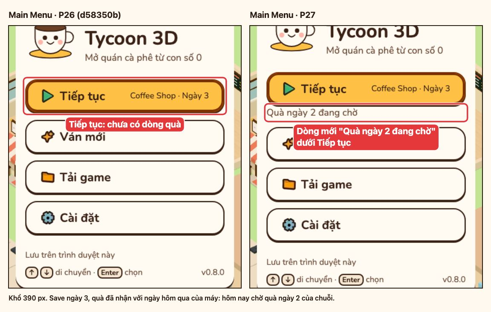 |
| Main Menu | 1280 | Như trên | 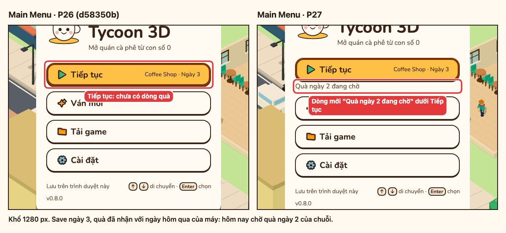 |
| HUD | 390 | Chip Tem (7) ngay sau tiền trong cụm Tiến độ | 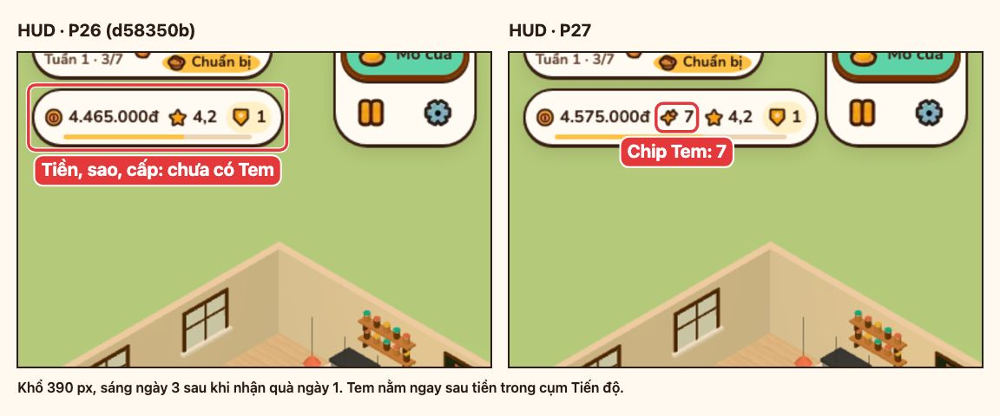 |
| HUD | 1280 | Như trên, HUD một hàng | 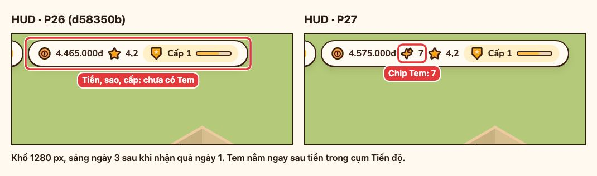 |
| Nhân viên | 390 | Chip "Gọn gàng", dòng "Cấp 1/5 · KN 338/240", thanh KN đầy, xác nhận "Đào tạo Quân lên cấp 2?" tại chỗ | 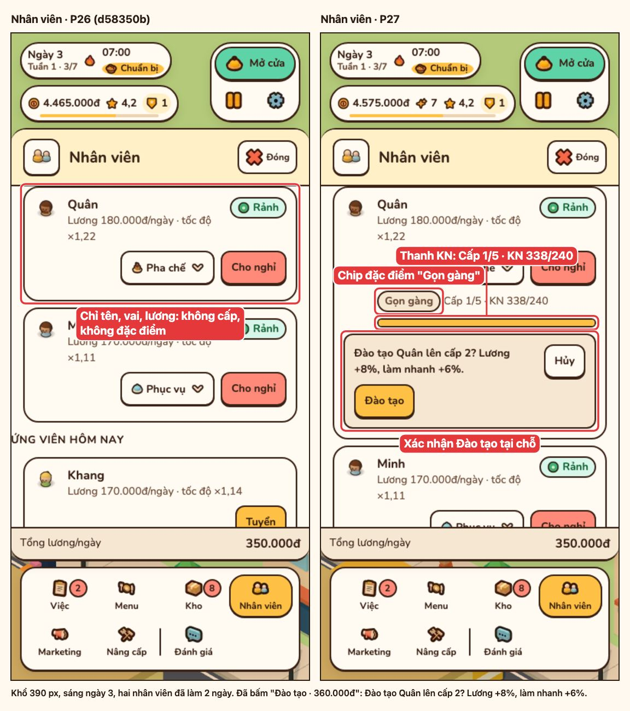 |
| Nhân viên | 1280 | Như trên | 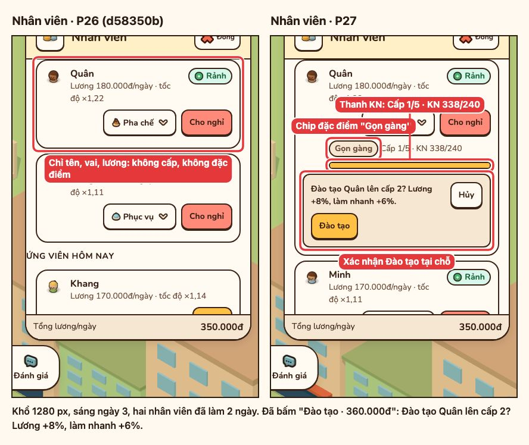 |

### Chỉ P27

| Cảnh | Khổ | Chỗ cần nhìn | Ảnh |
| --- | --- | --- | --- |
| Việc | 390 | Khung trái: thẻ Quà hằng ngày với chuỗi 7 ô và nút "Nhận quà ngày 2". Khung phải: đơn "3 Espresso trước 19:00 · 2/3" kèm thưởng, danh sách Thành tựu đã sổ | 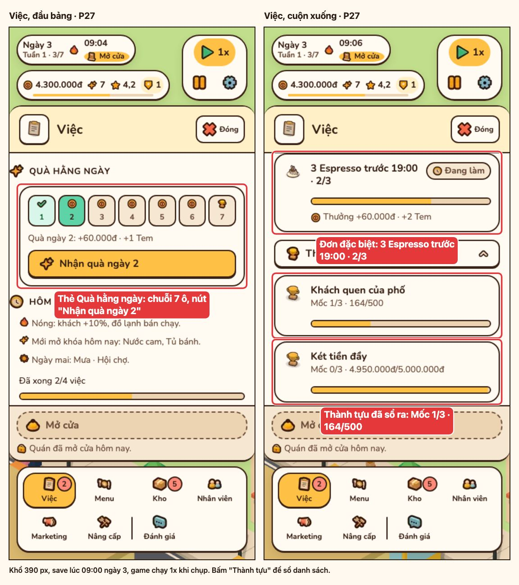 |
| Việc | 1280 | Như trên | 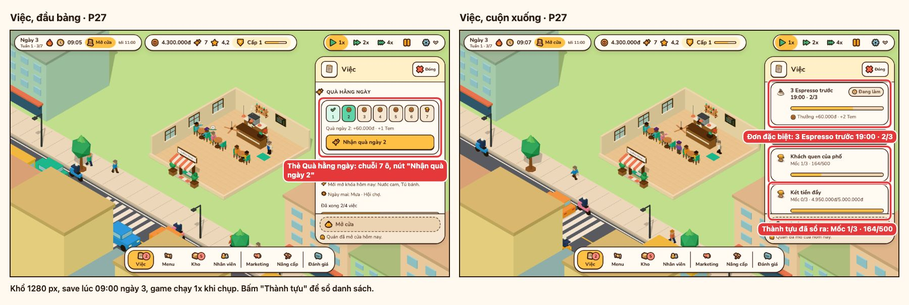 |
| Nâng cấp | 390 | "Giá 1.500.000đ + 3 Tem" ở Máy hát đĩa, "Giá 2.500.000đ + 5 Tem" ở Góc sofa, chip Tem trên HUD | 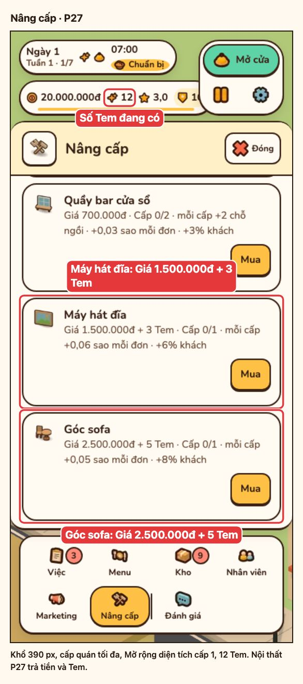 |
| Nâng cấp | 1280 | Như trên | 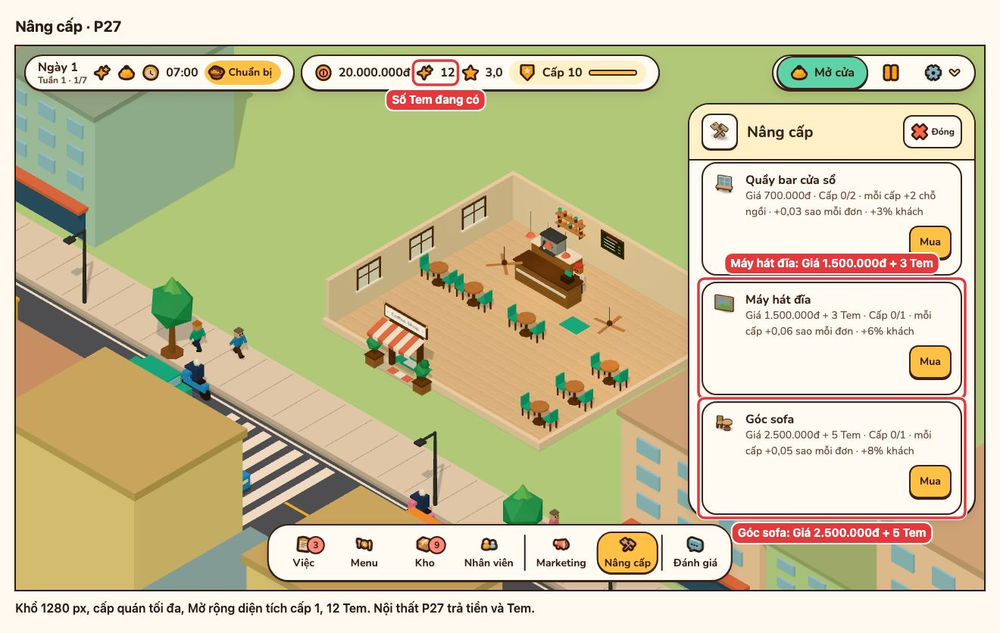 |
| Quán mở rộng cấp 4 | 1280 | Phòng bên cấp 4 kín bàn, Biển neon hai bên cửa, Kệ sách, Máy hát đĩa trên quầy sau, Góc sofa | 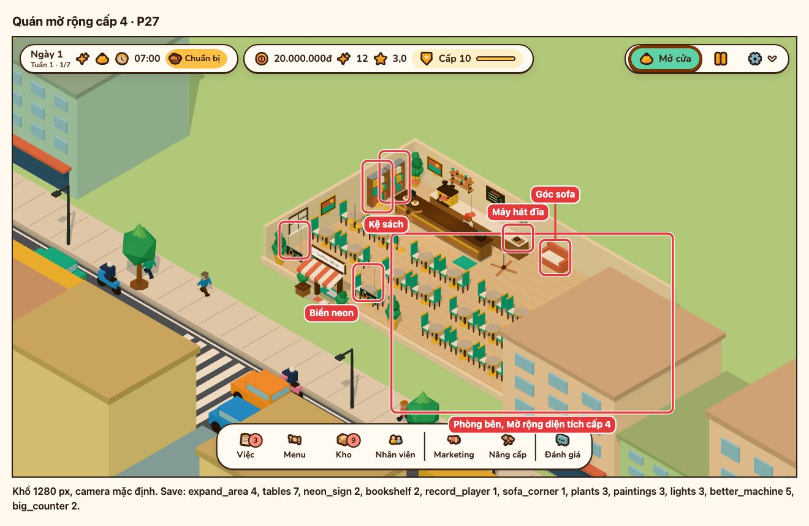 |
| Quán mở rộng cấp 4 | 390 | Khung điện thoại thấy một phần quán: Biển neon và Kệ sách | 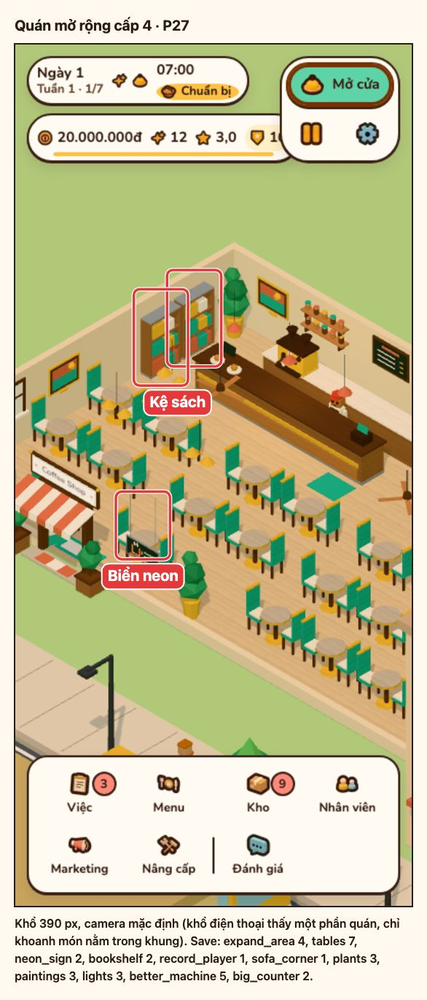 |
| Khách VIP | 1280 | Ngôi sao vàng trên đầu khách VIP (ngày 5), camera phóng khoảng 2x | 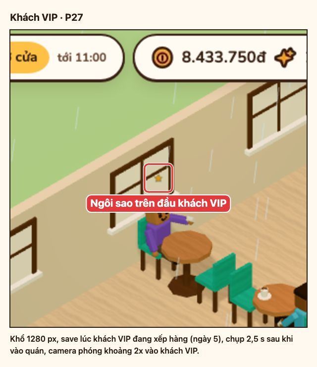 |
| Khách VIP | 390 | Ngôi sao trên đầu khách VIP, camera mặc định | 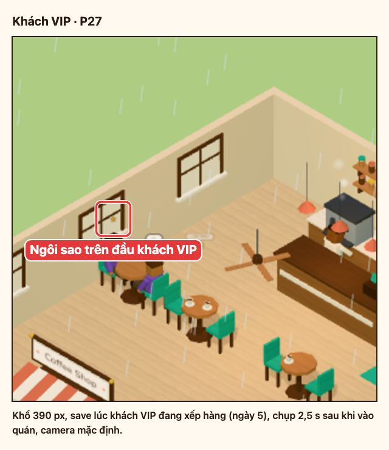 |
