# P29 — Hiệu ứng juice và ánh sáng theo giờ

Báo cáo kiểm chứng P29 so với base `774be34` (merge-base của nhánh với `origin/main`): kết quả `npm run check`, thời gian tới Main Menu và cảnh 3D, kích thước CSS và JS chính, khung hình và long task, nạp save v0–v3, ảnh trước/sau có khoanh. Cách P29 vẽ ánh sáng, mưa và hiệu ứng: [architecture.md](../architecture.md).

Mọi số đo làm trên commit `1fb13be` (HEAD của nhánh tích hợp P29 lúc đo). Máy đo: Apple M2, Chrome 155, WebGL ANGLE Metal.

| Phần | Lệnh |
| --- | --- |
| Kiểm tra code | `npm run check` |
| Khởi động, bảng chunk | `PORT=<cổng> node scripts/measure-startup.mjs --base 774be34 --runs 9` (hai lượt) |
| Khung hình 5 s đầu | `MEDIA_PORT=<cổng> npm run perf:frames -- --base 774be34 --runs 5`, thêm `--headed` |
| Khung hình quanh hiệu ứng | `MEDIA_PORT=<cổng> npm run perf:frames -- --base 774be34 --runs 5 --headed --fx` |
| Khung hình cảnh P29 | như trên với `--scene dusk-rain` và `--scene noon-sunny` thay cho `--fx` |
| Save | `npx vitest run tests/save`, cộng một lượt Playwright nạp save v0–v3 vào bản build ([mục 5](#5-save-cũ)) |
| Ảnh P29 | `MEDIA_PORT=<cổng> npm run media:p29` (tên file và save: đầu [scripts/capture-p29.mjs](../../scripts/capture-p29.mjs)) |

## 1. Tóm tắt

| Kiểm | Ngưỡng | Kết quả |
| --- | --- | --- |
| `npm run check` | tsc, test, build xanh | PASS: 115 file, 1737 test pass, 1 test `expected fail` |
| Main Menu Phone 390×844 (2 lượt) | < 1000 ms | PASS: 662 và 687 ms (base 668 và 604 ms) |
| Main Menu Mobile (2 lượt) | FAIL khi chậm hơn base rõ ở cả hai lượt và vượt 1 s | PASS: 672 / 520 ms (+152 ms) và 654 / 526 ms (+128 ms); chậm hơn base ở cả hai lượt nhưng dưới 1 s |
| CSS chính `index-*.css` gzip | ≤ 9,7 kB | PASS: `index-G0d7UaCo.css` 9,64 kB, cùng file (cùng hash) với base |
| JS chính `index-*.js` gzip | So base | 15,6 kB, bằng base |
| p95 headed, mọi bảng | Không tệ hơn base quá 1 ms | PASS: lệch lớn nhất +1 ms (`noon-sunny` máy bàn, 19 / 18 ms) |
| Long task mới > 50 ms | Không có | PASS: 0 long task ở mọi lần đo của P29 (headless, headed, `--fx`, hai `--scene`) |
| Save v0–v3 | Nạp được, vào cảnh, không lỗi console | PASS: `tests/save` 10 file, 189 test; Playwright 4/4 |
| Ảnh | Trước/sau có khoanh | 7 ảnh ghép trước/sau, 24 ảnh cảnh và 1 ảnh thẻ Lên cấp của `media:p29` |

## 2. Khởi động

`measure-startup.mjs` chạy hai lượt liền nhau, mỗi ô là trung vị 9 lần. Mobile và Phone dùng mạng 150 ms RTT, 1,6 Mbps, CPU 4x; Phone là 390×844 @3x.

| Lượt | Cấu hình | Bản | Nội dung đầu tiên hiện | Main Menu | Cảnh 3D | Cảnh 3D so base |
| --- | --- | --- | --- | --- | --- | --- |
| 1 | Máy bàn | `774be34` | 76 ms | 82 ms | 280 ms | |
| 1 | Máy bàn | P29 | 76 ms | 77 ms | 274 ms | −2,1% |
| 1 | Mobile | `774be34` | 280 ms | 520 ms | 2931 ms | |
| 1 | Mobile | P29 | 320 ms | 672 ms | 3163 ms | +7,9% |
| 1 | Phone 390×844 | `774be34` | 304 ms | 668 ms | 3060 ms | |
| 1 | Phone 390×844 | P29 | 340 ms | 662 ms | 3125 ms | +2,1% |
| 2 | Máy bàn | `774be34` | 80 ms | 90 ms | 287 ms | |
| 2 | Máy bàn | P29 | 84 ms | 97 ms | 276 ms | −3,8% |
| 2 | Mobile | `774be34` | 276 ms | 526 ms | 2914 ms | |
| 2 | Mobile | P29 | 324 ms | 654 ms | 3180 ms | +9,1% |
| 2 | Phone 390×844 | `774be34` | 292 ms | 604 ms | 3017 ms | |
| 2 | Phone 390×844 | P29 | 356 ms | 687 ms | 3132 ms | +3,8% |

| Ngưỡng | Lượt 1 | Lượt 2 | Chấm |
| --- | --- | --- | --- |
| Main Menu Phone < 1000 ms | 662 ms | 687 ms | PASS |
| Main Menu Mobile so base | +152 ms | +128 ms | PASS: chậm hơn base ở cả hai lượt, dưới 1 s, trong khoảng 79–291 ms đã chấp nhận từ P27 |

### Chunk

Bảng chunk của `measure-startup.mjs` (gzip mức 9), giống nhau ở hai lượt. Ô CSS và JS chính của P29 ghi kèm số của Vite trong `npm run check`.

| Chunk | `774be34` gzip | P29 gzip | Tải lúc |
| --- | --- | --- | --- |
| JS chính `index-*.js` | 15,6 kB | 15,6 kB (Vite 15,59 kB) | Trước Main Menu |
| CSS `index-*.css` | 9,6 kB (`index-G0d7UaCo.css`) | 9,6 kB, cùng file (Vite 9,64 kB) | Trước Main Menu |
| `src/render` `index-*.js` | 38,0 kB | 40,3 kB | Sau khung hình đầu của menu |
| `game-*.js` | 45,4 kB | 45,7 kB | Sau khung hình đầu của menu |
| `iconMap-*.js` | 28,0 kB | 28,0 kB | Cùng `game-*.js` |
| `game-*.css` | 5,3 kB | 5,3 kB | Cùng `game-*.js` |
| `three-*.js` | 126,1 kB | 126,4 kB | Cùng `src/render` |
| `confetti-*.js` | 1,2 kB | 1,2 kB | Khi báo cáo có lên cấp |

## 3. Khung hình

`perf:frames --base 774be34 --runs 5`, 1280×800, trung vị 5 lần. Headless cấp khung theo bội số nhịp màn hình nên p95 headless chỉ để so; dòng headed là thời gian khung thật. Cột Long task ghi số long task trong cửa sổ đo của từng lần.

### 5 s đầu sau `cst:world`

| Chế độ | Hồ sơ | Bản | Cảnh 3D | p50 / p95 / dài nhất | Khung > 50 ms | Long task |
| --- | --- | --- | --- | --- | --- | --- |
| Headless | Máy bàn | `774be34` | 232 ms | 67 / 117 / 133 ms | 40 | 0 ở cả 5 lần |
| Headless | Máy bàn | P29 | 243 ms | 67 / 117 / 133 ms | 46 | 0 ở cả 5 lần |
| Headless | Di động | `774be34` | 3306 ms | 50 / 133 / 133 ms | 40 | 0 ở cả 5 lần |
| Headless | Di động | P29 | 3316 ms | 67 / 133 / 133 ms | 40 | 0 ở cả 5 lần |
| Headed | Máy bàn | `774be34` | 197 ms | 17 / 18 / 19 ms | 0 | 0 ở cả 5 lần |
| Headed | Máy bàn | P29 | 215 ms | 17 / 18 / 22 ms | 0 | 0 ở cả 5 lần |
| Headed | Di động | `774be34` | 3298 ms | 17 / 18 / 19 ms | 0 | 0 ở cả 5 lần |
| Headed | Di động | P29 | 3365 ms | 17 / 18 / 19 ms | 0 | 0 ở cả 5 lần |

Confetti và atlas `tiers` không tải trước khi cửa sổ đo kết thúc ở mọi dòng.

### Quanh hiệu ứng (`--headed --fx`)

Cửa sổ 3 s quanh lúc mua nâng cấp ("upgrade") và lúc báo cáo có thẻ Lên cấp mở ("level-up").

| Hồ sơ | Hiệu ứng | Bản | p50 / p95 / dài nhất | Khung > 50 ms | Long task |
| --- | --- | --- | --- | --- | --- |
| Máy bàn | upgrade | `774be34` | 17 / 19 / 19 ms | 0 (1/0/0/0/0) | 0 ở cả 5 lần |
| Máy bàn | upgrade | P29 | 17 / 19 / 20 ms | 0 | 0 ở cả 5 lần |
| Máy bàn | level-up | `774be34` | 17 / 18 / 33 ms | 0 (1/0/0/0/0) | 0 ở cả 5 lần |
| Máy bàn | level-up | P29 | 17 / 18 / 33 ms | 0 | 0 ở cả 5 lần |
| Di động | upgrade | `774be34` | 17 / 18 / 19 ms | 0 | 0 ở cả 5 lần |
| Di động | upgrade | P29 | 17 / 18 / 19 ms | 0 | 0 ở cả 5 lần |
| Di động | level-up | `774be34` | 17 / 18 / 52 ms | 1 (1/1/0/1/1) | 0 ở cả 5 lần |
| Di động | level-up | P29 | 17 / 18 / 51 ms | 1 (1/0/1/1/1) | 0 ở cả 5 lần |

### Cảnh P29 (`--headed --scene`)

Save do sim của từng bản chơi ra: ngày 2, 6 khách, 2 nhân viên. Cửa sổ 5 s, bắt đầu 1,5 s sau Tiếp tục; `dusk-rain` đo lúc HUD 19:03.

| Cảnh | Hồ sơ | Bản | p50 / p95 / dài nhất | Khung > 50 ms | Long task |
| --- | --- | --- | --- | --- | --- |
| `dusk-rain` (19:00, mưa) | Máy bàn | `774be34` | 17 / 18 / 20 ms | 0 | 0 ở cả 5 lần |
| `dusk-rain` | Máy bàn | P29 | 17 / 18 / 20 ms | 0 | 0 ở cả 5 lần |
| `dusk-rain` | Di động | `774be34` | 17 / 18 / 19 ms | 0 | 0 ở cả 5 lần |
| `dusk-rain` | Di động | P29 | 17 / 18 / 19 ms | 0 | 0 ở cả 5 lần |
| `noon-sunny` (12:00, nắng) | Máy bàn | `774be34` | 17 / 18 / 20 ms | 0 | 0 ở cả 5 lần |
| `noon-sunny` | Máy bàn | P29 | 17 / 19 / 20 ms | 0 | 0 ở cả 5 lần |
| `noon-sunny` | Di động | `774be34` | 17 / 18 / 19 ms | 0 | 0 ở cả 5 lần |
| `noon-sunny` | Di động | P29 | 17 / 18 / 19 ms | 0 | 0 ở cả 5 lần |

p95 máy bàn headed vẫn là 18–19 ms, chưa đạt 16,7 ms (nợ cũ từ P27, base cũng 18 ms).

## 4. Ánh sáng đo trong cảnh

Tổng sáng tính như `totalLightOf` trong `src/render/scene/renderer.ts`: hemi + env × 6 + nắng, đọc từ đèn của cảnh lúc chụp. Ngân sách `LIGHT_BUDGET` là 3,4.

| Cảnh | Mức | `774be34` | P29 |
| --- | --- | --- | --- |
| 12:00 nắng | Vừa | 4,15 (hemi 1,65, env 0,10, nắng 1,90), vượt ngân sách | 3,40 (hemi 1,00, env 0,10, nắng 1,80) |
| 19:30 mưa | Cao | 2,06 | 1,42 |
| 19:30 mưa | Thấp | 1,46 | 1,42 |

## 5. Save cũ

| Kiểm | Kết quả |
| --- | --- |
| `npx vitest run tests/save` | PASS: 10 file, 189 test, gồm `tests/save/p29-compat.test.ts` (v0–v3, thời tiết lạ hay thiếu, giờ lạ) |
| Playwright: save 19:00 mưa do sim P29 chơi ra, đổi sang dạng v0, v1, v2, v3 như `p29-compat.test.ts`, đặt vào slot `auto`, mở bản build, bấm Tiếp tục, chờ 4 s | PASS 4/4: đồng hồ chạy 19:01 → 19:05, cảnh 3D sẵn sàng, 0 lỗi console và 0 `pageerror`. v1–v3 có mưa; v0 không có trường thời tiết nên nạp thành nắng, không mưa |
| `SAVE_VERSION` | Vẫn là 3 |

## 6. Ảnh

Ảnh trước/sau: bên trái build `774be34`, bên phải P29 `1fb13be`, cùng save do sim của từng bản chơi ra (cùng seed, cùng khổ 1280×800 trừ thẻ Lên cấp 390×844). Vòng đỏ là chỗ đổi, dòng đỏ dưới ảnh là số đo của đúng khung đó.

| Cảnh | Đã sửa gì | Ảnh |
| --- | --- | --- |
| 12:00 nắng, Vừa | Ánh sáng theo giờ không còn đè mức đồ họa: tổng sáng 4,15 → 3,40, về đúng ngân sách 3,4; tường và sàn quán (khoanh) bớt cháy màu | 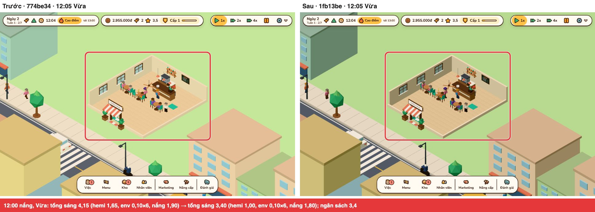 |
| 19:30 nắng, Cao | Đèn quán bật lúc chạng vạng có thêm 2 vũng sáng ấm trên sàn (khoanh); cả hai bản đều có 2 PointLight | 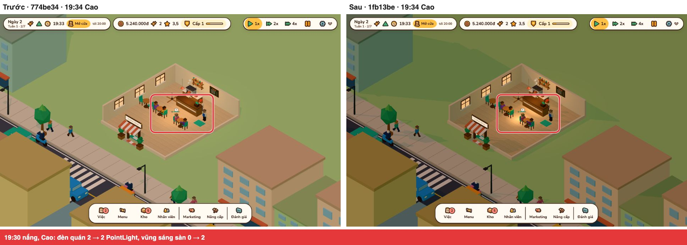 |
| 19:30 mưa, Cao | Mưa có thêm 120 tia bắn trên mặt đất (vùng khoanh là chỗ tia bắn dày nhất) và vệt mưa nghiêng; số vệt giữ 900 | 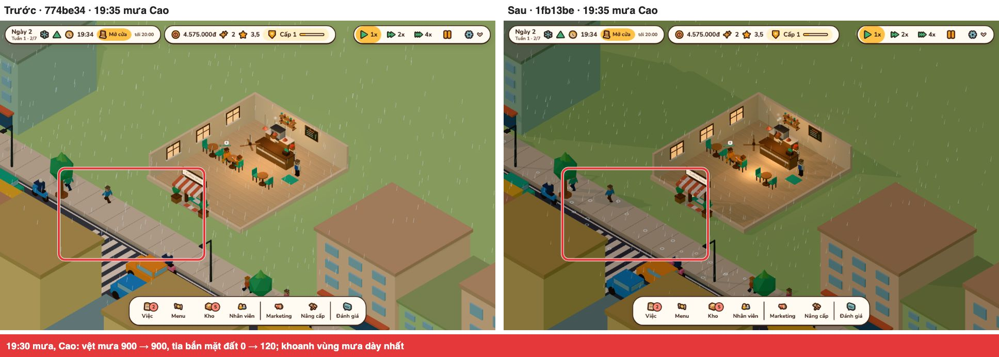 |
| 19:30 mưa, Thấp | Mức Thấp có mưa: 0 → 120 vệt, không có tia bắn | 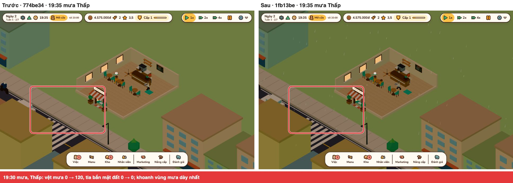 |
| Đồng xu khi bán, Cao | Đồng xu nảy theo cung rồi vỡ thành xu nhỏ: khung có nhiều sprite xu nhất trong 20 s là 2 (xu và nhãn tiền) ở base, 7 (xu nhỏ vỡ ra) ở P29; ảnh phóng 4x | 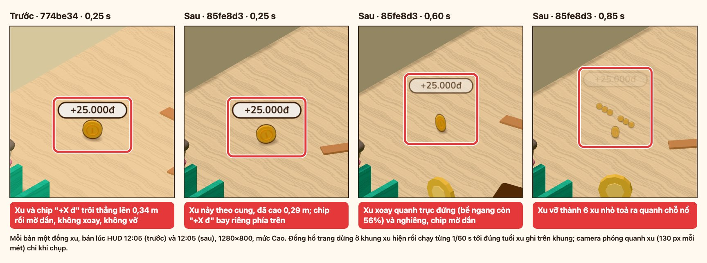 |
| Thẻ Lên cấp, 390 | Huy hiệu cấp rung ngang một lần sau khi hiện: giữ ở chỗ lệch xa nhất (490 ms) thì lệch −2,8 px so với nét đứt xanh; base không rung | 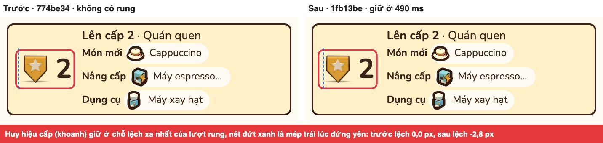 |

Ảnh đồng xu và Lên cấp chỉ cho thấy một khung của chuyển động; số đo dưới ảnh là phần chứng minh.

### Ảnh `media:p29`

`npm run media:p29` chụp P29 ở 07:00, 12:00, 19:30 × nắng, mưa × Cao, Thấp × 390, 1280 px: 24 ảnh `docs/media/p29/scene-<giờ>-<thời tiết>-<mức>-<khổ>-p29.jpg`, cùng `levelup-390-p29.jpg` khoanh thẻ Lên cấp. HUD trong ảnh chạy trước giờ đặt 3–5 phút.

| Giờ | Nắng, Cao, 1280 | Mưa, Cao, 1280 | Mưa, Thấp, 390 |
| --- | --- | --- | --- |
| 07:00 | 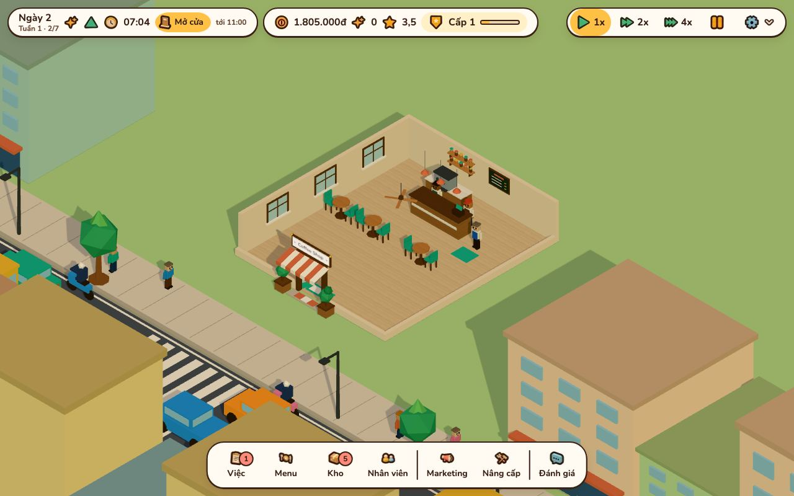 | 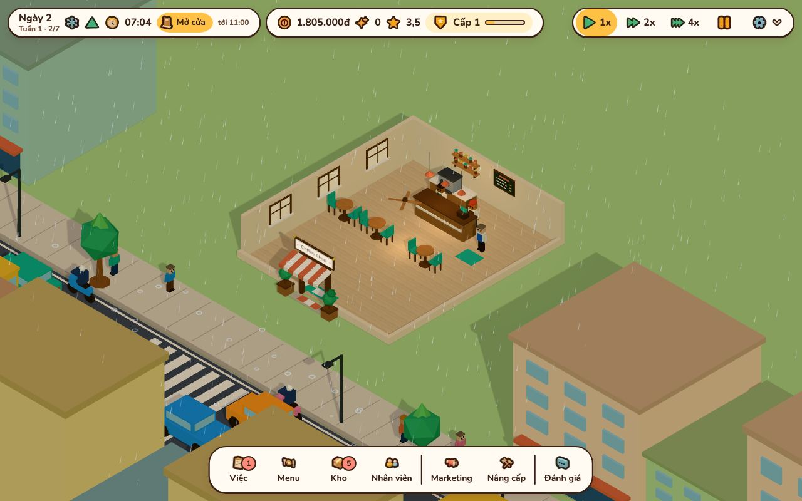 | 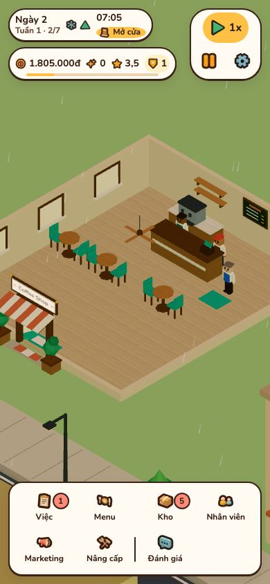 |
| 12:00 | 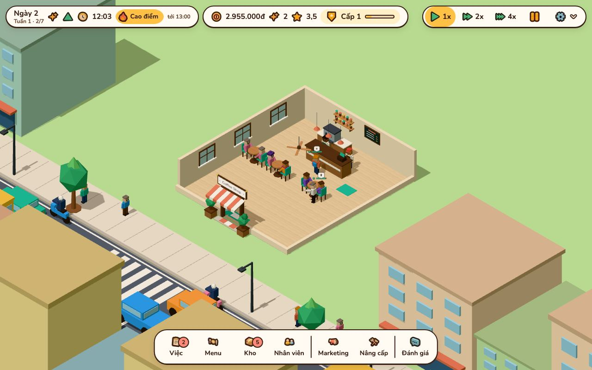 | 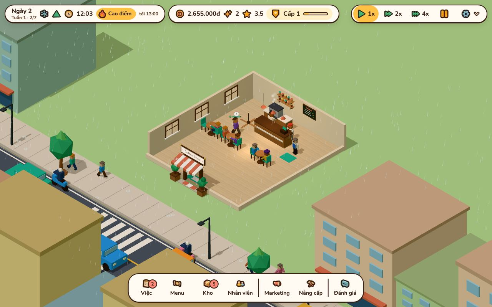 | 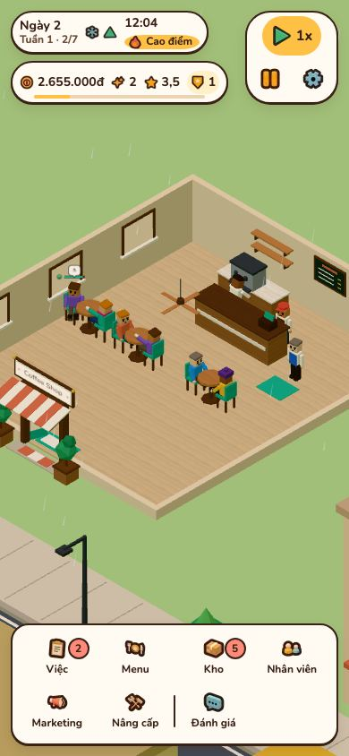 |
| 19:30 | 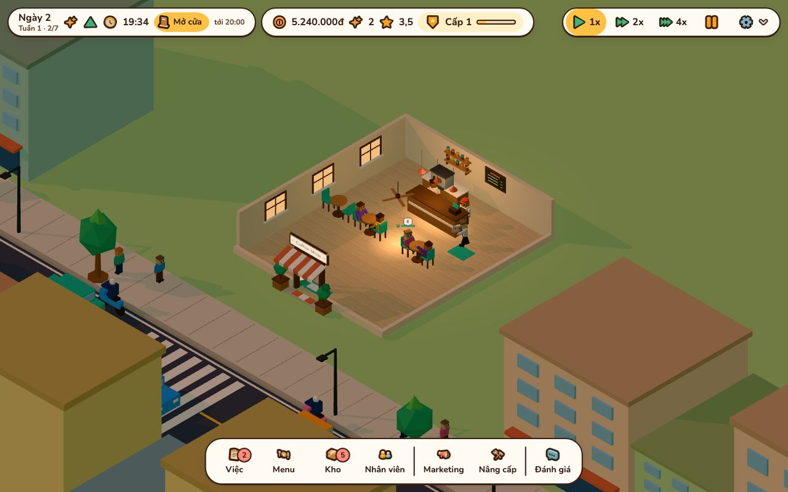 | 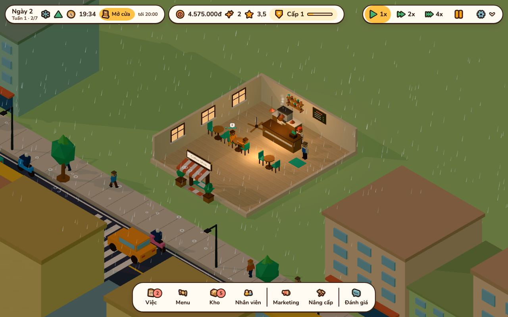 | 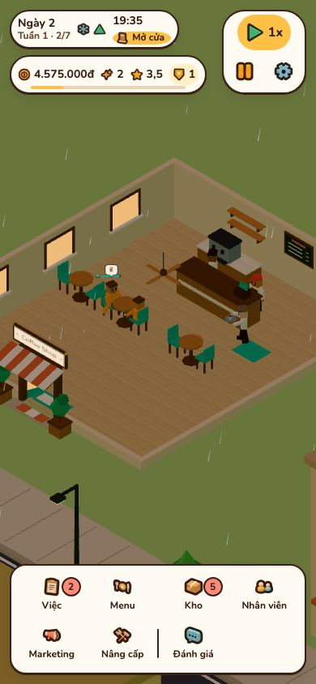 |
