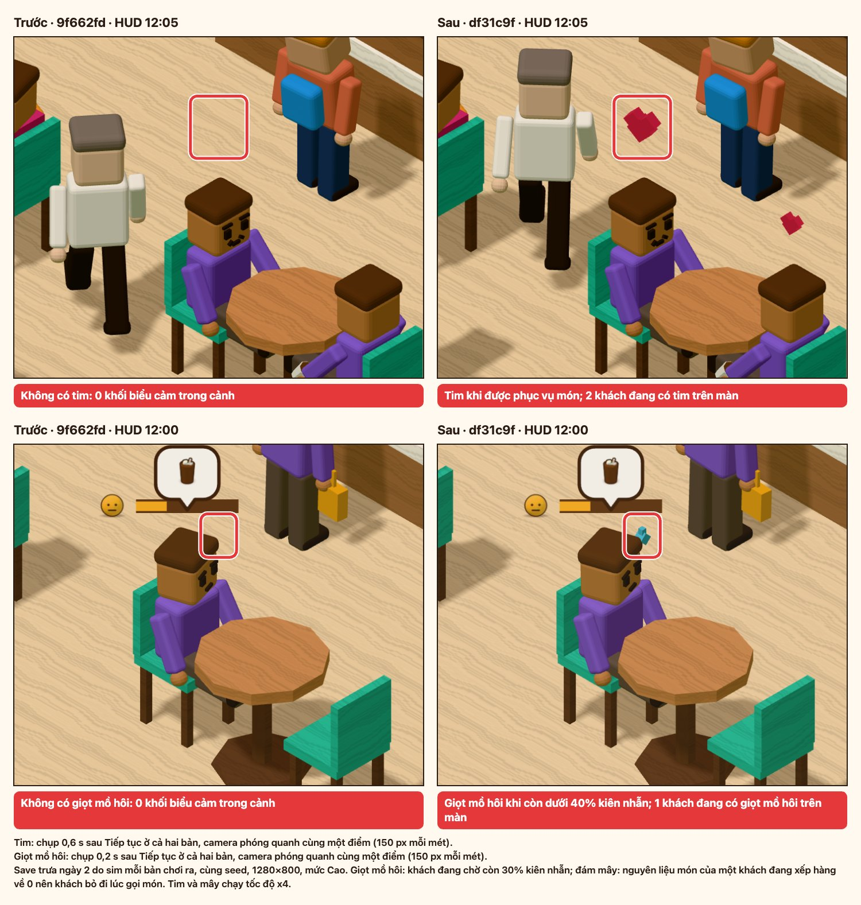
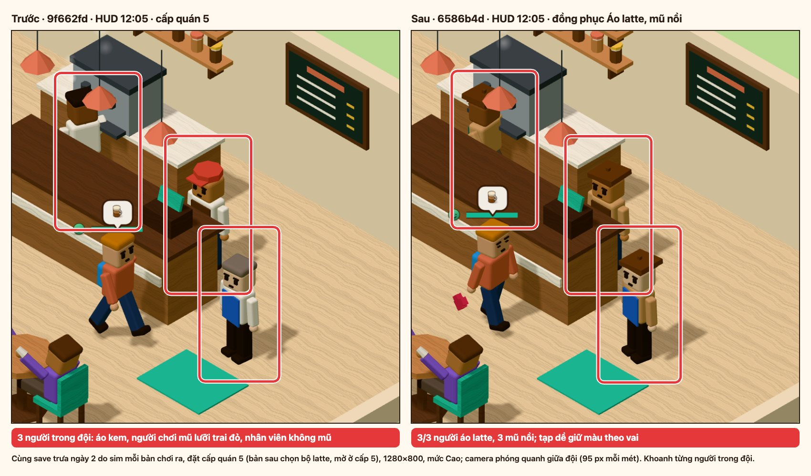
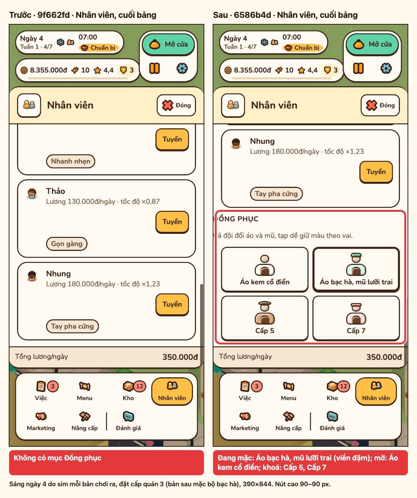
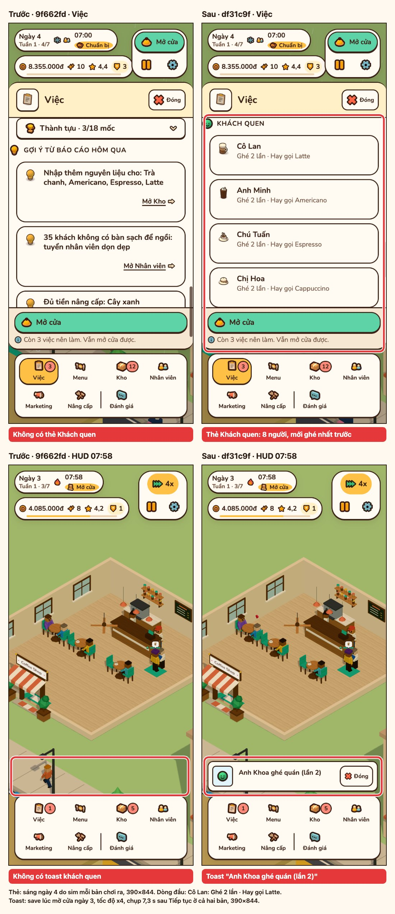

# P30 — Khách quen, đồng phục và biểu cảm

Báo cáo kiểm chứng P30 so với base `9f662fd` (`chore(release): v0.10.0`, bản P29 đã deploy): kết quả `npm run check`, thời gian tới Main Menu và cảnh 3D, khung hình, layout, nạp save v0–v3, ảnh trước/sau có khoanh. Luật và con số của P30: [spec/p30-characters.md](../spec/p30-characters.md).

Mọi số đo làm trên commit `df31c9f` (HEAD của nhánh tích hợp P30 lúc đo; commit sau đó chỉ thêm script chụp ảnh và tài liệu). Máy đo: Apple M2, Chrome 155, WebGL ANGLE Metal.

| Phần | Lệnh |
| --- | --- |
| Kiểm tra code | `npm run check` |
| Khởi động, bảng chunk | `PORT=<cổng> node scripts/measure-startup.mjs --base 9f662fd --runs 9` (hai lượt) |
| Khung hình 5 s đầu | `MEDIA_PORT=<cổng> npm run perf:frames -- --base 9f662fd --runs 5 --headed` |
| Khung hình cảnh có khách | như trên, thêm `--scene dusk-rain` hoặc `--scene noon-sunny` |
| Layout 390–1440 px | `npm run layout` |
| Save | `npx vitest run tests/save`, cộng một lượt Playwright nạp save v3 của P29 vào bản build ([mục 5](#5-save-cũ)) |
| Ảnh | `MEDIA_HEADED=1 MEDIA_PORT=<cổng> npm run media:p30` ([media.md](../media.md#ảnh-p30)) |

## 1. Tóm tắt

| Kiểm | Ngưỡng | Kết quả |
| --- | --- | --- |
| `npm run check` | tsc, test, build xanh | PASS: 123 file, 1810 test |
| Main Menu Phone 390×844 (2 lượt) | < 1000 ms | PASS: 668 và 824 ms (base 663 và 804 ms) |
| Main Menu Mobile (2 lượt) | < 1000 ms | PASS: 674 và 659 ms (base 673 và 662 ms) |
| CSS chính `index-*.css` gzip | So base | `index-G0d7UaCo.css` 9,64 kB, cùng file (cùng hash) với base |
| JS chính `index-*.js` gzip | So base | 15,6 kB, bằng base |
| Khung > 50 ms, headed | Không thêm rõ rệt so với base | PASS: 0 khung > 50 ms ở mọi lần đo của P30 (5 s đầu, `dusk-rain`, `noon-sunny`) |
| Long task | Không có long task mới | PASS: 0 long task ở mọi lần đo của P30 |
| p95 headed | So base | PASS: 18 ms ở mọi bảng, base 18–19 ms |
| `npm run layout` | PASS | PASS: 98 mục |
| Save v0–v3 | Nạp được, chơi tiếp được | PASS: `tests/save` 11 file, 195 test; Playwright nạp save v3 của P29: đồng hồ chạy, 0 lỗi mới |
| Ảnh | Trước/sau có khoanh | 4 ảnh ghép: tim và giọt mồ hôi, đội mặc đồng phục latte, mục Đồng phục, thẻ Khách quen và toast. Chưa có ảnh đám mây: `media:p30` kết thúc với mã 1, do trình duyệt không vẽ khung chứ không do game treo ([mục 6](#6-ảnh)) |

## 2. Khởi động

`measure-startup.mjs` chạy hai lượt liền nhau, mỗi ô là trung vị 9 lần. Mobile và Phone dùng mạng 150 ms RTT, 1,6 Mbps, CPU 4x; Phone là 390×844 @3x.

| Lượt | Cấu hình | Bản | Nội dung đầu tiên hiện | Main Menu | Cảnh 3D | Cảnh 3D so base |
| --- | --- | --- | --- | --- | --- | --- |
| 1 | Máy bàn | `9f662fd` | 80 ms | 84 ms | 352 ms | |
| 1 | Máy bàn | P30 | 68 ms | 85 ms | 328 ms | −6,8% |
| 1 | Mobile | `9f662fd` | 316 ms | 673 ms | 3206 ms | |
| 1 | Mobile | P30 | 344 ms | 674 ms | 3190 ms | −0,5% |
| 1 | Phone 390×844 | `9f662fd` | 324 ms | 663 ms | 3161 ms | |
| 1 | Phone 390×844 | P30 | 304 ms | 668 ms | 3219 ms | +1,8% |
| 2 | Máy bàn | `9f662fd` | 68 ms | 82 ms | 270 ms | |
| 2 | Máy bàn | P30 | 76 ms | 82 ms | 300 ms | +11,1% |
| 2 | Mobile | `9f662fd` | 292 ms | 662 ms | 3098 ms | |
| 2 | Mobile | P30 | 312 ms | 659 ms | 3201 ms | +3,3% |
| 2 | Phone 390×844 | `9f662fd` | 460 ms | 804 ms | 3412 ms | |
| 2 | Phone 390×844 | P30 | 440 ms | 824 ms | 3475 ms | +1,8% |

| Ngưỡng | Lượt 1 | Lượt 2 | Chấm |
| --- | --- | --- | --- |
| Main Menu Phone < 1000 ms | 668 ms (+5 ms so base) | 824 ms (+20 ms) | PASS |
| Main Menu Mobile < 1000 ms | 674 ms (+1 ms) | 659 ms (−3 ms) | PASS |

Lượt 2 của Phone chậm hơn lượt 1 ở cả hai bản (base 663 → 804 ms), nên phần tăng là nhiễu của máy đo, không do P30. Cảnh 3D máy bàn lệch −6,8% rồi +11,1% giữa hai lượt, cùng lý do.

### Chunk

Bảng chunk của `measure-startup.mjs` (gzip mức 9), giống nhau ở hai lượt. Ô có thêm số của Vite lấy từ `npm run check`.

| Chunk | `9f662fd` gzip | P30 gzip | Tải lúc |
| --- | --- | --- | --- |
| JS chính `index-*.js` | 15,6 kB | 15,6 kB (Vite 15,60 kB) | Trước Main Menu |
| CSS `index-*.css` | 9,6 kB (`index-G0d7UaCo.css`) | 9,6 kB, cùng file (Vite 9,64 kB) | Trước Main Menu |
| `src/render` `index-*.js` | 40,3 kB | 41,6 kB (Vite 41,68 kB) | Sau khung hình đầu của menu |
| `game-*.js` | 45,9 kB | 46,9 kB (Vite 47,02 kB) | Sau khung hình đầu của menu |
| `iconMap-*.js` | 28,0 kB | 28,7 kB (Vite 28,73 kB) | Cùng `game-*.js` |
| `game-*.css` | 5,3 kB | 5,7 kB (Vite 5,79 kB) | Cùng `game-*.js` |
| `three-*.js` | 126,4 kB | 126,4 kB | Cùng `src/render` |
| `confetti-*.js` | 1,2 kB | 1,2 kB | Khi báo cáo có lên cấp |

Hai chunk tải trước Main Menu giữ nguyên; phần tăng của P30 (khoảng 3,4 kB gzip) nằm ở các chunk tải sau khung hình đầu của menu.

## 3. Khung hình

`perf:frames --base 9f662fd --runs 5 --headed`, 1280×800, trung vị 5 lần. Cột "Khung > 50 ms" và "Long task" ghi trung vị, trong ngoặc là từng lần.

### 5 s đầu sau `cst:world`

| Hồ sơ | Bản | Cảnh 3D | p50 / p95 / dài nhất | Khung > 50 ms | Long task |
| --- | --- | --- | --- | --- | --- |
| Máy bàn | `9f662fd` | 228 ms | 17 / 18 / 19 ms | 0 (0/0/0/0/0) | 0 |
| Máy bàn | P30 | 247 ms | 17 / 18 / 19 ms | 0 (0/0/0/0/0) | 0 |
| Di động | `9f662fd` | 3316 ms | 17 / 18 / 19 ms | 0 (0/0/0/0/0) | 0 |
| Di động | P30 | 3349 ms | 17 / 18 / 19 ms | 0 (0/0/0/0/0) | 0 |

Confetti và atlas `tiers` không tải trước khi cửa sổ đo kết thúc ở mọi dòng.

### Cảnh có khách (`--scene`)

Save ngày 2 do sim của từng bản chơi ra (6 khách, 2 nhân viên), nên cảnh P30 có khách quen, biểu cảm và đồng phục. Cửa sổ 5 s, bắt đầu 1,5 s sau Tiếp tục.

| Cảnh | Hồ sơ | Bản | p50 / p95 / dài nhất | Khung > 50 ms | Long task |
| --- | --- | --- | --- | --- | --- |
| `dusk-rain` (19:00, mưa) | Máy bàn | `9f662fd` | 17 / 18 / 19 ms | 0 (0/0/0/0/0) | 0 (0/0/0/0/0) |
| `dusk-rain` | Máy bàn | P30 | 17 / 18 / 20 ms | 0 (0/0/0/0/0) | 0 (0/0/0/0/0) |
| `dusk-rain` | Di động | `9f662fd` | 17 / 18 / 19 ms | 0 (0/0/0/0/0) | 0 (0/0/0/0/0) |
| `dusk-rain` | Di động | P30 | 17 / 18 / 19 ms | 0 (0/0/0/0/0) | 0 (0/0/0/0/0) |
| `noon-sunny` (12:00, nắng) | Máy bàn | `9f662fd` | 17 / 19 / 19 ms | 0 (0/0/0/0/0) | 0 (0/0/0/0/0) |
| `noon-sunny` | Máy bàn | P30 | 17 / 18 / 19 ms | 0 (0/0/0/0/0) | 0 (0/0/0/0/0) |
| `noon-sunny` | Di động | `9f662fd` | 17 / 18 / 19 ms | 0 (0/0/0/0/2) | 0 (0/0/0/0/2) |
| `noon-sunny` | Di động | P30 | 17 / 18 / 19 ms | 0 (0/0/0/0/0) | 0 (0/0/0/0/0) |

Khung dài nhất của P30 trong từng lần là 28 ms (`dusk-rain` di động, lần 5); base có một lần 119 ms với 2 long task (`noon-sunny` di động, lần 5). p95 máy bàn vẫn 18 ms, chưa đạt 16,7 ms (nợ cũ từ P27, base cũng 18–19 ms).

## 4. Layout

`npm run layout`: PASS 98/98 mục ở 390×844, 768×1024, 1280×720, 1440×900, gồm bảng Nhân viên (có mục Đồng phục) và bảng Việc (có thẻ Khách quen, lúc chưa có ai là dòng "Chưa có khách quen nào ghé") của ván mới; Kho CLS 0.

## 5. Save cũ

| Kiểm | Kết quả |
| --- | --- |
| `npx vitest run tests/save` | PASS: 11 file, 195 test, gồm `tests/save/p30-compat.test.ts` (v0–v3 nạp không có khách quen hay đồng phục, chơi một ngày, lưu lại giữ cả hai; id đồng phục lạ mặc `classic`) |
| Playwright (`media:p30`): save trưa ngày 2 do sim `9f662fd` chơi ra (save v3 của P29, không có `regulars`, `uniform`), đặt vào slot `auto`, mở bản build P30, bấm Tiếp tục, chờ 4 s | PASS: đồng hồ chạy 12:00 → 12:08, 0 lỗi console, 0 request lỗi. Save của chính P30 cũng nạp qua cùng bước; lần mở trình duyệt đầu tiên có 1 request 404, có cả với save của chính P30 nên không do save cũ |
| `SAVE_VERSION` | Vẫn là 3 |

## 6. Ảnh

Bên trái build `9f662fd`, bên phải P30 `df31c9f`, cùng save do sim của từng bản chơi ra (cùng seed). Bản P30 chụp trước; bản gốc chụp cùng số giây sau Tiếp tục, camera ở cùng điểm và cùng vòng khoanh. Vòng đỏ là chỗ đổi, dòng đỏ dưới ảnh là số đo của đúng khung đó.

| Mục | Đã đổi gì | Ảnh |
| --- | --- | --- |
| Biểu cảm, 1280×800, mức Cao | Tim (khối kim cương hai thùy) bay lên trên khách vừa được phục vụ, 0,6 s sau Tiếp tục có 2 khách đang có tim. Giọt mồ hôi ở thái dương khách còn 30% kiên nhẫn. Base không có khối biểu cảm nào trong cảnh |  |
| Đồng phục cấp 5, 1280×800 | Cả 3 người trong đội (người chơi, pha chế, phục vụ) mặc áo latte và mũ nồi; tạp dề giữ màu theo vai. Base: áo kem, người chơi mũ lưỡi trai đỏ, nhân viên không mũ |  |
| Mục Đồng phục, 390×844 | Bảng Nhân viên có mục Đồng phục 4 nút, đủ 3 trạng thái ở cấp quán 3: Áo bạc hà đang mặc (viền đậm), Áo kem cổ điển mở, hai bộ khoá ghi "Cấp 5", "Cấp 7". Mỗi nút cao 90 px |  |
| Thẻ Khách quen và toast, 390×844 | Bảng Việc có thẻ Khách quen: 8 người, mỗi dòng "Ghé 2 lần · Hay gọi <món>". Toast "Anh Khoa ghé quán (lần 2)" lúc khách quen ghé ngày 3; base không có toast nào ở cùng lúc |  |

Lần chạy `npm run media:p30` dùng cho bốn ảnh trên kết thúc với mã 1 vì một dòng `!!`: không thấy đám mây ở save hết hàng trong 40 s. Bảng Biểu cảm vì vậy chỉ có tim và giọt mồ hôi; ba bảng còn lại không có `!!`. Bảng Biểu cảm chưa đủ cho tới khi `media:p30` chạy lại thoát mã 0.

Ở lần đó đồng hồ HUD dừng ở 12:08 và không có toast "Khách bỏ đi". Đó không phải game treo:

| Kiểm | Kết quả |
| --- | --- |
| Save đám mây nạp lại bằng `loadGame`, chạy ở x4 theo khung 60 fps (`cloudCheck` trong `scripts/capture-p30.mjs`, `tests/scripts/p30-cloud.test.ts`) | Khách bỏ đi vì hết món lúc 12:05, 2 phút game sau mốc save 12:03 |
| Cùng save qua `mountGame` và **Tiếp tục** trong jsdom, mỗi khung chạy sim, nhân vật (`createActors`), HUD và toast như `src/main.ts`; 600 khung 1/60 s và 600 khung 0,1 s | Đồng hồ 12:03 → 13:22 và 12:03 → 20:03, có toast "Khách bỏ đi", 0 lỗi |

Mỗi khung trình duyệt đẩy đồng hồ tối đa 0,8 phút game ở x4 (`MAX_FRAME_S` 0,1 s), nên đi 5 phút trong 40 s nghĩa là trang chỉ vẽ khoảng 6 khung: trình duyệt không vẽ khung, sim không dừng. Script giờ in số khung trang đã vẽ và đồng hồ đầu/cuối khi không thấy biểu cảm, và in `!!` khi sim trong Node không cho ai bỏ đi ở save đám mây. Hình và luật của đám mây có test trong `tests/render/emotes.test.ts`.
