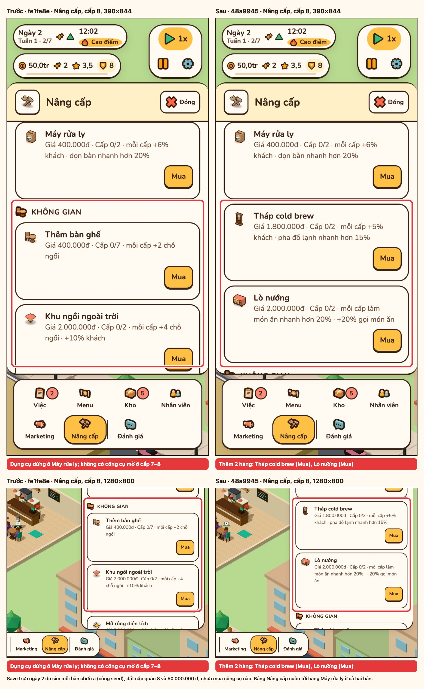
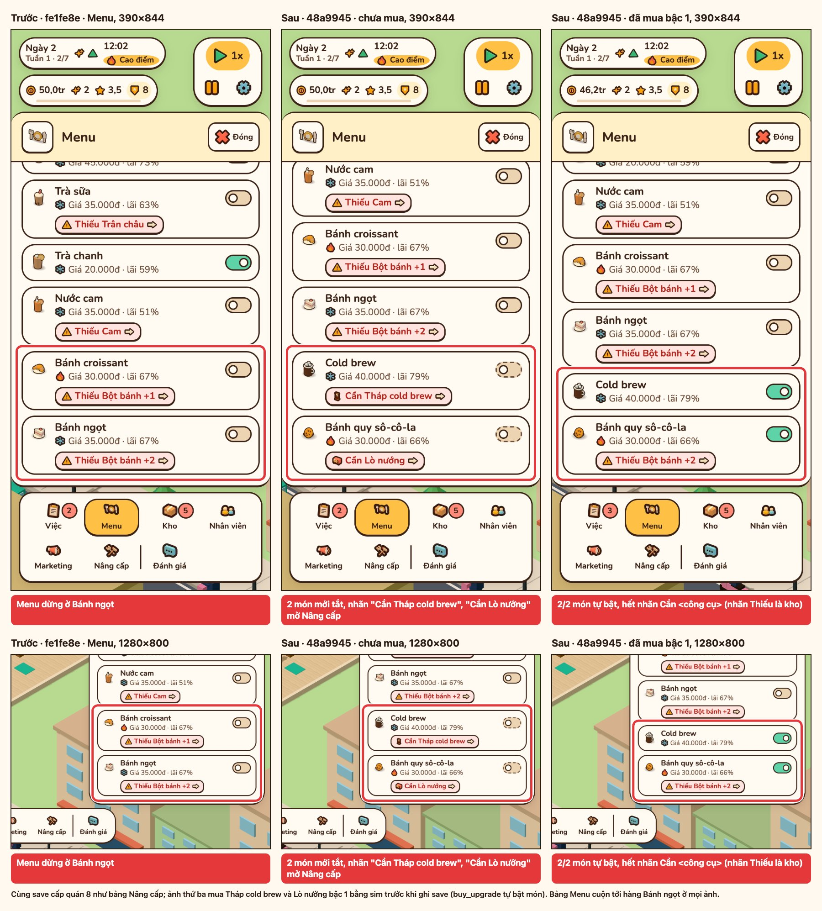
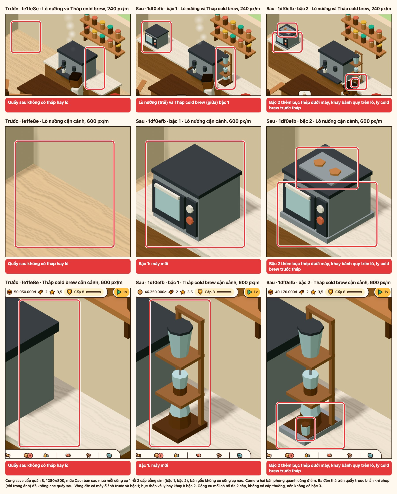

# P31 — Tháp cold brew, lò nướng và hai món mới

Báo cáo kiểm chứng P31 so với base `fe1fe8e` (v0.11.0, bản P30 đã deploy): kết quả `npm run check`, thời gian tới Main Menu và cảnh 3D, khung hình, layout, nạp save v0–v3, ảnh trước/sau có khoanh. Luật và con số của P31: [spec/p31-equipment.md](../spec/p31-equipment.md).

Mọi số đo và ảnh làm trên commit `48a9945` (HEAD của nhánh tích hợp P31 lúc đo), cộng kịch bản chụp `scripts/scenarios/p31.mjs` và kiểu shot `machines` chưa commit lúc đo (chỉ đổi script, không đổi `src/`). Máy đo: Apple M2, Chrome 155.0.8059.85, WebGL `ANGLE (Apple, ANGLE Metal Renderer: Apple M2, Unspecified Version)` ở mọi lệnh.

| Phần | Lệnh |
| --- | --- |
| Kiểm tra code | `npm run check` |
| Khởi động, bảng chunk | `node scripts/measure-startup.mjs --base fe1fe8e --runs 9` (hai lượt) |
| Khung hình 5 s đầu | `MEDIA_PORT=<cổng> npm run perf:frames -- --base fe1fe8e --runs 5 --headed` |
| Khung hình cảnh có khách | như trên, thêm `--scene dusk-rain` hoặc `--scene noon-sunny` |
| Khung hình cảnh có tháp và lò | `npm run perf:frames -- --base fe1fe8e --runs 5 --headed --scene tools-p31` |
| Layout 390–1440 px | `LAYOUT_PORT=<cổng> npm run layout` |
| Save | `npx vitest run tests/save`, cộng bước `compat` của kịch bản ảnh ([mục 5](#5-save-cũ)) |
| Ảnh | `MEDIA_PORT=<cổng> npm run media -- --scenario p31` ([media.md](../media.md#ảnh-p31)) |

## 1. Tóm tắt

| Tiêu chí | Ngưỡng | Kết quả |
| --- | --- | --- |
| `npm run check` | tsc, test, build xanh | PASS: 132 file, 1869 test |
| Main Menu Phone 390×844 (2 lượt) | < 1000 ms | PASS: 690 và 670 ms (base 669 và 650 ms) |
| Main Menu Mobile (2 lượt) | < 1000 ms | PASS: 694 và 685 ms (base 689 và 656 ms) |
| JS chính `index-*.js` gzip | Gần như không đổi | PASS: 15,6 kB (Vite 15,62 kB), base 15,6 kB |
| CSS chính `index-*.css` gzip | Gần như không đổi | PASS: `index-G0d7UaCo.css` 9,6 kB, cùng file (cùng hash) với base |
| p95 headed | Không xấu hơn base quá 1 ms | PASS: 18 ms ở mọi bảng; base 18–19 ms |
| Khung > 50 ms, headed | Không thêm khung > 50 ms | PASS theo trung vị (0 ở mọi bảng của P31). Đếm từng lần: P31 có 13 khung trong 8/60 lần, base 6 khung trong 5/60 lần ([mục 3](#3-khung-hình)) |
| `npm run layout` | Không tràn ngang ở 390–1440 | PASS: 98/98 mục |
| Save v0–v3 | Nạp được, chơi tiếp được | PASS: `tests/save` 12 file, 201 test; save v3 của `fe1fe8e` chạy 12:00 → 12:08 trong bản P31, 0 lỗi mới |
| Ảnh | Trước/sau có khoanh, 390 và 1280 | PASS: kịch bản `p31` thoát mã 0, không có dòng `!!`; 3 ảnh ghép ([mục 6](#6-ảnh)) |

## 2. Khởi động

`measure-startup.mjs` chạy hai lượt liền nhau, mỗi ô là trung vị 9 lần. Mobile và Phone dùng mạng 150 ms RTT, 1,6 Mbps, CPU 4x; Phone là 390×844 @3x.

| Lượt | Cấu hình | Bản | Nội dung đầu tiên hiện | Main Menu | Cảnh 3D |
| --- | --- | --- | --- | --- | --- |
| 1 | Máy bàn | `fe1fe8e` | 64 ms | 52 ms | 296 ms |
| 1 | Máy bàn | P31 | 64 ms | 113 ms | 308 ms |
| 1 | Mobile | `fe1fe8e` | 352 ms | 689 ms | 3179 ms |
| 1 | Mobile | P31 | 328 ms | 694 ms | 3253 ms |
| 1 | Phone 390×844 | `fe1fe8e` | 324 ms | 669 ms | 3163 ms |
| 1 | Phone 390×844 | P31 | 356 ms | 690 ms | 3249 ms |
| 2 | Máy bàn | `fe1fe8e` | 76 ms | 75 ms | 315 ms |
| 2 | Máy bàn | P31 | 72 ms | 100 ms | 313 ms |
| 2 | Mobile | `fe1fe8e` | 348 ms | 656 ms | 3180 ms |
| 2 | Mobile | P31 | 336 ms | 685 ms | 3207 ms |
| 2 | Phone 390×844 | `fe1fe8e` | 344 ms | 650 ms | 3233 ms |
| 2 | Phone 390×844 | P31 | 340 ms | 670 ms | 3227 ms |

| Ngưỡng | Lượt 1 | Lượt 2 | Chấm |
| --- | --- | --- | --- |
| Main Menu Phone < 1000 ms | 690 ms (+21 ms so base) | 670 ms (+20 ms) | PASS |
| Main Menu Mobile < 1000 ms | 694 ms (+5 ms) | 685 ms (+29 ms) | PASS |

Main Menu máy bàn của P31 chậm hơn base ở cả hai lượt (+61 và +25 ms). Không có ngưỡng cho máy bàn; P30 đo 82–85 ms ở cấu hình này.

### Chunk

Bảng chunk của `measure-startup.mjs` (gzip mức 9), giống nhau ở hai lượt.

| Chunk | `fe1fe8e` gzip | P31 gzip | Tải lúc |
| --- | --- | --- | --- |
| JS chính `index-*.js` | 15,6 kB (`index-CHNOldLT.js`, 39,7 kB thô) | 15,6 kB (`index-BtqqmuLR.js`, 39,7 kB thô) | Trước Main Menu |
| CSS `index-*.css` | 9,6 kB (`index-G0d7UaCo.css`) | 9,6 kB, cùng file | Trước Main Menu |
| `src/render` `index-*.js` | 41,6 kB | 42,1 kB | Sau khung hình đầu của menu |
| `game-*.js` | 46,9 kB | 47,1 kB | Sau khung hình đầu của menu |
| `iconMap-*.js` | 28,7 kB | 29,2 kB | Cùng `game-*.js` |
| `game-*.css` | 5,7 kB | 5,7 kB, cùng file | Cùng `game-*.js` |
| `three-*.js` | 126,4 kB | 126,4 kB, cùng file | Cùng `src/render` |
| `confetti-*.js` | 1,2 kB | 1,2 kB, cùng file | Khi báo cáo có lên cấp |

Phần tăng của P31 (khoảng 1,2 kB gzip) nằm ở các chunk tải sau khung hình đầu của menu.

## 3. Khung hình

`perf:frames --base fe1fe8e --runs 5 --headed`, 1280×800, trung vị 5 lần. Cột "Khung > 50 ms" và "Long task" ghi trung vị, trong ngoặc là từng lần.

### 5 s đầu sau `cst:world`

| Hồ sơ | Bản | Cảnh 3D | p50 / p95 / dài nhất | Khung > 50 ms | Long task |
| --- | --- | --- | --- | --- | --- |
| Máy bàn | `fe1fe8e` | 345 ms | 17 / 18 / 51 ms | 1 (1/0/0/1/1) | 0 |
| Máy bàn | P31 | 305 ms | 17 / 18 / 46 ms | 0 (1/0/0/0/0) | 0 |
| Di động | `fe1fe8e` | 3206 ms | 17 / 18 / 45 ms | 0 (0/0/0/0/1) | 0 |
| Di động | P31 | 3219 ms | 17 / 18 / 34 ms | 0 (0/1/1/0/0) | 0 |

Confetti và atlas `tiers` không tải trước khi cửa sổ đo kết thúc ở mọi dòng.

### Cảnh có khách (`--scene`)

Save ngày 2 do sim của từng bản chơi ra; quán ở cấp thấp nên cảnh chưa có tháp hay lò. Cửa sổ 5 s, bắt đầu 1,5 s sau Tiếp tục. `dusk-rain` đo hai lần vì lần 1 bản P31 di động có khung > 50 ms ở lần 3 và 4.

| Cảnh | Hồ sơ | Bản | p50 / p95 / dài nhất | Khung > 50 ms | Long task |
| --- | --- | --- | --- | --- | --- |
| `dusk-rain` (19:00, mưa), lần đo 1 | Máy bàn | `fe1fe8e` | 17 / 18 / 26 ms | 0 (0/0/0/0/0) | 0 (0/0/0/0/0) |
| `dusk-rain`, lần đo 1 | Máy bàn | P31 | 17 / 18 / 26 ms | 0 (0/0/0/0/1) | 0 (0/0/0/0/1) |
| `dusk-rain`, lần đo 1 | Di động | `fe1fe8e` | 17 / 19 / 36 ms | 0 (0/0/0/0/0) | 0 (0/0/0/0/0) |
| `dusk-rain`, lần đo 1 | Di động | P31 | 17 / 18 / 35 ms | 0 (0/0/1/5/0) | 0 (0/0/1/4/0) |
| `dusk-rain`, lần đo 2 | Máy bàn | `fe1fe8e` | 17 / 18 / 21 ms | 0 (0/2/0/0/0) | 0 (0/1/0/0/0) |
| `dusk-rain`, lần đo 2 | Máy bàn | P31 | 17 / 18 / 20 ms | 0 (0/0/0/0/0) | 0 (0/0/0/0/0) |
| `dusk-rain`, lần đo 2 | Di động | `fe1fe8e` | 17 / 18 / 18 ms | 0 (0/0/0/0/0) | 0 (0/0/0/0/0) |
| `dusk-rain`, lần đo 2 | Di động | P31 | 17 / 18 / 22 ms | 0 (0/0/0/2/0) | 0 (0/0/0/2/0) |
| `noon-sunny` (12:00, nắng) | Máy bàn | `fe1fe8e` | 17 / 18 / 33 ms | 0 (0/0/0/0/0) | 0 (0/0/0/0/1) |
| `noon-sunny` | Máy bàn | P31 | 17 / 18 / 31 ms | 0 (0/0/1/0/0) | 0 (0/0/1/1/0) |
| `noon-sunny` | Di động | `fe1fe8e` | 17 / 18 / 34 ms | 0 (0/0/0/0/0) | 0 (0/0/0/0/1) |
| `noon-sunny` | Di động | P31 | 17 / 18 / 18 ms | 0 (0/0/0/0/0) | 0 (0/0/0/0/0) |

Khung dài nhất của P31 trong từng lần là 272 ms (`dusk-rain` di động, lần đo 1, lần 3); lần 4 cùng bảng có 5 khung > 50 ms, p95 31 ms. Base có khung 167 ms (5 s đầu máy bàn, lần 1). Tổng cả 60 lần mỗi bản: P31 13 khung > 50 ms trong 8 lần, base 6 khung trong 5 lần; trung vị mọi bảng của P31 là 0. p95 vẫn 18 ms, chưa đạt 16,7 ms (nợ cũ từ P27).

## 4. Layout

`npm run layout`: PASS 98/98 mục ở 390×844, 768×1024, 1280×720, 1440×900; Kho CLS 0. Bảng Menu và Nâng cấp ở cấp 8 (có hai hàng công cụ, nhãn "Cần …") được xem qua ảnh 390 và 1280 ở [mục 6](#6-ảnh).

## 5. Save cũ

| Kiểm | Kết quả |
| --- | --- |
| `npx vitest run tests/save` | PASS: 12 file, 201 test, gồm `tests/save/p31-compat.test.ts` (giữ `SAVE_VERSION` 3; save v0–v3 không có món hay công cụ P31 nạp được với Cold brew và Bánh quy tắt, chơi một ngày, lưu lại; Cold brew bị từ chối khi chưa có tháp) |
| Bước `compat` của `media -- --scenario p31`: save trưa ngày 2 do sim `fe1fe8e` chơi ra (save v3 của P30), đặt vào slot `auto`, mở bản build P31, bấm Tiếp tục, chờ 4 s | PASS: đồng hồ chạy 12:00 → 12:08, 0 lỗi console, 0 request lỗi. Save của chính P31 qua cùng bước có 1 request 404, nên không do save cũ |
| `SAVE_VERSION` | Vẫn là 3 |

## 6. Ảnh

Bên trái build `fe1fe8e`, bên phải P31 `48a9945`, cùng save do sim của từng bản chơi ra (cùng seed), đặt cấp quán 8 và 50.000.000 đ. Chụp bằng `npm run media -- --scenario p31`, thoát mã 0, không có dòng `!!`. Vòng đỏ là chỗ đổi.

| Mục | Đã đổi gì | Ảnh |
| --- | --- | --- |
| Nâng cấp, cấp 8, 390×844 và 1280×800 | Cuối nhóm Dụng cụ thêm 2 hàng: Tháp cold brew (1.800.000 đ, cấp 0/2) và Lò nướng (2.000.000 đ, cấp 0/2), nút Mua. Base: sau Máy rửa ly là nhóm Không gian |  |
| Menu, 390×844 và 1280×800 | Chưa mua: Cold brew và Bánh quy sô-cô-la tắt, công tắc khoá, nhãn "Cần Tháp cold brew", "Cần Lò nướng" mở Nâng cấp. Mua bậc 1 hai công cụ: cả hai món tự bật, nhãn "Cần …" biến mất (Bánh quy còn nhãn kho "Thiếu Bột bánh"). Base: Menu dừng ở Bánh ngọt |  |
| Quầy sau, 1280×800 và 390×844 | Lò nướng bên trái, Tháp cold brew giữa máy espresso và máy pha nhanh; bậc 2 thêm bệ, khay bánh quy trên lò, ly cold brew dưới tháp. Base: chỗ đó trống. Camera hai bản phóng quanh cùng một điểm (240 px mỗi mét ở 1280, 105 ở 390) |  |

Tháp cold brew và Lò nướng có `maxLevel` 2 và không có trong `maxLevelBonus` của cấp quán 7–10 (`src/sim/data/levels.ts`), nên cấp cao nhất là 2 và bậc hình cao nhất là bậc 2. Trong game không có bậc 3 của hai công cụ này; dòng kế hoạch ghi "bậc 3 (cấp thưởng)" là sai. Nhánh bậc 3 của hai máy trong `src/render/scene/equipment.ts` (sao vàng) không bao giờ được vẽ.

## 7. Đối chiếu P30

Số P30 đo trên `df31c9f` ([báo cáo P30](p30-characters.md)), số P31 đo trên `48a9945`, cùng máy và cùng lệnh.

| Chỉ số | P30 | P31 | Base của P31 (`fe1fe8e`) |
| --- | --- | --- | --- |
| Main Menu Phone 390×844, lượt 1 / 2 | 668 / 824 ms | 690 / 670 ms | 669 / 650 ms |
| Main Menu Mobile, lượt 1 / 2 | 674 / 659 ms | 694 / 685 ms | 689 / 656 ms |
| Main Menu máy bàn, lượt 1 / 2 | 85 / 82 ms | 113 / 100 ms | 52 / 75 ms |
| JS chính `index-*.js` gzip | 15,6 kB | 15,6 kB | 15,6 kB |
| CSS chính `index-*.css` | `index-G0d7UaCo.css` 9,64 kB | cùng file | cùng file |
| p95 headed (mọi bảng) | 18 ms | 18 ms | 18–19 ms |
| Khung > 50 ms, trung vị | 0 | 0 | 0–1 |
| `npm run layout` | 98 mục PASS | 98 mục PASS | |
| `tests/save` | 11 file, 195 test | 12 file, 201 test | |
